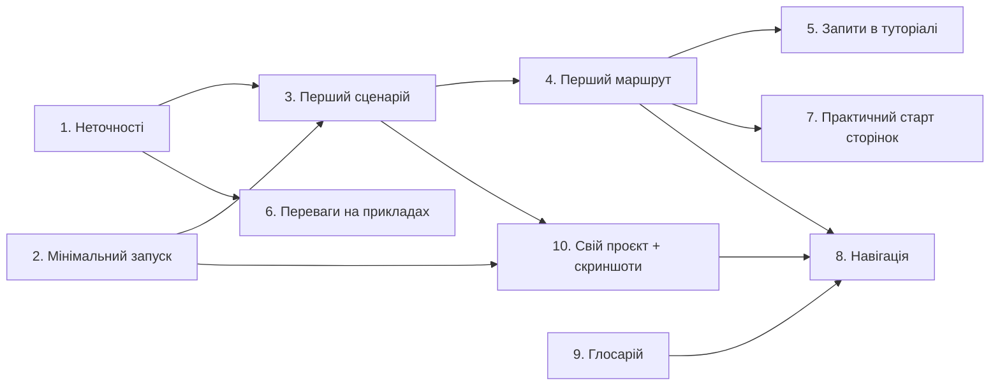

# План: навчальний маршрут у документації для початківців

Мета: читач, який не знає шаблону, проходить шлях **запустив → побачив роботу → зробив маленьку зміну → додав повну фічу → адаптував шаблон під свій проєкт**, і на жодному кроці не отримує неточного спрощення.

Основа: PR #117 (`docs/beginner-friendly-home`) — нова головна і `guide/how-backend-works.md`. План виконується після його мерджу.

## Принципи для всіх змін

- **Спрощувати, але не спотворювати.** Кожне спрощене твердження звіряємо з кодом і з технічною сторінкою. Якщо деталь опущено, пишемо «спрощено, деталі — [посилання]».
- **Порядок на сторінці:** навіщо → мінімальний приклад → результат → внутрішня реалізація.
- **Кожна навчальна сторінка** має блок «Що потрібно знати перед читанням» (1–3 посилання) і в кінці один блок «Наступний крок».
- **Перша поява терміна** посилається на глосарій.
- Нові сторінки додаються в sidebar (`documentation/.vitepress/config.ts`) і в `KEY_PAGES` (`documentation/scripts/verify-dist.mjs`). Перевірка: `pnpm docs:build && pnpm docs:verify && pnpm format:check`.
- Кожен приклад запиту/відповіді перевіряємо на локально запущеному застосунку, а не пишемо з пам'яті.

## Етапи

Етапи впорядковано за пріоритетом і залежностями. Кожен етап — окремий PR.

### Етап 1. Виправити неточності в спрощених поясненнях (п. 1)

Файл: `documentation/guide/how-backend-works.md`.

| Що зараз                                        | Як насправді (джерело)                                                                                                      | Що змінити                                                                                              |
| ----------------------------------------------- | --------------------------------------------------------------------------------------------------------------------------- | ------------------------------------------------------------------------------------------------------- |
| Для `GET /api/main/init` «ядро читає тіло»      | Тіло читається лише для `post`/`put`/`patch` (`BODY_METHODS` у `vendor/utils/routing/body-methods.ts`)                      | Прибрати читання тіла з прикладу GET або сказати «для POST/PUT/PATCH ядро ще й читає тіло»              |
| `csrf_guard` «перевіряє CSRF-токен» на GET      | Guard пропускає безпечні методи (`UNSAFE_METHODS` у `app/middlewares/csrf-guard.ts`); за замовчуванням `CSRF_ENFORCE=false` | Написати: «на GET перевірка не потрібна; для POST/PUT/PATCH/DELETE потрібен заголовок `x-csrf-token`»   |
| Валідація стоїть після middleware               | Query і body валідуються до `executeMiddlewares` (`request-lifecycle.md`, діаграма `setHttpHandler`)                        | Переставити кроки і діаграму в порядку lifecycle; додати примітку «спрощено» з посиланням               |
| «uWebSockets.js обробляє у рази більше запитів» | Власних вимірювань у репозиторії немає                                                                                      | Переформулювати без цифр («один з найшвидших за публічними бенчмарками») + посилання на бенчмарк автора |
| «HttpOnly-cookie не вкраде XSS»                 | HttpOnly захищає від читання cookie, але XSS-скрипт може робити запити від імені користувача                                | Додати речення про це і про роль CSP                                                                    |

Також перевірити ці ж твердження на головній (`documentation/index.md`, блок «Чому саме цей шаблон»).

**Готово, коли:** кожне твердження в таблиці виправлено, і на кожне з них в тексті є посилання на технічну сторінку.

### Етап 2. Мінімальний запуск і опційні можливості (п. 2)

Файл: `documentation/guide/getting-started.md`, новий розділ після «Файл `.env`»: «Що потрібно зараз, а що пізніше».

Таблиця з колонками **Сервіс / Обов'язковий для запуску / Змінні `.env` / Що не працює без нього / Сторінка**:

- Обов'язкові: PostgreSQL **з pgvector** (зберегти наявне пояснення, чому `db:create` падає без розширення), Redis.
- Опційні: SMTP (листи підтвердження й скидання пароля), S3/MinIO (аватари, скриншоти бази знань), OAuth (вхід через соцмережі), AI-ключі (чат підтримки, переіндексація), VAPID (push), SMS-провайдер (вхід по телефону), Sentry.

Перед написанням перевірити в коді поведінку без кожного опційного сервісу: чи стартує сервер (`validate-runtime-config.ts`), що повертає відповідний маршрут. У таблицю писати фактичну поведінку.

**Готово, коли:** таблиця покриває всі групи змінних з `.env.example`, а поведінку «без сервісу» перевірено вручну.

### Етап 3. Швидкий старт до першого користувацького сценарію (п. 3)

Файл: `documentation/guide/getting-started.md`, новий розділ після «Перевірка health»: «Перший сценарій: від реєстрації до виходу».

Кроки (для кожного — дія, очікуваний результат, скриншот):

1. Підготувати demo-акаунт: `SEED_USER_*` / `SEED_ADMIN_*` у `.env` і `pnpm --filter backend db:seed --demo`.
2. Відкрити `http://localhost:5173`, увійти demo-користувачем.
3. Відкрити сторінку акаунта, завантажити аватар (якщо налаштовано S3; інакше пояснити, яку помилку видно).
4. DevTools → Network: знайти `POST /api/auth/login`, `GET /api/main/init`; показати cookie сесії, заголовок `x-csrf-token` у наступних POST, WS-з'єднання.
5. Увійти адміном, відкрити адмінку → «Онлайн»: побачити себе в списку в реальному часі.
6. Вийти, переконатися, що `GET /api/main/init` повертає `401`.

**Готово, коли:** сценарій пройдено на чистій машині за інструкцією, скриншоти лежать у `documentation/public/screenshots/`.

### Етап 4. Перша маленька зміна без БД (п. 4)

Нова сторінка: `documentation/guide/first-endpoint.md` — «Перший маршрут за 15 хвилин». Розмістити в sidebar гайду перед «Як додати фічу».

Вправа: `GET /api/hello?name=...` → `{ status: 'ok', message: 'Hello, <name>' }`.

1. Схема query й відповіді в `shared` (мінімальна).
2. Сервіс `hello-service.ts`, що повертає `Result.ok(...)` і `Result.err(...)` для порожнього імені.
3. Контролер з `mapControllerError`.
4. `defineRoute` у `http-routes.ts` (без middleware).
5. Перевірка `curl` — успішна відповідь, `422` при невалідному query, помилка сервісу.
6. (Опційно) один unit-тест сервісу.
7. «Що ви щойно використали»: таблиця шар → файл → посилання на технічну сторінку.

Перед публікацією реально додати цей код у тимчасову гілку, прогнати `pnpm typecheck && pnpm test`, скопіювати фактичні відповіді `curl` у сторінку, а код не мерджити (або залишити як приклад, якщо вирішимо — окреме рішення).

На початку `backend/adding-a-feature.md` додати: «Спочатку пройдіть [Перший маршрут](/guide/first-endpoint)».

### Етап 5. Точні запити й відповіді в туторіалі notes (п. 5)

Файл: `documentation/backend/adding-a-feature.md`, «Крок 10. Перевірка».

Пройти туторіал на тимчасовій гілці й зафіксувати:

- логін через `curl -c cookies.txt` і отримання CSRF-токена з `GET /api/main/init`;
- `POST` з тілом, `-b cookies.txt` і `-H 'x-csrf-token: ...'` → статус і JSON;
- `GET` списку → JSON;
- помилкові запити: без сесії (`401`), невалідне тіло (`422` з `issues`), чужий/неіснуючий id (`404`), без CSRF при `CSRF_ENFORCE=true` (`403`);
- той самий сценарій через API Playground (коротко, з посиланням).

Окремо згадати, що за замовчуванням `CSRF_ENFORCE=false`.

### Етап 6. Переваги через конкретні зміни (п. 6)

Файл: `documentation/index.md`, після «Чому саме цей шаблон» — розділ «Як це виглядає на практиці» з трьома короткими прикладами (до 10 рядків коду кожен):

1. **Контракт:** перейменували поле у схемі відповіді в `shared` → `pnpm typecheck` показує помилки у фронтенді (навести реальний вивід).
2. **Один сервіс для HTTP і WS:** приклад сервісу, який викликається з HTTP- і WS-контролера (знайти реальний у коді, напр. support/admin).
3. **Тест без БД:** фрагмент наявного `*.spec.ts`, де репозиторій підмінено.

Приклади брати з наявного коду, з посиланнями на файли.

### Етап 7. Технічні сторінки починаються з практичної задачі (п. 7)

Не переписувати сторінки, а додати на початок кожної блок «Коротко на прикладі» (навіщо → мінімальний приклад → результат), а наявний текст залишити як «Як це влаштовано».

Пріоритет сторінок:

1. `backend/validation.md` — «як перевірити поле запиту»: схема в `shared` → `validator` у маршруті → відповідь `422`.
2. `backend/auth-security.md` — «що відбувається після входу»: cookie → сесія в Redis → `main/init` → CSRF-токен → logout.
3. `backend/routing-middlewares.md` — «як закрити маршрут для незалогінених».
4. `backend/database.md` — «як додати колонку і міграцію».
5. `backend/websocket.md` — «як надіслати подію з сервера клієнту».
6. Решта сторінок `backend/` — за потреби.

### Етап 8. Навчальна навігація (п. 8)

- `config.ts`: на початку sidebar гайду група **«Перший день»**: Вступ → Швидкий старт → Як влаштований бекенд → Перший маршрут → Як додати фічу → Свій проєкт на шаблоні. У nav — пункт «Почати навчання».
- На кожній сторінці «Першого дня» блоки «Перед читанням» і «Наступний крок» (див. принципи).
- `backend/index.md`: на початку tip-блок з посиланням на `guide/how-backend-works`.
- Технічні сторінки: один рядок «Наступний крок» у кінці.

Етап можна робити паралельно з 4–7; фінальний порядок sidebar оновити після появи всіх сторінок.

### Етап 9. Базові поняття в глосарії (п. 9)

Файл: `documentation/reference/glossary.md`.

- Розділити на дві таблиці: **«Базові поняття»** (нова) і **«Терміни шаблону»** (наявна).
- Базові: endpoint, HTTP-метод, статус-код, JSON, header, cookie, payload/body, query-параметр, сесія (загально), ORM, міграція, runtime-валідація (vs перевірка типів TypeScript), автентифікація vs авторизація, middleware (загально), WebSocket.
- Визначення — одне-два речення простою мовою + приклад з шаблону.
- Пройтися по сторінкам «Першого дня» і зробити першу появу кожного терміна посиланням на глосарій. Перевірити, що якорі генеруються коректно (VitePress перетворює `ї` → `і`, див. `#сесіі`).
- Спростити наявні визначення, які спираються на інші невизначені терміни.

### Етап 10. Свій проєкт на шаблоні + скриншоти (п. 10)

Нова сторінка: `documentation/guide/your-project.md` — «Свій проєкт на шаблоні». Відокремити від `guide/workflow.md` (той лишається про процес у цьому репозиторії; додати до нього посилання).

Розділи:

1. **Перейменування:** назва в `package.json`, PWA-маніфест, `<title>`, лого, `APP_NAME`/домени в `.env`, cookie-префікси (перевірити повний список по коду).
2. **Інтерфейс:** де головний layout, теми/стилі, локалізації, юридичні сторінки (замінити тексти Privacy/Terms!).
3. **Свій домен:** посилання на «Перший маршрут» і «Як додати фічу»; де додати сторінку у фронтенді та роут.
4. **Вибір інтеграцій:** таблиця з етапу 2 + як прибрати непотрібне (AI-чат, push, телефонний вхід). Вказати, які файли зачіпає видалення, і що тест `layering.spec.ts` має проходити.
5. **Backend-only режим:** коротко, з посиланням на вступ.
6. **Галерея можливостей:** скриншоти акаунта, адмінки (користувачі, онлайн, база знань), чату підтримки, API Playground — кожен з підписом «яку готову можливість демонструє».

Скриншоти знімаються під час етапу 3 і тут перевикористовуються. Робити в світлій темі, без реальних персональних даних.

## Порядок виконання і залежності

Рекомендовані PR:

| PR  | Етапи | Обсяг                                |
| --- | ----- | ------------------------------------ |
| 1   | 1, 6  | малий                                |
| 2   | 2, 3  | середній                             |
| 3   | 4, 5  | середній                             |
| 4   | 9     | малий                                |
| 5   | 7     | великий (можна дробити по сторінках) |
| 6   | 10    | середній                             |
| 7   | 8     | малий, фінальний                     |

## Перевірка результату

- Технічна: `pnpm docs:build && pnpm docs:verify && pnpm format:check` на кожному PR.
- Фактична: усі приклади команд і відповідей отримано з запущеного застосунку.
- На читачах: після PR 3 дати 1–2 людям, які не знають шаблону, пройти «Перший день» від клону до першого маршруту. Записати, де вони застрягли і скільки часу пішло, і скоригувати етапи 7–10 за результатами. Оцінка складності з рецензії — гіпотеза, її перевіряємо саме так.

## Поза межами плану

- Зміни коду застосунку (крім тимчасових гілок для перевірки прикладів).
- Переклад документації іншими мовами.
- Відео-туторіали.

## Статус виконання (2026-10-25)

| PR                                                            | Етапи | Стан                             |
| ------------------------------------------------------------- | ----- | -------------------------------- |
| [#117](https://github.com/Blazheiko/itvibe-template/pull/117) | 1, 6  | готово (разом з головною)        |
| [#119](https://github.com/Blazheiko/itvibe-template/pull/119) | 2, 3  | готово                           |
| [#120](https://github.com/Blazheiko/itvibe-template/pull/120) | 4, 5  | готово                           |
| [#121](https://github.com/Blazheiko/itvibe-template/pull/121) | 9     | готово                           |
| [#122](https://github.com/Blazheiko/itvibe-template/pull/122) | 7     | готово (5 сторінок)              |
| [#123](https://github.com/Blazheiko/itvibe-template/pull/123) | 10    | готово, без скриншота Playground |
| #124                                                          | 8     | готово                           |

PR-и складені стеком: кожен базується на попередньому. Окремо, від `main`: [#118](https://github.com/Blazheiko/itvibe-template/pull/118) — виправлення `.env.example`, знайдені під час проходження швидкого старту.

Не зроблено: перевірка «Першого дня» на 1–2 реальних читачах (розділ «Перевірка результату») — це за людьми.
