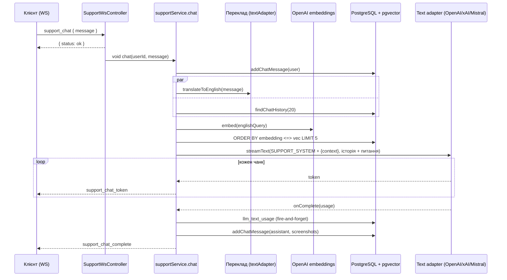

# AI-інтеграції

У бекенді AI використовується в одному продуктовому сценарії: **Support AI**. Це чат техпідтримки, який відповідає на основі бази знань із пошуком через pgvector. Довкола нього є адмінка промптів, облік токенів і керування базою знань. Ця сторінка описує, як усе влаштовано в коді. Змінні оточення для AI перелічені в [Конфігурації](/backend/configuration), тут вони не повторюються.

## Абстракція провайдерів

Контракт текстового адаптера описано в [`types.ts`](https://github.com/Blazheiko/itvibe-template/blob/main/packages/backend/src/app/services/ai/types.ts): інтерфейс `ITextAdapter` має `isConfigured()`, геттер `model` і **єдину операцію** `streamText(opts, onComplete?)`. Це async-генератор текстових чанків, тобто генерація завжди потокова. `TextStreamOptions` містить `systemPrompt`, `userPrompt`, `temperature`, `maxOutputTokens`, `modelOverride` і необов'язковий `toolCallHandler` для tool calling. Після завершення потоку `onComplete` отримує `TokenUsage` (`promptTokens`/`completionTokens`/`totalTokens`), назву моделі та `finalPrompt`, який збирає `buildFinalTextPrompt()`.

| Адаптер                                                                                                                                                       | Провайдер / SDK                                                                                             | Tool calling                      | Usage                                            |
| ------------------------------------------------------------------------------------------------------------------------------------------------------------- | ----------------------------------------------------------------------------------------------------------- | --------------------------------- | ------------------------------------------------ |
| [`openai-text-adapter.ts`](https://github.com/Blazheiko/itvibe-template/blob/main/packages/backend/src/app/services/ai/adapters/openai-text-adapter.ts)       | OpenAI Chat Completions через голий `fetch` на `OPENAI_CHAT_API_URL`, SSE (`stream: true`, `include_usage`) | Так, один раунд tool calls        | Сума usage обох запитів                          |
| [`xai-text-adapter.ts`](https://github.com/Blazheiko/itvibe-template/blob/main/packages/backend/src/app/services/ai/adapters/xai-text-adapter.ts)             | xAI через `ai` (`streamText`) + `@ai-sdk/xai`, Responses API (`xaiProvider.responses()`)                    | Так, `stepCountIs(3)`             | `result.usage`                                   |
| [`mistralai-text-adapter.ts`](https://github.com/Blazheiko/itvibe-template/blob/main/packages/backend/src/app/services/ai/adapters/mistralai-text-adapter.ts) | `@mistralai/mistralai` (`client.chat.stream`)                                                               | Ні, `toolCallHandler` ігнорується | З останнього чанка, якщо провайдер його надіслав |

Окремо є [`openai-embedding-adapter.ts`](https://github.com/Blazheiko/itvibe-template/blob/main/packages/backend/src/app/services/ai/adapters/openai-embedding-adapter.ts) на офіційному SDK `openai`. Він має методи `embed(text)` і `embedBatch(texts)` та використовує `OPENAI_EMBEDDING_MODEL` і `OPENAI_EMBEDDING_DIMENSIONS`. Embeddings є **тільки в OpenAI**, альтернативного драйвера немає. Генерації зображень у коді немає.

Вибір адаптера робить [`ai-provider.ts`](https://github.com/Blazheiko/itvibe-template/blob/main/packages/backend/src/app/services/ai/ai-provider.ts):

- `textAdapter` є адаптером за замовчуванням. Його обирає `AI_TEXT_DRIVER`: `openai` (дефолт), `xai`, а будь-яке інше значення дає Mistral.
- `getTextAdapterForModel(model)` обирає адаптер за назвою моделі з рядка промпту в БД: `grok` веде до xAI, `mistral` до Mistral, `gpt`/`openai` до OpenAI. Порожнє або невідоме значення повертає `textAdapter`. Модель із промпту потім передається адаптеру як `modelOverride`.

::: warning Неочевидна поведінка
Якщо в `AI_TEXT_DRIVER` друкарська помилка (наприклад, `OpenAI` з великої літери), застосунок мовчки перемкнеться на Mistral: порівняння в `createTextAdapter()` точне й чутливе до регістру.
:::

## Промпти

Промпти зберігаються в таблиці `llm_system_prompts` ([`schema.ts`](https://github.com/Blazheiko/itvibe-template/blob/main/packages/backend/src/database/schema.ts)): унікальний `type`, `content`, і необов'язкові `model`, `temperature`, `max_tokens`. Доступ до таблиці дає [`prompt-repository.ts`](https://github.com/Blazheiko/itvibe-template/blob/main/packages/backend/src/app/repositories/ai/prompt-repository.ts) (`findAll`/`findByType`/`update`). Контролер працює з трьома типами: `SUPPORT_SYSTEM`, `SUPPORT_FIRST_CHAT`, `SUPPORT_QUERY_TRANSLATION`.

[`prompt-service.ts`](https://github.com/Blazheiko/itvibe-template/blob/main/packages/backend/src/app/services/ai/prompt-service.ts) завантажує всі рядки в `Map` на старті (`promptService.load()` у [`index.ts`](https://github.com/Blazheiko/itvibe-template/blob/main/packages/backend/src/index.ts)) і далі віддає їх синхронно. Як працює кеш і чому він не має TTL, описано в [Кешування та ETag](/backend/caching-etag) (проблема №43). Якщо в БД промпту немає, сервіси беруть дефолти: [`config/support.ts`](https://github.com/Blazheiko/itvibe-template/blob/main/packages/backend/src/config/support.ts) для системного та першого повідомлення, константу в [`support-query-translation-service.ts`](https://github.com/Blazheiko/itvibe-template/blob/main/packages/backend/src/app/services/support/support-query-translation-service.ts) для перекладу.

Адмінські маршрути групи `prompts` ([`http-routes.ts`](https://github.com/Blazheiko/itvibe-template/blob/main/packages/backend/src/app/routes/http-routes.ts)) проходять через middlewares `session_web`, `csrf_guard`, `auth_guard`, `admin_guard`. Обробляє їх [`prompt-controller.ts`](https://github.com/Blazheiko/itvibe-template/blob/main/packages/backend/src/app/controllers/http/ai/prompt-controller.ts):

- `GET /prompts`, `GET /prompts/:type` читають промпти з кешу;
- `PUT /prompts/:type` оновлює БД, після чого `promptService.update()` перечитує рядок у кеш;
- `POST /prompts/:type/test` проганяє промпт із довільним повідомленням через `textAdapter`. Якщо адаптер падає, запит повторюється напряму через `fetch` до OpenAI. Це порушення шарів, див. проблему №23 і [Контролери та сервіси](/backend/controllers-services).

## Облік використання

[`llm-usage-service.ts`](https://github.com/Blazheiko/itvibe-template/blob/main/packages/backend/src/app/services/ai/usage/llm-usage-service.ts) пише в таблицю `llm_text_usage` через `recordText()`. Запис іде у fire-and-forget режимі: помилка вставки потрапляє лише в `logger.warn`. У кожному рядку зберігаються `user_id`, `llm_system_prompt_id`, `model`, `feature` (enum `PROMPT_TEST` / `SUPPORT_CHAT` / `SUPPORT_QUERY_TRANSLATION`), **`final_prompt` повністю** та три лічильники токенів.

Адмінські `GET /admin/usage/text` (пагінація з фільтрами `userId`, `dateFrom`, `dateTo`, `feature`) та `GET /admin/usage/stats` (кількість викликів і сума токенів у розрізі `model` × `feature`) обслуговує [`llm-usage-controller.ts`](https://github.com/Blazheiko/itvibe-template/blob/main/packages/backend/src/app/controllers/http/ai/usage/llm-usage-controller.ts). Запити до БД виконує [`llm-usage-repository.ts`](https://github.com/Blazheiko/itvibe-template/blob/main/packages/backend/src/app/repositories/ai/usage/llm-usage-repository.ts).

::: warning Прогалини обліку

- **Вартість не рахується.** Колонки ціни немає, є лише токени.
- Usage записують тільки виклики `SUPPORT_CHAT` з [`support-service.ts`](https://github.com/Blazheiko/itvibe-template/blob/main/packages/backend/src/app/services/support/support-service.ts). Переклад запиту і тест промпту не передають `onComplete`, тому значення enum `SUPPORT_QUERY_TRANSLATION` і `PROMPT_TEST` на практиці не з'являються. Embedding-запити не обліковуються зовсім.
- У Mistral-адаптері запис пропускається, якщо провайдер не повернув usage.
  :::

## Support AI і база знань

Статті лежать у `support_knowledge_base`: `title`, `content`, `category`, `is_active`, скріншот і колонка `embedding vector(1536)`, яку описує `customType` у [`schema.ts`](https://github.com/Blazheiko/itvibe-template/blob/main/packages/backend/src/database/schema.ts). Про розширення pgvector див. [Базу даних](/backend/database) і проблему №7. Розмірність колонки зашита як 1536, тому зміна `OPENAI_EMBEDDING_DIMENSIONS` без міграції зламає запис.

**Індексація** відбувається в [`support-embedding-service.ts`](https://github.com/Blazheiko/itvibe-template/blob/main/packages/backend/src/app/services/support/support-embedding-service.ts). Текст `${title}\n\n${content}` відправляється в OpenAI embeddings, а результат записує `setEmbedding()` сирим SQL `::vector`. Індексацію запускають:

- [`knowledge-base-service.ts`](https://github.com/Blazheiko/itvibe-template/blob/main/packages/backend/src/app/services/support/knowledge-base-service.ts) після створення статті та після зміни `title`/`content`, у фоні (`void ... .catch(log)`);
- адмінські `POST /admin/knowledge-base/:id/reindex` і `POST /admin/knowledge-base/reindex-all`. Другий маршрут надсилає всі активні статті **одним** `embedBatch`;
- `POST /admin/knowledge-base/init` імпортує статті з файлів ([`knowledge-base-init-service.ts`](https://github.com/Blazheiko/itvibe-template/blob/main/packages/backend/src/app/services/support/knowledge-base-init-service.ts)).

Якщо ключ OpenAI не задано, індексація пропускається з попередженням, а пошук повертає порожній список. `clearEmbedding()` виконує два окремі запити без транзакції, це проблема №25.

**Пошук** виконує `searchByEmbedding()` у [`support-knowledge-repository.ts`](https://github.com/Blazheiko/itvibe-template/blob/main/packages/backend/src/app/repositories/support/support-knowledge-repository.ts): косинусна відстань `embedding <=> $vec::vector` серед активних статей із непорожнім embedding, `ORDER BY distance`, `LIMIT 5`. Порогу відстані немає, тому в контекст завжди потрапляє до 5 найближчих статей, навіть якщо вони нерелевантні.

**Чат** працює через WebSocket ([`ws-routes.ts`](https://github.com/Blazheiko/itvibe-template/blob/main/packages/backend/src/app/routes/ws-routes.ts), група `support`, `rateLimit` 60 запитів за хвилину). Деталі транспорту описано на сторінці [WebSocket](/backend/websocket). [`support-controller.ts`](https://github.com/Blazheiko/itvibe-template/blob/main/packages/backend/src/app/controllers/ws/support-controller.ts) одразу відповідає `{ status: 'ok' }` і запускає `supportService.chat()` / `openChat()` у фоні. Токени приходять клієнту подіями `support_chat_token`, наприкінці надходить `support_chat_complete` (з `screenshots`, витягнутими з маркерів `[screenshot:id]`; клієнт показує їх через `GET /support/screenshot/:articleId`, який редиректить на `CDN_URL`, бо медіа чату дозволено лише з нашого CDN) або `support_chat_error`. Історію читають і видаляють HTTP-маршрути `GET`/`DELETE /support/chat/history`.

## Потік запиту

Системний промпт збирає [`support-llm-service.ts`](https://github.com/Blazheiko/itvibe-template/blob/main/packages/backend/src/app/services/support/support-llm-service.ts). Він підставляє контекст замість `{context}`, а якщо плейсхолдера немає, дописує контекст у кінець і логує попередження. Окремо додається інструкція відповідати рідною мовою користувача. Невдалий переклад не зупиняє чат: сервіс повертає оригінальний запит.

## Надійність, вартість і безпека

- **Таймаутів немає.** Ні `fetch` в OpenAI-адаптері та `prompt-controller`, ні виклики SDK xAI/Mistral/embeddings не отримують `AbortSignal` чи timeout. Якщо провайдер завис, фонова задача чату висить разом із ним.
- **Помилки.** Будь-яка помилка в `chat()`/`openChat()` ловиться, логується і перетворюється на подію `support_chat_error` з загальним текстом. Ретраїв немає. У тесті промпту помилка повертається як `internalMessage('LLM call failed')`.
- **Rate limit.** Для WS-групи `support` діє ліміт 60 запитів за хвилину на з'єднання. Кожне повідомлення коштує мінімум 3 платні виклики: переклад, embedding і відповідь. HTTP-групи `prompts` і `admin/knowledge-base` закриті `admin_guard`, але власного `rateLimit` у визначенні групи не мають.
- **PII.** Провайдеру йдуть дослівне повідомлення користувача та до 20 останніх повідомлень історії. У `llm_text_usage.final_prompt` той самий текст зберігається повністю й безстроково, а адмін бачить його через `/admin/usage/text`. Фільтрації чи маскування персональних даних немає.
- **Секрети.** Ключі задаються тільки через env (`OPENAI_API_KEY=<your-openai-key>` тощо). `OPENAI_API_KEY` спільний для чату й embeddings.

::: warning Мова відповіді
У [`support-service.ts`](https://github.com/Blazheiko/itvibe-template/blob/main/packages/backend/src/app/services/support/support-service.ts) `langNative` жорстко задано як `'ru'` і в `chat()`, і в `openChat()`. Мова профілю користувача не враховується.
:::
