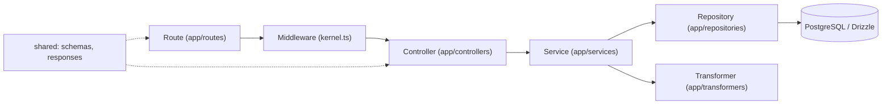

# Архітектура бекенду

Бекенд (`packages/backend`) — це TypeScript-сервер на uWebSockets.js без стороннього веб-фреймворку. Код розділений на дві частини: `src/vendor/` — власне «ядро фреймворку» (HTTP/WS-сервер, роутер, читання тіла запиту, rate limit, сесії, логер), і `src/app/` — прикладний код (маршрути, контролери, сервіси, репозиторії, трансформери, middleware). Контракти між бекендом і фронтендом (схеми валідації, типи відповідей, enum-и) живуть у workspace-пакеті `shared`.

## Розподіл vendor/ та app/

| Каталог                                                   | Призначення                                                                                                                                                     | Приклади                                                                                                                                                                                                                                                                                                 |
| --------------------------------------------------------- | --------------------------------------------------------------------------------------------------------------------------------------------------------------- | -------------------------------------------------------------------------------------------------------------------------------------------------------------------------------------------------------------------------------------------------------------------------------------------------------- |
| `vendor/start/`                                           | Запуск uWS-сервера, реєстрація маршрутів                                                                                                                        | [server.ts](https://github.com/Blazheiko/vibe-template/blob/main/packages/backend/src/vendor/start/server.ts), [router.ts](https://github.com/Blazheiko/vibe-template/blob/main/packages/backend/src/vendor/start/router.ts)                                                                             |
| `vendor/utils/network/`                                   | Читання заголовків/тіла, WS-обробники                                                                                                                           | [http-request-handlers.ts](https://github.com/Blazheiko/vibe-template/blob/main/packages/backend/src/vendor/utils/network/http-request-handlers.ts), [ws-handlers.ts](https://github.com/Blazheiko/vibe-template/blob/main/packages/backend/src/vendor/utils/network/ws-handlers.ts)                     |
| `vendor/utils/routing/`                                   | Диспетчер WS-подій                                                                                                                                              | [ws-api-dispatcher.ts](https://github.com/Blazheiko/vibe-template/blob/main/packages/backend/src/vendor/utils/routing/ws-api-dispatcher.ts)                                                                                                                                                              |
| `vendor/utils/middlewares/`                               | Виконання ланцюжка middleware, базові guard-и                                                                                                                   | [execute-httpMiddlewares.ts](https://github.com/Blazheiko/vibe-template/blob/main/packages/backend/src/vendor/utils/middlewares/core/execute-httpMiddlewares.ts), [auth-guard.ts](https://github.com/Blazheiko/vibe-template/blob/main/packages/backend/src/vendor/utils/middlewares/core/auth-guard.ts) |
| `vendor/utils/validation/`                                | Валідація payload і query маршруту, `getTypedPayload`                                                                                                           | [validation/](https://github.com/Blazheiko/vibe-template/tree/main/packages/backend/src/vendor/utils/validation)                                                                                                                                                                                         |
| `vendor/utils/rate-limit/`                                | HTTP-, WS- і upgrade-ліміти (у пам'яті та Redis)                                                                                                                | [rate-limit/](https://github.com/Blazheiko/vibe-template/tree/main/packages/backend/src/vendor/utils/rate-limit)                                                                                                                                                                                         |
| `vendor/utils/session/`                                   | Сесії в Redis, підпис cookie, CSRF-токен                                                                                                                        | [session/](https://github.com/Blazheiko/vibe-template/tree/main/packages/backend/src/vendor/utils/session)                                                                                                                                                                                               |
| `vendor/utils/storage/`                                   | Файлове сховище (S3)                                                                                                                                            | [storage/](https://github.com/Blazheiko/vibe-template/tree/main/packages/backend/src/vendor/utils/storage)                                                                                                                                                                                               |
| `vendor/utils/` (інше)                                    | `context`, `env`, `helpers`, `tooling` (серіалізація схем для doc), логер                                                                                       | [utils/](https://github.com/Blazheiko/vibe-template/tree/main/packages/backend/src/vendor/utils)                                                                                                                                                                                                         |
| `vendor/contracts/`, `vendor/types/`, `vendor/constants/` | Контракт `Validator<T>` ([ADR 0001](https://github.com/Blazheiko/vibe-template/blob/main/docs/adr/0001-validator-abstraction.md)), спільні типи ядра, константи | [contracts/](https://github.com/Blazheiko/vibe-template/tree/main/packages/backend/src/vendor/contracts), [types/](https://github.com/Blazheiko/vibe-template/tree/main/packages/backend/src/vendor/types)                                                                                               |
| `app/routes/`                                             | Декларації HTTP- і WS-маршрутів                                                                                                                                 | [http-routes.ts](https://github.com/Blazheiko/vibe-template/blob/main/packages/backend/src/app/routes/http-routes.ts), [ws-routes.ts](https://github.com/Blazheiko/vibe-template/blob/main/packages/backend/src/app/routes/ws-routes.ts)                                                                 |
| `app/middlewares/`                                        | Реєстр middleware за іменем                                                                                                                                     | [kernel.ts](https://github.com/Blazheiko/vibe-template/blob/main/packages/backend/src/app/middlewares/kernel.ts)                                                                                                                                                                                         |
| `app/controllers/`                                        | HTTP- та WS-контролери                                                                                                                                          | [main-controller.ts](https://github.com/Blazheiko/vibe-template/blob/main/packages/backend/src/app/controllers/http/core/main-controller.ts)                                                                                                                                                             |
| `app/services/`                                           | Бізнес-логіка, повертає `Result` з `better-result`                                                                                                              | [main-service.ts](https://github.com/Blazheiko/vibe-template/blob/main/packages/backend/src/app/services/core/main-service.ts)                                                                                                                                                                           |
| `app/repositories/`                                       | Доступ до БД через Drizzle                                                                                                                                      | [user-repository.ts](https://github.com/Blazheiko/vibe-template/blob/main/packages/backend/src/app/repositories/user/user-repository.ts)                                                                                                                                                                 |
| `app/transformers/`                                       | Серіалізація рядків БД у публічні DTO                                                                                                                           | [user-transformer.ts](https://github.com/Blazheiko/vibe-template/blob/main/packages/backend/src/app/transformers/user-transformer.ts)                                                                                                                                                                    |
| `app/state/`                                              | In-memory стан процесу (зокрема `listenSocket`)                                                                                                                 | [state.ts](https://github.com/Blazheiko/vibe-template/blob/main/packages/backend/src/app/state/state.ts)                                                                                                                                                                                                 |
| `app/websocket/`                                          | Прикладна логіка WS: автентифікація, реєстр з'єднань, presence                                                                                                  | [ws-coordinator.ts](https://github.com/Blazheiko/vibe-template/blob/main/packages/backend/src/app/websocket/ws-coordinator.ts), [ws-session-auth.ts](https://github.com/Blazheiko/vibe-template/blob/main/packages/backend/src/app/websocket/ws-session-auth.ts)                                         |
| `app/start/`                                              | Ініціалізація при старті: реєстрація WS-хуків і валідатора                                                                                                      | [index.ts](https://github.com/Blazheiko/vibe-template/blob/main/packages/backend/src/app/start/index.ts)                                                                                                                                                                                                 |

Ядро не імпортує прикладну бізнес-логіку напряму для WS: `app/start/index.ts` реєструє хуки через `registerWsAppHooks` і `registerWsMessageValidator` з `ws-handlers.ts`. Для HTTP ядро звертається до `app/middlewares/kernel.ts` (реєстр middleware за рядковим ім'ям) і до валідаторів з `app/validate/`.

::: info
Окремого каталогу `events/` у `packages/backend/src/app` немає. Реалтайм-події реалізовано через WebSocket-маршрути (`ws-routes.ts`) і `broadcastToChannel` у [server.ts](https://github.com/Blazheiko/vibe-template/blob/main/packages/backend/src/vendor/start/server.ts).
:::

## Шари



- **Route** — об'єкт `defineRoute({ url, method, handler, validator, ResponseSchema, middlewares, rateLimit })` ([define-route.ts](https://github.com/Blazheiko/vibe-template/blob/main/packages/backend/src/app/routing/define-route.ts)). Групи задають `prefix`, спільні `middlewares` і `rateLimit`; `routesHandler` у [router.ts](https://github.com/Blazheiko/vibe-template/blob/main/packages/backend/src/vendor/start/router.ts) розгортає їх у плоский список і додає `appConfig.pathPrefix` (за замовчуванням `api`, змінна `API_PATH_PREFIX`).
- **Middleware** — функція `(context, next)`; якщо вона не викликала `next()`, обробник не запускається (див. [Middleware](/backend/middlewares)).
- **Controller** — отримує `HttpContext`, викликає сервіс, мапить помилку `Result` у HTTP-відповідь через `mapControllerError`.
- **Service** — бізнес-логіка, повертає `Result.ok(...)` / `Result.err(...)`.
- **Repository** — запити Drizzle (див. [/backend/database](/backend/database)).
- **Transformer** — прибирає чутливі поля (`password`, `sessionToken`) і нормалізує дати.

Правила імпорту між шарами перевіряє [`layering.spec.ts`](https://github.com/Blazheiko/vibe-template/blob/main/packages/backend/src/app/layering.spec.ts) (статичний аналіз імпортів, без завантаження модулів):

- контролери, middleware (зокрема `admin_guard`) і `app/websocket` не імпортують репозиторії, навіть як типи: дані — через сервіси (`adminUserService`, `userRoleService` тощо), типи — з сервісу або `shared`;
- поза `app/repositories` репозиторії імпортуються лише через barrel `#app/repositories/index.js`, і barrel експортує кожен модуль `*-repository.ts`;
- репозиторії не логують: рішення «це варто залогувати» приймає сервіс;
- сервіси не імпортують `#database/db.js` і `#database/schema.js` — лише репозиторії.

## Контракти в packages/shared

Пакет `shared` ([index.ts](https://github.com/Blazheiko/vibe-template/blob/main/packages/shared/src/index.ts)) експортує `schemas` (вхідні схеми, напр. `VerifyEmailInputSchema`), `responses` (схеми відповідей, напр. `InitResponseSchema`), `enums`, `errors`, `brands`, `utils`. Маршрути імпортують їх як `shared/schemas` і `shared/responses`, а контролери — типи відповідей (`InitResponse`, `PingResponse`) з `shared`.

## Наскрізний приклад: GET /api/main/init

1. **Маршрут.** У [http-routes.ts](https://github.com/Blazheiko/vibe-template/blob/main/packages/backend/src/app/routes/http-routes.ts) група з `prefix: "main"` і `middlewares: ["session_web", "csrf_guard"]` містить:

```ts
defineRoute({
  url: "/init",
  method: "get",
  handler: MainController.init.bind(MainController),
  ResponseSchema: ResponseSchemas.InitResponseSchema,
  description: "Initialize app state",
  middlewares: ["auth_guard"],
}),
```

Після `routesHandler` URL стає `api/main/init`, а ланцюжок middleware — `session_web → csrf_guard → auth_guard`.

2. **Middleware.** `executeMiddlewares` бере функції з [kernel.ts](https://github.com/Blazheiko/vibe-template/blob/main/packages/backend/src/app/middlewares/kernel.ts). `auth_guard` ([auth-guard.ts](https://github.com/Blazheiko/vibe-template/blob/main/packages/backend/src/vendor/utils/middlewares/core/auth-guard.ts)) за відсутності автентифікації ставить `responseData.status = 401` і не викликає `next()`.
3. **Controller.** `MainController.init` ([main-controller.ts](https://github.com/Blazheiko/vibe-template/blob/main/packages/backend/src/app/controllers/http/core/main-controller.ts)) викликає `mainService.init(session.sessionInfo ?? null)`; при помилці — `mapControllerError`, інакше повертає `{ status: "ok", ...result.value }`.
4. **Service.** `mainService.init` ([main-service.ts](https://github.com/Blazheiko/vibe-template/blob/main/packages/backend/src/app/services/core/main-service.ts)) перевіряє сесію, завантажує користувача через `userRepository.findById(BigInt(userId))`, генерує WS-токен (`generateWsToken`) і повертає CSRF-токен, дані користувача, `wsUrl`, `wsToken` і конфіг сховища.
5. **Repository.** `userRepository.findById` ([user-repository.ts](https://github.com/Blazheiko/vibe-template/blob/main/packages/backend/src/app/repositories/user/user-repository.ts)) читає рядок `users`. Цей ендпоінт формує DTO користувача вручну в сервісі; трансформер `userTransformer.serialize` використовується, наприклад, в [auth-service.ts](https://github.com/Blazheiko/vibe-template/blob/main/packages/backend/src/app/services/auth/auth-service.ts) (див. [Репозиторії](/backend/repositories)).
6. **Відповідь.** Повернуте значення handler-а записується в `responseData.payload` і серіалізується в JSON у `sendResponse` ([server.ts](https://github.com/Blazheiko/vibe-template/blob/main/packages/backend/src/vendor/start/server.ts)). Деталі — на сторінці [«Життєвий цикл запиту»](/backend/request-lifecycle).

Найпростіший маршрут — `GET /api/ping` (`MainController.ping` → `mainService.ping()` → `{ status: "ok" }`) — проходить той самий шлях, але без middleware і БД. Як додати власний ресурс за цими шарами — див. [/backend/adding-a-feature](/backend/adding-a-feature).
