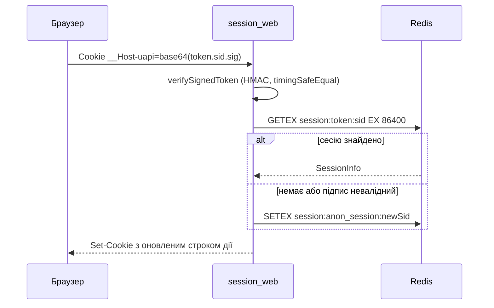

# Автентифікація та безпека

Ця сторінка описує, як бекенд автентифікує користувачів і захищає HTTP- та WebSocket-трафік: сесії в Redis з HMAC-підписаною cookie, способи входу (email/пароль, телефон/SMS, OAuth), обмеження частоти запитів, CSRF, CORS, заголовки безпеки, визначення IP за проксі та авторизацію WebSocket. Усе нижче описано за поточним кодом у `packages/backend/src`. Загальний порядок обробки запиту описано на сторінці [Життєвий цикл запиту](/backend/request-lifecycle), а підключення middleware до маршрутів — на сторінці [Маршрутизація та middleware](/backend/routing-middlewares).

## Сесії

### Формат cookie

Сесію створює і перевіряє [`session-handler.ts`](https://github.com/Blazheiko/itvibe-template/blob/main/packages/backend/src/vendor/utils/session/session-handler.ts), а підпис робить [`token-handler.ts`](https://github.com/Blazheiko/itvibe-template/blob/main/packages/backend/src/vendor/utils/session/token-handler.ts).

- Значення до підпису: `<userToken>.<sessionId>`. Для анонімної сесії замість `userToken` стоїть рядок `anon_session`.
- `sessionId` генерується через `crypto.randomUUID()`.
- Підпис: HMAC-SHA256 з ключем `APP_KEY`, hex-рядок обрізаний до 32 символів. Підпис дописується через крапку, а результат кодується в base64: `base64("<userToken>.<sessionId>.<signature>")`.
- Під час перевірки підписи порівнюються через `crypto.timingSafeEqual`. Токен має складатися рівно з 3 частин, а `userToken` має відповідати шаблону `^[a-zA-Z0-9_-]{10,}$`.
- Якщо `APP_KEY` не задано, він коротший за 32 символи або дорівнює `your-secret-key` чи `change-me`, модуль кидає помилку під час завантаження, і сервер не стартує.

Ім'я та атрибути cookie задає [`config/session.ts`](https://github.com/Blazheiko/itvibe-template/blob/main/packages/backend/src/config/session.ts):

| Параметр                     | Значення                                                                                                                                   |
| ---------------------------- | ------------------------------------------------------------------------------------------------------------------------------------------ |
| Ім'я                         | `__Host-uapi`, якщо `SESSION_COOKIE_HOST_PREFIX` увімкнено (за замовчуванням вмикається, коли `appConfig.isProductionLike`), інакше `uapi` |
| `path` / `httpOnly`          | `/` / `true`                                                                                                                               |
| `secure`                     | `true` для будь-якого `APP_ENV`, крім `local`                                                                                              |
| `sameSite`                   | `Lax`                                                                                                                                      |
| TTL (`age`, `maxAge`, Redis) | 24 години (`duration('24h')`)                                                                                                              |

Поки триває перехід на нове ім'я, [`resolve-session-cookie.ts`](https://github.com/Blazheiko/itvibe-template/blob/main/packages/backend/src/vendor/utils/session/resolve-session-cookie.ts) спершу шукає активне ім'я cookie, а потім застаріле `uapi`. Якщо знайдено лише застаріле ім'я, [`delete-legacy-session-cookie.ts`](https://github.com/Blazheiko/itvibe-template/blob/main/packages/backend/src/vendor/utils/session/delete-legacy-session-cookie.ts) надсилає `Set-Cookie`, який видаляє стару cookie. Під час старту [`validate-runtime-config.ts`](https://github.com/Blazheiko/itvibe-template/blob/main/packages/backend/src/app/start/validate-runtime-config.ts) перевіряє, що при `__Host-` префіксі cookie має `Secure=true`, а `APP_URL` починається з `https://`.

### Redis як джерело істини

Сесії зберігає [`redis-session-storage.ts`](https://github.com/Blazheiko/itvibe-template/blob/main/packages/backend/src/vendor/utils/session/redis-session-storage.ts):

- Ключ має вигляд `session:<userToken|anon_session>:<sessionId>`. Перед кожною операцією `sanitizeRedisKey` перевіряє його: дозволено лише `[a-zA-Z0-9:_*-]`, довжина не більше 86 символів.
- Запис робиться через `SETEX` з TTL `age`, читання — через `GETEX ... EX age`. Тобто кожне читання продовжує життя сесії (ковзний TTL).
- Якщо підпис валідний, але ключа в Redis немає, створюється нова анонімна сесія.
- `destroyAllSessions` (виклик `logoutAll`) знаходить ключі через `SCAN MATCH session:<userToken>:*` порціями по 100, а не через `KEYS`.

Middleware `session_web` ([`session-web.ts`](https://github.com/Blazheiko/itvibe-template/blob/main/packages/backend/src/vendor/utils/middlewares/ws/session-web.ts)) читає cookie, а `session_api` ([`session-api.ts`](https://github.com/Blazheiko/itvibe-template/blob/main/packages/backend/src/vendor/utils/middlewares/http/session-api.ts)) бере той самий підписаний токен із заголовка `Authorization: Bearer <token>`. Cookie переписується з оновленим строком дії на кожному запиті, що пройшов через `sessionHandler`.

### Ротація

- `auth.login(userId, userToken)` видаляє попередню автентифіковану сесію, якщо вона була, і створює нову з новим `sessionId` та новим CSRF-токеном. Це захищає від session fixation.
- `auth.logout()` видаляє поточну сесію і видає нову анонімну.
- `auth.logoutAll()` видаляє всі сесії користувача і видає нову анонімну.



## Способи входу

Маршрути групи `auth` оголошено в [`http-routes.ts`](https://github.com/Blazheiko/itvibe-template/blob/main/packages/backend/src/app/routes/http-routes.ts). Група має middleware `session_web` і `csrf_guard` та rate limit 10 запитів на хвилину з IP на кожен маршрут групи (окремі маршрути мають суворіші власні ліміти). Контролери: [`auth-controller.ts`](https://github.com/Blazheiko/itvibe-template/blob/main/packages/backend/src/app/controllers/http/auth/auth-controller.ts) і [`oauth-controller.ts`](https://github.com/Blazheiko/itvibe-template/blob/main/packages/backend/src/app/controllers/http/auth/oauth-controller.ts).

- **Email і пароль**: `POST /auth/register/email` для реєстрації та `POST /auth/login` для входу. Схема входу [`login.ts`](https://github.com/Blazheiko/itvibe-template/blob/main/packages/shared/src/schemas/auth/login.ts) приймає або `email`, або `identifier`, разом із `password` (8–32 символи). Паролі хешує `hashPassword` з `metautil` ([`auth-service.ts`](https://github.com/Blazheiko/itvibe-template/blob/main/packages/backend/src/app/services/auth/auth-service.ts)). Є також `forgot-password`, `reset-password`, `verify-email`, `resend-verification-email`, `change-password`, `link-email/start`.
- **Телефон і SMS**: `register/phone/start`, `register/phone/confirm`, `register/phone/complete-profile`, `reset-phone/start`, `reset-phone/complete`, `link-phone/start`, `link-phone/confirm`. Вмикається через `AUTH_PHONE_ENABLED` ([`config/auth.ts`](https://github.com/Blazheiko/itvibe-template/blob/main/packages/backend/src/config/auth.ts)). OTP-коди зберігаються як HMAC-SHA256 з ключем `AUTH_OTP_HMAC_KEY` (або `APP_KEY`, якщо перший не задано) ([`otp-verification-hash.ts`](https://github.com/Blazheiko/itvibe-template/blob/main/packages/backend/src/app/services/auth/otp-verification-hash.ts)). Якщо телефонний вхід увімкнено, а ключ коротший за 32 символи, сервер не стартує.
- **OAuth** (бібліотека `arctic`): `GET /auth/oauth/:provider/redirect` і `GET /auth/oauth/:provider/callback` для провайдерів Google, Facebook, GitHub і GitLab ([`config/oauth.ts`](https://github.com/Blazheiko/itvibe-template/blob/main/packages/backend/src/config/oauth.ts), [`oauth-service.ts`](https://github.com/Blazheiko/itvibe-template/blob/main/packages/backend/src/app/services/auth/oauth-service.ts)). `state` генерує `generateState()`. Для Google додатково використовується PKCE (`generateCodeVerifier()`). `oauthState` і `oauthCodeVerifier` зберігаються в сесії. У callback `state` звіряється, і при розбіжності повертається помилка `OAuth state mismatch`. Після цього дані OAuth видаляються з сесії.

Провайдер SMS обирається через `AUTH_SMS_PROVIDER`. Валідатор runtime-конфігурації забороняє `AUTH_SMS_PROVIDER=fake` в середовищах production-like і вимагає явно задати `AUTH_SMS_PROVIDER_ALLOW_FAKE=true` та `AUTH_FAKE_SMS_CODE`.

## Обмеження частоти запитів

Захист працює на кількох рівнях. HTTP і WebSocket мають окремі гілки й незалежні бюджети:

```
HTTP API:  L1 global per-IP  →  per-route limit  →  handler
WebSocket: upgrade per-IP    →  auth (onUpgrade)  →  per-message limits
```

1. **L1, глобальний ліміт HTTP за IP** (`checkGlobalRateLimit` у [`http-rate-limit.ts`](https://github.com/Blazheiko/itvibe-template/blob/main/packages/backend/src/vendor/utils/rate-limit/http-rate-limit.ts)). Один fixed-window бюджет на IP для всіх API-запитів: зареєстровані маршрути, API-404, preflight `OPTIONS` і звичайні HTTP-запити на `/<API_PATH_PREFIX>/websocket`. Кожен запит рахується рівно один раз. Статика не рахується. За замовчуванням 600 запитів на хвилину (`HTTP_GLOBAL_RATE_LIMIT_*`). На успішній відповіді L1 заголовків не пише. На 429 він віддає `X-RateLimit-*` і `Retry-After` саме для себе, і per-route перевірка тоді не виконується.
2. **Rate limit маршрутів**: [`http-rate-limit.ts`](https://github.com/Blazheiko/itvibe-template/blob/main/packages/backend/src/vendor/utils/rate-limit/http-rate-limit.ts) і [`ws-rate-limit.ts`](https://github.com/Blazheiko/itvibe-template/blob/main/packages/backend/src/vendor/utils/rate-limit/ws-rate-limit.ts). Ліміт задається полем `rateLimit: { windowMs, maxRequests }` на маршруті або групі, і ліміт маршруту має пріоритет над лімітом групи. Ключ складається з IP і URL маршруту. HTTP-відповідь містить заголовки `X-RateLimit-Limit`, `X-RateLimit-Remaining` і `X-RateLimit-Reset`. Коли ліміт перевищено, повертається `429` з `Retry-After` і кодом `rate_limited`. Якщо сама перевірка падає з помилкою, повертається `503 rate_limit_unavailable`, тобто система працює за принципом fail-closed. У [`server.ts`](https://github.com/Blazheiko/itvibe-template/blob/main/packages/backend/src/vendor/start/server.ts) обидві HTTP-перевірки виконуються синхронно і **до** читання тіла запиту.
3. **Ліміт WebSocket upgrade за IP** ([`upgrade-rate-limit.ts`](https://github.com/Blazheiko/itvibe-template/blob/main/packages/backend/src/vendor/utils/rate-limit/upgrade-rate-limit.ts)). `handleUpgrade` перевіряє його першим: до формату токена і до пошуку сесії. Тому флуд upgrade-запитами не коштує I/O, а невалідні токени теж витрачають бюджет. Перевищення дає `429` з `Retry-After`, помилка лічильника дає `503`. За замовчуванням 60 спроб на хвилину (`WS_UPGRADE_RATE_LIMIT_*`). Цього вистачає на кілька вкладок за одним NAT, які перепідключаються кожні 5 с.
4. **Throttling auth-дій у Redis**: [`auth-throttle-service.ts`](https://github.com/Blazheiko/itvibe-template/blob/main/packages/backend/src/app/services/auth/auth-throttle-service.ts) атомарно виконує `INCR` і `EXPIRE` через Lua-скрипт для ключа `auth:throttle:<scope>:<key>`. Ліміти задаються в `config/auth.ts` змінними `AUTH_SMS_*`, `AUTH_EMAIL_REGISTER_*` і `AUTH_EMAIL_LINK_*`. Серед них: кількість SMS на телефон і на IP за годину, кількість невдалих підтверджень, cooldown між повторними відправками.

**Лічильник** ([`rate-limit-store.ts`](https://github.com/Blazheiko/itvibe-template/blob/main/packages/backend/src/vendor/utils/rate-limit/rate-limit-store.ts)) синхронний і живе в пам'яті процесу:

- **Відхилені спроби квоту не витрачають і не зберігаються.** Тому `Retry-After` точний: повтор через вказаний час проходить. Стан на ключ обмежений: sliding log довжиною не більше `max`, для L1 fixed window з одним лічильником.
- **Межа ключів жорстка, 100 000.** На новий ключ перевіряються максимум 64 найстаріші ключі, і прострочені видаляються. Якщо місця досі немає, витісняється найстаріший ключ. Повний GC запускається раз на 60 с таймером.

::: warning Переповнення store
Коли ключів більше за межу, **строгість квот не гарантується**. FIFO-витіснення може скинути навіть активний лічильник, зокрема маршрутний ліміт логіну. Так пам'ять лишається обмеженою під атакою з великої кількості IP. Витіснення пише `warn` у лог не частіше разу на хвилину.
:::

::: warning Масштабування
Лічильники L1, маршрутів і upgrade зберігаються в пам'яті кожного процесу окремо. Якщо запустити кілька інстансів, фактичний ліміт множиться на їх кількість. Redis тут не використовується, бо HTTP-перевірка мусить бути синхронною. Для кількох інстансів ставте edge-ліміт, див. [Розгортання](/backend/deployment#rate-limit-на-edge). Throttling auth-дій зберігається в Redis, тому діє спільно для всіх інстансів.
:::

## CSRF

Використовується модель synchronizer token ([`config/csrf.ts`](https://github.com/Blazheiko/itvibe-template/blob/main/packages/backend/src/config/csrf.ts), [`csrf-guard.ts`](https://github.com/Blazheiko/itvibe-template/blob/main/packages/backend/src/app/middlewares/csrf-guard.ts), [`csrf-token.ts`](https://github.com/Blazheiko/itvibe-template/blob/main/packages/backend/src/vendor/utils/session/csrf-token.ts)):

- Кожна сесія має `csrfToken`: 32 випадкові байти в кодуванні base64url. Якщо в старій сесії токена немає, він дописується під час наступного завантаження сесії.
- `csrf_guard` перевіряє лише методи `post`, `put`, `patch`, `delete`/`del`, і лише коли сесія існує. Токен передається в заголовку `x-csrf-token` і порівнюється через `timingSafeEqual`.
- Додатково звіряються `Origin`/`Referer` зі списком `CSRF_ALLOWED_ORIGINS`. Якщо список порожній, перевірку origin пройде будь-яке значення. `CSRF_STRICT_ORIGIN=true` відхиляє небезпечні запити, у яких немає обох заголовків.
- `CSRF_ENFORCE` за замовчуванням дорівнює `false`. У цьому режимі порушення лише логуються (`CSRF validation failed`), а запит проходить далі. Якщо `true`, сервер відповідає `403` з кодом `csrf_invalid` і полем `reason` (`origin_mismatch` або `token_mismatch`).
- `session_web` додає `csrfToken` до відповідей, які сформував ланцюжок middleware (401 від `auth_guard`, 403 від `csrf_guard`). Завдяки цьому анонімний клієнт отримує токен для запиту входу.

## CORS

[`config/cors.ts`](https://github.com/Blazheiko/itvibe-template/blob/main/packages/backend/src/config/cors.ts) задає налаштування, а `setCorsHeader` у [`server.ts`](https://github.com/Blazheiko/itvibe-template/blob/main/packages/backend/src/vendor/start/server.ts) їх застосовує:

- `ENABLED_CORS` за замовчуванням дорівнює `false`.
- `CORS_ALLOWED_ORIGINS` — список дозволених origin з точним збігом, без wildcard. `Access-Control-Allow-Origin` відображає `Origin` запиту лише тоді, коли він є в списку. Порожній список забороняє всі крос-доменні запити.
- `Access-Control-Allow-Credentials: true` надсилається лише при `CREDENTIONALS_CORS=true` (назва змінної саме така, з помилкою в слові) і лише для origin зі списку.
- Сервер завжди надсилає `Vary: Origin`. Preflight `OPTIONS` отримує `200` з CORS-заголовками.

## Заголовки безпеки та CSP

[`http-response-handlers.ts`](https://github.com/Blazheiko/itvibe-template/blob/main/packages/backend/src/vendor/utils/network/http-response-handlers.ts) (`setSecurityHeaders`) додає до кожної відповіді — JSON API, помилок, CORS `OPTIONS`, HTML-оболонки SPA і статики — такі заголовки: `X-Content-Type-Options: nosniff`, `X-Frame-Options: DENY`, `Referrer-Policy: no-referrer` і `Strict-Transport-Security: max-age=31536000; includeSubDomains`, а також CSP за правилами нижче.

Статика ([`static-server.ts`](https://github.com/Blazheiko/itvibe-template/blob/main/packages/backend/src/vendor/start/static-server.ts)) завантажується в пам'ять під час старту з білого списку розширень, без файлів, що починаються з крапки. Запити з `..`, `%2e%2e`, `\0` або `%00` отримують `400`.

### Content-Security-Policy

Політику будує [`config/csp.ts`](https://github.com/Blazheiko/itvibe-template/blob/main/packages/backend/src/config/csp.ts) з функцій [`vendor/utils/network/csp.ts`](https://github.com/Blazheiko/itvibe-template/blob/main/packages/backend/src/vendor/utils/network/csp.ts). Значення заголовків обчислюються **один раз на старті**.

| Відповідь                                            | Політика                                                                |
| ---------------------------------------------------- | ----------------------------------------------------------------------- |
| HTML: `/`, `/index.html`, SPA fallback, і 200, і 304 | повна політика документа (нижче)                                        |
| SVG зі статики, 200 і 304                            | `default-src 'none'; style-src 'unsafe-inline'; frame-ancestors 'none'` |
| `/service-worker.js`                                 | **без CSP**                                                             |
| інші JS, CSS, шрифти, картинки                       | без CSP (для підресурсів браузер її ігнорує)                            |
| API JSON, помилки, статичні 400/404, CORS `OPTIONS`  | `default-src 'none'; frame-ancestors 'none'`                            |

Політика документа:

```text
default-src 'self'; base-uri 'self'; object-src 'none'; frame-ancestors 'none';
form-action 'self'; script-src 'self';
style-src 'self' 'unsafe-inline' https://fonts.googleapis.com;
style-src-elem 'self' 'unsafe-inline' https://fonts.googleapis.com;
img-src 'self' data: blob: <CDN_URL origin> <CSP_EXTRA_IMG_SRC>;
font-src 'self' data: https://fonts.gstatic.com;
connect-src 'self' <API origin> <WS origin> <CSP_SENTRY_ORIGIN> <CSP_EXTRA_CONNECT_SRC>;
upgrade-insecure-requests          # лише в production-like режимі
report-uri <CSP_REPORT_URI>        # якщо задано
```

Поза production-like режимом `connect-src` додатково дозволяє `ws://localhost:*` і `ws://127.0.0.1:*` (Vite HMR).

**Режими.** Один режим діє на всі типи відповідей:

| `CSP_ENABLED` | `CSP_REPORT_ONLY` | Результат                                                                           |
| ------------- | ----------------- | ----------------------------------------------------------------------------------- |
| `false`       | будь-яке          | глобальна CSP не надсилається ніде                                                  |
| `true`        | `false`           | `Content-Security-Policy`                                                           |
| `true`        | `true`            | `Content-Security-Policy-Report-Only` для всіх відповідей, без глобальної enforcing |

Кілька політик діють незалежно ([CSP3, multiple policies](https://www.w3.org/TR/CSP3/#multiple-policies)), тому в report-only режимі жодна глобальна enforcing-політика не надсилається — інакше вона блокувала б застосунок попри режим спостереження. Без `CSP_REPORT_URI` порушення видно лише в DevTools; для централізованого збору потрібен зовнішній отримувач. `upgrade-insecure-requests` у Report-Only ігнорується.

**Власна політика маршруту.** Якщо контролер сам задає `Content-Security-Policy` або `Content-Security-Policy-Report-Only` (`responseData.setHeader`), глобальна політика для цієї відповіді не пишеться. Заголовок контролера надсилається як є, навіть при `CSP_ENABLED=false` і в report-only режимі: прапорці керують лише глобальними політиками.

**Origins.** Беруться з тих адрес, які браузер реально використовує:

- API — `CSP_API_ORIGIN`, за замовчуванням origin `APP_URL`. Має збігатися з `VITE_BASE_URL` фронтенду.
- WebSocket — origin результату `getWsUrl()` ([`get-ws-url-service.ts`](https://github.com/Blazheiko/itvibe-template/blob/main/packages/backend/src/app/services/communication/get-ws-url-service.ts): `DOMAIN`, `APP_ENV`, `API_PATH_PREFIX`), саме цю адресу API віддає клієнту як `wsUrl`. Перевизначення — `CSP_WS_ORIGIN`.
- Медіа — origin `CDN_URL` (клієнт отримує його як `cdnUrl`). Це єдине джерело зображень поза `'self'`: чат підтримки та інші екрани віддають медіа тільки з нашого CDN, а не з presigned S3 URL (див. [Сховище](/backend/storage)). Запити до S3, які робить лише бекенд, у `connect-src` не потрібні.
- Sentry — `CSP_SENTRY_ORIGIN` (origin з `VITE_SENTRY_DSN`).

Невалідне значення (не origin, неправильна схема, `;`, `,` або пробіл) зупиняє старт через `validateRuntimeConfig()`.

**Чому немає `'unsafe-inline'` у `script-src`.** Vite-збірка не має inline-скриптів; єдиний inline-блок в `index.html` — `application/ld+json`, на який `script-src` не діє. `eval` / `new Function` теж заборонені: фронтенд не імпортує ArkType у runtime (перевірка JIT у ArkType викликає `new Function`), тому WS-payload перевіряються гардами з [`ws-payload-guards.ts`](https://github.com/Blazheiko/itvibe-template/blob/main/packages/frontend/src/utils/ws-payload-guards.ts), а `ErrorCodeSchema` винесено з `shared/errors` у `shared/responses`. E2e-тест `test:e2e:csp` падає на будь-якому порушенні CSP, тож повернення ArkType у бандл буде помічене.

::: warning HTML без бекенда
Коли `SERVE_STATIC=false`, HTML віддає reverse proxy або CDN, і CSP для документа треба налаштувати там (див. [Деплой](/backend/deployment#csp-коли-фронтенд-віддає-проксі)). Бекенд у такому разі ставить лише жорстку політику на API.
:::

## Trust proxy і визначення IP

[`config/network.ts`](https://github.com/Blazheiko/itvibe-template/blob/main/packages/backend/src/config/network.ts) і [`get-ip.ts`](https://github.com/Blazheiko/itvibe-template/blob/main/packages/backend/src/vendor/utils/network/get-ip.ts):

- `TRUST_PROXY` за замовчуванням дорівнює `false`. Тоді IP клієнта — це remote address сокета, а заголовки ігноруються.
- Якщо `TRUST_PROXY=true`, заголовкам довіряють лише тоді, коли remote address входить у `TRUSTED_PROXY_CIDRS` (підтримуються IPv4, IPv6 і IPv4-mapped адреси). Ланцюжок `X-Forwarded-For` разом із remote address обходиться справа наліво, і клієнтом вважається перша адреса, яка не належить довіреному проксі. Якщо такої немає, використовується `X-Real-IP`, а потім remote address.
- Цей IP використовують rate limit і throttling. Якщо `TRUST_PROXY` за реверс-проксі неправильно налаштовано, усі клієнти отримують спільний ліміт за IP проксі. У production-like режимі старт пише `warn`, якщо `TRUST_PROXY=false` або `TRUST_PROXY=true` з порожнім `TRUSTED_PROXY_CIDRS` ([validate-runtime-config.ts](https://github.com/Blazheiko/itvibe-template/blob/main/packages/backend/src/app/start/validate-runtime-config.ts)).

## Авторизація WebSocket

1. Автентифікований клієнт викликає `GET /main/update-ws-token` (`auth_guard`). [`generate-ws-token-service.ts`](https://github.com/Blazheiko/itvibe-template/blob/main/packages/backend/src/app/services/auth/generate-ws-token-service.ts) кладе в Redis ключ `auth:ws:<token>` з TTL 60 с і даними `{ sessionId, userId, userToken }`.
2. Клієнт відкриває `/<pathPrefix>/websocket` і передає токен першим елементом `Sec-WebSocket-Protocol`. `handleUpgrade` у [`ws-handlers.ts`](https://github.com/Blazheiko/itvibe-template/blob/main/packages/backend/src/vendor/utils/network/ws-handlers.ts) перевіряє формат токена: довжина `accessTokenLength`, лише символи `[a-zA-Z0-9]`. Якщо формат невірний, сервер відповідає `401`.
3. [`ws-session-auth.ts`](https://github.com/Blazheiko/itvibe-template/blob/main/packages/backend/src/app/websocket/ws-session-auth.ts) (`verifyUpgradeToken`) читає токен, знаходить сесію `session:<userToken>:<sessionId>` і перевіряє, що `userId` у сесії збігається з `userId` у токені. `refreshToken` продовжує TTL токена до 120 с, а `revokeToken` видаляє токен під час закриття з'єднання.
4. Кожне повідомлення проходить через `wsSessionHandler`. Якщо сесії немає або в ній немає `userId`, клієнт отримує unauthorized-повідомлення, а з'єднання закривається з кодом `4001`.

## Ролі: `auth_guard` та `admin_guard`

- [`auth-guard.ts`](https://github.com/Blazheiko/itvibe-template/blob/main/packages/backend/src/vendor/utils/middlewares/core/auth-guard.ts) повертає `401 unauthorized`, якщо `auth.check()` хибне.
- [`admin-guard.ts`](https://github.com/Blazheiko/itvibe-template/blob/main/packages/backend/src/app/middlewares/admin-guard.ts) завантажує користувача з БД і повертає `403 forbidden`, якщо `role !== 'admin'`. Адмінські групи підключають `["session_web", "csrf_guard", "auth_guard", "admin_guard"]`.

## Чекліст для production

Чекліст складено за кодом конфігурації (див. також [Конфігурація](/backend/configuration)):

- `APP_KEY`: випадковий рядок довжиною щонайменше 32 символи, наприклад `APP_KEY=<openssl rand -hex 32>`. Без нього сервер не стартує.
- `APP_ENV` не має дорівнювати `local`, бо інакше cookie втрачають `Secure`, а в тексті 500-помилок з'являються деталі.
- `APP_URL=https://...`. Залиште `SESSION_COOKIE_HOST_PREFIX` увімкненим (за замовчуванням так і є при `APP_ENV=production`/`prod` або `APP_IS_PRODUCTION=true`).
- `CSRF_ENFORCE=true` (за замовчуванням `false`, тобто лише режим звітування) і `CSRF_ALLOWED_ORIGINS=https://app.example.com`.
- CORS: або `ENABLED_CORS=false`, або явний `CORS_ALLOWED_ORIGINS`. `CREDENTIONALS_CORS=true` вмикайте лише за потреби.
- За реверс-проксі: `TRUST_PROXY=true` і точний `TRUSTED_PROXY_CIDRS`.
- Телефонний вхід: справжній `AUTH_SMS_PROVIDER` і `AUTH_OTP_HMAC_KEY` довжиною щонайменше 32 символи. `fake` у production заборонено кодом.
- Ключі OAuth (`GOOGLE_CLIENT_SECRET=<secret>` тощо) і `*_REDIRECT_URI` на https.
- CSP: залиште `CSP_ENABLED=true`. Задайте `CSP_API_ORIGIN`, `CSP_WS_ORIGIN` (за проксі), `CSP_SENTRY_ORIGIN`, якщо адреси відрізняються від `APP_URL` / `getWsUrl()`. Перший деплой можна зробити з `CSP_REPORT_ONLY=true` і `CSP_REPORT_URI`.
- `DOC_PAGE` не вмикайте: ендпоінт `/doc/routes` реєструється лише при `APP_ENV=manual-test`.

::: danger Відомі відкриті питання

- Rate limit не спільний між інстансами (немає Redis-лічильника). Обхід: edge-ліміт у nginx.
  :::
