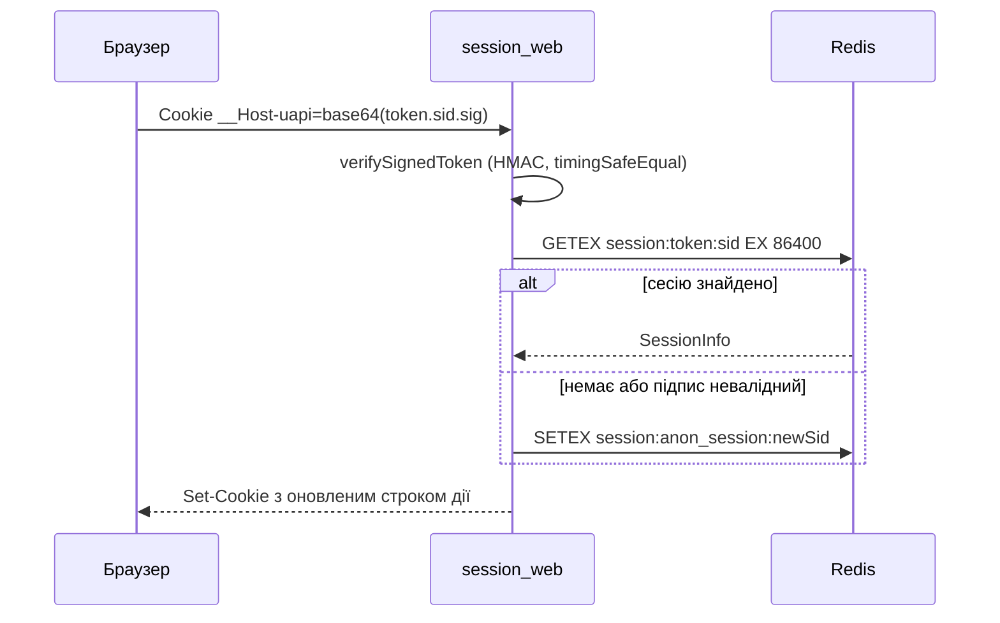

# Автентифікація

Ця сторінка описує, як бекенд впізнає користувача: сесії в Redis з HMAC-підписаною cookie, способи входу, як залогінити й розлогінити користувача з коду, авторизацію WebSocket і ролі. Захист трафіку (rate limiting, CSRF, CORS, CSP, проксі) описано на сторінці [Безпека](/backend/security), вхід через Google, GitHub та інші — на сторінці [Вхід через соцмережі](/backend/oauth).

## Коротко на прикладі: що відбувається після входу

Цей ланцюжок можна пройти в браузері (DevTools → Network) або через curl, див. [Перший сценарій](/guide/getting-started#_6-першии-сценаріи-від-входу-до-виходу).

1. **`GET /api/main/init`** без cookie. Сервер створює гостьову сесію в Redis, ставить cookie `uapi` і повертає `401` з `csrfToken`.
2. **`POST /api/auth/login`** з email, паролем і заголовком `x-csrf-token`. Сервер перевіряє пароль, прив'язує сесію до користувача і оновлює cookie:

    ```text
    Set-Cookie: uapi=<…>; Path=/; Expires=…; HttpOnly; Max-Age=86400; SameSite=Lax
    ```

    Неправильний пароль дає `401 {"message":"Invalid email or password","code":"unauthorized"}`, а після 10 невдалих спроб поспіль з однієї адреси сервер відповідає `429` із заголовком `Retry-After: 60` (перевірено з налаштуваннями за замовчуванням; ліміти описано нижче).

3. **Кожен наступний запит** несе cookie автоматично. Middleware `session_web` знаходить сесію в Redis і знає, хто ви. `GET /api/main/init` тепер повертає `200` з даними користувача, `wsToken` і новим `csrfToken`.
4. **Захищені маршрути.** `auth_guard` пропускає лише сесію з користувачем (інакше `401`), `admin_guard` — лише роль `admin` (інакше `403 Admin access required`).
5. **`POST /api/auth/logout`** видаляє сесію з Redis. Стара cookie більше нічого не відкриває, `init` знову дає `401`. `logout-all` видаляє всі сесії користувача, тобто виходить на всіх пристроях.

Що лежить у Redis після такого сценарію (ключі з префіксом `REDIS_PREFIX`):

```text
uwebsocket:session:<userId>:<sessionId>          сесія залогіненого користувача
uwebsocket:session:anon_session:<sessionId>      гостьова сесія (до входу)
uwebsocket:auth:throttle:login_ip:127.0.0.1      лічильник спроб входу з IP
uwebsocket:auth:ws:<token>                       одноразовий WebSocket-токен (60 с)
```

Нижче описано формат cookie, підпис, ротацію і решту механізмів.

## Вхід і вихід у коді

Розробнику не треба працювати з cookie, Redis чи підписами напряму. У кожному HTTP-контексті є два об'єкти: `context.auth` (хто користувач, вхід і вихід) і `context.session` (дані поточної сесії). Їх заповнює middleware `session_web` (або `session_api`), тож маршрут має стояти в групі з ним. Типи — `Auth` і `Session` у [`vendor/types/types.d.ts`](https://github.com/Blazheiko/vibe-template/blob/main/packages/backend/src/vendor/types/types.d.ts), реалізація — [`session-handler.ts`](https://github.com/Blazheiko/vibe-template/blob/main/packages/backend/src/vendor/utils/session/session-handler.ts).

### `context.auth`

| Метод                      | Повертає           | Що робить                                                                                                                                                                                                                                                                                                                                             |
| -------------------------- | ------------------ | ----------------------------------------------------------------------------------------------------------------------------------------------------------------------------------------------------------------------------------------------------------------------------------------------------------------------------------------------------- |
| `check()`                  | `boolean`          | `true`, якщо в сесії є `userId`, тобто користувач залогінений. Те саме перевіряє `auth_guard`.                                                                                                                                                                                                                                                        |
| `getUserId()`              | `string \| null`   | id користувача з сесії рядком або `null` для гостя. Для запиту до БД перетворіть на `BigInt(userId)`.                                                                                                                                                                                                                                                 |
| `login(userId, userToken)` | `Promise<boolean>` | **Логінить** користувача: видаляє поточну сесію (гостьову чи іншого користувача), створює нову з новим `sessionId` і CSRF-токеном, ставить cookie у відповідь. `userId` — `String(user.id)`, `userToken` — `user.sessionToken` з таблиці `users`. Якщо будь-який аргумент `undefined`, нічого не робить і повертає `false`. Помилку Redis кидає далі. |
| `logout()`                 | `Promise<boolean>` | **Розлогінює** на цьому пристрої: видаляє поточну сесію і видає нову гостьову з новим CSRF-токеном.                                                                                                                                                                                                                                                   |
| `logoutAll()`              | `Promise<number>`  | Виходить на **всіх** пристроях: видаляє всі сесії користувача, повертає їх кількість і видає нову гостьову сесію. Для гостя повертає `0`. Якщо не встиг за дедлайн, кидає помилку, яка стає `503` (див. [Redis як джерело істини](#redis-як-джерело-істини)).                                                                                         |

Після `login`, `logout` і `logoutAll` об'єкти `context.auth` і `context.session` у тому ж запиті вже дивляться на **нову** сесію: `getUserId()` одразу повертає нового користувача, а `context.session.sessionInfo.data.csrfToken` — новий токен, який треба віддати клієнту.

### `context.session`

| Член                      | Що робить                                                                                                                                                          |
| ------------------------- | ------------------------------------------------------------------------------------------------------------------------------------------------------------------ |
| `sessionInfo`             | Поточна сесія `{ id, data, createdAt, updatedAt? }` або `null`. У `data` лежать `userId`, `userToken`, `csrfToken`, `wsToken` і ваші власні поля.                  |
| `updateSessionData(data)` | **Зливає** `data` з наявними даними сесії і зберігає в Redis. Так OAuth зберігає `oauthState` між редиректом і callback. Щоб прибрати поле, передайте `undefined`. |
| `changeSessionData(data)` | **Замінює** дані сесії повністю. Обережно: без `userId`/`userToken`/`csrfToken` у новому об'єкті користувач фактично розлогіниться, а CSRF перестане працювати.    |
| `destroySession()`        | Видаляє поточну сесію з Redis без видачі нової. Для виходу користуйтеся `auth.logout()`, який ще й видає гостьову сесію та cookie.                                 |
| `destroyAllSessions`      | У HTTP-контексті не заповнюється і повертає `0`. Щоб вийти на всіх пристроях, використовуйте `auth.logoutAll()`.                                                   |

### Приклад: свій спосіб входу

Типова схема — сервіс знаходить користувача, перевіряє облікові дані й викликає `auth.login`. Так влаштовано [`auth-service.ts`](https://github.com/Blazheiko/vibe-template/blob/main/packages/backend/src/app/services/auth/auth-service.ts) (функція `buildAuthSuccess`, яка ще й видає `wsToken`); нижче спрощений варіант:

```ts
import type { Auth, Session } from '#vendor/types/types.js'

async function signIn(auth: Auth, session: Session, email: string, password: string) {
    const user = await userRepository.findByEmail(email)
    if (user === undefined || !(await validatePassword(password, user.password))) {
        return Result.err(unauthorized('Invalid email or password'))
    }

    // нова сесія, нова cookie, новий CSRF-токен
    await auth.login(String(user.id), user.sessionToken)

    return Result.ok({
        user: userTransformer.serialize(user),
        csrfToken: session.sessionInfo?.data.csrfToken,
    })
}
```

Контролер передає в сервіс `context.auth` і `context.session` і повертає результат. Новий `csrfToken` обов'язково віддайте клієнту: старий після входу більше не приймається (`403 token_mismatch`).

### Приклад: вихід

```ts
async logout(context: HttpContext<EmptyFormInput>): Promise<LogoutResponse> {
    await context.auth.logout()
    return { status: 'success', csrfToken: context.session.sessionInfo?.data.csrfToken }
}
```

Реальний [`auth-controller.ts`](https://github.com/Blazheiko/vibe-template/blob/main/packages/backend/src/app/controllers/http/auth/auth-controller.ts) робить те саме через `authService.logout(context.auth, context.session)` і обробляє помилки через `Result`. Вихід на всіх пристроях — `authService.logoutAll`, який ще й надсилає push-сповіщення безпеки.

### Перевірити, хто робить запит

```ts
async getProfile(context: HttpContext): Promise<ProfileResponse> {
    const userId = context.auth.getUserId()
    if (userId === null) {
        // сюди не дійде, якщо маршрут закрито auth_guard
        context.responseData.status = 401
        return { status: 'error', message: 'Unauthorized' }
    }
    const user = await userRepository.findById(BigInt(userId))
    // ...
}
```

Зазвичай перевірку робить не контролер, а `auth_guard` на маршруті (див. [Middleware](/backend/middlewares)). Тоді в контролері `getUserId()` гарантовано не `null`.

::: warning WebSocket
У WS-контексті `context.auth` і `context.session` дорівнюють `null`: користувач визначається під час підключення, а в обробнику доступний `context.userData`. Див. [Авторизація WebSocket](#авторизація-websocket).
:::

## Сесії

### Формат cookie

Сесію створює і перевіряє [`session-handler.ts`](https://github.com/Blazheiko/vibe-template/blob/main/packages/backend/src/vendor/utils/session/session-handler.ts), а підпис робить [`token-handler.ts`](https://github.com/Blazheiko/vibe-template/blob/main/packages/backend/src/vendor/utils/session/token-handler.ts).

- Значення до підпису: `<userToken>.<sessionId>`. Для анонімної сесії замість `userToken` стоїть рядок `anon_session`.
- `sessionId` генерується через `crypto.randomUUID()`.
- Підпис: HMAC-SHA256 з ключем `APP_KEY`, hex-рядок обрізаний до 32 символів. Підпис дописується через крапку, а результат кодується в base64: `base64("<userToken>.<sessionId>.<signature>")`.
- Під час перевірки підписи порівнюються через `crypto.timingSafeEqual`. Токен має складатися рівно з 3 частин, а `userToken` має відповідати шаблону `^[a-zA-Z0-9_-]{10,}$`.
- Якщо `APP_KEY` не задано, він коротший за 32 символи або дорівнює `your-secret-key` чи `change-me`, модуль кидає помилку під час завантаження, і сервер не стартує.

Ім'я та атрибути cookie задає [`config/session.ts`](https://github.com/Blazheiko/vibe-template/blob/main/packages/backend/src/config/session.ts):

| Параметр                     | Значення                                                                                                                                   |
| ---------------------------- | ------------------------------------------------------------------------------------------------------------------------------------------ |
| Ім'я                         | `__Host-uapi`, якщо `SESSION_COOKIE_HOST_PREFIX` увімкнено (за замовчуванням вмикається, коли `appConfig.isProductionLike`), інакше `uapi` |
| `path` / `httpOnly`          | `/` / `true`                                                                                                                               |
| `secure`                     | `true` для будь-якого `APP_ENV`, крім `local`                                                                                              |
| `sameSite`                   | `Lax`                                                                                                                                      |
| TTL (`age`, `maxAge`, Redis) | 24 години (`duration('24h')`)                                                                                                              |

Поки триває перехід на нове ім'я, [`resolve-session-cookie.ts`](https://github.com/Blazheiko/vibe-template/blob/main/packages/backend/src/vendor/utils/session/resolve-session-cookie.ts) спершу шукає активне ім'я cookie, а потім застаріле `uapi`. Якщо знайдено лише застаріле ім'я, [`delete-legacy-session-cookie.ts`](https://github.com/Blazheiko/vibe-template/blob/main/packages/backend/src/vendor/utils/session/delete-legacy-session-cookie.ts) надсилає `Set-Cookie`, який видаляє стару cookie. Під час старту [`validate-runtime-config.ts`](https://github.com/Blazheiko/vibe-template/blob/main/packages/backend/src/app/start/validate-runtime-config.ts) перевіряє, що при `__Host-` префіксі cookie має `Secure=true`, а `APP_URL` починається з `https://`.

### Redis як джерело істини

### Що таке `userToken`

`userToken` — це колонка `users.session_token` (`nanoid()`, 21 символ, унікальна, задається при створенні користувача). Це не сесія і не секрет для входу, а **постійний простір імен сесій користувача** в Redis:

- усі сесії одного користувача на всіх пристроях лежать під `session:<userToken>:*`, тож `logoutAll` знаходить їх одним `SCAN MATCH` без окремого індексу «користувач → сесії»;
- скидання пароля (за email і за SMS) **замінює** `session_token` на новий `nanoid()` і видаляє ключі зі старим: старі cookie після цього не можуть знайти свою сесію, навіть якщо якийсь ключ лишився;
- значення входить у підписану cookie (`<userToken>.<sessionId>.<signature>`), тож сервер одразу знає, де шукати сесію, без запиту до БД.

Зберігається воно в PostgreSQL, бо мусить пережити всі сесії: нова сесія після логіну бере `userToken` з рядка користувача, а Redis зберігає лише живі сесії з TTL. Без постійного значення в БД кожен вхід створював би новий простір імен, і `logoutAll` не бачив би сесій з інших пристроїв.

Клієнту `userToken` не потрібен: відповіді з користувачем (`user-transformer.ts`) його не містять. Сам по собі він сесію не відкриває — потрібні ще `sessionId` і підпис `APP_KEY`, — але й світити його в JSON, доступному з JavaScript, немає причин.

Сесії зберігає [`redis-session-storage.ts`](https://github.com/Blazheiko/vibe-template/blob/main/packages/backend/src/vendor/utils/session/redis-session-storage.ts):

- Ключ має вигляд `session:<userToken|anon_session>:<sessionId>`. Перед кожною операцією `sanitizeRedisKey` перевіряє його: дозволено лише `[a-zA-Z0-9:_*-]`, довжина не більше 86 символів.
- Запис робиться через `SETEX` з TTL `age`, читання — через `GETEX ... EX age`. Тобто кожне читання продовжує життя сесії (ковзний TTL).
- Якщо підпис валідний, але ключа в Redis немає, створюється нова анонімна сесія.
- `destroyAllSessions` (виклик `logoutAll`) знаходить ключі через `SCAN MATCH session:<userToken>:*` порціями по 100, а не через `KEYS`.
- **Межа `logoutAll`.** Увесь цикл `SCAN`/`DEL` обмежений дедлайном `REDIS_LOGOUT_ALL_DEADLINE_MS` (2000 мс), що рахується від його початку. Перед кожним `await` обчислюється залишок бюджету, і команда очікується не довше `min(залишок, REDIS_COMMAND_TIMEOUT_MS)`. Успіх (`deletedCount`) повертається **лише** якщо `SCAN` дійшов до курсора `0`, тобто всі сесії видалено. Якщо дедлайн вичерпано або команда отримала `RedisUnavailableError` — `503 service_unavailable` з `Retry-After: 1`, без `deletedCount`. Уже видалені сесії лишаються видаленими (`DEL` ідемпотентний), повторний виклик дочищає решту:
    - **поточна сесія видаляється останньою**, лише після курсора `0`, тож після `503` клієнт лишається автентифікованим і може повторити запит (з тим самим CSRF-токеном);
    - **курсор `SCAN` зберігається** в `logout_all:cursor:<userToken>:<sessionId>` (TTL 600 с) після кожної порції, і повтор `logoutAll` з тієї самої сесії продовжує з нього, а не з `0`, тому на великій базі повтори просуваються. Сесії, створені між спробами позаду збереженого курсора, продовжений обхід не бачить;
    - **повне відкликання** (скидання пароля, виклик без поточної сесії) завжди обходить базу з `0` і курсор не читає й не пише: прогрес перерваного `logoutAll`, який пропустив свою сесію, не може приховати її від відкликання.

Middleware `session_web` ([`session-web.ts`](https://github.com/Blazheiko/vibe-template/blob/main/packages/backend/src/vendor/utils/middlewares/ws/session-web.ts)) читає cookie, а `session_api` ([`session-api.ts`](https://github.com/Blazheiko/vibe-template/blob/main/packages/backend/src/vendor/utils/middlewares/http/session-api.ts)) бере той самий підписаний токен із заголовка `Authorization: Bearer <token>`. Cookie нової сесії видається одразу, а cookie незміненої сесії — повторно не частіше ніж раз на годину, щоб продовжити строк дії. Момент оновлення визначає окремий ключ `session_cookie_refresh:<sessionId>` (`SET NX EX 3600`): запис сесії при цьому не переписується, тож оновлення не може відновити сесію, яку інший запит щойно видалив. Нова сесія ставить цей ключ одразу; якщо запис ключа не вдається, сесія все одно створюється (помилка лише логується), і cookie просто буде оновлено раніше. Перед відправкою відповіді (`context.session.beforeSend` після хендлера) сервер перевіряє, що сесія, чию cookie повторно видає запит, ще існує: повільна відповідь не повертає браузеру cookie сесії, яку тим часом замінив інший запит (зміна пароля, logout-all). Запити, що самі змінили сесію (login, logout), свою cookie зберігають. Якщо ця перевірка не вдається (Redis недоступний), cookie з відповіді прибирається, а відповідь хендлера лишається без змін. Залишковий ризик: браузер може отримати відповіді в іншому порядку, ніж сервер їх відправив, і зберегти cookie вже видаленої сесії. Тоді наступний запит отримує нову анонімну сесію (користувач входить знову); прав видаленої сесії він не отримує.

### Ротація

- `auth.login(userId, userToken)` видаляє попередню сесію — і автентифіковану, і анонімну — і створює нову з новим `sessionId` та новим CSRF-токеном. Стара cookie після цього відкриває вже нову анонімну сесію з іншим токеном, тож мутація зі старим токеном отримує `403 token_mismatch`. Це захищає від session fixation.
- `auth.logout()` видаляє поточну сесію і видає нову анонімну.
- `auth.logoutAll()` видаляє всі сесії користувача і видає нову анонімну.
- Після `login`/`logout`/`logoutAll` хелпери `context.session.*` у тому ж запиті працюють уже з новою сесією.
- Ротація лише CSRF-токена без зміни `sessionId` не використовується: зміна автентифікації завжди означає новий `sessionId`.

Коли змінюється сесія (аудит переходів автентифікації):

| Потік                                        | Що відбувається з сесією                                                                                                                                                                                                                                                                                                                                                               |
| -------------------------------------------- | -------------------------------------------------------------------------------------------------------------------------------------------------------------------------------------------------------------------------------------------------------------------------------------------------------------------------------------------------------------------------------------- |
| Вхід (email/пароль, телефон), OAuth-callback | `auth.login`: новий `sessionId` і токен, попередня сесія видалена                                                                                                                                                                                                                                                                                                                      |
| `register/phone/complete-profile`            | `auth.login` після створення користувача                                                                                                                                                                                                                                                                                                                                               |
| `register/email`                             | анонімна сесія видаляється; вхід — після підтвердження email                                                                                                                                                                                                                                                                                                                           |
| `register/phone/confirm`, `verify-email`     | сесія не змінюється: лише підтвердження коду або адреси, права не змінюються                                                                                                                                                                                                                                                                                                           |
| `change-password`                            | `authService.renewSession`: новий `sessionId`, CSRF- і WS-токен для того самого користувача; відповідь `sessionRenewed: true` з `csrfToken`, `wsUrl`, `wsToken`, і клієнт перепідключає WebSocket. Пароль записується до ротації: якщо Redis-ротація падає, відповідь лишається успіхом з `sessionRenewed: false` (попередня сесія може бути вже видалена — тоді клієнт входить знову) |
| `reset-password`, `reset-phone/complete`     | анонімний запит; усі сесії користувача відкликаються (`destroyAllSessions`)                                                                                                                                                                                                                                                                                                            |
| `link-phone/confirm`, `link-email/*`         | сесія не змінюється: додається ідентифікатор, права не змінюються                                                                                                                                                                                                                                                                                                                      |
| Зміна ролі                                   | ендпоінта немає; `admin_guard` читає роль із бази на кожному запиті                                                                                                                                                                                                                                                                                                                    |



## Способи входу

Маршрути групи `auth` оголошено в [`http-routes.ts`](https://github.com/Blazheiko/vibe-template/blob/main/packages/backend/src/app/routes/http-routes.ts). Група має middleware `session_web` і `csrf_guard` та rate limit 10 запитів на хвилину з IP на кожен маршрут групи (окремі маршрути мають суворіші власні ліміти). Контролери: [`auth-controller.ts`](https://github.com/Blazheiko/vibe-template/blob/main/packages/backend/src/app/controllers/http/auth/auth-controller.ts) і [`oauth-controller.ts`](https://github.com/Blazheiko/vibe-template/blob/main/packages/backend/src/app/controllers/http/auth/oauth-controller.ts).

- **Email і пароль**: `POST /auth/register/email` для реєстрації та `POST /auth/login` для входу. Схема входу [`login.ts`](https://github.com/Blazheiko/vibe-template/blob/main/packages/shared/src/schemas/auth/login.ts) приймає або `email`, або `identifier`, разом із `password` (8–32 символи). Паролі хешує `hashPassword` з `metautil` ([`auth-service.ts`](https://github.com/Blazheiko/vibe-template/blob/main/packages/backend/src/app/services/auth/auth-service.ts)). Є також `forgot-password`, `reset-password`, `verify-email`, `resend-verification-email`, `change-password`, `link-email/start`.
- **Телефон і SMS**: `register/phone/start`, `register/phone/confirm`, `register/phone/complete-profile`, `reset-phone/start`, `reset-phone/complete`, `link-phone/start`, `link-phone/confirm`. Вмикається через `AUTH_PHONE_ENABLED` ([`config/auth.ts`](https://github.com/Blazheiko/vibe-template/blob/main/packages/backend/src/config/auth.ts)). OTP-коди зберігаються як HMAC-SHA256 з ключем `AUTH_OTP_HMAC_KEY` (або `APP_KEY`, якщо перший не задано) ([`otp-verification-hash.ts`](https://github.com/Blazheiko/vibe-template/blob/main/packages/backend/src/app/services/auth/otp-verification-hash.ts)). Якщо телефонний вхід увімкнено, а ключ коротший за 32 символи, сервер не стартує.
- **Соцмережі (OAuth)**: Google, Facebook, GitHub і GitLab через бібліотеку `arctic`. Що потрібно налаштувати і як додати провайдера — на сторінці [Вхід через соцмережі](/backend/oauth).

Провайдер SMS обирається через `AUTH_SMS_PROVIDER`. Валідатор runtime-конфігурації забороняє `AUTH_SMS_PROVIDER=fake` в середовищах production-like і вимагає явно задати `AUTH_SMS_PROVIDER_ALLOW_FAKE=true` та `AUTH_FAKE_SMS_CODE`.

## Авторизація WebSocket

1. Автентифікований клієнт викликає `GET /main/update-ws-token` (`auth_guard`). [`generate-ws-token-service.ts`](https://github.com/Blazheiko/vibe-template/blob/main/packages/backend/src/app/services/auth/generate-ws-token-service.ts) кладе в Redis ключ `auth:ws:<token>` з TTL 60 с і даними `{ sessionId, userId, userToken }`.
2. Клієнт відкриває `/<pathPrefix>/websocket` і передає токен першим елементом `Sec-WebSocket-Protocol`. `handleUpgrade` у [`ws-handlers.ts`](https://github.com/Blazheiko/vibe-template/blob/main/packages/backend/src/vendor/utils/network/ws-handlers.ts) перевіряє формат токена: довжина `accessTokenLength`, лише символи `[a-zA-Z0-9]`. Якщо формат невірний, сервер відповідає `401`.
3. [`ws-session-auth.ts`](https://github.com/Blazheiko/vibe-template/blob/main/packages/backend/src/app/websocket/ws-session-auth.ts) (`verifyUpgradeToken`) читає токен, знаходить сесію `session:<userToken>:<sessionId>` і перевіряє, що `userId` у сесії збігається з `userId` у токені. `refreshToken` продовжує TTL токена до 120 с, а `revokeToken` видаляє токен під час закриття з'єднання.
4. Кожне повідомлення проходить через `wsSessionHandler`. Якщо сесії немає або в ній немає `userId`, клієнт отримує unauthorized-повідомлення, а з'єднання закривається з кодом `4001`.

## Ролі: `auth_guard` та `admin_guard`

- [`auth-guard.ts`](https://github.com/Blazheiko/vibe-template/blob/main/packages/backend/src/vendor/utils/middlewares/core/auth-guard.ts) повертає `401 unauthorized`, якщо `auth.check()` хибне.
- [`admin-guard.ts`](https://github.com/Blazheiko/vibe-template/blob/main/packages/backend/src/app/middlewares/admin-guard.ts) завантажує користувача з БД і повертає `403 forbidden`, якщо `role !== 'admin'`. Адмінські групи підключають `["session_web", "csrf_guard", "auth_guard", "admin_guard"]`.
