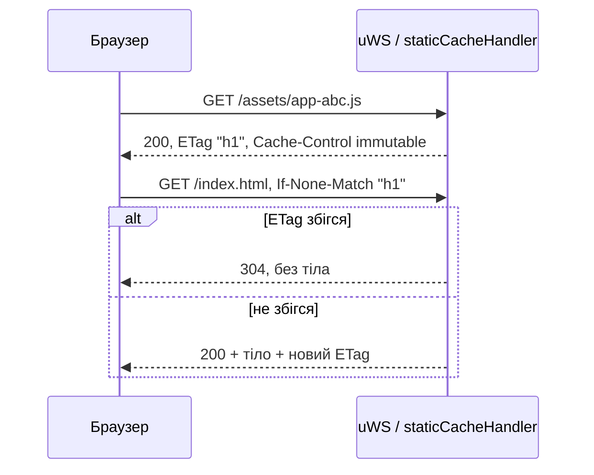

# Кешування та ETag

Бекенд має два шари кешування: in-memory кеш статики з ETag/`Cache-Control` для браузера та кілька процесних кешів у пам'яті. Для JSON API HTTP-кешування не налаштоване. Як увімкнути роздачу статики (`SERVE_STATIC`, `CDN_URL`), описано в [Розгортанні](/backend/deployment). Як запит проходить через сервер, описано в [Життєвому циклі запиту](/backend/request-lifecycle).

## Статика: кеш у пам'яті

Усе реалізовано в [`static-server.ts`](https://github.com/Blazheiko/itvibe-template/blob/main/packages/backend/src/vendor/start/static-server.ts):

- **Коли:** лише при `appConfig.serveStatic`. Функція `cacheStaticSource()` один раз на старті рекурсивно читає `./public` (при `APP_ENV=manual-test` — `./public-test`) відносно `process.cwd()`. Файли й каталоги, чиї імена починаються з `.`, пропускаються.
- **Що:** беруться лише файли з розширеннями з whitelist `ALLOWED_STATIC_EXTENSIONS` (html, css, js, mjs, json, webmanifest, зображення, шрифти, аудіо/відео). Решта ігнорується. Бінарні файли зберігаються як `Buffer`, текстові як `utf8`-рядок ([`isBinaryExtension`](https://github.com/Blazheiko/itvibe-template/blob/main/packages/backend/src/vendor/utils/helpers/file-utils.ts)).
- **Ліміти розміру:** немає. Весь каталог лежить у RAM процесу. Зміни на диску після старту не підхоплюються, потрібен рестарт.
- **Маршрути:** у [`server.ts`](https://github.com/Blazheiko/itvibe-template/blob/main/packages/backend/src/vendor/start/server.ts) (`configureHttp`) для кожного закешованого шляху реєструється окремий `server.get(key, …)` → `staticCacheHandler`. Шлях `/` отримує копію `/index.html`.
- **Стиснення:** немає (ні gzip/brotli на льоту, ні precompressed). У коді про це є коментар `Compression not implemented yet`. Стискайте на reverse proxy або CDN.

## ETag

`computeEtag` рахує SHA-1 від вмісту файлу в base64url і бере результат у лапки (strong ETag, наприклад `"q1w2…"`). Хеші обчислюються один раз на старті й лежать у мапі `etags`. Коментар у коді пояснює, чому validator має залежати від вмісту, а не від довжини: після ребілду `index.html` зазвичай змінює лише хеші асетів однакової довжини.

`If-None-Match` порівнюється з ETag **точним рядковим збігом**. Списки (`"a", "b"`), `*` і weak-префікс `W/` не розбираються. Якщо значення збіглося, сервер відповідає `304` без тіла.



## Cache-Control за типом файлу

| Тип                               | `Cache-Control`                                             | Інші заголовки                                                                                 |
| --------------------------------- | ----------------------------------------------------------- | ---------------------------------------------------------------------------------------------- |
| HTML (`.html`, `/`, SPA fallback) | `public, max-age=0, must-revalidate` (`HTML_CACHE_CONTROL`) | `ETag`, `content-type`, `setSecurityHeaders` (nosniff, X-Frame-Options, Referrer-Policy, HSTS) |
| Усе інше з whitelist              | `public, max-age=31536000, immutable`                       | `ETag`, `Content-Type`, `Content-Length`, `X-Content-Type-Options: nosniff`                    |

MIME-тип береться з [`MIME_TYPES`](https://github.com/Blazheiko/itvibe-template/blob/main/packages/backend/src/vendor/constants/mime-types.ts) за розширенням. Якщо розширення немає в мапі, береться `default`.

::: warning Immutable і для файлів без хешу в імені
Річний `immutable` віддається для **всіх** не-HTML файлів, а не лише для хешованих Vite-асетів із `/assets/`. Він же стоїть на `manifest.json`, `favicon.svg`, `/icons/*`, `/audio/*` і `service-worker.js`. Якщо такий файл зміниться без зміни імені, браузери можуть до року тримати стару версію. Для самого скрипта `service-worker.js` ризик менший: браузер перевіряє його оновлення в обхід HTTP-кешу (за замовчуванням `updateViaCache: 'imports'`, і HTTP-кеш скрипта SW обмежений 24 годинами). Але `manifest.json`, іконки та аудіо оновлюються лише після закінчення `max-age`.
:::

## SPA fallback і безпека

Запити, які не збіглися з жодним закешованим шляхом, потрапляють у `server.any('/*')`. Якщо це `GET` поза `/${pathPrefix}/` і `serveStatic` увімкнено, викликається `staticHandler`:

- `isUrlSafe` відхиляє URL із `..`, `\0`, `%2e%2e`, `%00` → `400 Bad Request`. Детальніше про захист — у [Auth та безпеці](/backend/auth-security).
- URL **без крапки** отримує `index.html` через той самий `handleHtmlRequest`, тобто з ETag і `must-revalidate`.
- URL із крапкою, якого немає в кеші, отримує `404` з порожнім тілом.

::: warning CSP
Генерація заголовка CSP у `static-server.ts` закоментована (`setCspHeader`), тому HTML віддається без Content-Security-Policy. Це проблема 1 у `docs/plan/code-issues-found-during-docs.md`.
:::

## API-відповіді

`sendResponse` у [`server.ts`](https://github.com/Blazheiko/itvibe-template/blob/main/packages/backend/src/vendor/start/server.ts) виставляє `content-type: application/json`, security-заголовки, заголовки й cookies з `responseData` і CORS. **Ні `Cache-Control`, ні `ETag` на JSON-відповіді не ставляться**, зокрема немає `no-store`. Поведінку кешування визначає браузер або проміжний проксі. Контролер може сам додати заголовок через `responseData.headers`.

CORS: якщо `ENABLED_CORS=true`, `setCorsHeader` пише `Vary: Origin` і `Access-Control-Max-Age` = `maxAge` з [`config/cors.ts`](https://github.com/Blazheiko/itvibe-template/blob/main/packages/backend/src/config/cors.ts) (зараз `90` секунд, змінюється лише в коді). Отже, браузер кешує результат preflight на 90 с.

## Інші кеші в пам'яті

- **AI-промпти:** [`prompt-service.ts`](https://github.com/Blazheiko/itvibe-template/blob/main/packages/backend/src/app/services/ai/prompt-service.ts) тримає `Map<PromptType, PromptRow>`. Його заповнює `promptService.load()` на старті ([`index.ts`](https://github.com/Blazheiko/itvibe-template/blob/main/packages/backend/src/index.ts)), а `update()` перечитує змінений рядок із БД. TTL немає. Кеш живе в кожному процесі окремо: зміна на одному інстансі не потрапить на інші до їх рестарту.
- Сесії, throttle і токени в Redis — це стан, а не кеш. Див. [Auth та безпеку](/backend/auth-security).

## Фронтенд: Service Worker

[`service-worker.ts`](https://github.com/Blazheiko/itvibe-template/blob/main/packages/frontend/src/service-worker.ts) (збирається через [`vite.sw.config.ts`](https://github.com/Blazheiko/itvibe-template/blob/main/packages/frontend/vite.sw.config.ts)) під час `install` прекешує список `filesToCache`: `/`, іконки, splash, аудіо. Для `/assets/`, `/icons/`, `/audio/`, `.css` тощо (`isStaticAsset`) він працює за стратегією cache-first. Ім'я кешу — `BUILD_TIMESTAMP`. Старі кеші видаляються на `activate`.

## Перевірка через curl

Приклад (ілюстративний, значення умовні):

```bash
curl -I http://localhost:3000/index.html
# HTTP/1.1 200 OK
# content-type: text/html; charset=UTF-8
# Cache-Control: public, max-age=0, must-revalidate
# ETag: "3n0Yq…"

curl -I -H 'If-None-Match: "3n0Yq…"' http://localhost:3000/index.html
# HTTP/1.1 304 Not Modified
```

Порт і MIME залежать від вашої конфігурації ([Конфігурація](/backend/configuration)).

## Як змінити поведінку

- Значення `Cache-Control` захардкоджені в `static-server.ts` (`HTML_CACHE_CONTROL`, `maxAge = 31536000`). Щоб, наприклад, давати `immutable` лише `/assets/*`, потрібно змінити `staticCacheHandler`.
- Whitelist розширень задається в `ALLOWED_STATIC_EXTENSIONS`.
- **Dev:** фронтенд віддає Vite dev-сервер, `SERVE_STATIC` зазвичай `false`. **Prod:** або `SERVE_STATIC=true` з каталогом `public` в образі (у Dockerfile змінна не задана, проблема 31), або окремий хостинг/CDN (`CDN_URL`). У випадку CDN заголовки кешування задає CDN. Див. [Розгортання](/backend/deployment).

::: info Історія
[`etag-improvements.md`](https://github.com/Blazheiko/itvibe-template/blob/main/packages/backend/src/docs/etag-improvements.md) описує старий ETag на основі довжини файлу й застарів: зараз ETag рахується як хеш вмісту (проблема 15).
:::
