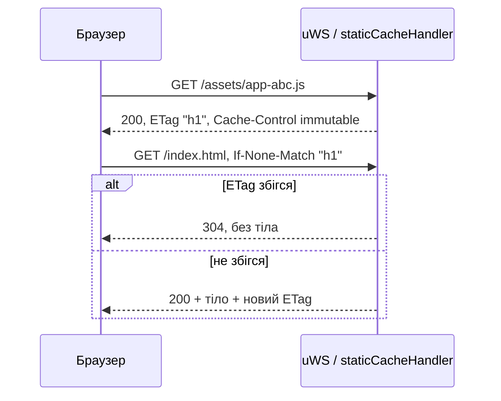

# Кешування та ETag

Бекенд має два шари кешування: in-memory кеш статики з ETag/`Cache-Control` для браузера та кілька процесних кешів у пам'яті. JSON API за замовчуванням не кешується: відповіді мають `Cache-Control: no-store`. Як увімкнути роздачу статики (`SERVE_STATIC`, `CDN_URL`), описано в [Розгортанні](/backend/deployment). Як запит проходить через сервер, описано в [Життєвому циклі запиту](/backend/request-lifecycle).

## Статика: кеш у пам'яті

Усе реалізовано в [`static-server.ts`](https://github.com/Blazheiko/vibe-template/blob/main/packages/backend/src/vendor/start/static-server.ts):

- **Коли:** лише при `appConfig.serveStatic`. Функція `cacheStaticSource()` один раз на старті рекурсивно читає `./public` (при `APP_ENV=manual-test` — `./public-test`) відносно `process.cwd()`. Файли й каталоги, чиї імена починаються з `.`, пропускаються.
- **Що:** беруться лише файли з розширеннями з whitelist `ALLOWED_STATIC_EXTENSIONS` (html, css, js, mjs, json, webmanifest, зображення, шрифти, аудіо/відео). Решта ігнорується. Бінарні файли зберігаються як `Buffer`, текстові як `utf8`-рядок ([`isBinaryExtension`](https://github.com/Blazheiko/vibe-template/blob/main/packages/backend/src/vendor/utils/helpers/file-utils.ts)).
- **Ліміти пам'яті:** у RAM кладуться файли до `STATIC_MAX_MEMORY_FILE_SIZE` (за замовчуванням 1 MiB), доки сума (разом зі стислими варіантами) не перевищить `STATIC_MAX_MEMORY_TOTAL` (64 MiB). Решта віддається **стрімінгом з диска** (`fs.createReadStream` з backpressure uWS: `tryEnd` / `onWritable`) — їхній вміст на старті не читається. `index.html` завжди в пам'яті: його віддає SPA fallback. На старті в лог пишеться `Static files cached` з `files`, `memoryBytes` і `streamedFromDisk`. Зміни на диску після старту не підхоплюються, потрібен рестарт.
- **Маршрути:** у [`server.ts`](https://github.com/Blazheiko/vibe-template/blob/main/packages/backend/src/vendor/start/server.ts) (`configureHttp`) для кожного закешованого шляху реєструється окремий `server.get(key, …)` → `staticCacheHandler`. Шлях `/` отримує копію `/index.html`.
- **Стиснення:** для текстових типів (`html`, `js`, `mjs`, `css`, `svg`, `json`, `webmanifest`, `txt`, `xml`) від 1 KiB сервер на старті готує варіанти `br` (якість 9) і `gzip` (рівень 9) і тримає їх у пам'яті, якщо вони менші за оригінал. Варіант обирається за `Accept-Encoding` (`br` → `gzip` → без стиснення; `q=0` вимикає кодування) з `Content-Encoding`; відповідь на такий файл завжди має `Vary: Accept-Encoding`, зокрема й `304`. Наприклад, головний бандл 873 428 B віддається як 251 055 B у `br`. Файли зі стрімінгу не стискаються. `Content-Length` стрімінгу — розмір файлу на момент старту: якщо файл з тих пір став коротшим (перезбірка `public/` під працюючим сервером), відповідь закривається з `warn`, а не висить.

## ETag

`computeEtag` рахує SHA-1 від вмісту файлу в base64url і бере результат у лапки (strong ETag, наприклад `"q1w2…"`). Хеші обчислюються один раз на старті й зберігаються в записі кешу. Для файлів зі стрімінгу ETag слабкий, з розміру й `mtime`: `W/"<size hex>-<mtime hex>"`. Коментар у коді пояснює, чому validator має залежати від вмісту, а не від довжини: після ребілду `index.html` зазвичай змінює лише хеші асетів однакової довжини.

`If-None-Match` розбирає [`matchesIfNoneMatch`](https://github.com/Blazheiko/vibe-template/blob/main/packages/backend/src/vendor/utils/network/if-none-match.ts) за RFC 9110 §13.1.2: `*` збігається з будь-яким файлом, список через кому перевіряється поелементно, порівняння слабке (`W/"x"` = `"x"`). Збіг → `304` без тіла.



## Cache-Control за типом файлу

| Тип                                                                           | `Cache-Control`                                                       | Інші заголовки                                                                                     |
| ----------------------------------------------------------------------------- | --------------------------------------------------------------------- | -------------------------------------------------------------------------------------------------- |
| HTML (`.html`, `/`, SPA fallback)                                             | `public, max-age=0, must-revalidate` (`HTML_CACHE_CONTROL`)           | `ETag`, `content-type`, `setSecurityHeaders` (nosniff, X-Frame-Options, Referrer-Policy, HSTS)     |
| `/assets/*` (імена з хешем від Vite)                                          | `public, max-age=31536000, immutable`                                 | `ETag`, `Content-Type`, `X-Content-Type-Options: nosniff`, `Vary` / `Content-Encoding` для стислих |
| Усе інше з whitelist (`manifest.json`, `service-worker.js`, іконки, аудіо, …) | `no-cache` — браузер кешує, але щоразу перевіряє ETag (дешевий `304`) | ті самі                                                                                            |

MIME-тип береться з [`MIME_TYPES`](https://github.com/Blazheiko/vibe-template/blob/main/packages/backend/src/vendor/constants/mime-types.ts) за розширенням. Якщо розширення немає в мапі, береться `default`.

## SPA fallback і безпека

Запити, які не збіглися з жодним закешованим шляхом, потрапляють у `server.any('/*')`. Якщо це `GET` поза `/${pathPrefix}/` і `serveStatic` увімкнено, викликається `staticHandler`:

- `isUrlSafe` відхиляє URL із `..`, `\0`, `%2e%2e`, `%00` → `400 Bad Request`. Детальніше про захист — у [Auth та безпеці](/backend/auth-security).
- URL **без крапки** отримує `index.html` через той самий `handleHtmlRequest`, тобто з ETag і `must-revalidate`.
- URL із крапкою, якого немає в кеші, отримує `404` з порожнім тілом.

::: warning CSP
Генерація заголовка CSP у `static-server.ts` закоментована (`setCspHeader`), тому HTML віддається без Content-Security-Policy. Це проблема 1 у `docs/plan/code-issues-found-during-docs.md`.
:::

## API-відповіді

`sendResponse` у [`server.ts`](https://github.com/Blazheiko/vibe-template/blob/main/packages/backend/src/vendor/start/server.ts) виставляє `content-type: application/json`, security-заголовки, заголовки й cookies з `responseData` і CORS. Кожна API-відповідь — і з `sendResponse`, і помилки з `sendErrorResponse` (422, 429, 500 тощо) — отримує `Cache-Control: no-store` (`setApiCacheHeader` у [`http-response-handlers.ts`](https://github.com/Blazheiko/vibe-template/blob/main/packages/backend/src/vendor/utils/network/http-response-handlers.ts)): відповіді містять сесійні й персональні дані, тож браузер і проміжні проксі не повинні їх зберігати. Якщо контролер сам задав `Cache-Control` у `responseData.headers` (без огляду на регістр), його значення лишається, і `no-store` не додається. `ETag` на JSON-відповіді не ставиться. Статика має власні правила (вище).

CORS: якщо `ENABLED_CORS=true`, `setCorsHeader` пише `Vary: Origin` і `Access-Control-Max-Age` = `maxAge` з [`config/cors.ts`](https://github.com/Blazheiko/vibe-template/blob/main/packages/backend/src/config/cors.ts) (зараз `90` секунд, змінюється лише в коді). Отже, браузер кешує результат preflight на 90 с.

## Інші кеші в пам'яті

- **AI-промпти:** [`prompt-service.ts`](https://github.com/Blazheiko/vibe-template/blob/main/packages/backend/src/app/services/ai/prompt-service.ts) тримає `Map<PromptType, PromptRow>`. Його заповнює `promptService.load()` на старті ([`index.ts`](https://github.com/Blazheiko/vibe-template/blob/main/packages/backend/src/index.ts)), а `update()` перечитує змінений рядок із БД і одразу кладе в кеш. TTL — `PROMPT_CACHE_TTL_MS` (60 с): прострочений кеш відповідає поточним значенням і перечитує всі промпти у фоні (одне перечитування одночасно; при помилці лишаються старі значення). Кеш живе в кожному процесі окремо, тож зміна на одному інстансі потрапляє на інші із затримкою до TTL; pub/sub-інвалідації немає.
- Сесії, throttle і токени в Redis — це стан, а не кеш. Див. [Auth та безпеку](/backend/auth-security).

## Фронтенд: Service Worker

[`service-worker.ts`](https://github.com/Blazheiko/vibe-template/blob/main/packages/frontend/src/service-worker.ts) (збирається через [`vite.sw.config.ts`](https://github.com/Blazheiko/vibe-template/blob/main/packages/frontend/vite.sw.config.ts)) під час `install` прекешує список `filesToCache`: `/`, іконки, splash, аудіо. Для `/assets/`, `/icons/`, `/audio/`, `.css` тощо (`isStaticAsset`) він працює за стратегією cache-first. Ім'я кешу — `BUILD_TIMESTAMP`. Старі кеші видаляються на `activate`.

## Перевірка через curl

Приклад (ілюстративний, значення умовні):

```bash
curl -I http://localhost:3000/index.html
# HTTP/1.1 200 OK
# content-type: text/html; charset=UTF-8
# Cache-Control: public, max-age=0, must-revalidate
# ETag: "3n0Yq…"

curl -I -H 'If-None-Match: "3n0Yq…"' http://localhost:3000/index.html
# HTTP/1.1 304 Not Modified
```

Порт і MIME залежать від вашої конфігурації ([Конфігурація](/backend/configuration)).

## Як змінити поведінку

- Значення `Cache-Control` задані константами в `static-server.ts` (`HTML_CACHE_CONTROL`, `IMMUTABLE_CACHE_CONTROL`, `REVALIDATE_CACHE_CONTROL`); правило «`immutable` лише для `/assets/`» — у `cacheControlFor`.
- Ліміти пам'яті — `STATIC_MAX_MEMORY_FILE_SIZE`, `STATIC_MAX_MEMORY_TOTAL` ([Конфігурація](/backend/configuration)).
- Whitelist розширень задається в `ALLOWED_STATIC_EXTENSIONS`.
- **Dev:** фронтенд віддає Vite dev-сервер, `SERVE_STATIC` зазвичай `false`. **Prod:** або `SERVE_STATIC=true` з каталогом `public` в образі (у Dockerfile змінна не задана, проблема 31), або окремий хостинг/CDN (`CDN_URL`). У випадку CDN заголовки кешування задає CDN. Див. [Розгортання](/backend/deployment).

::: info Історія
Раніше ETag будувався з довжини файлу й URL. Зараз це SHA1-хеш вмісту, порахований один раз при старті; чому так — у коментарі в [static-server.ts](https://github.com/Blazheiko/vibe-template/blob/main/packages/backend/src/vendor/start/static-server.ts). Нотатку `etag-improvements.md` з варіантами MD5 / mtime / CRC32 видалено у feat-009 ([остання версія](https://github.com/Blazheiko/vibe-template/blob/8f3479f/packages/backend/src/docs/etag-improvements.md)).
:::
