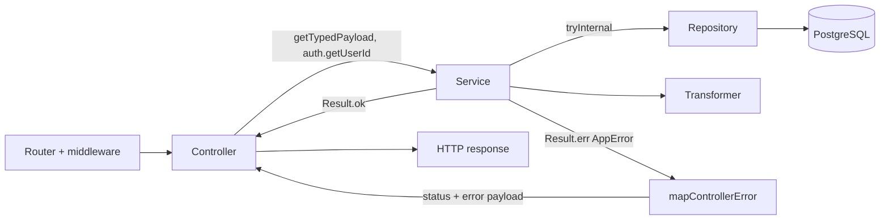

# Контролери та сервіси

Прикладний код бекенду розділений на тонкі **контролери** (HTTP/WS-адаптери) і **сервіси** (бізнес-логіка, що повертає `AppResult<T>`). Загальну схему шарів описано в [Архітектурі](/backend/architecture), покроковий приклад нової фічі — у [Як додати фічу](/backend/adding-a-feature). Ця сторінка — довідник конвенцій обох шарів.

## Контролери

Контролери лежать у [`src/app/controllers`](https://github.com/Blazheiko/itvibe-template/tree/main/packages/backend/src/app/controllers):

- `http/` — обробники HTTP-маршрутів, згруповані за доменом;
- `ws/` — обробники WebSocket-подій ([admin-ws-controller.ts](https://github.com/Blazheiko/itvibe-template/blob/main/packages/backend/src/app/controllers/ws/admin-ws-controller.ts), [support-controller.ts](https://github.com/Blazheiko/itvibe-template/blob/main/packages/backend/src/app/controllers/ws/support-controller.ts));
- `shared/` — `mapControllerError` ([controller-error.ts](https://github.com/Blazheiko/itvibe-template/blob/main/packages/backend/src/app/controllers/shared/controller-error.ts)).

Окремої теки `static/` у контролерах немає: роздача статики живе у vendor-шарі.

Контролер — це об'єкт за замовчуванням (`export default { ... }`) з async-методами. У маршрутах метод передається як `handler: AuthController.login.bind(AuthController)` ([http-routes.ts](https://github.com/Blazheiko/itvibe-template/blob/main/packages/backend/src/app/routes/http-routes.ts), [ws-routes.ts](https://github.com/Blazheiko/itvibe-template/blob/main/packages/backend/src/app/routes/ws-routes.ts)).

### Контекст обробника

Типи визначені у [vendor/types/types.d.ts](https://github.com/Blazheiko/itvibe-template/blob/main/packages/backend/src/vendor/types/types.d.ts):

```ts
export interface HttpContext<TPayload = unknown, TQuery = null> {
    requestId: string
    logger: Logger
    httpData: HttpData<TPayload, TQuery>
    responseData: ResponseData
    session: Session
    auth: Auth
}
export interface WsContext<TPayload = unknown> {
    requestId: string
    ws: MyWebSocket
    wsData: WsData<TPayload>
    responseData: WsResponseData
    userData: UserConnection | null
    session: null
    auth: null
    logger: Logger
}
```

| Що потрібно         | HTTP                                                               | WS                                    |
| ------------------- | ------------------------------------------------------------------ | ------------------------------------- |
| Провалідоване тіло  | `getTypedPayload(context)`                                         | `getTypedPayload(context)`            |
| Параметри шляху     | `context.httpData.params['id']` (рядки)                            | —                                     |
| Query               | `context.httpData.query` (типізований, якщо є `queryValidator`)    | —                                     |
| Поточний користувач | `context.auth.getUserId()` (`string \| null`)                      | `context.userData?.userId`            |
| Сесія               | `context.session.sessionInfo`, `updateSessionData(...)`            | `session: null`                       |
| Статус / заголовки  | `context.responseData.status = 201`, `responseData.setHeader(...)` | `context.responseData.status` (рядок) |

[`getTypedPayload`](https://github.com/Blazheiko/itvibe-template/blob/main/packages/backend/src/vendor/utils/validation/get-typed-payload.ts) працює з обома контекстами й повертає payload, який уже пройшов валідатор маршруту (див. [Валідація](/backend/validation)). Параметри шляху беруться напряму, наприклад у [oauth-controller.ts](https://github.com/Blazheiko/itvibe-template/blob/main/packages/backend/src/app/controllers/http/auth/oauth-controller.ts): `context.httpData.params["provider"] ?? ""`.

### Повернення даних і статус

Значення, яке повертає метод, стає тілом відповіді; статус за замовчуванням — успішний, інший задається через `context.responseData.status` (наприклад `201` у [admin-knowledge-base-controller.ts](https://github.com/Blazheiko/itvibe-template/blob/main/packages/backend/src/app/controllers/http/admin/admin-knowledge-base-controller.ts), `302` для редиректів в OAuth). Типи відповідей беруться з `shared` (`shared/responses`).

### Мапінг помилок

Помилки сервісу (`AppError`) перетворюються на канонічну відповідь однією функцією:

```ts
export function mapControllerError(
    context: Pick<HttpContext<unknown, unknown>, 'responseData'>,
    error: AppError,
): ReturnType<typeof appErrorToHttpPayload> {
    applyAppErrorStatus(context.responseData, error)
    return appErrorToHttpPayload(error)
}
```

[`applyAppErrorStatus`](https://github.com/Blazheiko/itvibe-template/blob/main/packages/backend/src/app/services/shared/apply-service-status.ts) виставляє HTTP-статус за `_tag` (`BadRequest`→400, `Unauthorized`→401, `Forbidden`→403, `NotFound`→404, `Conflict`→409, `RateLimited`→429 + `Retry-After`, `Internal`→500 — таблиця в [errors.ts](https://github.com/Blazheiko/itvibe-template/blob/main/packages/backend/src/app/services/shared/errors.ts)), а тіло має форму `{ status: 'error', message, code, reason? }`. Для WS є аналог [`appErrorToWsError`](https://github.com/Blazheiko/itvibe-template/blob/main/packages/backend/src/app/services/shared/ws-error.ts).

Типовий метод контролера наведено в [Кроці 7](/backend/adding-a-feature#крок-7-controller).

### Групи HTTP-контролерів

| Тека             | Відповідальність                                     | Приклад маршруту                                 |
| ---------------- | ---------------------------------------------------- | ------------------------------------------------ |
| `core/`          | `ping`, ініціалізація клієнта, WS-токен              | `main/init`                                      |
| `auth/`          | Реєстрація, логін, скидання пароля, OAuth            | `auth/login`, `auth/oauth/:provider/redirect`    |
| `notifications/` | Push-підписки й тестовий push                        | `push-subscriptions/:subscriptionId`             |
| `user/`          | Аватар користувача                                   | префікс `avatar`                                 |
| `support/`       | Історія чату підтримки, скріншоти статей             | `support/chat/history`                           |
| `admin/`         | База знань, онлайн-користувачі, історія, користувачі | `admin/knowledge-base/:id`, `admin/users-online` |
| `ai/`            | Промпти та статистика використання LLM               | `prompts/:type`, `admin/usage/stats`             |

Префікси груп — у [http-routes.ts](https://github.com/Blazheiko/itvibe-template/blob/main/packages/backend/src/app/routes/http-routes.ts); деталі — у [Маршрутизації та middleware](/backend/routing-middlewares).

::: warning Відхилення від конвенції «тонкий контролер»

- [prompt-controller.ts](https://github.com/Blazheiko/itvibe-template/blob/main/packages/backend/src/app/controllers/http/ai/prompt-controller.ts) сам робить `fetch` до OpenAI і кидає `throw new Error(...)` замість повернення `AppError`.
- [admin-user-controller.ts](https://github.com/Blazheiko/itvibe-template/blob/main/packages/backend/src/app/controllers/http/admin/admin-user-controller.ts) імпортує `userRepository` напряму, минаючи сервіс.

Не беріть ці файли за зразок.
:::

## Сервіси

Сервіси лежать у [`src/app/services`](https://github.com/Blazheiko/itvibe-template/tree/main/packages/backend/src/app/services). Index-файлів у доменах немає — імпорт іде з конкретного файлу.

| Домен            | Відповідальність                                                                                   |
| ---------------- | -------------------------------------------------------------------------------------------------- |
| `actions/`       | Лише типи `ToolDefinition` / `ToolCallHandler` для викликів інструментів                           |
| `admin/`         | Онлайн-користувачі, історія онлайну, підписка адміна на WS-канал                                   |
| `ai/`            | Адаптери LLM-провайдерів (OpenAI, Mistral, xAI), промпти, облік використання (`usage/`)            |
| `auth/`          | Реєстрація/логін, OAuth, скидання пароля, верифікація email/SMS, throttle, WS-токен                |
| `communication/` | Broadcast, присутність у WS, онлайн-статус, URL WebSocket                                          |
| `core/`          | `mainService`: init, сесія, оновлення WS-токена                                                    |
| `notifications/` | Email, push-підписки та відправка push                                                             |
| `observability/` | Інтеграція із Sentry                                                                               |
| `shared/`        | `AppError`/`AppResult`, `tryInternal`/`tryDomain`, мапінг помилок у HTTP/WS, доступ до сесії, мова |
| `statistics/`    | Статистика push-підписок                                                                           |
| `support/`       | Чат підтримки, база знань, ембединги, LLM, переклад запитів                                        |
| `user/`          | Аватар                                                                                             |

### Як сервіси оголошуються

DI-контейнера немає. Сервіс — модульний синглтон-об'єкт (`export const authService = { ... }`, [auth-service.ts](https://github.com/Blazheiko/itvibe-template/blob/main/packages/backend/src/app/services/auth/auth-service.ts)) або окрема функція (`export async function consumeAuthThrottle`, [auth-throttle-service.ts](https://github.com/Blazheiko/itvibe-template/blob/main/packages/backend/src/app/services/auth/auth-throttle-service.ts)). Залежності — звичайні ES-імпорти репозиторіїв і трансформерів з `#app/repositories/index.js` і `#app/transformers/index.js` (див. [Репозиторії та трансформери](/backend/repositories-transformers)). Фабрика використовується лише для AI-адаптера: `export const textAdapter = createTextAdapter()` у [ai-provider.ts](https://github.com/Blazheiko/itvibe-template/blob/main/packages/backend/src/app/services/ai/ai-provider.ts).

### Результати та помилки

Сервіси повертають `AppResult<T> = Result<T, AppError>` з `better-result` і не кидають винятків назовні. `AppError` — дискримінований union за `_tag` ([errors.ts](https://github.com/Blazheiko/itvibe-template/blob/main/packages/backend/src/app/services/shared/errors.ts)); конструктори: `badRequest`, `unauthorized`, `forbidden`, `notFound`, `conflict`, `rateLimited`, `internal`. Виклики репозиторіїв обгортаються в `tryInternal` / `tryDomain` з [result-helpers.ts](https://github.com/Blazheiko/itvibe-template/blob/main/packages/backend/src/app/services/shared/result-helpers.ts). Приклад — [Крок 6](/backend/adding-a-feature#крок-6-service).

Бізнес-правила (перевірка власника ресурсу, throttle, генерація токенів, повідомлення) живуть у сервісах; хелпери доступу — у [session-access.ts](https://github.com/Blazheiko/itvibe-template/blob/main/packages/backend/src/app/services/shared/session-access.ts) (`resolveActorAuth`, `resolveResourceOwnership`).

### Тести сервісів

Тести `*.spec.ts` лежать поруч із сервісом. Патерн: замокати `#app/repositories/index.js` і `#app/transformers/index.js` через `vi.mock`, імпортувати сервіс динамічно після моків, перевіряти `Result.isOk` / `Result.isError`. Фрагмент з [push-subscription-service.spec.ts](https://github.com/Blazheiko/itvibe-template/blob/main/packages/backend/src/app/services/notifications/push-subscription-service.spec.ts):

```ts
vi.mock('#app/repositories/index.js', () => ({
    pushSubscriptionRepository: pushSubscriptionRepositoryMock,
}))

afterEach(() => {
    vi.resetModules()
    vi.clearAllMocks()
})

it('returns serialized subscriptions', async () => {
    pushSubscriptionRepositoryMock.findByUserIdWithLogs.mockResolvedValue([{ id: 1n }])

    const { pushSubscriptionService } = await import('./push-subscription-service.js')
    const result = await pushSubscriptionService.getSubscriptions(7n)

    expect(Result.isOk(result)).toBe(true)
})
```

## Потік виклику



## Що класти в контролер, а що в сервіс

**Контролер:**

- [ ] дістати `userId` (`context.auth` / `context.userData`), payload (`getTypedPayload`), `params`, `query`;
- [ ] викликати один метод сервісу;
- [ ] на `Result.isError` — `mapControllerError` (HTTP) або `appErrorToWsError` (WS);
- [ ] зібрати відповідь `{ status: 'success', ... }` за типом із `shared`;
- [ ] за потреби — статус (`201`, `302`), cookies, заголовки, сесія.

**Сервіс:**

- [ ] бізнес-правила, перевірка прав і власності;
- [ ] виклики репозиторіїв (у `tryInternal`) і серіалізація через трансформери;
- [ ] зовнішні інтеграції (email, push, LLM, Sentry);
- [ ] повернення `AppResult<T>`, без `throw` і без доступу до `responseData`.

**Ніколи в контролері:** прямі імпорти репозиторіїв, `fetch` до зовнішніх API, `throw` для очікуваних помилок.
