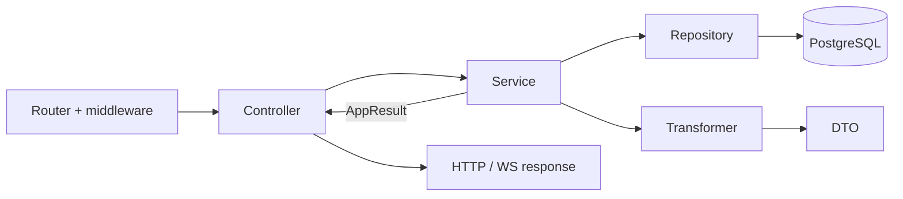

# Контролери

Контролер — це **вхідний адаптер** бекенду: він стоїть між транспортом (HTTP через uWebSockets.js або WebSocket-подія) і бізнес-логікою. Маршрутизатор і middleware вже розібрали запит, перевірили сесію, CSRF і провалідували payload схемою з `shared`; контролер отримує готовий `HttpContext` / `WsContext` і має лише «перекласти» запит мовою сервісу, а результат сервісу — мовою протоколу.

## Навіщо потрібен цей шар

- **Ізоляція транспорту.** Лише контролер знає про `context.responseData`, статус-коди, cookies, заголовки, сесію і WS-сокет. Сервіси про HTTP нічого не знають, тому одну й ту саму логіку можна викликати з HTTP-маршруту, WS-події, скрипта чи тесту.
- **Єдина точка входу для маршруту.** Кожен рядок у [http-routes.ts](https://github.com/Blazheiko/vibe-template/blob/main/packages/backend/src/app/routes/http-routes.ts) / [ws-routes.ts](https://github.com/Blazheiko/vibe-template/blob/main/packages/backend/src/app/routes/ws-routes.ts) вказує на конкретний метод контролера — за маршрутом легко знайти код, що його обслуговує.
- **Передбачуваний формат відповіді.** Контролер збирає відповідь `{ status: 'success', ... }` за типом із `shared/responses`, а помилки сервісу перетворює на канонічне тіло й правильний статус однією функцією `mapControllerError`. Клієнт завжди бачить однакову форму помилок.
- **Тонкість як правило.** Контролер не містить бізнес-правил, не звертається до БД і зовнішніх API. Завдяки цьому його майже не треба тестувати окремо, а вся логіка, що варта тестів, зосереджена в сервісах. Межу перевіряє [`layering.spec.ts`](https://github.com/Blazheiko/vibe-template/blob/main/packages/backend/src/app/layering.spec.ts).

Типова робота методу контролера — п'ять кроків: дістати `userId` і payload з контексту → викликати один метод сервісу → на помилці повернути `mapControllerError` → на успіху зібрати відповідь → за потреби виставити статус, cookie чи заголовок.



## Структура

Контролери лежать у [`src/app/controllers`](https://github.com/Blazheiko/vibe-template/tree/main/packages/backend/src/app/controllers):

- `http/` — обробники HTTP-маршрутів, згруповані за доменом;
- `ws/` — обробники WebSocket-подій ([admin-ws-controller.ts](https://github.com/Blazheiko/vibe-template/blob/main/packages/backend/src/app/controllers/ws/admin-ws-controller.ts), [support-controller.ts](https://github.com/Blazheiko/vibe-template/blob/main/packages/backend/src/app/controllers/ws/support-controller.ts));
- `shared/` — `mapControllerError` ([controller-error.ts](https://github.com/Blazheiko/vibe-template/blob/main/packages/backend/src/app/controllers/shared/controller-error.ts)).

Окремої теки `static/` у контролерах немає: роздача статики живе у vendor-шарі.

Контролер — це об'єкт за замовчуванням (`export default { ... }`) з async-методами. У маршрутах метод передається як `handler: AuthController.login.bind(AuthController)` ([http-routes.ts](https://github.com/Blazheiko/vibe-template/blob/main/packages/backend/src/app/routes/http-routes.ts), [ws-routes.ts](https://github.com/Blazheiko/vibe-template/blob/main/packages/backend/src/app/routes/ws-routes.ts)).

## Контекст обробника

Коротка шпаргалка нижче; кожне поле розібрано в розділах [HttpContext докладно](#httpcontext-докладно) і [WsContext докладно](#wscontext-докладно).

Типи визначені у [vendor/types/types.d.ts](https://github.com/Blazheiko/vibe-template/blob/main/packages/backend/src/vendor/types/types.d.ts):

```ts
export interface HttpContext<TPayload = unknown, TQuery = null> {
    requestId: string
    logger: Logger
    httpData: HttpData<TPayload, TQuery>
    responseData: ResponseData
    session: Session
    auth: Auth
}
export interface WsContext<TPayload = unknown> {
    requestId: string
    ws: MyWebSocket
    wsData: WsData<TPayload>
    responseData: WsResponseData
    userData: UserConnection | null
    session: null
    auth: null
    logger: Logger
}
```

| Що потрібно         | HTTP                                                               | WS                                    |
| ------------------- | ------------------------------------------------------------------ | ------------------------------------- |
| Провалідоване тіло  | `getTypedPayload(context)`                                         | `getTypedPayload(context)`            |
| Параметри шляху     | `context.httpData.params['id']` (рядки)                            | —                                     |
| Query               | `context.httpData.query` (типізований, якщо є `queryValidator`)    | —                                     |
| Поточний користувач | `context.auth.getUserId()` (`string \| null`)                      | `context.userData?.userId`            |
| Сесія               | `context.session.sessionInfo`, `updateSessionData(...)`            | `session: null`                       |
| Статус / заголовки  | `context.responseData.status = 201`, `responseData.setHeader(...)` | `context.responseData.status` (рядок) |

[`getTypedPayload`](https://github.com/Blazheiko/vibe-template/blob/main/packages/backend/src/vendor/utils/validation/get-typed-payload.ts) працює з обома контекстами й повертає payload, який уже пройшов валідатор маршруту (див. [Валідація](/backend/validation)). Параметри шляху беруться напряму, наприклад у [oauth-controller.ts](https://github.com/Blazheiko/vibe-template/blob/main/packages/backend/src/app/controllers/http/auth/oauth-controller.ts): `context.httpData.params["provider"] ?? ""`.

## HttpContext докладно

Контекст створюється для кожного запиту в [http-context.ts](https://github.com/Blazheiko/vibe-template/blob/main/packages/backend/src/vendor/utils/context/http-context.ts). Спочатку `session` і `auth` — заглушки (`getUserId()` → `null`, `login()` → `false`); реальні реалізації підставляє session-middleware з [session-handler.ts](https://github.com/Blazheiko/vibe-template/blob/main/packages/backend/src/vendor/utils/session/session-handler.ts). Тому на маршруті без session-middleware `auth.getUserId()` завжди повертає `null`.

Крім полів нижче, є `requestId` (UUID запиту) і `signal` — `AbortSignal`, який спрацьовує, коли клієнт розірвав з'єднання до відповіді. Його варто передавати в довгі операції (`fetch`, LLM-виклики).

### `logger: Logger`

Дочірній [pino](https://getpino.io/)-логер, у який уже додано `requestId`, тож усі записи одного запиту легко зв'язати. Першим аргументом передавайте об'єкт контексту, другим — повідомлення; помилку кладіть у поле `err`, щоб pino її серіалізував:

```ts
context.logger.info({ userId }, 'Avatar uploaded')
context.logger.error({ err: result.error }, 'Failed to load history')
```

Не логуйте паролі, токени та повні тіла запитів.

### `httpData: HttpData<TPayload, TQuery>`

Усе, що прийшло від клієнта. Об'єкт тільки для читання.

| Поле          | Тип                                 | Опис                                                                                                                                                           |
| ------------- | ----------------------------------- | -------------------------------------------------------------------------------------------------------------------------------------------------------------- |
| `method`      | `Method`                            | HTTP-метод маршруту (`'get'`, `'post'`, …).                                                                                                                    |
| `ip`          | `string \| null \| undefined`       | IP клієнта (з урахуванням довірених проксі).                                                                                                                   |
| `params`      | `Record<string, string>`            | Параметри шляху (`:id` → `params['id']`). Завжди рядки — числа й `bigint` перетворюйте самі.                                                                   |
| `payload`     | `TPayload \| null`                  | Тіло запиту після валідатора маршруту. Читайте через `getTypedPayload(context)`, а не напряму.                                                                 |
| `query`       | `TQuery`                            | Провалідований об'єкт query, **не** `URLSearchParams`. Без `queryValidator` — `null` (звертання до полів — помилка TS). Див. [Валідація](/backend/validation). |
| `headers`     | `Map<string, string>`               | Заголовки запиту, імена в нижньому регістрі: `headers.get('user-agent')`.                                                                                      |
| `contentType` | `string \| undefined`               | `Content-Type` запиту.                                                                                                                                         |
| `cookies`     | `Map<string, string>`               | Cookies запиту: `cookies.get('name')`.                                                                                                                         |
| `isJson`      | `boolean`                           | Чи тіло прийшло як JSON.                                                                                                                                       |
| `files`       | `Map<string, UploadedFile> \| null` | Файли з `multipart/form-data`: `{ name, filename, type, data: ArrayBuffer }`. `null`, якщо файлів немає.                                                       |
| `hasFile`     | `(name: string) => boolean`         | Чи є файл з таким іменем поля.                                                                                                                                 |

```ts
async getItem(context: HttpContext<unknown, ListQuery>) {
    const id = context.httpData.params['id'] ?? ''
    const { page, limit } = context.httpData.query
    const lang = context.httpData.headers.get('accept-language')
    if (!context.httpData.hasFile('avatar')) { /* ... */ }
    const file = context.httpData.files?.get('avatar')
}
```

### `responseData: ResponseData`

Те, що піде клієнтові, крім тіла (тілом стає значення, яке повертає метод).

| Поле / метод                       | Опис                                                                                                                                                                                                                                  |
| ---------------------------------- | ------------------------------------------------------------------------------------------------------------------------------------------------------------------------------------------------------------------------------------- |
| `status: number`                   | HTTP-статус, за замовчуванням `200`. `200` з порожнім тілом (`null`) стає `204`; `3xx`, `204`, `205` відправляються без тіла.                                                                                                         |
| `setHeader(name, value)`           | Додає заголовок відповіді (наприклад `Location` для `302`, `Cache-Control`).                                                                                                                                                          |
| `setCookie(name, value, options?)` | Ставить cookie. Не вказані опції беруться з `cookiesConfig.default` ([config/cookies.ts](https://github.com/Blazheiko/vibe-template/blob/main/packages/backend/src/config/cookies.ts)). Є перевантаження `setCookie(cookie: Cookie)`. |
| `deleteCookie(name, options?)`     | Відправляє `Set-Cookie` з `Max-Age=0`. `path` має збігатися з `Path` оригінальної cookie, інакше браузер її не видалить.                                                                                                              |
| `headers`, `cookies`               | Накопичені заголовки / cookies. Змінюйте через методи вище.                                                                                                                                                                           |
| `payload`                          | Сюди фреймворк сам кладе результат обробника — у контролері не чіпайте.                                                                                                                                                               |
| `middlewareData`                   | Довільні дані, які middleware передають далі по ланцюжку.                                                                                                                                                                             |
| `aborted`                          | Службовий прапорець; для скасування використовуйте `context.signal`.                                                                                                                                                                  |

```ts
context.responseData.status = 302
context.responseData.setHeader('Location', redirectUrl)
context.responseData.setCookie('oauth_state', state, { maxAge: 600, httpOnly: true })
context.responseData.deleteCookie('oauth_state', { path: '/' })
return null
```

### `session: Session`

Серверна сесія в Redis ([redis-session-storage.ts](https://github.com/Blazheiko/vibe-template/blob/main/packages/backend/src/vendor/utils/session/redis-session-storage.ts)). Сесія існує завжди, навіть для анонімного користувача; cookie з її id ставить middleware.

| Поле / метод                 | Опис                                                                                                                                       |
| ---------------------------- | ------------------------------------------------------------------------------------------------------------------------------------------ |
| `sessionInfo`                | `{ id, data, createdAt, updatedAt? }` або `null`. `data: SessionData` містить `userId`, `userToken`, `wsToken`, `csrfToken` та ваші ключі. |
| `updateSessionData(data)`    | **Зливає** `data` з поточними даними сесії (`{ ...old, ...data }`) і повертає оновлений `SessionInfo` (або `null`, якщо сесії вже немає).  |
| `changeSessionData(data)`    | **Замінює** дані сесії повністю. Обережно: можна стерти `userId`/`csrfToken`; майже завжди потрібен `updateSessionData`.                   |
| `destroySession()`           | Видаляє поточну сесію з Redis. Для виходу користувача використовуйте `auth.logout()` — він ще й видає нову анонімну сесію.                 |
| `destroyAllSessions(userId)` | Видаляє всі сесії користувача. Для виходу з усіх пристроїв використовуйте `auth.logoutAll()`.                                              |

```ts
const wsToken = context.session.sessionInfo?.data.wsToken
await context.session.updateSessionData({ locale: 'uk' })
```

`sessionInfo` — знімок на момент початку запиту: після `updateSessionData` беріть дані з результату, який він повертає.

### `auth: Auth`

Автентифікація поверх сесії.

| Метод                      | Опис                                                                                                                                                      |
| -------------------------- | --------------------------------------------------------------------------------------------------------------------------------------------------------- |
| `getUserId()`              | `userId` поточного користувача як **рядок** або `null`. Для репозиторіїв перетворюйте: `BigInt(userId)`.                                                  |
| `check()`                  | `true`, якщо користувач залогінений.                                                                                                                      |
| `login(userId, userToken)` | Знищує стару сесію, створює нову з `userId`/`userToken` і ставить нову cookie (захист від session fixation). Повертає `false`, якщо аргумент `undefined`. |
| `logout()`                 | Видаляє поточну сесію і видає нову анонімну. Повертає `true`.                                                                                             |
| `logoutAll()`              | Видаляє всі сесії користувача (поточну — останньою), видає нову анонімну; повертає кількість видалених.                                                   |

```ts
const userId = context.auth.getUserId()
if (userId === null) return mapControllerError(context, unauthorized())

const result = await authService.login(payload)
if (Result.isError(result)) return mapControllerError(context, result.error)
await context.auth.login(result.value.userId, result.value.userToken)
```

Перевірку «чи залогінений» на рівні маршруту зазвичай робить auth-middleware (див. [Маршрутизація](/backend/routing) і [Middleware](/backend/middlewares)); у контролері `getUserId()` потрібен, щоб передати id у сервіс.

## WsContext докладно

Контекст створюється для кожного WS-повідомлення в [ws-context.ts](https://github.com/Blazheiko/vibe-template/blob/main/packages/backend/src/vendor/utils/context/ws-context.ts) диспетчером [ws-api-dispatcher.ts](https://github.com/Blazheiko/vibe-template/blob/main/packages/backend/src/vendor/utils/routing/ws-api-dispatcher.ts). Сесія й автентифікація вже перевірені при підключенні (upgrade), тому `session` і `auth` тут завжди `null` — користувач береться з `userData`. Є також `requestId`, `logger` (з `requestId` і `userId`) і `signal`, який спрацьовує при закритті з'єднання.

### `ws: MyWebSocket`

Сокет uWebSockets.js поточного з'єднання (`WebSocket<UserConnection>` + `id`). Потрібен, коли треба діяти з самим з'єднанням, а не просто відповісти:

- `ws.subscribe(topic)` / `ws.unsubscribe(topic)` — підписка на pub/sub-канал (так робить [admin-ws-channel-service.ts](https://github.com/Blazheiko/vibe-template/blob/main/packages/backend/src/app/services/admin/admin-ws-channel-service.ts));
- `ws.getUserData()` — той самий об'єкт, що й `context.userData`.

Відповідь на поточне повідомлення **не** відправляйте через `ws.send` — просто поверніть значення з методу. Розсилки іншим клієнтам робіть через сервіси `communication/` (broadcast).

### `wsData: WsData<TPayload>`

| Поле             | Опис                                                                                                    |
| ---------------- | ------------------------------------------------------------------------------------------------------- |
| `payload`        | Провалідований і заморожений (`Object.freeze`) payload події. Читайте через `getTypedPayload(context)`. |
| `ws`             | Те саме, що `context.ws`.                                                                               |
| `middlewareData` | Дані, які передають WS-middleware.                                                                      |
| `status`         | Службове поле (`'200'`); статус відповіді задається через `responseData.status`.                        |

### `responseData: WsResponseData`

Конверт відповіді, який диспетчер відправляє клієнту: `{ event, timestamp, status, data, error }`.

| Поле                 | Опис                                                                                                                            |
| -------------------- | ------------------------------------------------------------------------------------------------------------------------------- |
| `event`, `timestamp` | Копіюються з вхідного повідомлення, щоб клієнт зіставив відповідь із запитом. Не змінюйте.                                      |
| `status: string`     | За замовчуванням `'200'`. Виставляйте рядок, наприклад `'403'`, коли повертаєте помилку.                                        |
| `data`               | Сюди диспетчер кладе значення, яке повернув метод.                                                                              |
| `error`              | Заповнює диспетчер для системних помилок (`not_found`, `validation_failed`, `internal_error`, rate limit) зі `status: 'error'`. |

Помилку сервісу повертайте як дані через `appErrorToWsError`:

```ts
subscribeOnlineUsers(context: WsContext): AdminOnlineUsersWsResponse {
    const result = adminWsChannelService.subscribeCurrentAdminConnection(context.ws)
    if (Result.isError(result)) {
        context.responseData.status = '403'
        return appErrorToWsError(result.error)
    }
    return { status: 'success' }
}
```

Необроблений виняток з контролера диспетчер перехопить і відповість `internal_error`, але для очікуваних помилок `throw` не використовуйте.

### `userData: UserConnection | null`

Дані з'єднання, зібрані під час upgrade ([types.d.ts](https://github.com/Blazheiko/vibe-template/blob/main/packages/backend/src/vendor/types/types.d.ts)):

| Поле                       | Опис                                                                   |
| -------------------------- | ---------------------------------------------------------------------- |
| `userId`                   | `string \| undefined` — id користувача; для сервісів `BigInt(userId)`. |
| `sessionId`, `userToken`   | Сесія, з якою відкрито з'єднання.                                      |
| `uuid`                     | Унікальний id з'єднання (один користувач може мати кілька вкладок).    |
| `role`                     | `'user' \| 'admin'`.                                                   |
| `appType`                  | `'web' \| 'pwa'`.                                                      |
| `ip`, `ip2`, `userAgent`   | Дані клієнта.                                                          |
| `isAdminChannelSubscribed` | Чи підписане з'єднання на адмін-канал.                                 |
| `timeStart`                | Час підключення (ms).                                                  |

Тип допускає `null` і `userId: undefined`, тому перевіряйте перед використанням:

```ts
const userData = context.userData
if (userData?.userId === undefined) {
    context.responseData.status = '401'
    return appErrorToWsError(unauthorized())
}
const payload = getTypedPayload(context)
void supportService.chat(BigInt(userData.userId), payload.message, userData.uuid, context.signal)
```

## Повернення даних і статус

Значення, яке повертає метод, стає тілом відповіді; статус за замовчуванням — успішний, інший задається через `context.responseData.status` (наприклад `201` у [admin-knowledge-base-controller.ts](https://github.com/Blazheiko/vibe-template/blob/main/packages/backend/src/app/controllers/http/admin/admin-knowledge-base-controller.ts), `302` для редиректів в OAuth). Типи відповідей беруться з `shared` (`shared/responses`).

## Мапінг помилок

Помилки сервісу (`AppError`) перетворюються на канонічну відповідь однією функцією:

```ts
export function mapControllerError(
    context: Pick<HttpContext<unknown, unknown>, 'responseData'>,
    error: AppError,
): ReturnType<typeof appErrorToHttpPayload> {
    applyAppErrorStatus(context.responseData, error)
    return appErrorToHttpPayload(error)
}
```

[`applyAppErrorStatus`](https://github.com/Blazheiko/vibe-template/blob/main/packages/backend/src/app/services/shared/apply-service-status.ts) виставляє HTTP-статус за `_tag` (`BadRequest`→400, `Unauthorized`→401, `Forbidden`→403, `NotFound`→404, `Conflict`→409, `RateLimited`→429 + `Retry-After`, `Internal`→500 — таблиця в [errors.ts](https://github.com/Blazheiko/vibe-template/blob/main/packages/backend/src/app/services/shared/errors.ts)), а тіло має форму `{ status: 'error', message, code, reason? }`. Для WS є аналог [`appErrorToWsError`](https://github.com/Blazheiko/vibe-template/blob/main/packages/backend/src/app/services/shared/ws-error.ts).

Типовий метод контролера наведено в [Кроці 7](/backend/adding-a-feature#крок-7-controller).

## Групи HTTP-контролерів

| Тека             | Відповідальність                                     | Приклад маршруту                                 |
| ---------------- | ---------------------------------------------------- | ------------------------------------------------ |
| `core/`          | `ping`, ініціалізація клієнта, WS-токен              | `main/init`                                      |
| `auth/`          | Реєстрація, логін, скидання пароля, OAuth            | `auth/login`, `auth/oauth/:provider/redirect`    |
| `notifications/` | Push-підписки й тестовий push                        | `push-subscriptions/:subscriptionId`             |
| `user/`          | Аватар користувача                                   | префікс `avatar`                                 |
| `support/`       | Історія чату підтримки, скріншоти статей             | `support/chat/history`                           |
| `admin/`         | База знань, онлайн-користувачі, історія, користувачі | `admin/knowledge-base/:id`, `admin/users-online` |
| `ai/`            | Промпти та статистика використання LLM               | `prompts/:type`, `admin/usage/stats`             |

Префікси груп — у [http-routes.ts](https://github.com/Blazheiko/vibe-template/blob/main/packages/backend/src/app/routes/http-routes.ts); деталі — у [Маршрутизації](/backend/routing).

Контролери не звертаються до репозиторіїв і зовнішніх API напряму: це перевіряє [`layering.spec.ts`](https://github.com/Blazheiko/vibe-template/blob/main/packages/backend/src/app/layering.spec.ts).

## Чек-лист контролера

**Контролер:**

- [ ] дістати `userId` (`context.auth` / `context.userData`), payload (`getTypedPayload`), `params`, `query`;
- [ ] викликати один метод сервісу;
- [ ] на `Result.isError` — `mapControllerError` (HTTP) або `appErrorToWsError` (WS);
- [ ] зібрати відповідь `{ status: 'success', ... }` за типом із `shared`;
- [ ] за потреби — статус (`201`, `302`), cookies, заголовки, сесія.

**Ніколи в контролері:** прямі імпорти репозиторіїв, `fetch` до зовнішніх API, `throw` для очікуваних помилок.

## Суміжні шари

- [Контролери](/backend/controllers) — HTTP/WS-адаптери: приймають запит і віддають відповідь.
- [Сервіси](/backend/services) — бізнес-логіка, повертають `AppResult<T>`.
- [Репозиторії](/backend/repositories) — єдине місце, де пишеться SQL.
- [Трансформери](/backend/transformers) — перетворення рядків БД на публічні DTO.

Загальна схема — [Архітектура](/backend/architecture), покроковий приклад — [Додавання фічі](/backend/adding-a-feature).
