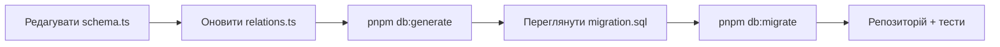

# База даних

Бекенд працює з PostgreSQL через Drizzle ORM. Пакети `drizzle-orm` і `drizzle-kit` закріплені на релізі-кандидаті `1.0.0-rc.4` у [`packages/backend/package.json`](https://github.com/Blazheiko/itvibe-template/blob/main/packages/backend/package.json); оновлювати їх слід разом і на ту саму точну версію. Драйвер — `pg` (`node-postgres`). Redis використовується окремо — як сховище сесій та для тротлінгу.

## Підключення

Параметри беруться з env-змінних `PGSQL_*` (див. [`.env.example`](https://github.com/Blazheiko/itvibe-template/blob/main/packages/backend/.env.example) та [Конфігурацію](/backend/configuration)):

| Змінна           | Приклад у `.env.example` |
| ---------------- | ------------------------ |
| `PGSQL_HOST`     | `127.0.0.1`              |
| `PGSQL_PORT`     | `5432`                   |
| `PGSQL_USER`     | `postgres`               |
| `PGSQL_PASSWORD` | `postgres`               |
| `PGSQL_DB_NAME`  | `itvibe_template`        |

Runtime-конфіг — [`src/config/database.ts`](https://github.com/Blazheiko/itvibe-template/blob/main/packages/backend/src/config/database.ts); пул і клієнт Drizzle створюються в [`src/database/db.ts`](https://github.com/Blazheiko/itvibe-template/blob/main/packages/backend/src/database/db.ts):

```ts
const pool = new pg.Pool({
    /* host, port, ... */ max: 10,
    idleTimeoutMillis: 30000,
    connectionTimeoutMillis: 2000,
    ssl: false,
})

const db = drizzle({
    client: pool,
    relations,
    logger: appConfig.env === 'prod' || appConfig.env === 'production' ? false : true,
})
```

SQL-логування вмикається для всіх середовищ, крім `prod`/`production`.

Для `drizzle-kit` є окремий [`drizzle.config.ts`](https://github.com/Blazheiko/itvibe-template/blob/main/packages/backend/drizzle.config.ts): він бере підключення з тієї ж `resolveDatabaseConfig()`, що й застосунок, `schema: "./src/database/schema.ts"`, `out: "./src/drizzle/migrations"`, таблиця журналу `drizzle.__drizzle_migrations`, `strict: true`.

## Схема та relations

Таблиці описано в одному файлі [`src/database/schema.ts`](https://github.com/Blazheiko/itvibe-template/blob/main/packages/backend/src/database/schema.ts) (`pgTable`, `pgEnum`, індекси, `customType`), наприклад `export const users = pgTable('users', { ... })`. Каталог `src/drizzle/` містить лише міграції; схема і relations живуть у `src/database`.

Зв'язки задаються через Relational Queries v2 у [`src/database/relations.ts`](https://github.com/Blazheiko/itvibe-template/blob/main/packages/backend/src/database/relations.ts):

```ts
export const relations = defineRelations(schema, (r) => ({
    users: {
        oauthAccounts: r.many.oauthAccounts({ from: r.users.id, to: r.oauthAccounts.userId }),
        // ...
    },
}))
```

Об'єкт `relations` передається в `drizzle({ relations })`, тож `db.query.<table>.findMany/findFirst` з `with` доступні. Однак наразі репозиторії їх не використовують — запити пишуться core query builder-ом, як у [`user-repository.ts`](https://github.com/Blazheiko/itvibe-template/blob/main/packages/backend/src/app/repositories/user/user-repository.ts):

```ts
async findById(id) {
  return await db
    .select()
    .from(users)
    .where(eq(users.id, id))
    .limit(1)
    .then((rows) => rows.at(0));
},
```

Типи рядків виводяться через `InferSelectModel<typeof users>` / `InferInsertModel<typeof users>`. Транзакцій (`db.transaction`) у коді застосунку зараз немає.

## pgvector

PostgreSQL має містити розширення [pgvector](https://github.com/pgvector/pgvector) (`vector`). Ця вимога **обов'язкова навіть тоді, коли AI не налаштовано**: тип `vector` використовує сама схема, тому без розширення не пройде ні `db:create`, ні початкова міграція.

### Навіщо потрібне розширення

Support AI відповідає на питання користувачів на основі бази знань (RAG: спершу знайти релевантні статті, потім передати їх у LLM як контекст). Шукати статті за ключовими словами погано: користувач формулює питання іншими словами, ніж автор статті. Тому пошук іде за змістом через embeddings, і для цього потрібна векторна арифметика в БД:

1. **Зберігання.** Кожна стаття в `support_knowledge_base` має колонку `embedding vector(1536)` ([`schema.ts`](https://github.com/Blazheiko/itvibe-template/blob/main/packages/backend/src/database/schema.ts), `customType` `vector1536`). У ній лежить вектор, який OpenAI embeddings (`text-embedding-3-small`, 1536 вимірів) повертає для тексту `title + content`.
2. **Пошук.** Питання користувача перекладається англійською, перетворюється на вектор тим самим способом, і БД шукає найближчі статті за косинусною відстанню, оператором `<=>` з pgvector ([`searchByEmbedding`](https://github.com/Blazheiko/itvibe-template/blob/main/packages/backend/src/app/repositories/support/support-knowledge-repository.ts)):

    ```sql
    SELECT id, title, content, embedding <=> $1::vector AS distance
    FROM support_knowledge_base
    WHERE is_active = true AND embedding IS NOT NULL
    ORDER BY distance ASC
    LIMIT 5;
    ```

3. **Відповідь.** Знайдені статті підставляються в system prompt замість `{context}`, і LLM відповідає лише на їх основі.

Без pgvector довелося б тримати вектори в окремій векторній БД (ще один сервіс, синхронізація з PostgreSQL) або завантажувати всі вектори в застосунок і рахувати відстань у JavaScript. pgvector дає пошук в одному SQL-запиті поруч з рештою даних статті, з транзакціями й бекапами PostgreSQL. Повний сценарій описано на сторінці [AI](/backend/ai#support-ai-і-база-знань).

### Де це видно в коді

| Місце                                                                                                                                                                     | Що робить                                                                  |
| ------------------------------------------------------------------------------------------------------------------------------------------------------------------------- | -------------------------------------------------------------------------- |
| [`create-database.ts`](https://github.com/Blazheiko/itvibe-template/blob/main/packages/backend/src/db/create-database.ts)                                                 | `CREATE EXTENSION IF NOT EXISTS vector` у цільовій БД                      |
| [`20261017193054_init/migration.sql`](https://github.com/Blazheiko/itvibe-template/blob/main/packages/backend/src/drizzle/migrations/20261017193054_init/migration.sql)   | колонка `"embedding" vector(1536)`; саме розширення міграція не створює    |
| [`support-knowledge-repository.ts`](https://github.com/Blazheiko/itvibe-template/blob/main/packages/backend/src/app/repositories/support/support-knowledge-repository.ts) | `setEmbedding` (`::vector`), `clearEmbedding`, `searchByEmbedding` (`<=>`) |

### Що буде без розширення

- `db:create` падає на `CREATE EXTENSION IF NOT EXISTS vector` з помилкою на кшталт `extension "vector" is not available`.
- Якщо БД створено інакше, `db:migrate` падає на початковій міграції: `type "vector" does not exist`.

### Як отримати PostgreSQL з pgvector

- **Docker (локально):** образ `pgvector/pgvector`, наприклад `pgvector/pgvector:pg16` (команда є в розділі [Початок роботи](/guide/getting-started#postgresql-і-redis-через-docker)). Звичайний образ `postgres` розширення не містить.
- **Встановлений PostgreSQL:** пакет pgvector для своєї версії PostgreSQL, наприклад `brew install pgvector` (Homebrew) або `postgresql-16-pgvector` (apt, репозиторій PGDG). Інші способи описано в [README pgvector](https://github.com/pgvector/pgvector#installation).
- **Керовані сервіси:** більшість хмарних PostgreSQL підтримують pgvector, але розширення треба дозволити або увімкнути за документацією провайдера.

`CREATE EXTENSION` може вимагати прав власника БД або суперкористувача. Якщо користувач з `PGSQL_USER` таких прав не має, адміністратор БД виконує команду один раз вручну, а `db:create` далі лише підтвердить наявність розширення (`IF NOT EXISTS`).

Перевірити, що розширення є:

```sql
SELECT extversion FROM pg_extension WHERE extname = 'vector';
```

### Обмеження поточної реалізації

- Розмірність `1536` зашита в схемі, хоча `OPENAI_EMBEDDING_DIMENSIONS` налаштовується. Інша модель або розмірність потребує міграції колонки й переіндексації статей (проблема 54).
- Векторного індексу (HNSW / IVFFlat) немає, тому пошук перебирає всі активні статті. Для бази знань підтримки на сотні статей цього достатньо; для більших обсягів варто додати індекс `USING hnsw (embedding vector_cosine_ops)` міграцією.

## Міграції

Міграції лежать у [`src/drizzle/migrations`](https://github.com/Blazheiko/itvibe-template/blob/main/packages/backend/src/drizzle/migrations) у форматі Drizzle 1.0 «тека на міграцію»: кожна тека `<timestamp>_<name>` містить `migration.sql` і `snapshot.json`:

| Міграція                                                                                                                                                                              | Що робить                                                                                                                                                                                                                                                                                                                                |
| ------------------------------------------------------------------------------------------------------------------------------------------------------------------------------------- | ---------------------------------------------------------------------------------------------------------------------------------------------------------------------------------------------------------------------------------------------------------------------------------------------------------------------------------------- |
| `20261017193054_init`                                                                                                                                                                 | початкова схема                                                                                                                                                                                                                                                                                                                          |
| [`20261024152453_llm_usage_nullable`](https://github.com/Blazheiko/itvibe-template/blob/main/packages/backend/src/drizzle/migrations/20261024152453_llm_usage_nullable/migration.sql) | `llm_text_usage`: `prompt_tokens`, `completion_tokens`, `total_tokens` і `user_id` стають nullable (`NULL` = провайдер не повідомив usage / системний виклик без користувача), дефолти `0` прибрано; `llm_text_feature` отримує `SUPPORT_EMBEDDING`. Наявні рядки не змінюються. `ALTER TYPE … ADD VALUE` не відкочується простим `DROP` |

## Скрипти

Запускаються в пакеті backend (`pnpm --filter ./packages/backend <script>`):

| Скрипт           | Команда                           | Що робить                                                                                                                                                                                                                            |
| ---------------- | --------------------------------- | ------------------------------------------------------------------------------------------------------------------------------------------------------------------------------------------------------------------------------------ |
| `db:create`      | `tsx src/db/create-database.ts`   | підключається до БД `postgres`, створює `PGSQL_DB_NAME`, якщо її немає, і виконує `CREATE EXTENSION IF NOT EXISTS vector` ([код](https://github.com/Blazheiko/itvibe-template/blob/main/packages/backend/src/db/create-database.ts)) |
| `db:create:prod` | `node dist/db/create-database.js` | те саме зі зібраного коду                                                                                                                                                                                                            |
| `db:generate`    | `drizzle-kit generate`            | генерує нову теку міграції з різниці між схемою та snapshot                                                                                                                                                                          |
| `db:migrate`     | `drizzle-kit migrate`             | застосовує невиконані міграції                                                                                                                                                                                                       |
| `db:studio`      | `drizzle-kit studio`              | веб-інтерфейс Drizzle Studio                                                                                                                                                                                                         |
| `db:seed`        | `tsx src/db/seed.ts`              | ідемпотентно вставляє початкові промпти, з `--demo` — ще й demo-акаунти, див. [Seed](#seed) ([код](https://github.com/Blazheiko/itvibe-template/blob/main/packages/backend/src/db/seed.ts))                                          |
| `db:seed:prod`   | `node dist/db/seed.js`            | те саме зі зібраного коду                                                                                                                                                                                                            |

## Seed

`db:seed` можна запускати повторно: наявні рядки він пропускає й нічого не перезаписує. Усе виконується в одній транзакції, тож при помилці в БД не залишається нічого, а команда завершується з кодом 1. Логіка — у [`src/db/seed/run-seed.ts`](https://github.com/Blazheiko/itvibe-template/blob/main/packages/backend/src/db/seed/run-seed.ts).

| Що                                                                                                  | Коли            | Повторний запуск                                                                        |
| --------------------------------------------------------------------------------------------------- | --------------- | --------------------------------------------------------------------------------------- |
| Промпти `SUPPORT_SYSTEM`, `SUPPORT_FIRST_CHAT`, `SUPPORT_QUERY_TRANSLATION` у `llm_system_prompts`  | завжди          | `ON CONFLICT (type) DO NOTHING`: промпти, відредаговані в адмінці, лишаються як є       |
| Адмін (`SEED_ADMIN_EMAIL` / `SEED_ADMIN_PASSWORD`) і, опційно, звичайний користувач (`SEED_USER_*`) | лише з `--demo` | наявний користувач (пошук за `LOWER(email)`) пропускається; пароль і роль не змінюються |

- Тексти промптів беруться з тих самих defaults, що й runtime-fallback сервісів ([`config/support.ts`](https://github.com/Blazheiko/itvibe-template/blob/main/packages/backend/src/config/support.ts)), тому перший seed не змінює поведінку AI. Без рядків у таблиці AI працює на цих fallback, але адмінка не може змінити промпт: `UPDATE` не створює відсутній рядок.
- Від `APP_ENV` seed не залежить: без `--demo` акаунти не створюються в жодному середовищі. З `--demo` у production-like середовищі виводиться попередження.
- Email нормалізується (`trim().toLowerCase()`), пароль хешується `hashPassword` з `metautil`, `email_verified_at` = поточний час.
- Якщо `SEED_ADMIN_EMAIL` уже належить користувачу з `role = 'user'`, seed завершується успішно з попередженням `exists_without_admin_role`: роль автоматично не підвищується.
- Ідемпотентність гарантована для послідовних запусків. Наявність користувача перевіряється `SELECT` перед `INSERT`, тому з двох одночасних запусків `--demo` один може впасти на unique-індексі email. Транзакція тоді відкочується, і повторний запуск завершується успішно.
- Помилка виводиться без SQL-параметрів, `detail` і тексту pg-помилки, бо там можуть бути email, хеш пароля й `session_token`. Виводяться лише назва помилки та поля `code`, `constraint`, `table`, `column`; текст лишається тільки для системних помилок на кшталт `ECONNREFUSED` ([`describe-error.ts`](https://github.com/Blazheiko/itvibe-template/blob/main/packages/backend/src/db/seed/describe-error.ts)).
- Звіт виводить для кожного запису `inserted` або `skipped (<причина>)`: `already_exists`, `exists_without_admin_role`, `missing_credentials`, `demo_disabled`.

::: warning Кеш промптів
Backend читає промпти один раз на старті (`promptService.load()` у [`src/index.ts`](https://github.com/Blazheiko/itvibe-template/blob/main/packages/backend/src/index.ts)). Запускайте `db:seed` до старту backend або перезапустіть його після seed.
:::

### Перший адмін у production

Demo-сценарій для production не призначений. Варіанти:

1. Зареєструватися звичайним способом і підвищити роль вручну:

    ```sql
    UPDATE users SET role = 'admin' WHERE LOWER(email) = '<admin-email>';
    ```

2. Разово виконати `pnpm db:seed:prod --demo` з тимчасово заданими `SEED_ADMIN_EMAIL` і `SEED_ADMIN_PASSWORD`, а потім одразу прибрати їх з оточення.

## Як змінити схему



1. Змініть таблиці в `src/database/schema.ts`; для нових зв'язків — `relations.ts`.
2. `db:generate` створить нову теку в `src/drizzle/migrations`; перевірте SQL вручну.
3. `db:migrate` застосує її до локальної БД.
4. Додайте методи у відповідний репозиторій (див. [Архітектуру](/backend/architecture) і [Додавання фічі](/backend/adding-a-feature)).

## Redis

Клієнт `ioredis` створюється в [`src/database/redis.ts`](https://github.com/Blazheiko/itvibe-template/blob/main/packages/backend/src/database/redis.ts) з конфігу `#config/redis.js` (`REDIS_HOST`, `REDIS_PORT`, `REDIS_PASSWORD`, `REDIS_PREFIX`). Його використовують сховище сесій ([`redis-session-storage.ts`](https://github.com/Blazheiko/itvibe-template/blob/main/packages/backend/src/vendor/utils/session/redis-session-storage.ts)), WS-автентифікація, скидання пароля та тротлінг автентифікації. Докладніше — [Автентифікація та безпека](/backend/auth-security).

Клієнт відмовляє швидко, а не зависає: без offline queue і повторів, з таймаутом команди `REDIS_COMMAND_TIMEOUT_MS` (500 мс); коли Redis недоступний, запити отримують `503 service_unavailable`. Контракт і обмеження — [Відмова Redis](/backend/auth-security#відмова-redis).
