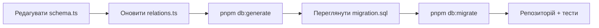

# База даних

Бекенд працює з PostgreSQL через Drizzle ORM. Пакети `drizzle-orm` і `drizzle-kit` закріплені на релізі-кандидаті `1.0.0-rc.4` у [`packages/backend/package.json`](https://github.com/Blazheiko/itvibe-template/blob/main/packages/backend/package.json); оновлювати їх слід разом і на ту саму точну версію. Драйвер — `pg` (`node-postgres`). Redis використовується окремо — як сховище сесій та для тротлінгу.

## Підключення

Параметри беруться з env-змінних `PGSQL_*` (див. [`.env.example`](https://github.com/Blazheiko/itvibe-template/blob/main/packages/backend/.env.example) та [Конфігурацію](/backend/configuration)):

| Змінна           | Приклад у `.env.example` |
| ---------------- | ------------------------ |
| `PGSQL_HOST`     | `127.0.0.1`              |
| `PGSQL_PORT`     | `5432`                   |
| `PGSQL_USER`     | `postgres`               |
| `PGSQL_PASSWORD` | `postgres`               |
| `PGSQL_DB_NAME`  | `itvibe_template`        |

Runtime-конфіг — [`src/config/database.ts`](https://github.com/Blazheiko/itvibe-template/blob/main/packages/backend/src/config/database.ts); пул і клієнт Drizzle створюються в [`src/database/db.ts`](https://github.com/Blazheiko/itvibe-template/blob/main/packages/backend/src/database/db.ts):

```ts
const pool = new pg.Pool({
    /* host, port, ... */ max: 10,
    idleTimeoutMillis: 30000,
    connectionTimeoutMillis: 2000,
    ssl: false,
})

const db = drizzle({
    client: pool,
    relations,
    logger: appConfig.env === 'prod' || appConfig.env === 'production' ? false : true,
})
```

SQL-логування вмикається для всіх середовищ, крім `prod`/`production`.

Для `drizzle-kit` є окремий [`drizzle.config.ts`](https://github.com/Blazheiko/itvibe-template/blob/main/packages/backend/drizzle.config.ts): він бере підключення з тієї ж `resolveDatabaseConfig()`, що й застосунок, `schema: "./src/database/schema.ts"`, `out: "./src/drizzle/migrations"`, таблиця журналу `drizzle.__drizzle_migrations`, `strict: true`.

## Схема та relations

Таблиці описано в одному файлі [`src/database/schema.ts`](https://github.com/Blazheiko/itvibe-template/blob/main/packages/backend/src/database/schema.ts) (`pgTable`, `pgEnum`, індекси, `customType`), наприклад `export const users = pgTable('users', { ... })`. Каталог `src/drizzle/schema/` містить лише порожній `index.ts` — справжня схема саме в `src/database`.

Зв'язки задаються через Relational Queries v2 у [`src/database/relations.ts`](https://github.com/Blazheiko/itvibe-template/blob/main/packages/backend/src/database/relations.ts):

```ts
export const relations = defineRelations(schema, (r) => ({
    users: {
        oauthAccounts: r.many.oauthAccounts({ from: r.users.id, to: r.oauthAccounts.userId }),
        // ...
    },
}))
```

Об'єкт `relations` передається в `drizzle({ relations })`, тож `db.query.<table>.findMany/findFirst` з `with` доступні. Однак наразі репозиторії їх не використовують — запити пишуться core query builder-ом, як у [`user-repository.ts`](https://github.com/Blazheiko/itvibe-template/blob/main/packages/backend/src/app/repositories/user/user-repository.ts):

```ts
async findById(id) {
  return await db
    .select()
    .from(users)
    .where(eq(users.id, id))
    .limit(1)
    .then((rows) => rows.at(0));
},
```

Типи рядків виводяться через `InferSelectModel<typeof users>` / `InferInsertModel<typeof users>`. Транзакцій (`db.transaction`) у коді застосунку зараз немає.

## Міграції

Міграції лежать у [`src/drizzle/migrations`](https://github.com/Blazheiko/itvibe-template/blob/main/packages/backend/src/drizzle/migrations) у форматі Drizzle 1.0 «тека на міграцію»: кожна тека `<timestamp>_<name>` містить `migration.sql` і `snapshot.json`. Зараз є одна — `20261017193054_init`.

## Скрипти

Запускаються в пакеті backend (`pnpm --filter ./packages/backend <script>`):

| Скрипт           | Команда                           | Що робить                                                                                                                                                                                                                            |
| ---------------- | --------------------------------- | ------------------------------------------------------------------------------------------------------------------------------------------------------------------------------------------------------------------------------------ |
| `db:create`      | `tsx src/db/create-database.ts`   | підключається до БД `postgres`, створює `PGSQL_DB_NAME`, якщо її немає, і виконує `CREATE EXTENSION IF NOT EXISTS vector` ([код](https://github.com/Blazheiko/itvibe-template/blob/main/packages/backend/src/db/create-database.ts)) |
| `db:create:prod` | `node dist/db/create-database.js` | те саме зі зібраного коду                                                                                                                                                                                                            |
| `db:generate`    | `drizzle-kit generate`            | генерує нову теку міграції з різниці між схемою та snapshot                                                                                                                                                                          |
| `db:migrate`     | `drizzle-kit migrate`             | застосовує невиконані міграції                                                                                                                                                                                                       |
| `db:studio`      | `drizzle-kit studio`              | веб-інтерфейс Drizzle Studio                                                                                                                                                                                                         |
| `db:seed`        | `tsx src/db/seed.ts`              | наразі заглушка: [`seed.ts`](https://github.com/Blazheiko/itvibe-template/blob/main/packages/backend/src/db/seed.ts) містить лише `import "dotenv/config"`                                                                           |

## Як змінити схему



1. Змініть таблиці в `src/database/schema.ts`; для нових зв'язків — `relations.ts`.
2. `db:generate` створить нову теку в `src/drizzle/migrations`; перевірте SQL вручну.
3. `db:migrate` застосує її до локальної БД.
4. Додайте методи у відповідний репозиторій (див. [Архітектуру](/backend/architecture) і [Додавання фічі](/backend/adding-a-feature)).

## Redis

Клієнт `ioredis` створюється в [`src/database/redis.ts`](https://github.com/Blazheiko/itvibe-template/blob/main/packages/backend/src/database/redis.ts) з конфігу `#config/redis.js` (`REDIS_HOST`, `REDIS_PORT`, `REDIS_PASSWORD`, `REDIS_PREFIX`). Його використовують сховище сесій ([`redis-session-storage.ts`](https://github.com/Blazheiko/itvibe-template/blob/main/packages/backend/src/vendor/utils/session/redis-session-storage.ts)), WS-автентифікація, скидання пароля та тротлінг автентифікації. Докладніше — [Автентифікація та безпека](/backend/auth-security).

Клієнт відмовляє швидко, а не зависає: без offline queue і повторів, з таймаутом команди `REDIS_COMMAND_TIMEOUT_MS` (500 мс); коли Redis недоступний, запити отримують `503 service_unavailable`. Контракт і обмеження — [Відмова Redis](/backend/auth-security#відмова-redis).
