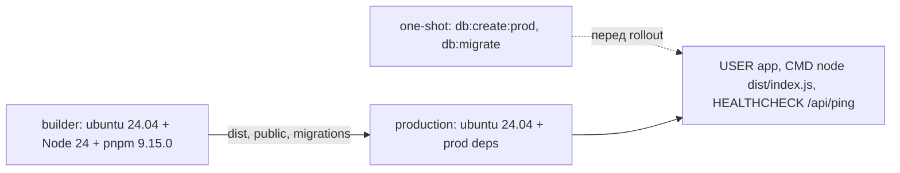

# Деплой

Ця сторінка описує, як зібрати застосунок для production, що міститься в [`Dockerfile`](https://github.com/Blazheiko/itvibe-template/blob/main/Dockerfile) і які умови потрібні під час запуску. Змінні оточення детально описано на сторінці [Конфігурація](/backend/configuration), а безпеку — на сторінці [Автентифікація та безпека](/backend/auth-security). Тут вони лише згадуються.

## Збірка

Кореневий скрипт `pnpm build` виконує `pnpm -r build` ([`package.json`](https://github.com/Blazheiko/itvibe-template/blob/main/package.json)). pnpm упорядковує пакети за залежностями workspace, тож `shared` збирається першим. `Dockerfile` задає порядок явно: `shared` → `frontend` → `backend`.

- **backend**: `tsc --build` ([`packages/backend/package.json`](https://github.com/Blazheiko/itvibe-template/blob/main/packages/backend/package.json)) компілює `src/` у `dist/` (`outDir`/`rootDir` у [`tsconfig.json`](https://github.com/Blazheiko/itvibe-template/blob/main/packages/backend/tsconfig.json)). Під час виконання аліаси `#app/*`, `#config/*`, `#vendor/*`, `#database/*`, `#drizzle/*` і `#logger` резолвляться через поле `imports` у `package.json` і вказують на `./dist/...`, тому `node dist/index.js` (`pnpm start`) працює без `tsx`.
- **frontend**: `build` запускає type-check, `vite build` і окрему збірку service worker (`vite.sw.config.ts`), див. [`packages/frontend/package.json`](https://github.com/Blazheiko/itvibe-template/blob/main/packages/frontend/package.json). Результат потрапляє в `packages/frontend/dist`.
- Окремого скрипта copy-static немає. Фронтенд у `packages/backend/public` копіює сам `Dockerfile` (`cp -r packages/frontend/dist packages/backend/public`).

### Як віддається фронтенд

Бекенд віддає статику лише при `SERVE_STATIC=true` ([`config/app.ts`](https://github.com/Blazheiko/itvibe-template/blob/main/packages/backend/src/config/app.ts), default `false`). Тоді [`static-server.ts`](https://github.com/Blazheiko/itvibe-template/blob/main/packages/backend/src/vendor/start/static-server.ts) на старті кешує в пам'ять каталог `./public` відносно `process.cwd()` (при `APP_ENV=manual-test` замість нього береться `./public-test`). `/` віддає `index.html`. Інший варіант — віддавати `frontend/dist` окремим хостингом або CDN (`CDN_URL`, див. [Маршрутизація і CDN](/backend/configuration#маршрутизація-і-cdn)).

::: warning
`Dockerfile` копіює фронтенд у `public` і задає `SERVE_STATIC=true` та `APP_ENV=production`, тож контейнер віддає фронтенд без додаткових змінних. Якщо фронтенд віддає проксі або CDN, перевизначте `-e SERVE_STATIC=false`. Коли `SERVE_STATIC=true`, а каталогу `public` немає, сервер пише попередження і стартує без статики ([`static-server.ts`](https://github.com/Blazheiko/itvibe-template/blob/main/packages/backend/src/vendor/start/static-server.ts)). У `.env.example` стоїть `SERVE_STATIC=false`, бо в dev фронтенд віддає Vite.
:::

### CSP, коли фронтенд віддає проксі

При `SERVE_STATIC=true` бекенд сам ставить CSP на HTML (див. [Content-Security-Policy](/backend/auth-security#content-security-policy)). Якщо HTML віддає nginx або CDN, політику документа треба задати там, з тим самим винятком для service worker:

```nginx
location = /service-worker.js {
    # CSP у відповіді зі скриптом worker'а діяла б на сам worker
    add_header Cache-Control "no-cache";
}

location / {
    try_files $uri /index.html;
    add_header Content-Security-Policy "default-src 'self'; base-uri 'self'; object-src 'none'; frame-ancestors 'none'; form-action 'self'; script-src 'self'; style-src 'self' 'unsafe-inline' https://fonts.googleapis.com; style-src-elem 'self' 'unsafe-inline' https://fonts.googleapis.com; img-src 'self' data: blob: https://cdn.example.com; font-src 'self' data: https://fonts.gstatic.com; connect-src 'self' https://api.example.com wss://api.example.com; upgrade-insecure-requests" always;
}
```

Значення можна взяти з відповіді бекенда: `curl -sS -D - -o /dev/null https://<backend>/` при `SERVE_STATIC=true`.

### Локальний production-like запуск

`pnpm prod:local` ([`scripts/prod-local.sh`](https://github.com/Blazheiko/itvibe-template/blob/main/scripts/prod-local.sh)) збирає `shared`, frontend (з `VITE_BASE_URL=http://localhost:<PORT>`, без Sentry) і backend, копіює `frontend/dist` у `backend/public`, як `Dockerfile`, і стартує бекенд з `SERVE_STATIC=true`. Потрібні PostgreSQL і Redis з `packages/backend/.env`. Оскільки це plain http, скрипт задає `APP_ENV=local` і `APP_IS_PRODUCTION=false` (інакше `getWsUrl()` видав би `wss://`, а `upgrade-insecure-requests` зламав би всі запити). `PROD_LOCAL_SKIP_BUILD=true` пропускає збірку.

## Dockerfile



**Етап `builder`**

1. Образ `ubuntu:24.04`. Node.js 24 ставиться з NodeSource, pnpm `9.15.0` вмикається через corepack.
2. Спочатку копіюються лише `package.json`, `pnpm-lock.yaml`, `pnpm-workspace.yaml` і `package.json` трьох пакетів, далі виконується `pnpm install --frozen-lockfile`. Так шар із залежностями кешується.
3. `COPY . .` копіює проєкт без того, що виключає [`.dockerignore`](https://github.com/Blazheiko/itvibe-template/blob/main/.dockerignore): `.git`, `node_modules`, `dist`, `coverage`, звіти тестів, кеш VitePress і всі `.env`/`.env.*`, крім `.env.example`. Тому локальні секрети не потрапляють ні в build context, ні в шари builder-етапу, а локальний `packages/frontend/.env` не вшивається у фронтенд-бандл — Vite бачить лише `VITE_SENTRY_*` з build-аргументів.
4. Build-аргументи `VITE_SENTRY_*` (DSN, ENABLED, ENVIRONMENT, RELEASE, sample rates) стають `ENV`, бо Vite вшиває їх у бандл під час збірки.
5. Збираються `shared`, `frontend` і `backend`, після цього `frontend/dist` копіюється в `backend/public`.

**Етап `production`**

1. Знову `ubuntu:24.04` + Node 24 + pnpm. `COREPACK_HOME=/opt/corepack` (доступний на читання всім), щоб користувач `app` запускав уже підготовлений pnpm без мережі. Створюється системний користувач `app` (uid < 1000) з домашнім каталогом `/home/app` — його потребує pnpm при one-shot запусках.
2. `pnpm install --frozen-lockfile --prod --filter backend...` ставить лише production-залежності бекенду та його workspace-залежностей. `drizzle-kit` міститься в `dependencies` бекенду, тому потрапляє в образ.
3. `ENV NODE_ENV=production`.
4. З `builder` копіюються `packages/backend/dist`, `packages/shared/dist`, `packages/backend/public`, `packages/backend/public-test`, `drizzle.config.ts` разом з `src/config/database.ts`, `src/drizzle/migrations` і `docs/support-knowledge-base` (його читає [`knowledge-base-init-service.ts`](https://github.com/Blazheiko/itvibe-template/blob/main/packages/backend/src/app/services/support/knowledge-base-init-service.ts)).
5. `EXPOSE 3000`, `WORKDIR /app/packages/backend`, `USER app`. Файли застосунку належать root і лише читаються: у рантаймі застосунок нічого не пише на диск.
6. `HEALTHCHECK` (interval 30 с, timeout 3 с, start-period 20 с, retries 3): `curl -fsS http://127.0.0.1:${PORT:-3000}/api/ping | grep -q '"status":"ok"'`. Перевіряється тіло, а не лише код: із `SERVE_STATIC=true` будь-який невідомий шлях повертає `index.html` зі статусом 200 (SPA fallback), тож перевірка лише статусу проходила б і при неправильному шляху.
7. `CMD ["node", "dist/index.js"]` — PID 1 є Node, тож `SIGTERM` від `docker stop` доходить до `stopGracefully`. Міграції на старті **не** запускаються.

Чого в образі немає:

- `.env` у production-етап не копіюється. Конфігурація передається через `-e`/`--env-file`. `dotenv/config` у [`index.ts`](https://github.com/Blazheiko/itvibe-template/blob/main/packages/backend/src/index.ts) просто не знайде файл.
- Вихідних кодів `src/` (окрім міграцій), devDependencies і `tsx` теж немає.

### Команди

```sh
docker build -t itvibe-template .
# з Sentry для фронтенду:
docker build -t itvibe-template --build-arg VITE_SENTRY_DSN=<dsn> --build-arg VITE_SENTRY_ENABLED=true .

# один раз перед rollout нової версії (той самий образ, без -p):
docker run --rm --env-file ./production.env itvibe-template pnpm db:create:prod
docker run --rm --env-file ./production.env itvibe-template pnpm db:migrate

docker run -d -p 3000:3000 --env-file ./production.env itvibe-template
```

::: warning Зміна запуску (feat-019)
До feat-019 контейнер сам виконував `db:create:prod` і `db:migrate` на кожному старті. Тепер це окремі one-shot запуски: якщо їх пропустити, нова версія стартує на старій схемі. У Kubernetes це init-контейнер або `Job` перед rollout, у Compose — окремий сервіс з `restart: "no"`, від якого залежить застосунок (`depends_on: condition: service_completed_successfully`).
:::

**Healthcheck з іншим `PORT` або `API_PATH_PREFIX`.** Вбудована перевірка знає лише `PORT` і префікс `api`. Для іншого префікса перевизначте її при запуску, інакше контейнер стане `unhealthy`:

```sh
docker run -d -e API_PATH_PREFIX=v1 \
  --health-cmd "curl -fsS http://127.0.0.1:3000/v1/ping | grep -q '\"status\":\"ok\"' || exit 1" \
  --env-file ./production.env itvibe-template
```

`/api/ping` — це liveness (процес відповідає), а не readiness: доступність PostgreSQL і Redis він не перевіряє.

`production.env` — ваш файл зі змінними за сторінкою [Конфігурація](/backend/configuration) (секрети в ньому лише ваші, у репозиторії їх немає). Хост і порт задаються через `HOST` (default `0.0.0.0`) і `PORT` (default `3000`).

### Перевірка (2026-10-24, feat-019)

macOS, Docker Desktop, `docker build --no-cache`:

|               | До       | Після    |
| ------------- | -------- | -------- |
| Build context | 83,45 MB | 124,7 kB |
| Час збірки    | 337 с    | 172 с    |
| Розмір образу | 813 MB   | 813 MB   |

- Секрети: canary-маркер у кореневому `.env` і `packages/shared/.env` не знайдено ні в builder-етапі (`grep -r` по всій ФС), ні в жодному шарі фінального образу (`docker save` + `grep`), ні в `docker history`; файлів `.env` в образах немає. Позитивний контроль тих самих команд знаходить `.env.example` у builder-етапі і `stopGracefully` у шарах.
- Одноразові `pnpm db:create:prod` і `pnpm db:migrate` від користувача `app` на чистому PostgreSQL з pgvector — успішно; на старті застосунку міграцій у лозі немає.
- `id -u` у контейнері — `999` (`app`); PID 1 — Node; `healthy` за замовчуванням; з `API_PATH_PREFIX=v1` контейнер працює, але стає `unhealthy`, а з перевизначеним `--health-cmd` — `healthy`.
- `docker stop -t 10` — у лозі `stop SIGTERM` і `server stop type: SIGTERM`, зупинка за 1 с, код виходу 0.

## Runtime

- **Змінні**: повний перелік наведено на сторінці [Конфігурація](/backend/configuration), про production-like режим (`APP_IS_PRODUCTION` або `APP_ENV`/`NODE_ENV` зі значенням `production`/`prod`) див. [Production-like режим](/backend/configuration#production-like-режим). Образ задає `NODE_ENV=production` і `APP_ENV=production`: `secure` у cookie і конфіг CSP (`config/csp.ts`, зокрема `wss:` у `getWsUrl()`) читають саме `APP_ENV`. Для staging-оточення перевизначте `APP_ENV` при запуску.
- **TLS і проксі**: сервер слухає HTTP (`server.listen(host, port)` у [`server.ts`](https://github.com/Blazheiko/itvibe-template/blob/main/packages/backend/src/vendor/start/server.ts)), тож TLS завершується на реверс-проксі. За проксі потрібні `TRUST_PROXY=true` і `TRUSTED_PROXY_CIDRS`, див. [Trust proxy](/backend/auth-security#trust-proxy-і-визначення-ip).
- **Unix socket**: якщо задано `APP_UNIX_PATH`, сервер викликає `listen_unix` замість TCP, і `HOST`/`PORT` тоді ігноруються.
- **Graceful shutdown**: [`index.ts`](https://github.com/Blazheiko/itvibe-template/blob/main/packages/backend/src/index.ts) обробляє `SIGINT`, `SIGHUP`, `SIGTERM` і `uncaughtException`. `stopGracefully` закриває WebSocket-з'єднання та listen socket, робить `flush` Sentry (2 с), закриває пул PostgreSQL і Redis, а потім викликає `process.exit(0)`. У контейнері PID 1 — Node (`CMD` у exec-формі), тож `docker stop` закінчується через `stopGracefully` з кодом 0.
- **Sentry**: бекенд читає `SENTRY_DSN`, `SENTRY_ENVIRONMENT`, `SENTRY_RELEASE` тощо під час виконання ([`config/sentry.ts`](https://github.com/Blazheiko/itvibe-template/blob/main/packages/backend/src/config/sentry.ts)). Фронтенду потрібні `VITE_SENTRY_*` як `--build-arg` під час збірки.

### Rate limit на edge

Локальні ліміти бекенду (L1, маршрути, upgrade рівня 1, WS-повідомлення) живуть у пам'яті кожного процесу і захищають сам процес; з N інстансами їхній бюджет N×. Чутливі дії (вхід, реєстрація, SMS, скидання пароля) і upgrade рівня 2 обмежує спільний бюджет у Redis, див. [Обмеження частоти запитів](/backend/auth-security#обмеження-частоти-запитів). Ліміт на реверс-проксі — опційний додатковий шар на вході, а не заміна відсутньої функції. Приклад для nginx із шляхами за замовчуванням (`API_PATH_PREFIX=api`):

```nginx
limit_req_zone  $binary_remote_addr zone=api:10m rate=10r/s;
limit_req_zone  $binary_remote_addr zone=ws_upgrade:10m rate=1r/s;
limit_conn_zone $binary_remote_addr zone=ws_conn:10m;

# За замовчуванням nginx відповідає 503; клієнту потрібен 429.
limit_req_status  429;
limit_conn_status 429;

location /api/websocket {
    limit_req  zone=ws_upgrade burst=20 nodelay;
    limit_conn ws_conn 20;
    proxy_pass http://backend;
    proxy_http_version 1.1;
    proxy_set_header Upgrade $http_upgrade;
    proxy_set_header Connection "upgrade";
    # Any proxy_set_header here cancels inherited ones: repeat the forwarding headers.
    proxy_set_header X-Forwarded-For $remote_addr;
    proxy_set_header X-Real-IP       $remote_addr;
}

location /api/ {
    limit_req zone=api burst=50 nodelay;
    proxy_pass http://backend;
    # uWebSockets.js answers 505 to HTTP/1.0, nginx's default for upstreams.
    proxy_http_version 1.1;
    proxy_set_header X-Forwarded-For $remote_addr;
    proxy_set_header X-Real-IP       $remote_addr;
}
```

Зона `limit_req_zone` спільна лише в межах одного nginx. Якщо незалежних edge-вузлів кілька, кожен рахує свою квоту. Деталі в [документації nginx](https://nginx.org/en/docs/http/ngx_http_limit_req_module.html). Щоб бекенд бачив справжній IP клієнта, потрібні `TRUST_PROXY=true` і `TRUSTED_PROXY_CIDRS`.

::: danger Перезаписуйте forwarding-заголовки
Без `proxy_set_header` nginx пересилає `X-Forwarded-For` клієнта як є. Бекенд довіряє nginx і бере з ланцюжка найправіший недовірений IP, тобто значення, яке клієнт вписав сам. Ротацією підробленого `X-Forwarded-For` можна обійти всі per-IP ліміти бекенду, зокрема ліміт логіну. Edge-ліміт nginx при цьому лишається чинним.

- Якщо nginx — перший вузол, що приймає клієнта, найпростіше задати `X-Forwarded-For $remote_addr` і `X-Real-IP $remote_addr`, як у прикладі. `$proxy_add_x_forwarded_for` теж безпечний: він дописує справжній IP праворуч, а `getIP()` обходить ланцюжок справа наліво і пропускає лише довірені проксі, тож підроблений префікс клієнта ігнорується. Але для цього кожен довірений проксі має коректно дописувати ланцюжок, а `TRUSTED_PROXY_CIDRS` має точно відповідати адресам цих проксі.
- `proxy_set_header` успадковується з батьківського рівня лише тоді, коли в `location` немає жодного власного `proxy_set_header` ([документація nginx](https://nginx.org/en/docs/http/ngx_http_proxy_module.html#proxy_set_header)). Тому в WS-блоці, де задано `Upgrade` і `Connection`, forwarding-заголовки треба повторити.
- Якщо перед nginx стоїть ще один довірений балансувальник, використовуйте `$proxy_add_x_forwarded_for` і додайте адресу балансувальника в `TRUSTED_PROXY_CIDRS`. Або `set_real_ip_from` + `real_ip_header` у nginx.
  :::

Перевірка: з низьким лімітом бекенду надішліть кілька запитів, кожен з іншим підробленим `X-Forwarded-For`. Квота має вичерпатися так само, як без заголовка:

```sh
for i in 1 2 3 4 5 6; do
  curl -s -o /dev/null -w '%{http_code}\n' -H "X-Forwarded-For: 203.0.113.$i" https://<host>/api/main/init
done
```

## База даних у production

- `pnpm db:create:prod` (`node dist/db/create-database.js`) створює БД і виконує `CREATE EXTENSION IF NOT EXISTS vector`, тому PostgreSQL має містити pgvector. Що це за вимога і як її виконати на керованому PostgreSQL, див. [База даних → pgvector](/backend/database#pgvector).
- `pnpm db:migrate` (`drizzle-kit migrate`) працює в образі, бо там є `drizzle-kit`, `drizzle.config.ts`, `src/config/database.ts` і `src/drizzle/migrations`. Застосунок, `db:create:prod` і `db:migrate` беруть `PGSQL_*` з однаковими defaults; у продакшні все одно задавайте їх явно.
- Міграції — окремий one-shot запуск образу перед rollout (див. [Команди](#команди)); репліки застосунку їх не запускають, тож гонки між репліками немає.

## Redis і S3

- Redis обов'язковий: у ньому зберігаються сесії, і під час shutdown застосунок закриває з'єднання з ним. Див. [Redis](/backend/database#redis) і [Конфігурація → Redis](/backend/configuration#redis).
- [`corsS3.xml`](https://github.com/Blazheiko/itvibe-template/blob/main/corsS3.xml) у корені — CORS-конфігурація бакета S3/MinIO: лише `GET`/`HEAD` з origin застосунку (placeholder `https://app.example.com`). Файли вантажить і видаляє бекенд, тож браузеру запис у бакет не потрібен. Застосовується вручну до бакета, код її не читає. Для кількох оточень див. [`corsS3.prod.example.xml`](https://github.com/Blazheiko/itvibe-template/blob/main/corsS3.prod.example.xml).

## CI/CD

У `.github/workflows` є лише [`docs.yml`](https://github.com/Blazheiko/itvibe-template/blob/main/.github/workflows/docs.yml), який збирає і деплоїть цей сайт документації.

::: warning
Workflow для збірки, тестів або деплою самого застосунку немає. Docker-образ збирається і публікується вручну.
:::

## Чекліст

- [ ] PostgreSQL з pgvector доступний, усі `PGSQL_*` задані явно.
- [ ] Redis доступний.
- [ ] `pnpm db:create:prod` і `pnpm db:migrate` виконано one-shot запуском образу перед rollout.
- [ ] Healthcheck відповідає вашим `PORT` / `API_PATH_PREFIX`.
- [ ] `APP_ENV=production`, `APP_KEY` і решта пунктів із [чекліста безпеки](/backend/auth-security#чекліст-для-production).
- [ ] TLS на проксі, `TRUST_PROXY` і `TRUSTED_PROXY_CIDRS` налаштовано.
- [ ] Визначено, хто віддає фронтенд: `SERVE_STATIC=true` або окремий хостинг/CDN.
- [ ] `VITE_SENTRY_*` передано як build-args, `SENTRY_*` — як runtime env.
- [ ] CORS бакета ([`corsS3.xml`](https://github.com/Blazheiko/itvibe-template/blob/main/corsS3.xml)) обмежено вашим доменом.
