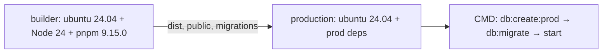

# Деплой

Ця сторінка описує, як зібрати застосунок для production, що міститься в [`Dockerfile`](https://github.com/Blazheiko/itvibe-template/blob/main/Dockerfile) і які умови потрібні під час запуску. Змінні оточення детально описано на сторінці [Конфігурація](/backend/configuration), а безпеку — на сторінці [Автентифікація та безпека](/backend/auth-security). Тут вони лише згадуються.

## Збірка

Кореневий скрипт `pnpm build` виконує `pnpm -r build` ([`package.json`](https://github.com/Blazheiko/itvibe-template/blob/main/package.json)). pnpm упорядковує пакети за залежностями workspace, тож `shared` збирається першим. `Dockerfile` задає порядок явно: `shared` → `frontend` → `backend`.

- **backend**: `tsc --build` ([`packages/backend/package.json`](https://github.com/Blazheiko/itvibe-template/blob/main/packages/backend/package.json)) компілює `src/` у `dist/` (`outDir`/`rootDir` у [`tsconfig.json`](https://github.com/Blazheiko/itvibe-template/blob/main/packages/backend/tsconfig.json)). Під час виконання аліаси `#app/*`, `#config/*`, `#vendor/*`, `#database/*`, `#drizzle/*` і `#logger` резолвляться через поле `imports` у `package.json` і вказують на `./dist/...`, тому `node dist/index.js` (`pnpm start`) працює без `tsx`.
- **frontend**: `build` запускає type-check, `vite build` і окрему збірку service worker (`vite.sw.config.ts`), див. [`packages/frontend/package.json`](https://github.com/Blazheiko/itvibe-template/blob/main/packages/frontend/package.json). Результат потрапляє в `packages/frontend/dist`.
- Окремого скрипта copy-static немає. Фронтенд у `packages/backend/public` копіює сам `Dockerfile` (`cp -r packages/frontend/dist packages/backend/public`).

### Як віддається фронтенд

Бекенд віддає статику лише при `SERVE_STATIC=true` ([`config/app.ts`](https://github.com/Blazheiko/itvibe-template/blob/main/packages/backend/src/config/app.ts), default `false`). Тоді [`static-server.ts`](https://github.com/Blazheiko/itvibe-template/blob/main/packages/backend/src/vendor/start/static-server.ts) на старті кешує в пам'ять каталог `./public` відносно `process.cwd()` (при `APP_ENV=manual-test` замість нього береться `./public-test`). `/` віддає `index.html`. Інший варіант — віддавати `frontend/dist` окремим хостингом або CDN (`CDN_URL`, див. [Маршрутизація і CDN](/backend/configuration#маршрутизація-і-cdn)).

::: warning
`Dockerfile` копіює фронтенд у `public`, але не задає `SERVE_STATIC`. Без `-e SERVE_STATIC=true` контейнер фронтенд не віддає. І навпаки: `SERVE_STATIC=true` без каталогу `public` ламає старт (проблема 4 у `docs/plan/code-issues-found-during-docs.md`).
:::

## Dockerfile



**Етап `builder`**

1. Образ `ubuntu:24.04`. Node.js 24 ставиться з NodeSource, pnpm `9.15.0` вмикається через corepack.
2. Спочатку копіюються лише `package.json`, `pnpm-lock.yaml`, `pnpm-workspace.yaml` і `package.json` трьох пакетів, далі виконується `pnpm install --frozen-lockfile`. Так шар із залежностями кешується.
3. `COPY . .` копіює весь проєкт.
4. Build-аргументи `VITE_SENTRY_*` (DSN, ENABLED, ENVIRONMENT, RELEASE, sample rates) стають `ENV`, бо Vite вшиває їх у бандл під час збірки.
5. Збираються `shared`, `frontend` і `backend`, після цього `frontend/dist` копіюється в `backend/public`.

**Етап `production`**

1. Знову `ubuntu:24.04` + Node 24 + pnpm.
2. `pnpm install --frozen-lockfile --prod --filter backend...` ставить лише production-залежності бекенду та його workspace-залежностей. `drizzle-kit` міститься в `dependencies` бекенду, тому потрапляє в образ.
3. `ENV NODE_ENV=production`.
4. З `builder` копіюються `packages/backend/dist`, `packages/shared/dist`, `packages/backend/public`, `packages/backend/public-test`, `drizzle.config.js`, `src/drizzle/migrations` і `docs/support-knowledge-base` (його читає [`knowledge-base-init-service.ts`](https://github.com/Blazheiko/itvibe-template/blob/main/packages/backend/src/app/services/support/knowledge-base-init-service.ts)).
5. `EXPOSE 3000`, `WORKDIR /app/packages/backend`.
6. `CMD ["sh", "-c", "node --version && pnpm db:create:prod && pnpm db:migrate && pnpm start"]`: при кожному старті контейнер створює БД (якщо її немає), застосовує міграції і запускає сервер.

Чого в образі немає:

- `.env` у production-етап не копіюється. Конфігурація передається через `-e`/`--env-file`. `dotenv/config` у [`index.ts`](https://github.com/Blazheiko/itvibe-template/blob/main/packages/backend/src/index.ts) просто не знайде файл.
- `USER` не задано, тож процес працює від `root`.
- `HEALTHCHECK` немає.
- Вихідних кодів `src/` (окрім міграцій), devDependencies і `tsx` теж немає.

::: warning
У репозиторії немає `.dockerignore`. Тому `COPY . .` у етапі `builder` переносить у build context локальні `.env`, `node_modules`, `dist`. У фінальний образ це не потрапляє, але може зберегтися в шарах builder-кешу і сповільнює збірку.
:::

### Команди

```sh
docker build -t itvibe-template .
# з Sentry для фронтенду:
docker build -t itvibe-template --build-arg VITE_SENTRY_DSN=<dsn> --build-arg VITE_SENTRY_ENABLED=true .

docker run --rm -p 3000:3000 --env-file ./production.env itvibe-template
```

`production.env` — ваш файл зі змінними за сторінкою [Конфігурація](/backend/configuration) (секрети в ньому лише ваші, у репозиторії їх немає). Хост і порт задаються через `HOST` (default `0.0.0.0`) і `PORT` (default `3000`).

### Перевірка (2026-10-19)

- `docker build -t itvibe-docs-check .` з кореня репозиторію завершився успішно приблизно за 3,5 хв (холодний кеш, macOS, Docker Desktop). Розмір образу 817 MB.
- `docker run` з `APP_ENV=production`, `APP_KEY=<32 символи>` і без PostgreSQL вивів `v24.22.0`, після чого `db:create:prod` впав з `Failed to create database: Error: connect ECONNREFUSED 127.0.0.1:5432`, а контейнер завершився з кодом 1. Без доступної БД сервер не стартує, бо так влаштований `CMD`.

## Runtime

- **Змінні**: повний перелік наведено на сторінці [Конфігурація](/backend/configuration), про production-like режим (`APP_IS_PRODUCTION` або `APP_ENV`/`NODE_ENV` зі значенням `production`/`prod`) див. [Production-like режим](/backend/configuration#production-like-режим). Майте на увазі, що образ задає `NODE_ENV=production`, тож без `APP_ENV` режим уже production-like. Але `secure` у cookie і конфіг CSP (`config/csp.ts`, який поки ніде не застосовується, див. п. 1 у списку проблем) читають саме `APP_ENV`, тому задайте `APP_ENV=production` явно. Відомі розбіжності `.env.example` описано в проблемі 6.
- **TLS і проксі**: сервер слухає HTTP (`server.listen(host, port)` у [`server.ts`](https://github.com/Blazheiko/itvibe-template/blob/main/packages/backend/src/vendor/start/server.ts)), тож TLS завершується на реверс-проксі. За проксі потрібні `TRUST_PROXY=true` і `TRUSTED_PROXY_CIDRS`, див. [Trust proxy](/backend/auth-security#trust-proxy-і-визначення-ip).
- **Unix socket**: якщо задано `APP_UNIX_PATH`, сервер викликає `listen_unix` замість TCP, і `HOST`/`PORT` тоді ігноруються. У `.env.example` ця змінна має назву `UNIX_PATH`, а код її не читає (проблема 6).
- **Graceful shutdown**: [`index.ts`](https://github.com/Blazheiko/itvibe-template/blob/main/packages/backend/src/index.ts) обробляє `SIGINT`, `SIGHUP`, `SIGTERM` і `uncaughtException`. `stopGracefully` закриває WebSocket-з'єднання та listen socket, робить `flush` Sentry (2 с), закриває пул PostgreSQL і Redis, а потім викликає `process.exit(0)`. Через `sh -c` у `CMD` сигнал `docker stop` отримує shell, а не Node. Чи дійде він до процесу, не перевірено.
- **Sentry**: бекенд читає `SENTRY_DSN`, `SENTRY_ENVIRONMENT`, `SENTRY_RELEASE` тощо під час виконання ([`config/sentry.ts`](https://github.com/Blazheiko/itvibe-template/blob/main/packages/backend/src/config/sentry.ts)). Фронтенду потрібні `VITE_SENTRY_*` як `--build-arg` під час збірки.

## База даних у production

- `pnpm db:create:prod` (`node dist/db/create-database.js`) створює БД і виконує `CREATE EXTENSION IF NOT EXISTS vector`, тому PostgreSQL має містити pgvector (проблема 7). Докладніше див. [База даних](/backend/database).
- `pnpm db:migrate` (`drizzle-kit migrate`) працює в образі, бо там є `drizzle-kit`, `drizzle.config.js` і `src/drizzle/migrations`. `drizzle.config.js` бере `PGSQL_*` з власними defaults, які відрізняються від defaults застосунку (проблеми 5 і 8). Тому задавайте всі `PGSQL_*`, зокрема `PGSQL_PORT`, явно.
- Міграції запускаються при кожному старті контейнера. Якщо реплік кілька, вони запустять міграції паралельно.

## Redis і S3

- Redis обов'язковий: у ньому зберігаються сесії, і під час shutdown застосунок закриває з'єднання з ним. Див. [Redis](/backend/database#redis) і [Конфігурація → Redis](/backend/configuration#redis).
- [`corsS3.xml`](https://github.com/Blazheiko/itvibe-template/blob/main/corsS3.xml) у корені — це CORS-конфігурація для бакета S3/MinIO: дозволено `GET`/`POST`/`PUT` з будь-якого origin з будь-якими заголовками. Вона потрібна, щоб браузер міг напряму вантажити файли за presigned URL. Застосовується вручну до бакета, код її не читає. Для production замініть `<AllowedOrigin>*</AllowedOrigin>` на свій домен. Параметри S3 описано в розділі [Сховище S3](/backend/configuration#сховище-s3).

## CI/CD

У `.github/workflows` є лише [`docs.yml`](https://github.com/Blazheiko/itvibe-template/blob/main/.github/workflows/docs.yml), який збирає і деплоїть цей сайт документації.

::: warning
Workflow для збірки, тестів або деплою самого застосунку немає. Docker-образ збирається і публікується вручну.
:::

## Чекліст

- [ ] PostgreSQL з pgvector доступний, усі `PGSQL_*` задані явно.
- [ ] Redis доступний.
- [ ] `APP_ENV=production`, `APP_KEY` і решта пунктів із [чекліста безпеки](/backend/auth-security#чекліст-для-production).
- [ ] TLS на проксі, `TRUST_PROXY` і `TRUSTED_PROXY_CIDRS` налаштовано.
- [ ] Визначено, хто віддає фронтенд: `SERVE_STATIC=true` або окремий хостинг/CDN.
- [ ] `VITE_SENTRY_*` передано як build-args, `SENTRY_*` — як runtime env.
- [ ] CORS бакета ([`corsS3.xml`](https://github.com/Blazheiko/itvibe-template/blob/main/corsS3.xml)) обмежено вашим доменом.
