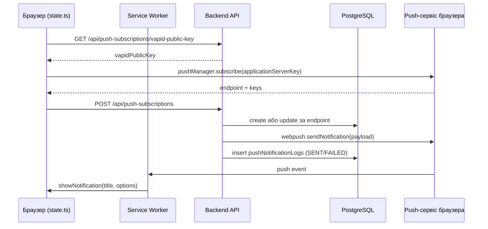

# Пошта та push-нотифікації

Бекенд має два канали нотифікацій: email через SMTP ([nodemailer](https://nodemailer.com/)) і Web Push через бібліотеку [`web-push`](https://github.com/web-push-libs/web-push) з VAPID-ключами. Обидва канали вимкнені, доки не задано відповідні змінні оточення — їх перелік і значення за замовчуванням описані в [Конфігурації](/backend/configuration).

## Email

### Транспорт

Сервіс [`email-service.ts`](https://github.com/Blazheiko/itvibe-template/blob/main/packages/backend/src/app/services/notifications/email-service.ts) створює один лінивий `nodemailer`-транспорт (`createTransport`) з `host`, `port`, `secure`, опційними `requireTLS`/`ignoreTLS` та `auth` (лише якщо задані і `SMTP_USER`, і `SMTP_PASSWORD`). Налаштування беруться з [`config/mail.ts`](https://github.com/Blazheiko/itvibe-template/blob/main/packages/backend/src/config/mail.ts).

Публічний API — об'єкт `emailService`:

- `isConfigured(): boolean` — чи пройдена перевірка конфігурації;
- `send(input: SendEmailInput): Promise<AppResult<SendEmailOutput>>` — повертає `Result` (`better-result`), не кидає винятків.

`SendEmailInput` підтримує `to`, `cc`, `bcc`, `replyTo` (рядок, `{ email, name? }` або масив), `subject`, `text`/`html`, `from` та `attachments`. Якщо `from` не задано, використовується `SMTP_FROM_NAME <SMTP_FROM_EMAIL>`; якщо `replyTo` не задано — `SMTP_REPLY_TO` з конфігу.

### Поведінка, коли SMTP вимкнено

Пошта **не підміняється логуванням**. Перед кожною відправкою `send()` перевіряє конфігурацію і при помилці пише `logger.warn` та повертає `Result.err(internalMessage(...))`. Можливі причини:

- `Email service is disabled` — `SMTP_ENABLED` не `true`;
- `SMTP_HOST is not configured`;
- `SMTP_FROM_EMAIL is not configured`;
- `SMTP_USER and SMTP_PASSWORD must be configured together`.

Далі валідуються вхідні дані (порожній `subject`, відсутні і `text`, і `html`, порожній список отримувачів, порожній відправник) — це `badRequest`. Помилка SMTP логується (`Failed to send email`) і повертається як `internal`. Успіх логується як `Email sent` з `messageId`, `accepted`, `rejected`.

::: warning Наслідок для auth-флоу
Оскільки виклики нижче перетворюють помилку `send()` на `internal`, при вимкненому SMTP запити на верифікацію email і скидання пароля через email завершуються помилкою сервера, а не «тихо» успіхом. Для локальної розробки без SMTP цей шлях не працює — див. [Локальне тестування](#локальне-тестування).
:::

### Які листи надсилаються

Шаблонів-файлів і i18n немає: тема, `text` та `html` будуються функціями в коді сервісів, англійською, з екрануванням імені користувача через `escapeHtml`.

| Лист                                       | Функція-шаблон           | Де викликається                                                                                                                                                |
| ------------------------------------------ | ------------------------ | -------------------------------------------------------------------------------------------------------------------------------------------------------------- |
| Підтвердження email («Confirm your email») | `buildEmailContent`      | [`email-verification-service.ts`](https://github.com/Blazheiko/itvibe-template/blob/main/packages/backend/src/app/services/auth/email-verification-service.ts) |
| Прив'язка нового email до акаунта          | `buildLinkEmailContent`  | [`email-verification-service.ts`](https://github.com/Blazheiko/itvibe-template/blob/main/packages/backend/src/app/services/auth/email-verification-service.ts) |
| Скидання пароля                            | `buildResetEmailContent` | [`password-reset-service.ts`](https://github.com/Blazheiko/itvibe-template/blob/main/packages/backend/src/app/services/auth/password-reset-service.ts)         |

Посилання в листах містять сирий токен, а в БД зберігається лише його хеш. Деталі флоу — у [Автентифікації та безпеці](/backend/auth-security).

### Тестовий лист: `mail:test`

Скрипт [`send-test-email.ts`](https://github.com/Blazheiko/itvibe-template/blob/main/packages/backend/src/scripts/send-test-email.ts) (`tsx`, підвантажує `.env` через `dotenv/config`) надсилає простий лист через той самий `emailService`:

```bash
pnpm --filter backend mail:test you@example.com "Optional subject"
```

Без отримувача скрипт друкує usage і завершується з кодом `1`. При помилці друкує `Failed to send test email: <причина>` (наприклад `Email service is disabled`) і теж повертає `1`; при успіху — `Message ID` та прийнятих отримувачів. Див. також [Скрипти](/reference/scripts).

Юніт-тести сервісу — [`email-service.spec.ts`](https://github.com/Blazheiko/itvibe-template/blob/main/packages/backend/src/app/services/notifications/email-service.spec.ts).

## Web Push

### VAPID-ключі

[`config/push.ts`](https://github.com/Blazheiko/itvibe-template/blob/main/packages/backend/src/config/push.ts) читає `VAPID_PUBLIC_KEY`, `VAPID_PRIVATE_KEY`, `VAPID_SUBJECT`. Під час першої відправки [`push-notification-sender-service.ts`](https://github.com/Blazheiko/itvibe-template/blob/main/packages/backend/src/app/services/notifications/push-notification-sender-service.ts) викликає `webpush.setVapidDetails(...)`; якщо ключі порожні — пише `VAPID keys not configured — push notifications disabled` і нічого не надсилає (`{ sent: 0, failed: 0 }`).

::: warning Генерація ключів
У репозиторії немає власного скрипта для генерації VAPID-ключів. Бібліотека `web-push` (залежність бекенду) надає CLI та функцію `generateVAPIDKeys()`, наприклад:

```bash
cd packages/backend && npx web-push generate-vapid-keys
```

Отримані значення покладіть у `.env` як `VAPID_PUBLIC_KEY=<public>` та `VAPID_PRIVATE_KEY=<private>`. Приватний ключ — секрет.
:::

### HTTP-маршрути

Група `push-subscriptions` у [`http-routes.ts`](https://github.com/Blazheiko/itvibe-template/blob/main/packages/backend/src/app/routes/http-routes.ts) з middleware `session_web` і `csrf_guard`; на кожному маршруті, крім `vapid-public-key`, стоїть `auth_guard` (анонімний запит → `401` до контролера); контролер — [`push-subscription-controller.ts`](https://github.com/Blazheiko/itvibe-template/blob/main/packages/backend/src/app/controllers/http/notifications/push-subscription-controller.ts). Фронтенд звертається до них з префіксом `/api` ([`utils/api.ts`](https://github.com/Blazheiko/itvibe-template/blob/main/packages/frontend/src/utils/api.ts)).

| Метод    | Шлях                                             | Призначення                                                                                                                                                  |
| -------- | ------------------------------------------------ | ------------------------------------------------------------------------------------------------------------------------------------------------------------ |
| `GET`    | `/push-subscriptions/vapid-public-key`           | Публічний VAPID-ключ                                                                                                                                         |
| `POST`   | `/push-subscriptions/test-push`                  | Тестовий push поточному користувачу; тіло `{ title?, body? }` (`PushSubscriptionTestInputSchema`: до 200 / 1000 символів), відповідь містить `sent`/`failed` |
| `GET`    | `/push-subscriptions`                            | Підписки користувача                                                                                                                                         |
| `POST`   | `/push-subscriptions`                            | Створити підписку (`CreateSubscriptionInputSchema`)                                                                                                          |
| `GET`    | `/push-subscriptions/:subscriptionId`            | Одна підписка                                                                                                                                                |
| `PUT`    | `/push-subscriptions/:subscriptionId`            | Оновити (`UpdateSubscriptionInputSchema`)                                                                                                                    |
| `DELETE` | `/push-subscriptions/:subscriptionId`            | Видалити                                                                                                                                                     |
| `GET`    | `/push-subscriptions/:subscriptionId/logs`       | Журнал відправок                                                                                                                                             |
| `GET`    | `/push-subscriptions/:subscriptionId/statistics` | Статистика                                                                                                                                                   |
| `PUT`    | `/push-subscriptions/:subscriptionId/deactivate` | Деактивувати                                                                                                                                                 |

### Збереження підписки

[`push-subscription-service.ts`](https://github.com/Blazheiko/itvibe-template/blob/main/packages/backend/src/app/services/notifications/push-subscription-service.ts) у `createSubscription` шукає підписку за `endpoint` (він унікальний серед усіх користувачів). Якщо підписка належить іншому користувачу, її переносять на поточного лише тоді, коли `p256dhKey` і `authKey` збігаються з збереженими (той самий браузер, зміна акаунта); інакше — `409 conflict`, підписка лишається за старим власником. Якщо вона є — оновлює ключі `p256dhKey`/`authKey`, метадані пристрою, `notificationTypes`, `timezone` і знову робить `isActive: true`; інакше створює новий запис. Робота з таблицею — через репозиторій, див. [Репозиторії та трансформери](/backend/repositories-transformers).

### Відправка та формат payload

`pushNotificationSenderService.sendToUser(userId, payload, { skipIfOnline?, notificationType? })`:

1. Якщо `skipIfOnline` і користувач має активне WebSocket-з'єднання (`wsConnectionRegistry.isUserOnline`) — push пропускається (див. [WebSocket](/backend/websocket)).
2. Береться список активних підписок; якщо в підписки непорожній `notificationTypes` і він не містить `notificationType` — її пропускають.
3. Для кожної підписки викликається `webpush.sendNotification` з JSON:

```json
{
    "notification": {
        "title": "...",
        "body": "...",
        "icon": "/icons/icon_192x192.png",
        "badge": "/icons/badge-72.png",
        "vibrate": [200, 100, 200],
        "data": { "url": "/", "...": "payload.data" },
        "tag": "...",
        "actions": [
            { "action": "open", "title": "Open" },
            { "action": "close", "title": "Close" }
        ]
    }
}
```

Кожна спроба пишеться в `pushNotificationLogs` зі статусом `SENT` (і `statusCode` відповіді) або `FAILED` (з `errorMessage`). Після успіху оновлюється `lastUsedAt` підписки.

**Прострочені підписки:** відповідь push-сервісу `410` або `404` деактивує підписку (`pushSubscriptionRepository.deactivate`). Окремої фонової очистки чи видалення неактивних записів немає.

Наразі єдиний виклик `sendToUser` у коді — ендпоінт `test-push`; бізнес-подій, що надсилають push, немає.

### Статистика

[`push-subscription-statistics-service.ts`](https://github.com/Blazheiko/itvibe-template/blob/main/packages/backend/src/app/services/statistics/push-subscription-statistics-service.ts) рахує `totalNotifications`, `sentNotifications`, `failedNotifications`, `pendingNotifications`, `successRate` (%), `last7DaysCount`, `lastUsed`, `isActive`.

::: warning Відомі проблеми
Сервіси відправки та статистики звертаються до `db` напряму, оминаючи репозиторії (проблема №20), а статистика завантажує всі логи і рахує їх у JS (№21) — див. `docs/plan/code-issues-found-during-docs.md`.
:::

### Фронтенд

- Підписка — у [`stores/state.ts`](https://github.com/Blazheiko/itvibe-template/blob/main/packages/frontend/src/stores/state.ts): перевіряє `registration.pushManager.getSubscription()`, отримує VAPID-ключ з `/api/push-subscriptions/vapid-public-key`, викликає `pushManager.subscribe({ applicationServerKey })` і відправляє дані на `POST /api/push-subscriptions`.
- [`service-worker.ts`](https://github.com/Blazheiko/itvibe-template/blob/main/packages/frontend/src/service-worker.ts) у обробнику `push` парсить JSON, зливає `payload.notification` з дефолтами і викликає `showNotification`; `notificationclick` закриває нотифікацію і відкриває `data.url` (або `/`).



## Локальне тестування

- **Пошта:** підніміть локальний SMTP-перехоплювач (наприклад Mailpit або MailHog на порту `1025`), задайте `SMTP_ENABLED=true`, `SMTP_HOST=localhost`, `SMTP_PORT=1025`, `SMTP_REQUIRE_TLS=false`, `SMTP_FROM_EMAIL=noreply@example.com` без логіна/пароля і перевірте `pnpm --filter backend mail:test you@example.com`. Ці інструменти не входять до репозиторію.
- **Push:** згенеруйте VAPID-ключі, перезапустіть бекенд, увімкніть нотифікації у фронтенді (service worker потребує `localhost` або HTTPS), потім викличте `POST /api/push-subscriptions/test-push` (тіло `{}` або `{ "title": "…", "body": "…" }`, з CSRF-токеном) з активною сесією. Результат видно у відповіді (`sent`/`failed`), у логах бекенду та через `/:subscriptionId/logs`.
- Юніт-тести: `pnpm --filter backend test` (включно з [`push-subscription-service.spec.ts`](https://github.com/Blazheiko/itvibe-template/blob/main/packages/backend/src/app/services/notifications/push-subscription-service.spec.ts)).
