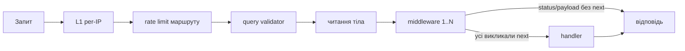

# Middleware

Middleware — це функції, які виконуються **перед** обробником маршруту і можуть його не пустити: перевірити сесію, CSRF-токен, роль. Які middleware спрацюють для запиту, визначає поле `middlewares` у маршруті та його групах — див. [Маршрутизація](/backend/routing#маршрут-—-єдине-джерело-істини).

## Коротко на прикладі: закрити маршрут для незалогінених

Middleware задаються списком назв на групі маршрутів (або на окремому маршруті) і виконуються по черзі до обробника.

```ts
{
    group: [ /* defineRoute(...) */ ],
    prefix: 'notes',
    middlewares: ['session_web', 'csrf_guard', 'auth_guard'],
}
```

| Набір middleware                                         | Хто пройде                | Інші отримають                                    |
| -------------------------------------------------------- | ------------------------- | ------------------------------------------------- |
| немає                                                    | усі (як `GET /api/hello`) | —                                                 |
| `session_web`, `csrf_guard`, `auth_guard`                | лише залогінені           | `401 unauthorized`                                |
| `session_web`, `csrf_guard`, `auth_guard`, `admin_guard` | лише роль `admin`         | `401` без входу, `403` для звичайного користувача |

Відповіді перевірено на запущеному сервері (`GET /api/admin/users`):

```text
без cookie            → 401 {"status":"error","code":"unauthorized","message":"Session expired or not found",...}
звичайний користувач  → 403 {"status":"forbidden","message":"Admin access required",...}
```

`session_web` має стояти першим: решта читає сесію, яку він піднімає. Повний список middleware і як додати свій — нижче.

## Kernel middleware

Усі middleware реєструються за іменем у [`src/app/middlewares/kernel.ts`](https://github.com/Blazheiko/vibe-template/blob/main/packages/backend/src/app/middlewares/kernel.ts):

| Ім'я             | Файл                                                                                                                                                                     | Що робить                                                                                                                                                                                                          |
| ---------------- | ------------------------------------------------------------------------------------------------------------------------------------------------------------------------ | ------------------------------------------------------------------------------------------------------------------------------------------------------------------------------------------------------------------ |
| `session_web`    | [`vendor/utils/middlewares/ws/session-web.ts`](https://github.com/Blazheiko/vibe-template/blob/main/packages/backend/src/vendor/utils/middlewares/ws/session-web.ts)     | сесія на cookie (використовується в HTTP-групах)                                                                                                                                                                   |
| `session_api`    | [`vendor/utils/middlewares/http/session-api.ts`](https://github.com/Blazheiko/vibe-template/blob/main/packages/backend/src/vendor/utils/middlewares/http/session-api.ts) | сесія для API-клієнтів                                                                                                                                                                                             |
| `csrf_guard`     | [`app/middlewares/csrf-guard.ts`](https://github.com/Blazheiko/vibe-template/blob/main/packages/backend/src/app/middlewares/csrf-guard.ts)                               | для `post/put/patch/delete` перевіряє Origin/Referer та CSRF-токен із заголовка `csrfConfig.headerName` (порівняння `timingSafeEqual`); при `enforce = false` лише логує порушення                                 |
| `auth_guard`     | [`vendor/utils/middlewares/core/auth-guard.ts`](https://github.com/Blazheiko/vibe-template/blob/main/packages/backend/src/vendor/utils/middlewares/core/auth-guard.ts)   | `401` з `code: "unauthorized"`, якщо `auth.check()` хибне                                                                                                                                                          |
| `admin_guard`    | [`app/middlewares/admin-guard.ts`](https://github.com/Blazheiko/vibe-template/blob/main/packages/backend/src/app/middlewares/admin-guard.ts)                             | `403`, якщо користувач не має `role === 'admin'`                                                                                                                                                                   |
| `ws_admin_guard` | [`app/middlewares/ws-admin-guard.ts`](https://github.com/Blazheiko/vibe-template/blob/main/packages/backend/src/app/middlewares/ws-admin-guard.ts)                       | для WS-маршрутів: якщо `userData.role !== 'admin'`, відповідь `status "403"` з `forbidden` без виклику handler. HTTP-`auth_guard`/`admin_guard` на WS не працюють: WS-контекст не має `auth` і HTTP-`responseData` |
| `test1`…`test4`  | `app/middlewares/test-middleware*.ts`                                                                                                                                    | демонстраційні middleware (логують і дописують `middlewareData`); зареєстровані в kernel, але в жодному маршруті не використовуються                                                                               |

Деталі сесій і CSRF — на сторінці [Автентифікація](/backend/auth) і [Безпека](/backend/security#csrf).

## Як виконується ланцюжок

[`execute-httpMiddlewares.ts`](https://github.com/Blazheiko/vibe-template/blob/main/packages/backend/src/vendor/utils/middlewares/core/execute-httpMiddlewares.ts) реалізує класичний `next()`-ланцюжок: бере middleware з kernel за іменем (невідоме ім'я — помилка `No middleware <name>`) і повертає `true`, лише якщо **кожен** middleware викликав `next()`. Handler запускається тоді, коли ланцюжок пройдено і `responseData.status` лишився у діапазоні 2xx.



## Власний middleware

Шаблон — як у `admin-guard.ts`: функція типу `Middleware`, що або встановлює `status`/`payload` і повертається, або викликає `await next()`.

```ts
import type { HttpContext, Middleware } from '#vendor/types/types.js'

const myGuard: Middleware = async (
    context: HttpContext,
    next: () => Promise<void>,
): Promise<void> => {
    if (context.auth.getUserId() === null) {
        context.responseData.status = 403
        context.responseData.payload = { status: 'forbidden', message: 'Forbidden' }
        return
    }
    await next()
}

export default myGuard
```

Далі: імпортуйте його в `kernel.ts`, додайте ключ (наприклад `my_guard: myGuard`) і вкажіть ім'я в `middlewares` маршруту чи групи. Порядок має значення: `auth_guard`/`admin_guard` повинні стояти після `session_web`. Повний приклад фічі — у [Додаванні фічі](/backend/adding-a-feature).
