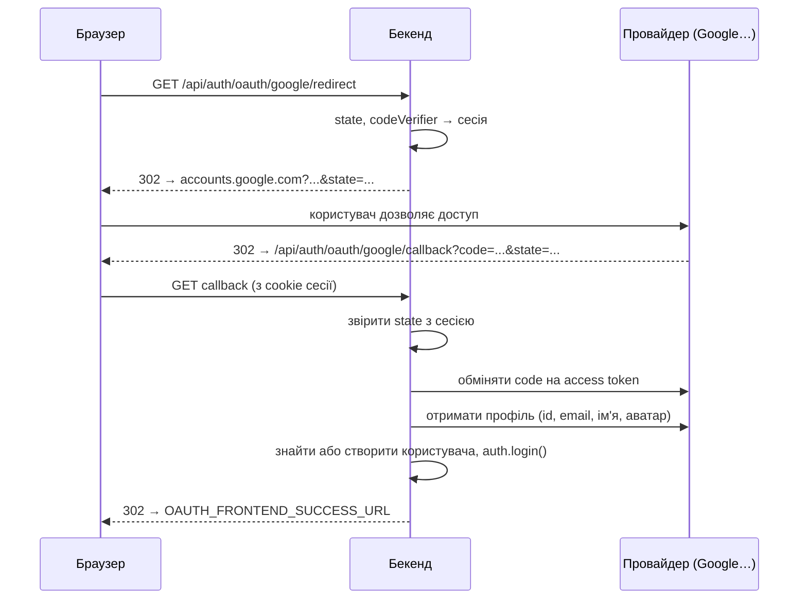

# Вхід через соцмережі

Користувач може увійти через акаунт у соцмережі замість пароля. Бекенд підтримує чотири провайдери: **Google**, **Facebook**, **GitHub** і **GitLab**. Протокол OAuth 2.0 реалізує бібліотека [`arctic`](https://arcticjs.dev/). Код: [`config/oauth.ts`](https://github.com/Blazheiko/vibe-template/blob/main/packages/backend/src/config/oauth.ts), [`oauth-service.ts`](https://github.com/Blazheiko/vibe-template/blob/main/packages/backend/src/app/services/auth/oauth-service.ts), [`oauth-controller.ts`](https://github.com/Blazheiko/vibe-template/blob/main/packages/backend/src/app/controllers/http/auth/oauth-controller.ts).

::: info Кнопки у фронтенді
У вікні входу ([`AuthModals.vue`](https://github.com/Blazheiko/vibe-template/blob/main/packages/frontend/src/components/AuthModals.vue)) зараз є кнопки лише для **Google** і **Facebook**. GitHub і GitLab на бекенді готові: щоб показати їх користувачам, додайте кнопку з посиланням на `apiPath('auth/oauth/github/redirect')`.
:::

## Як це працює

Маршрути лежать у групі `auth/oauth` з middleware `session_web` і `csrf_guard` (на `GET` CSRF не перевіряється, тож редиректи від провайдера проходять).

| Маршрут                                  | Що робить                                                                                          |
| ---------------------------------------- | -------------------------------------------------------------------------------------------------- |
| `GET /api/auth/oauth/:provider/redirect` | генерує `state` (і PKCE-`codeVerifier` для Google), кладе їх у сесію, `302` на сторінку провайдера |
| `GET /api/auth/oauth/:provider/callback` | сюди провайдер повертає користувача з `code` і `state`; бекенд логінить і робить `302` на фронтенд |



Що відбувається в callback ([`oauthService.handleCallback`](https://github.com/Blazheiko/vibe-template/blob/main/packages/backend/src/app/services/auth/oauth-service.ts)):

1. **Перевірка `state`.** Значення з query порівнюється з тим, що збережено в сесії на кроці redirect. Розбіжність — `OAuth state mismatch`: так відсікається підроблений callback (CSRF на вході). Після callback `oauthState` і `oauthCodeVerifier` видаляються з сесії.
2. **Обмін `code` на токени** через `arctic` і запит профілю до API провайдера.
3. **Email обов'язковий.** Якщо провайдер не віддав email, вхід не відбувається (`Could not retrieve email from provider`). Email приводиться до нижнього регістру.
4. **Пошук користувача** в такому порядку:
    - є запис у `oauth_accounts` з цим провайдером і id користувача в провайдера → це той самий користувач, оновлюються його токени;
    - інакше є користувач з таким email → до нього **прив'язується** новий OAuth-акаунт;
    - інакше створюється новий користувач без пароля (`password: null`) з ім'ям і аватаром із профілю.
5. **Вхід.** Викликається `auth.login(...)` — та сама функція, що й при вході за паролем (див. [Автентифікація](/backend/auth#вхід-і-вихід-у-коді)): нова сесія, нова cookie. Користувач отримує push «новий вхід».
6. **Редирект на фронтенд**: успіх — `OAUTH_FRONTEND_SUCCESS_URL` (`/?oauth=success`), будь-яка помилка — `OAUTH_FRONTEND_ERROR_URL` (`/?error=oauth_failed`). Сторінка входу показує повідомлення про помилку, коли бачить `error=oauth_failed`.

Токени провайдера (`access_token`, `refresh_token`) зберігаються в таблиці `oauth_accounts` разом з `provider`, `provider_user_id`, email, іменем і аватаром. Пара `provider` + `provider_user_id` унікальна. Шаблон самі токени далі не використовує: вони знадобляться, якщо ви захочете ходити в API провайдера від імені користувача.

::: warning Прив'язка за email
Якщо користувач з таким email уже є, OAuth-акаунт прив'язується до нього без додаткового підтвердження. Це зручно, але безпечно лише тоді, коли провайдер віддає **підтверджений** email. Google і GitHub (код бере лише `primary` і `verified` адресу з `/user/emails`, якщо публічної немає) це гарантують. Для провайдерів, де email може бути непідтвердженим, перевіряйте відповідне поле профілю (`email_verified`, `verified`) перед прив'язкою.
:::

## Що потрібно, щоб це запрацювало

### 1. Зареєструвати застосунок у провайдера

У консолі розробника кожного провайдера створіть OAuth-застосунок і отримайте **Client ID** і **Client Secret**.

| Провайдер | Де створити                                                                                                    | Які дозволи запитує бекенд            |
| --------- | -------------------------------------------------------------------------------------------------------------- | ------------------------------------- |
| Google    | [Google Cloud Console → Credentials](https://console.cloud.google.com/apis/credentials), тип «Web application» | `openid`, `profile`, `email` (+ PKCE) |
| Facebook  | [Meta for Developers](https://developers.facebook.com/apps/), продукт «Facebook Login»                         | `email`, `public_profile`             |
| GitHub    | [GitHub → Settings → Developer settings → OAuth Apps](https://github.com/settings/developers)                  | `user:email`                          |
| GitLab    | [GitLab → Preferences → Applications](https://gitlab.com/-/user_settings/applications)                         | `read_user`                           |

GitLab підключено до `https://gitlab.com`. Для власного інстансу GitLab змініть адресу в `createGitLabClient()` і `fetchGitLabUserInfo()`.

### 2. Вказати Redirect URI

У налаштуваннях застосунку провайдера додайте **Authorized redirect URI**. Він має вести на callback бекенду і **точно** збігатися з тим, що в `.env`:

```text
https://app.example.com/api/auth/oauth/<provider>/callback
```

Провайдер поверне браузер саме на цю адресу, і браузер має надіслати туди cookie сесії, створеної на кроці redirect. Тому домен у Redirect URI — той, на якому користувач відкрив застосунок.

::: tip Локальна розробка
У dev фронтенд працює на `http://localhost:5173`, а Vite проксіює `/api` на бекенд. Вказуйте Redirect URI через порт фронтенду: `http://localhost:5173/api/auth/oauth/google/callback`. Якщо вказати `:3000`, cookie сесії з `:5173` туди не дійде і вхід завершиться `Missing OAuth parameters`. Google і GitHub дозволяють `http://localhost`; Facebook вимагає HTTPS для всього, крім `localhost`.
:::

### 3. Заповнити `.env`

```bash
GOOGLE_CLIENT_ID=<client-id>
GOOGLE_CLIENT_SECRET=<client-secret>
GOOGLE_REDIRECT_URI=http://localhost:5173/api/auth/oauth/google/callback

# куди повернути користувача після входу (необов'язково)
OAUTH_FRONTEND_SUCCESS_URL=/?oauth=success
OAUTH_FRONTEND_ERROR_URL=/?error=oauth_failed
```

Так само для `FACEBOOK_*`, `GITHUB_*` і `GITLAB_*`. Повний список змінних — [Конфігурація → OAuth](/backend/configuration#oauth). Client Secret — секрет: не комітьте його.

Перезапустіть бекенд і відкрийте `http://localhost:5173/api/auth/oauth/google/redirect` — вас має перекинути на сторінку входу Google.

::: warning Ненастроєний провайдер
Окремої перевірки «провайдер не налаштовано» немає. Якщо `*_CLIENT_ID` порожній, redirect все одно відправить користувача до провайдера, і той покаже свою помилку (`invalid_client`, «Missing client_id»). Не показуйте кнопки провайдерів, для яких немає ключів.
:::

### Типові помилки

Усі помилки callback ведуть на `OAUTH_FRONTEND_ERROR_URL`; причину видно в логах бекенду.

| Повідомлення в логах                  | Причина                                                                                                                                       |
| ------------------------------------- | --------------------------------------------------------------------------------------------------------------------------------------------- |
| `Missing OAuth parameters`            | у callback немає `code`/`state` або в сесії немає `oauthState` (інший домен, інший браузер, сесія протермінувалась, користувач скасував вхід) |
| `OAuth state mismatch`                | `state` не збігся: старе посилання або callback з чужої сесії                                                                                 |
| `OAuth code exchange failed`          | невірний Client Secret, Redirect URI не збігається з зареєстрованим, `code` уже використаний                                                  |
| `oauth provider returned empty email` | користувач не дав доступу до email або в нього немає підтвердженої адреси                                                                     |
| `Unsupported provider: <name>`        | у URL провайдер, якого немає в `SUPPORTED_PROVIDERS`                                                                                          |

## Як додати нового провайдера

Нижче приклад для **Discord**. `arctic` підтримує понад 50 провайдерів ([список](https://arcticjs.dev/)), і для кожного кроки однакові. Усі зміни бекенду — у двох файлах: `config/oauth.ts` і `oauth-service.ts`. Маршрути змінювати не треба: `:provider` у URL уже приймає будь-яке ім'я.

### 1. Конфіг і змінні оточення

[`config/oauth.ts`](https://github.com/Blazheiko/vibe-template/blob/main/packages/backend/src/config/oauth.ts):

```ts
discord: {
    clientId: env['DISCORD_CLIENT_ID'] ?? '',
    clientSecret: env['DISCORD_CLIENT_SECRET'] ?? '',
    redirectUri: env['DISCORD_REDIRECT_URI'] ?? '',
},
```

Додайте ці три змінні в `packages/backend/.env.example` і в таблицю на сторінці [Конфігурація](/backend/configuration#oauth).

### 2. Сервіс

У [`oauth-service.ts`](https://github.com/Blazheiko/vibe-template/blob/main/packages/backend/src/app/services/auth/oauth-service.ts):

```ts
import { Discord /* , Google, ... */ } from 'arctic'

// 1. дозволити провайдера
const SUPPORTED_PROVIDERS = ['google', 'facebook', 'github', 'gitlab', 'discord'] as const

// 2. фабрика клієнта
function createDiscordClient(): Discord {
    return new Discord(
        oauthConfig.discord.clientId,
        oauthConfig.discord.clientSecret,
        oauthConfig.discord.redirectUri,
    )
}

// 3. профіль користувача → OAuthUserInfo
async function fetchDiscordUserInfo(accessToken: string): Promise<OAuthUserInfo> {
    const data = await fetchJson('https://discord.com/api/users/@me', {
        Authorization: `Bearer ${accessToken}`,
    })
    const id = typeof data['id'] === 'string' ? data['id'] : ''
    const avatarHash = typeof data['avatar'] === 'string' ? data['avatar'] : null
    return {
        id,
        // прив'язка за email безпечна лише для підтвердженої адреси
        email: data['verified'] === true && typeof data['email'] === 'string' ? data['email'] : '',
        name:
            typeof data['global_name'] === 'string'
                ? data['global_name']
                : typeof data['username'] === 'string'
                  ? data['username']
                  : '',
        avatar:
            avatarHash !== null
                ? `https://cdn.discordapp.com/avatars/${id}/${avatarHash}.png`
                : null,
    }
}
```

У `getAuthorizationUrl` додайте гілку перед GitLab (вона йде останньою як «інакше»):

```ts
if (provider === 'discord') {
    const url = createDiscordClient().createAuthorizationURL(state, null, ['identify', 'email'])
    return Result.ok({ url: url.toString(), state, codeVerifier: null })
}
```

У `handleCallback` — гілку обміну коду:

```ts
} else if (provider === 'discord') {
    const tokens = await createDiscordClient().validateAuthorizationCode(code, null)
    accessToken = tokens.accessToken()
    refreshToken = tokens.hasRefreshToken() ? tokens.refreshToken() : null
    userInfo = await fetchDiscordUserInfo(accessToken)
}
```

Сигнатури `createAuthorizationURL` і `validateAuthorizationCode` у різних провайдерів відрізняються: одні вимагають PKCE (`codeVerifier`, як Google), інші ні (GitHub), у треті його можна передати або `null` (Discord). Дивіться сторінку провайдера в документації `arctic`. Якщо провайдер вимагає PKCE, згенеруйте `codeVerifier` через `generateCodeVerifier()` і поверніть його з `getAuthorizationUrl` — контролер збереже його в сесії, як для Google.

Решту робить спільний код: пошук або створення користувача, запис у `oauth_accounts` з `provider = 'discord'`, `auth.login` і редирект. Колонка `provider` має довжину 50 символів, тож міграція БД не потрібна.

### 3. Фронтенд

У [`AuthModals.vue`](https://github.com/Blazheiko/vibe-template/blob/main/packages/frontend/src/components/AuthModals.vue) додайте посилання поруч з Google і Facebook:

```ts
const oauthDiscordUrl = apiPath('auth/oauth/discord/redirect')
```

```vue
<a :href="oauthDiscordUrl" class="social-btn">Discord</a>
```

Це звичайне посилання, а не `fetch`: браузер має сам перейти на сторінку провайдера.

### 4. Перевірка

1. Зареєструйте застосунок у [Discord Developer Portal](https://discord.com/developers/applications), Redirect URI — `http://localhost:5173/api/auth/oauth/discord/callback`.
2. Заповніть `DISCORD_*` у `.env`, перезапустіть бекенд.
3. Натисніть кнопку, дозвольте доступ — вас поверне на `/?oauth=success` уже залогіненим. У таблиці `oauth_accounts` з'явиться рядок з `provider = 'discord'`.
4. Запустіть `pnpm --filter backend typecheck` і `pnpm --filter backend test`.
