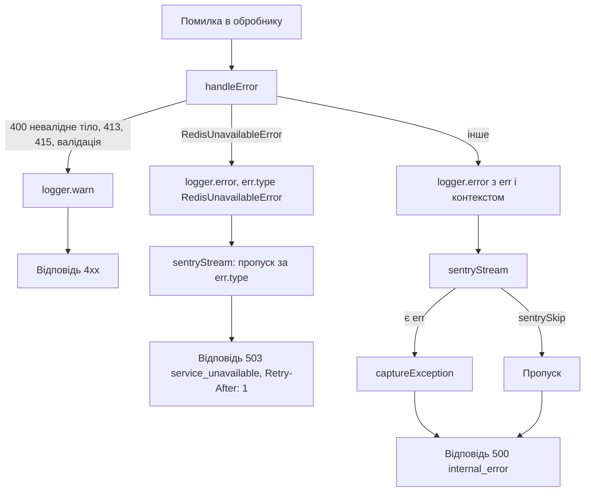

# Observability

Сторінка описує, як бекенд пише логи, що потрапляє в Sentry, як влаштований health check і чого в шаблоні поки немає (метрики, readiness). Змінні оточення Sentry перелічені в [Конфігурації](/backend/configuration), обробка помилок HTTP — у [Життєвому циклі запиту](/backend/request-lifecycle), Sentry-аргументи збірки фронтенду — у [Деплої](/backend/deployment).

## Логування

Логер — [pino](https://getpino.io) 10, єдиний екземпляр експортується з [logger.ts](https://github.com/Blazheiko/itvibe-template/blob/main/packages/backend/src/vendor/utils/logger.ts) (імпорт `#vendor/utils/logger.js`).

- **Рівень.** Опція `level` не задається, тож діє дефолт pino — `info`. Змінної `LOG_LEVEL` у коді немає; `debug`/`trace` не виводяться.
- **Формат.** Якщо `APP_ENV` дорівнює `prod` або `production`, логи йдуть у stdout як JSON-рядки (`destination({ sync: false })`). В інших оточеннях використовується `pino-pretty` з кольорами; пакет імпортується динамічно лише поза production.
- **Потоки.** `multistream` має два потоки: основний (stdout) і `sentryStream` рівня `error`, який пересилає помилки в Sentry (див. нижче).
- **Серіалізатори.** Додано лише серіалізатор `bigint` → рядок.
- **Redaction.** Опції pino `redact` немає. Маскування робиться вручну: хелпери `maskEmailForLogs` / маскування телефону в [mask-sensitive.ts](https://github.com/Blazheiko/itvibe-template/blob/main/packages/backend/src/vendor/utils/helpers/mask-sensitive.ts).

::: danger Токени в логах
Оскільки автоматичного redact немає, усе, що передано в об'єкт логу, пишеться як є. Відома проблема №3 у [code-issues-found-during-docs.md](https://github.com/Blazheiko/itvibe-template/blob/main/docs/plan/code-issues-found-during-docs.md) — токени потрапляють у логи. Не логуйте `httpData`, заголовки чи тіла запитів цілком.
:::

### Логер запиту

Для кожного HTTP-запиту і WS-повідомлення створюється дочірній логер `logger.child({ requestId })`, де `requestId` — `randomUUID()`. Він доступний у контролерах як `ctx.logger` ([http-context.ts](https://github.com/Blazheiko/itvibe-template/blob/main/packages/backend/src/vendor/utils/context/http-context.ts), [ws-context.ts](https://github.com/Blazheiko/itvibe-template/blob/main/packages/backend/src/vendor/utils/context/ws-context.ts)). `userId` у child-логер **не** додається.

### Що логується при помилці

`handleError` у [server.ts](https://github.com/Blazheiko/itvibe-template/blob/main/packages/backend/src/vendor/start/server.ts) використовує глобальний `logger`, а не логер запиту:

| Помилка                                       | Рівень  | Поля                                                        |
| --------------------------------------------- | ------- | ----------------------------------------------------------- |
| `PayloadTooLargeError`                        | `warn`  | `limit`, `contentType`                                      |
| `MalformedBodyError`                          | `warn`  | `bodyKind` (без тіла запиту й тексту помилки парсера)       |
| `UnsupportedMediaTypeError`                   | `warn`  | `receivedContentType`, `allowedKinds`                       |
| `ValidationError`, `ParameterValidationError` | `warn`  | `err`                                                       |
| `RedisUnavailableError` (відповідь 503)       | `error` | `err` + контекст; у Sentry не йде (див. нижче)              |
| інше (відповідь 500)                          | `error` | `err` + `requestId`, `userId`, `route`, `method` (контекст) |

Для маршрутів API контекст містить `requestId`, `userId`, `route.url`, `route.method`; для службового обробника документації маршрутів — лише `route` і `method`. Коди відповідей — у [Життєвому циклі запиту](/backend/request-lifecycle).

Також у [index.ts](https://github.com/Blazheiko/itvibe-template/blob/main/packages/backend/src/index.ts): `uncaughtException` логується як `error` з `sentrySkip: true` і окремо відправляється через `sentryService.captureException`; при graceful shutdown викликається `sentryService.flush(2000)`.

## Sentry (бекенд)

### Ініціалізація

[sentry-bootstrap.ts](https://github.com/Blazheiko/itvibe-template/blob/main/packages/backend/src/sentry-bootstrap.ts) — це перший імпорт у [index.ts](https://github.com/Blazheiko/itvibe-template/blob/main/packages/backend/src/index.ts): він завантажує `dotenv/config` і викликає `sentryService.init()`. Конфіг — [config/sentry.ts](https://github.com/Blazheiko/itvibe-template/blob/main/packages/backend/src/config/sentry.ts):

- Sentry активний, лише якщо `SENTRY_DSN` непорожній і `SENTRY_ENABLED` не `false`. Інакше всі методи сервісу — no-op.
- В `Sentry.init` передаються `dsn`, `environment` (`SENTRY_ENVIRONMENT` або `APP_ENV`), `release`, `tracesSampleRate` (дефолт `0`). Додаткові `integrations` не задаються — діють стандартні з `@sentry/node` 11.
- Помилка `Sentry.init` не зупиняє застосунок: пишеться `console.warn`, Sentry лишається вимкненим.

```dotenv
SENTRY_DSN=https://<public-key>@<org>.ingest.sentry.io/<project-id>
SENTRY_ENVIRONMENT=production
SENTRY_RELEASE=<git-sha>
SENTRY_TRACES_SAMPLE_RATE=0
```

### PII і санітизація

У Sentry 11 `sendDefaultPii` прибрано, тому [sentry-service.ts](https://github.com/Blazheiko/itvibe-template/blob/main/packages/backend/src/app/services/observability/sentry-service.ts) явно вимикає збір через `dataCollection`: `userInfo`, `cookies`, `httpBodies: []`, `genAI` inputs/outputs, `databaseQueryData`, `queues`, `stackFrameVariables` — усе `false`.

Додатково event processor `sanitizeEvent`:

- видаляє з `tags`, `extra`, `contexts` ключі, що збігаються з `/token|secret|password|cookie|auth|api[_-]?key|bearer/i`;
- видаляє заголовки `authorization`, `cookie` і ті, що збігаються з тим самим regex;
- видаляє `request.data`, якщо `status_code >= 400`, інакше обрізає його до 10 КБ.

З користувача в Sentry передається лише `id` (`scope.setUser({ id })`).

### Що потрапляє в Sentry

Логи пересилає `sentryStream` у [logger.ts](https://github.com/Blazheiko/itvibe-template/blob/main/packages/backend/src/vendor/utils/logger.ts). Правила:

1. Рівень нижче `error` (50) ігнорується — `warn` (4xx у `handleError`) у Sentry не йде.
2. `sentrySkip: true` — пропустити (використовується, коли помилку відправлено вручну). Так само пропускаються записи з `err.type === "RedisUnavailableError"`: інцидент уже зафіксовано модулем здоров'я Redis, див. [Відмова Redis](#відмова-redis).
3. Є поле `err` або `error` → `captureException`.
4. Інакше лише при `sentryCapture: true` → `captureMessage(msg, "error")`.

До події додаються теги `requestId`, `route`, `method` і `user.id`, якщо вони є в записі логу. `AppError` (об'єкти з `_tag`) нормалізуються в `Error` з ім'ям `AppError.<tag>`.

```ts
// повідомлення без exception — лише з явним прапорцем
ctx.logger.error({ sentryCapture: true, orderId }, 'Payment webhook mismatch')

// вже відправлено вручну — не дублювати
logger.error({ err, sentrySkip: true }, 'event uncaughtException')
```



### Відмова Redis

Стан основного Redis-клієнта тримає [redis-health.ts](https://github.com/Blazheiko/itvibe-template/blob/main/packages/backend/src/database/redis-health.ts): `healthy` або `unavailable`.

- **Одна подія на інцидент.** Перехід `healthy → unavailable` (перша подія `error`/`close` клієнта або перша `RedisUnavailableError` з `withRedis`) пише один `logger.error({ sentryCapture: true }, "Redis unavailable")` — це єдина подія Sentry за інцидент.
- **Поки інцидент триває**, модуль пише `warn` `"Redis still unavailable"` не частіше разу на хвилину і раз на 2 с шле фоновий `PING`.
- **Відновлення** — за першим із сигналів: успішна команда через `withRedis`, успішний фоновий `PING` або подія `ready` після reconnect. Тоді пишеться `info` `"Redis recovered"` з `downMs`, стан стає `healthy`, і наступний збій знову дасть одну подію.
- **На процес, а не на кластер.** Кожен процес має власний стан, тож N інстансів дадуть N подій; групує їх сам Sentry.
- **Інші записи не дублюють подію.** `sentryStream` пропускає записи, де `err.type === "RedisUnavailableError"` (поле, яке пише серіалізатор pino), — одне правило в транспорті замість правок у кожному місці.
- **Свідоме рішення щодо stdout.** `logger.error` із `handleError` і з login/logout/`logoutAll` під час збою лишаються в stdout на кожен запит: це діагностика конкретних запитів, і їхній обсяг обмежений самими запитами. Обмеження «раз на хвилину» діє лише для модуля здоров'я. Якщо обсяг логів стане проблемою, наступний крок — понизити ці записи до `warn`, а не прибирати.

### Сервіси observability

У [app/services/observability](https://github.com/Blazheiko/itvibe-template/blob/main/packages/backend/src/app/services/observability/sentry-service.ts) є лише `sentryService`: `init`, `isEnabled`, `captureException`, `captureMessage`, `withScope`, `flush`. Тести — [sentry-service.spec.ts](https://github.com/Blazheiko/itvibe-template/blob/main/packages/backend/src/app/services/observability/sentry-service.spec.ts).

## Sentry (фронтенд)

Фронтенд використовує `@sentry/vue` ([sentry-service.ts](https://github.com/Blazheiko/itvibe-template/blob/main/packages/frontend/src/utils/sentry-service.ts), [sentry-config.ts](https://github.com/Blazheiko/itvibe-template/blob/main/packages/frontend/src/utils/sentry-config.ts)). Налаштування задаються на етапі збірки через `VITE_SENTRY_DSN`, `VITE_SENTRY_ENABLED`, `VITE_SENTRY_ENVIRONMENT` (дефолт — Vite `MODE`), `VITE_SENTRY_RELEASE`, `VITE_SENTRY_TRACES_SAMPLE_RATE`, `VITE_SENTRY_REPLAYS_SESSION_SAMPLE_RATE`, `VITE_SENTRY_REPLAYS_ON_ERROR_SAMPLE_RATE`. Так само, як на бекенді, `dataCollection` вимикає збір PII. Як передати ці значення в Docker-збірку — у [Деплої](/backend/deployment).

## Health check

`GET /api/ping` ([http-routes.ts](https://github.com/Blazheiko/itvibe-template/blob/main/packages/backend/src/app/routes/http-routes.ts) → `MainController.ping` у [main-controller.ts](https://github.com/Blazheiko/itvibe-template/blob/main/packages/backend/src/app/controllers/http/core/main-controller.ts) → `mainService.ping` у [main-service.ts](https://github.com/Blazheiko/itvibe-template/blob/main/packages/backend/src/app/services/core/main-service.ts)) повертає статичне:

```json
{ "status": "ok" }
```

Ендпоінт підтверджує лише, що процес слухає порт. Він не перевіряє PostgreSQL, Redis, S3 чи SMTP.

::: warning Readiness check відсутній
Окремого readiness-ендпоінта немає. Якщо оркестратор має виводити інстанс з балансування при недоступній БД чи Redis, потрібен окремий маршрут (наприклад, `SELECT 1` + `PING` у Redis). Шаблон вимог для цього — [template-health-readiness-observability.md](https://github.com/Blazheiko/itvibe-template/blob/main/docs/requirements/operations/template-health-readiness-observability.md).
:::

## Метрики і трасування

- Prometheus/OpenTelemetry-метрик у бекенді немає: серед залежностей [package.json](https://github.com/Blazheiko/itvibe-template/blob/main/packages/backend/package.json) є лише `@sentry/node`, `pino`, `pino-pretty`. `@opentelemetry/api` у lockfile — транзитивна залежність, у коді не використовується.
- Трасування можливе лише через Sentry performance: `SENTRY_TRACES_SAMPLE_RATE` > 0 (дефолт `0` — трасування вимкнене).

## Практика

**Читати логи локально.** `pnpm dev:backend` виводить pretty-логи. Щоб знайти всі записи одного запиту, шукайте його `requestId`. У production (`APP_ENV=production`) логи — JSON, їх зручно фільтрувати через `jq`:

```bash
docker logs <container> | jq 'select(.level >= 50)'
docker logs <container> | jq 'select(.requestId == "<uuid>")'
```

**Перевірити Sentry.** Задайте `SENTRY_DSN` і перезапустіть бекенд. У `MainController` є метод `testSentryError`, який кидає `new Error("Sentry test error")`, але він не підключений до маршруту.

::: warning testSentryError недоступний
Відома проблема №27 у [code-issues-found-during-docs.md](https://github.com/Blazheiko/itvibe-template/blob/main/docs/plan/code-issues-found-during-docs.md): `testSentryError` не зареєстрований у маршрутах. Щоб перевірити інтеграцію, тимчасово додайте маршрут у [http-routes.ts](https://github.com/Blazheiko/itvibe-template/blob/main/packages/backend/src/app/routes/http-routes.ts) (не для production) або викличте `logger.error({ err: new Error('test') }, 'sentry test')`.
:::
