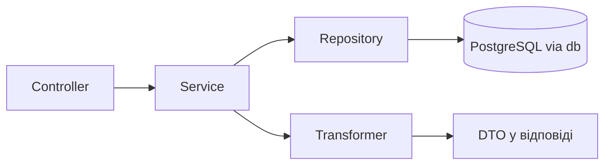

# Репозиторії та трансформери

Репозиторії — це єдиний шар, який (за задумом) пише SQL через Drizzle. Трансформери перетворюють рядки БД на публічні DTO. Загальну схему шарів див. на сторінці [«Архітектура»](/backend/architecture), про схему та міграції — [«База даних»](/backend/database), покроковий приклад нового ресурсу — [«Додавання фічі»](/backend/adding-a-feature).



## Структура репозиторіїв

Репозиторії лежать у [`app/repositories/`](https://github.com/Blazheiko/itvibe-template/blob/main/packages/backend/src/app/repositories/index.ts), згруповані за доменами: `ai/`, `auth/`, `communication/`, `notifications/`, `support/`, `user/`. Кожен модуль експортує **об'єкт-літерал** (не клас) з async-методами, часто типізований інтерфейсом, наприклад `export const userRepository: IUserRepository = { ... }` у [user-repository.ts](https://github.com/Blazheiko/itvibe-template/blob/main/packages/backend/src/app/repositories/user/user-repository.ts).

Barrel [repositories/index.ts](https://github.com/Blazheiko/itvibe-template/blob/main/packages/backend/src/app/repositories/index.ts) реекспортує частину репозиторіїв і їх типи (`UserRow`, `UserInsert`, `UserUpdate`, …). Не всі: `promptRepository`, `supportRepository` і `supportKnowledgeRepository` у barrel відсутні й імпортуються напряму за шляхом файлу (наприклад, у [prompt-service.ts](https://github.com/Blazheiko/itvibe-template/blob/main/packages/backend/src/app/services/ai/prompt-service.ts) і [support-service.ts](https://github.com/Blazheiko/itvibe-template/blob/main/packages/backend/src/app/services/support/support-service.ts)).

### Доступ до БД

Кожен репозиторій імпортує єдиний інстанс Drizzle і таблиці зі схеми:

```ts
import { db } from '#database/db.js'
import { users } from '#database/schema.js'
import type { InferInsertModel, InferSelectModel } from 'drizzle-orm'

export type UserRow = InferSelectModel<typeof users>
export type UserInsert = InferInsertModel<typeof users>
```

Типи рядків виводяться з таблиць через `InferSelectModel` / `InferInsertModel`, а типи оновлень — через `Partial<Pick<...>>` ([user-repository.ts](https://github.com/Blazheiko/itvibe-template/blob/main/packages/backend/src/app/repositories/user/user-repository.ts)).

### Типові методи та повернені значення

- **`create`** — `db.insert(...).values(...).returning()`; якщо рядок не повернувся, кидається `Error` (`"Failed to create user"`). Поля `createdAt`/`updatedAt` виставляє сам репозиторій.
- **`findBy*`** — `select().from().where().limit(1).then((rows) => rows.at(0))`; відсутність запису — це `undefined`, а не `null` і не виняток.
- **`update` / `delete`** — повертають оновлений рядок (`UserRow | undefined`) або `boolean`.
- Репозиторії повертають **сирі рядки Drizzle** (`bigint` id, `Date`) або вузькі проєкції (`AdminUserListRow` з `select({ id, name, ... })`). Вони не повертають `Result` — обгортання помилок робить сервіс, наприклад `tryInternal(() => userRepository.findById(...))` у [main-service.ts](https://github.com/Blazheiko/itvibe-template/blob/main/packages/backend/src/app/services/core/main-service.ts).

### Патерни запитів

| Патерн                                                                  | Приклад                                                                                                                                                                                                                                                                                                                                                      |
| ----------------------------------------------------------------------- | ------------------------------------------------------------------------------------------------------------------------------------------------------------------------------------------------------------------------------------------------------------------------------------------------------------------------------------------------------------ |
| Динамічний `WHERE` з масиву `SQL[]` + `and(...)`                        | `listAdminUsers` у [user-repository.ts](https://github.com/Blazheiko/itvibe-template/blob/main/packages/backend/src/app/repositories/user/user-repository.ts), `buildHistoryWhereClause` у [user-online-repository.ts](https://github.com/Blazheiko/itvibe-template/blob/main/packages/backend/src/app/repositories/communication/user-online-repository.ts) |
| Пагінація `limit`/`offset`                                              | `findText` у [llm-usage-repository.ts](https://github.com/Blazheiko/itvibe-template/blob/main/packages/backend/src/app/repositories/ai/usage/llm-usage-repository.ts), `findAll` у [support-knowledge-repository.ts](https://github.com/Blazheiko/itvibe-template/blob/main/packages/backend/src/app/repositories/support/support-knowledge-repository.ts)   |
| Затиснутий `limit` (1..100) + паралельний `count()` через `Promise.all` | `listAdminUsers`, `listHistory`                                                                                                                                                                                                                                                                                                                              |
| Фрагменти `sql`                                                         | регістронезалежний пошук `LOWER(email)`, атомарний інкремент `attemptCount + 1` у [sms-auth-challenge-repository.ts](https://github.com/Blazheiko/itvibe-template/blob/main/packages/backend/src/app/repositories/auth/sms-auth-challenge-repository.ts), `count(*)` у `getTextStats`                                                                        |
| Сирий SQL через `db.execute` + pgvector                                 | `setEmbedding`, `clearEmbedding`, `searchByEmbedding` (оператор `<=>`, `::vector`) у [support-knowledge-repository.ts](https://github.com/Blazheiko/itvibe-template/blob/main/packages/backend/src/app/repositories/support/support-knowledge-repository.ts)                                                                                                 |

Joins, upsert (`onConflict*`) і транзакції в репозиторіях не використовуються. Пов'язані дані підтягуються окремими запитами: `findByUserIdWithLogs` у [push-subscription-repository.ts](https://github.com/Blazheiko/itvibe-template/blob/main/packages/backend/src/app/repositories/notifications/push-subscription-repository.ts) робить по одному запиту логів на кожну підписку (N+1).

Фрагмент pgvector-пошуку:

```ts
sql`
    SELECT id, title, content, screenshot_key, screenshot_mime,
           embedding <=> ${vecStr}::vector AS distance
    FROM support_knowledge_base
    WHERE is_active = true AND embedding IS NOT NULL
    ORDER BY distance ASC
    LIMIT ${limit}
`
```

Результат `db.execute` вручну мапиться в camelCase і нормалізує `id`/`distance`, які можуть прийти рядками. Для роботи потрібне розширення pgvector.

::: warning
Розширення pgvector ніде не задокументоване як вимога — див. п. 7 у [code-issues-found-during-docs.md](https://github.com/Blazheiko/itvibe-template/blob/main/docs/plan/code-issues-found-during-docs.md).
:::

### Redis

Redis-репозиторіїв немає: у `app/repositories/` усі модулі працюють лише з PostgreSQL. Redis використовується напряму з сервісів і WS-шару — [auth-throttle-service.ts](https://github.com/Blazheiko/itvibe-template/blob/main/packages/backend/src/app/services/auth/auth-throttle-service.ts) (Lua `INCR`+`EXPIRE`, ключ `auth:throttle:*`), [generate-ws-token-service.ts](https://github.com/Blazheiko/itvibe-template/blob/main/packages/backend/src/app/services/auth/generate-ws-token-service.ts) (`setex`), [ws-session-auth.ts](https://github.com/Blazheiko/itvibe-template/blob/main/packages/backend/src/app/websocket/ws-session-auth.ts) (`auth:ws:*`).

### Зведена таблиця

| Репозиторій                                                                                                                                                                  | Таблиця(і)                                  | Ключові методи                                                                                                                            |
| ---------------------------------------------------------------------------------------------------------------------------------------------------------------------------- | ------------------------------------------- | ----------------------------------------------------------------------------------------------------------------------------------------- |
| [`userRepository`](https://github.com/Blazheiko/itvibe-template/blob/main/packages/backend/src/app/repositories/user/user-repository.ts)                                     | `users`                                     | `create`, `findById`, `findByEmail`, `findByPhone`, `findBySessionToken`, `listAdminUsers`, `emailExistsForOtherUser`, `update`, `delete` |
| [`oauthAccountRepository`](https://github.com/Blazheiko/itvibe-template/blob/main/packages/backend/src/app/repositories/auth/oauth-account-repository.ts)                    | `oauthAccounts`                             | `findByProviderAndProviderId`, `findByUserId`, `create`, `updateTokens`                                                                   |
| [`emailVerificationRepository`](https://github.com/Blazheiko/itvibe-template/blob/main/packages/backend/src/app/repositories/auth/email-verification-repository.ts)          | `emailVerifications`                        | `create`, `findByTokenHash`, `invalidatePendingByUserId`, `markUsed`                                                                      |
| [`emailLinkVerificationRepository`](https://github.com/Blazheiko/itvibe-template/blob/main/packages/backend/src/app/repositories/auth/email-link-verification-repository.ts) | `emailLinkVerifications`                    | те саме                                                                                                                                   |
| [`passwordResetRepository`](https://github.com/Blazheiko/itvibe-template/blob/main/packages/backend/src/app/repositories/auth/password-reset-repository.ts)                  | `passwordResetTokens`                       | те саме                                                                                                                                   |
| [`smsAuthChallengeRepository`](https://github.com/Blazheiko/itvibe-template/blob/main/packages/backend/src/app/repositories/auth/sms-auth-challenge-repository.ts)           | `smsAuthChallenges`                         | `findLatestPendingForPhoneFlow`, `markIssued`, `incrementAttemptCount`, `markConfirmed`, `markInvalidated`                                |
| [`userOnlineRepository`](https://github.com/Blazheiko/itvibe-template/blob/main/packages/backend/src/app/repositories/communication/user-online-repository.ts)               | `userOnline`                                | `create`, `findBySocketUuid`, `completeBySocketUuid`, `listHistory`, `countHistory`                                                       |
| [`pushSubscriptionRepository`](https://github.com/Blazheiko/itvibe-template/blob/main/packages/backend/src/app/repositories/notifications/push-subscription-repository.ts)   | `pushSubscriptions`, `pushNotificationLogs` | `findByEndpoint`, `findByUserIdWithLogs`, `update`, `deactivate`, `delete`, `getLogsBySubscriptionId`                                     |
| [`llmUsageRepository`](https://github.com/Blazheiko/itvibe-template/blob/main/packages/backend/src/app/repositories/ai/usage/llm-usage-repository.ts)                        | `llmTextUsage`                              | `insertText`, `findText`, `countText`, `getTextStats`                                                                                     |
| [`promptRepository`](https://github.com/Blazheiko/itvibe-template/blob/main/packages/backend/src/app/repositories/ai/prompt-repository.ts)                                   | `llmSystemPrompts`                          | `findAll`, `findByType`, `update`                                                                                                         |
| [`supportRepository`](https://github.com/Blazheiko/itvibe-template/blob/main/packages/backend/src/app/repositories/support/support-repository.ts)                            | `supportChatHistory`                        | `addChatMessage`, `findChatHistory`, `deleteAllChatHistory`                                                                               |
| [`supportKnowledgeRepository`](https://github.com/Blazheiko/itvibe-template/blob/main/packages/backend/src/app/repositories/support/support-knowledge-repository.ts)         | `supportKnowledgeBase`                      | `findAll`, `create`, `update`, `setScreenshot`, `setEmbedding`, `searchByEmbedding`                                                       |

## Трансформери

Трансформери в [`app/transformers/`](https://github.com/Blazheiko/itvibe-template/blob/main/packages/backend/src/app/transformers/index.ts) — це об'єкти з методами `serialize` / `serializeArray` (у push-підписок ще `serializeWithLogs` / `serializeArrayWithLogs`). Вони:

- приводять `bigint` id до `string`;
- переводять `Date` у ISO-рядок через `luxon` (`DateTime.fromJSDate(...).toISO()`), з перейменуванням `createdAt`/`updatedAt` → `created_at`/`updated_at`;
- прибирають чутливі поля: [user-transformer.ts](https://github.com/Blazheiko/itvibe-template/blob/main/packages/backend/src/app/transformers/user-transformer.ts) відкидає `password` та `isAdmin` і додає похідне `emailVerified: boolean`.

```ts
serialize(user: UserRow): SerializedUser {
    const { id, password: _password, isAdmin: _isAdmin, createdAt, updatedAt, emailVerifiedAt, ...rest } = user
    return { ...rest, id: String(id), created_at: DateTime.fromJSDate(createdAt).toISO(), /* ... */ }
}
```

Тип результату (`SerializedUser`, `SerializedPushSubscription`) виводиться з типу рядка через `Omit<...> & {...}`, тож він живе в бекенді й **не імпортується** з `packages/shared`. Схеми відповідей у [packages/shared/src/responses](https://github.com/Blazheiko/itvibe-template/blob/main/packages/shared/src/responses/main-controller.ts) описані окремо (ArkType + інтерфейси); відповідність DTO і схеми не перевіряється компілятором, а лише валідацією відповіді (див. [«Валідація»](/backend/validation)).

### Де використовуються

Трансформери викликаються в **сервісах**: `userTransformer` — у [auth-service.ts](https://github.com/Blazheiko/itvibe-template/blob/main/packages/backend/src/app/services/auth/auth-service.ts) і `mainService.saveUser` у [main-service.ts](https://github.com/Blazheiko/itvibe-template/blob/main/packages/backend/src/app/services/core/main-service.ts); `pushSubscriptionTransformer` — у [push-subscription-service.ts](https://github.com/Blazheiko/itvibe-template/blob/main/packages/backend/src/app/services/notifications/push-subscription-service.ts) і [push-subscription-statistics-service.ts](https://github.com/Blazheiko/itvibe-template/blob/main/packages/backend/src/app/services/statistics/push-subscription-statistics-service.ts).

Обхід: `mainService.init` збирає об'єкт користувача вручну (див. [«Архітектура»](/backend/architecture)); адмінські списки, AI-, support- та online-історія повертають рядки або проєкції репозиторіїв без трансформера.

## Правила та фактичні відхилення

- У репозиторіях — лише доступ до даних: побудова запитів, проставлення `createdAt`/`updatedAt`. Бізнес-рішення (перевірка сесії, коди помилок) — у сервісах.
- Виняток у репозиторії: [user-online-repository.ts](https://github.com/Blazheiko/itvibe-template/blob/main/packages/backend/src/app/repositories/communication/user-online-repository.ts) імпортує `logger`.

::: warning
Правило «БД лише через репозиторії» порушується в двох сервісах, які імпортують `db` напряму:
[push-notification-sender-service.ts](https://github.com/Blazheiko/itvibe-template/blob/main/packages/backend/src/app/services/notifications/push-notification-sender-service.ts) (`db.insert(pushNotificationLogs)`) і
[push-subscription-statistics-service.ts](https://github.com/Blazheiko/itvibe-template/blob/main/packages/backend/src/app/services/statistics/push-subscription-statistics-service.ts) (`db.select().from(pushNotificationLogs)`).
Крім того, репозиторії викликаються не лише з сервісів: [admin-user-controller.ts](https://github.com/Blazheiko/itvibe-template/blob/main/packages/backend/src/app/controllers/http/admin/admin-user-controller.ts), [admin-guard.ts](https://github.com/Blazheiko/itvibe-template/blob/main/packages/backend/src/app/middlewares/admin-guard.ts) і [ws-coordinator.ts](https://github.com/Blazheiko/itvibe-template/blob/main/packages/backend/src/app/websocket/ws-coordinator.ts) імпортують `userRepository`.
:::

## Тестування

Окремих spec-файлів для репозиторіїв чи трансформерів немає. Їх мокають у тестах сервісів через `vi.mock` barrel-модулів, наприклад у [push-subscription-service.spec.ts](https://github.com/Blazheiko/itvibe-template/blob/main/packages/backend/src/app/services/notifications/push-subscription-service.spec.ts):

```ts
vi.mock('#app/repositories/index.js', () => ({
    pushSubscriptionRepository: pushSubscriptionRepositoryMock,
}))
vi.mock('#app/transformers/index.js', () => ({
    pushSubscriptionTransformer: pushSubscriptionTransformerMock,
}))
```

Так само мокаються репозиторії в `auth-service.spec.ts`, `main-service.spec.ts`, `support-service.spec.ts`, `knowledge-base-service.spec.ts` та інших. Оскільки сервіси, що звертаються до `db` напряму, обходять цей мок, для них доведеться мокати `#database/db.js`. Трансформери — чисті функції, тож їх легко тестувати без моків (так зроблено в прикладі [«Додавання фічі»](/backend/adding-a-feature)).
