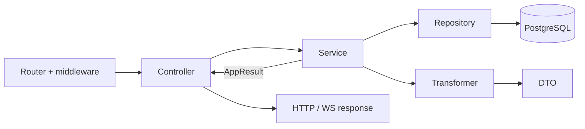

# Репозиторії

Репозиторій — це **шар доступу до даних**: єдине місце, де (за задумом) пишеться SQL через Drizzle. Кожен репозиторій відповідає за одну таблицю чи тісно пов'язану групу таблиць і надає сервісам набір іменованих операцій — `findById`, `findByEmail`, `create`, `markUsed` — замість сирих запитів.

## Навіщо потрібен цей шар

- **SQL в одному місці.** Сервіс говорить мовою домену («знайди користувача за email»), а не мовою запитів. Коли змінюється схема, індекс чи спосіб пошуку (наприклад, `LOWER(email)`), правиться один метод репозиторію, а не всі сервіси.
- **Типи з схеми.** Типи рядків (`UserRow`, `UserInsert`) виводяться з таблиць Drizzle через `InferSelectModel` / `InferInsertModel`, тому зміна колонки одразу підсвічує всі місця використання.
- **Тестованість сервісів.** Сервіси імпортують репозиторії лише через barrel `#app/repositories/index.js`, тож у тестах його легко замінити `vi.mock` і перевіряти бізнес-логіку без PostgreSQL.
- **Чітка відповідальність.** Репозиторій не приймає бізнес-рішень, не логує і не загортає помилки в `Result` — він лише читає й пише дані. Рішення «що робити, якщо запису немає» приймає сервіс.
- **Оптимізація запитів у одному місці.** Пагінація, агрегати в SQL, пакетне підтягування пов'язаних даних без N+1, pgvector-пошук — усе це деталі реалізації, сховані за простим методом.

Про схему БД і міграції — [База даних](/backend/database).



## Структура

Репозиторії лежать у [`app/repositories/`](https://github.com/Blazheiko/vibe-template/blob/main/packages/backend/src/app/repositories/index.ts), згруповані за доменами: `ai/`, `auth/`, `communication/`, `health/`, `notifications/`, `support/`, `user/`. Кожен модуль експортує **об'єкт-літерал** (не клас) з async-методами, часто типізований інтерфейсом, наприклад `export const userRepository: IUserRepository = { ... }` у [user-repository.ts](https://github.com/Blazheiko/vibe-template/blob/main/packages/backend/src/app/repositories/user/user-repository.ts).

Barrel [repositories/index.ts](https://github.com/Blazheiko/vibe-template/blob/main/packages/backend/src/app/repositories/index.ts) реекспортує всі репозиторії і їх типи (`UserRow`, `PromptType`, `KbArticleRow`, …). Поза `app/repositories` імпорт іде лише через нього; це й повноту barrel перевіряє [`layering.spec.ts`](https://github.com/Blazheiko/vibe-template/blob/main/packages/backend/src/app/layering.spec.ts).

## Доступ до БД

Кожен репозиторій імпортує єдиний інстанс Drizzle і таблиці зі схеми:

```ts
import { db } from '#database/db.js'
import { users } from '#database/schema.js'
import type { InferInsertModel, InferSelectModel } from 'drizzle-orm'

export type UserRow = InferSelectModel<typeof users>
export type UserInsert = InferInsertModel<typeof users>
```

Типи рядків виводяться з таблиць через `InferSelectModel` / `InferInsertModel`, а типи оновлень — через `Partial<Pick<...>>` ([user-repository.ts](https://github.com/Blazheiko/vibe-template/blob/main/packages/backend/src/app/repositories/user/user-repository.ts)).

## Типові методи та повернені значення

- **`create`** — `db.insert(...).values(...).returning()`; якщо рядок не повернувся, кидається `Error` (`"Failed to create user"`). Поля `createdAt`/`updatedAt` виставляє сам репозиторій.
- **`findBy*`** — `select().from().where().limit(1).then((rows) => rows.at(0))`; відсутність запису — це `undefined`, а не `null` і не виняток.
- **`update` / `delete`** — повертають оновлений рядок (`UserRow | undefined`) або `boolean`.
- Репозиторії повертають **сирі рядки Drizzle** (`bigint` id, `Date`) або вузькі проєкції (`AdminUserListRow` з `select({ id, name, ... })`). Вони не повертають `Result` — обгортання помилок робить сервіс, наприклад `tryInternal(() => userRepository.findById(...))` у [main-service.ts](https://github.com/Blazheiko/vibe-template/blob/main/packages/backend/src/app/services/core/main-service.ts).

## Патерни запитів

| Патерн                                                                  | Приклад                                                                                                                                                                                                                                                                                                                                                                                                                                          |
| ----------------------------------------------------------------------- | ------------------------------------------------------------------------------------------------------------------------------------------------------------------------------------------------------------------------------------------------------------------------------------------------------------------------------------------------------------------------------------------------------------------------------------------------ |
| Динамічний `WHERE` з масиву `SQL[]` + `and(...)`                        | `listAdminUsers` у [user-repository.ts](https://github.com/Blazheiko/vibe-template/blob/main/packages/backend/src/app/repositories/user/user-repository.ts), `buildHistoryWhereClause` у [user-online-repository.ts](https://github.com/Blazheiko/vibe-template/blob/main/packages/backend/src/app/repositories/communication/user-online-repository.ts)                                                                                         |
| Пагінація `limit`/`offset`                                              | `findText` у [llm-usage-repository.ts](https://github.com/Blazheiko/vibe-template/blob/main/packages/backend/src/app/repositories/ai/usage/llm-usage-repository.ts), `findAll` у [support-knowledge-repository.ts](https://github.com/Blazheiko/vibe-template/blob/main/packages/backend/src/app/repositories/support/support-knowledge-repository.ts)                                                                                           |
| Затиснутий `limit` (1..100) + паралельний `count()` через `Promise.all` | `listAdminUsers`, `listHistory`                                                                                                                                                                                                                                                                                                                                                                                                                  |
| Фрагменти `sql`                                                         | регістронезалежний пошук `LOWER(email)`, атомарний інкремент `attemptCount + 1` у [sms-auth-challenge-repository.ts](https://github.com/Blazheiko/vibe-template/blob/main/packages/backend/src/app/repositories/auth/sms-auth-challenge-repository.ts), `count(*)` у `getTextStats`                                                                                                                                                              |
| pgvector                                                                | `setEmbedding` і `clearEmbedding` — звичайний `update().set()` (вектор як літерал `[…]`, `NULL` разом з `updatedAt` одним запитом); `searchByEmbedding` — `db.execute` з оператором `<=>` і `::vector`, колонки й таблиця підставляються з об'єктів схеми, а не рядками; у [support-knowledge-repository.ts](https://github.com/Blazheiko/vibe-template/blob/main/packages/backend/src/app/repositories/support/support-knowledge-repository.ts) |

Joins, upsert (`onConflict*`) і транзакції в репозиторіях не використовуються. Пов'язані дані підтягуються окремим запитом на всю вибірку, а не на кожен рядок: `findByUserIdWithLogs` у [push-subscription-repository.ts](https://github.com/Blazheiko/vibe-template/blob/main/packages/backend/src/app/repositories/notifications/push-subscription-repository.ts) бере підписки, а потім одним запитом до 5 останніх логів кожної через `row_number() over (partition by subscription_id order by sent_at desc, id desc)` ([push-notification-log-repository.ts](https://github.com/Blazheiko/vibe-template/blob/main/packages/backend/src/app/repositories/notifications/push-notification-log-repository.ts)). Агрегати рахуються в SQL (`count(case …)`), а не в JS.

Фрагмент pgvector-пошуку:

```ts
sql`
    SELECT id, title, content, screenshot_key, screenshot_mime,
           embedding <=> ${vecStr}::vector AS distance
    FROM support_knowledge_base
    WHERE is_active = true AND embedding IS NOT NULL
    ORDER BY distance ASC
    LIMIT ${limit}
`
```

Результат `db.execute` вручну мапиться в camelCase і нормалізує `id`/`distance`, які можуть прийти рядками. Для роботи потрібне розширення pgvector, див. [База даних → pgvector](/backend/database#pgvector).

## Redis

Redis-репозиторіїв немає: у `app/repositories/` усі модулі працюють лише з PostgreSQL. Redis використовується напряму з сервісів і WS-шару — [auth-throttle-service.ts](https://github.com/Blazheiko/vibe-template/blob/main/packages/backend/src/app/services/auth/auth-throttle-service.ts) (Lua `INCR`+`EXPIRE`, ключ `auth:throttle:*`), [generate-ws-token-service.ts](https://github.com/Blazheiko/vibe-template/blob/main/packages/backend/src/app/services/auth/generate-ws-token-service.ts) (`setex`), [ws-session-auth.ts](https://github.com/Blazheiko/vibe-template/blob/main/packages/backend/src/app/websocket/ws-session-auth.ts) (`auth:ws:*`).

## Зведена таблиця

| Репозиторій                                                                                                                                                                     | Таблиця(і)                                  | Ключові методи                                                                                                                            |
| ------------------------------------------------------------------------------------------------------------------------------------------------------------------------------- | ------------------------------------------- | ----------------------------------------------------------------------------------------------------------------------------------------- |
| [`userRepository`](https://github.com/Blazheiko/vibe-template/blob/main/packages/backend/src/app/repositories/user/user-repository.ts)                                          | `users`                                     | `create`, `findById`, `findByEmail`, `findByPhone`, `findBySessionToken`, `listAdminUsers`, `emailExistsForOtherUser`, `update`, `delete` |
| [`oauthAccountRepository`](https://github.com/Blazheiko/vibe-template/blob/main/packages/backend/src/app/repositories/auth/oauth-account-repository.ts)                         | `oauthAccounts`                             | `findByProviderAndProviderId`, `findByUserId`, `create`, `updateTokens`                                                                   |
| [`emailVerificationRepository`](https://github.com/Blazheiko/vibe-template/blob/main/packages/backend/src/app/repositories/auth/email-verification-repository.ts)               | `emailVerifications`                        | `create`, `findByTokenHash`, `invalidatePendingByUserId`, `markUsed`                                                                      |
| [`emailLinkVerificationRepository`](https://github.com/Blazheiko/vibe-template/blob/main/packages/backend/src/app/repositories/auth/email-link-verification-repository.ts)      | `emailLinkVerifications`                    | те саме                                                                                                                                   |
| [`passwordResetRepository`](https://github.com/Blazheiko/vibe-template/blob/main/packages/backend/src/app/repositories/auth/password-reset-repository.ts)                       | `passwordResetTokens`                       | те саме                                                                                                                                   |
| [`smsAuthChallengeRepository`](https://github.com/Blazheiko/vibe-template/blob/main/packages/backend/src/app/repositories/auth/sms-auth-challenge-repository.ts)                | `smsAuthChallenges`                         | `findLatestPendingForPhoneFlow`, `markIssued`, `incrementAttemptCount`, `markConfirmed`, `markInvalidated`                                |
| [`userOnlineRepository`](https://github.com/Blazheiko/vibe-template/blob/main/packages/backend/src/app/repositories/communication/user-online-repository.ts)                    | `userOnline`                                | `create`, `findBySocketUuid`, `completeBySocketUuid`, `listHistory`, `countHistory`                                                       |
| [`pushSubscriptionRepository`](https://github.com/Blazheiko/vibe-template/blob/main/packages/backend/src/app/repositories/notifications/push-subscription-repository.ts)        | `pushSubscriptions`, `pushNotificationLogs` | `findByEndpoint`, `findByUserIdWithLogs`, `update`, `touchLastUsed`, `deactivate`, `delete`, `getLogsBySubscriptionId`                    |
| [`pushNotificationLogRepository`](https://github.com/Blazheiko/vibe-template/blob/main/packages/backend/src/app/repositories/notifications/push-notification-log-repository.ts) | `pushNotificationLogs`                      | `insertMany`, `countsBySubscription`, `latestBySubscriptionIds`                                                                           |
| [`llmUsageRepository`](https://github.com/Blazheiko/vibe-template/blob/main/packages/backend/src/app/repositories/ai/usage/llm-usage-repository.ts)                             | `llmTextUsage`                              | `insertText`, `findText`, `countText`, `getTextStats`                                                                                     |
| [`promptRepository`](https://github.com/Blazheiko/vibe-template/blob/main/packages/backend/src/app/repositories/ai/prompt-repository.ts)                                        | `llmSystemPrompts`                          | `findAll`, `findByType`, `update`                                                                                                         |
| [`supportRepository`](https://github.com/Blazheiko/vibe-template/blob/main/packages/backend/src/app/repositories/support/support-repository.ts)                                 | `supportChatHistory`                        | `addChatMessage`, `findChatHistory`, `deleteAllChatHistory`                                                                               |
| [`supportKnowledgeRepository`](https://github.com/Blazheiko/vibe-template/blob/main/packages/backend/src/app/repositories/support/support-knowledge-repository.ts)              | `supportKnowledgeBase`                      | `findAll`, `create`, `update`, `setScreenshot`, `setEmbedding`, `searchByEmbedding`                                                       |
| [`healthRepository`](https://github.com/Blazheiko/vibe-template/blob/main/packages/backend/src/app/repositories/health/health-repository.ts)                                    | —                                           | `pingDatabase` (`SELECT 1` для health-check)                                                                                              |

## Правила

- У репозиторіях — лише доступ до даних: побудова запитів, проставлення `createdAt`/`updatedAt`. Бізнес-рішення (перевірка сесії, коди помилок) — у сервісах.
- Репозиторії не логують: `completeBySocketUuid` повертає `false`, а попередження «no record found on disconnect» пише `userOnlineService`.
- Репозиторії викликаються лише з сервісів; контролери, middleware і WS-координатор ідуть через сервіси.

## Тестування

Окремих spec-файлів для репозиторіїв немає. Їх мокають у тестах сервісів через `vi.mock` barrel-модуля, наприклад у [push-subscription-service.spec.ts](https://github.com/Blazheiko/vibe-template/blob/main/packages/backend/src/app/services/notifications/push-subscription-service.spec.ts):

```ts
vi.mock('#app/repositories/index.js', () => ({
    pushSubscriptionRepository: pushSubscriptionRepositoryMock,
}))
```

Так само мокаються репозиторії в `auth-service.spec.ts`, `main-service.spec.ts`, `support-service.spec.ts`, `knowledge-base-service.spec.ts` та інших. Оскільки сервіси, що звертаються до `db` напряму, обходять цей мок, для них доведеться мокати `#database/db.js`.

## Суміжні шари

- [Контролери](/backend/controllers) — HTTP/WS-адаптери: приймають запит і віддають відповідь.
- [Сервіси](/backend/services) — бізнес-логіка, повертають `AppResult<T>`.
- [Репозиторії](/backend/repositories) — єдине місце, де пишеться SQL.
- [Трансформери](/backend/transformers) — перетворення рядків БД на публічні DTO.

Загальна схема — [Архітектура](/backend/architecture), покроковий приклад — [Додавання фічі](/backend/adding-a-feature).
