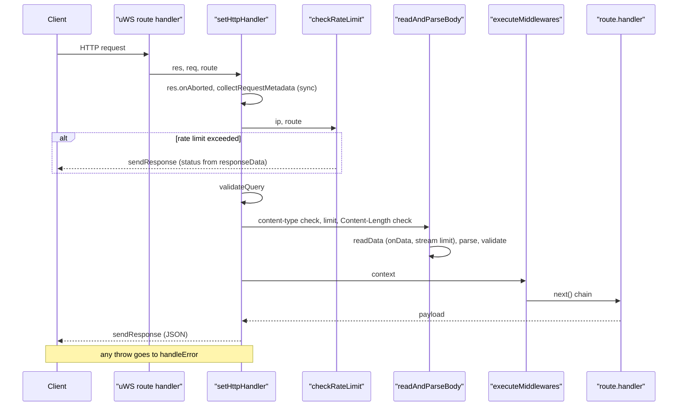
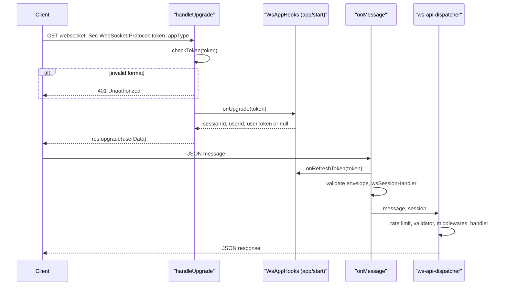

# Життєвий цикл запиту

Ця сторінка простежує шлях HTTP-запиту та WebSocket-з'єднання від старту процесу до відправки відповіді. Усе описане нижче реалізовано у `packages/backend/src/vendor/`; посилання ведуть на актуальний код.

## Старт сервера

[index.ts](https://github.com/Blazheiko/itvibe-template/blob/main/packages/backend/src/index.ts) у функції `start()`:

1. `validateRuntimeConfig()` — перевірка конфігурації (див. [/backend/configuration](/backend/configuration));
2. `promptService.load()`;
3. `routesHandler(httpRoutes)` і `routesHandler(wsRoutes)` з [router.ts](https://github.com/Blazheiko/itvibe-template/blob/main/packages/backend/src/vendor/start/router.ts) розгортають групи у плоский список `RouteItem` (префікс `appConfig.pathPrefix`, злиття `middlewares`, успадкування `rateLimit`, витяг `:param` у `parametersKey`);
4. `createWsRoutesByUrl` будує таблицю WS-маршрутів (лише точний збіг URL, без `:param`);
5. `initServer(...)` з [server.ts](https://github.com/Blazheiko/itvibe-template/blob/main/packages/backend/src/vendor/start/server.ts) викликає `configureWebsockets`, `configureHttp` і `listen` (або `listen_unix`, якщо задано `unixPath`). Токен прослуховування зберігається в `state.listenSocket`.

Сигнали `SIGINT`/`SIGHUP`/`SIGTERM` запускають `stopGracefully`: `stopServer` (закриття всіх WS і listen-сокета), `sentryService.flush`, закриття пулу БД і Redis.

## Реєстрація HTTP-обробників

`configureHttp` реєструє: кеш статики (якщо `serveStatic`), кожен маршрут через `registerHttpRoute` (`server.get/post/put/patch/del`), і catch-all `server.any("/*")`, який:

- для `OPTIONS` при `corsConfig.enabled` відповідає `200` з CORS-заголовками (preflight);
- для невідомого шляху під `/<pathPrefix>/` повертає `404` `{ status: "error", code: "not_found", message: "Route not found" }`;
- для інших `GET` віддає статику (`staticHandler`), інакше — `404`.

`setCorsHeader` завжди пише `Vary: Origin`, а `Access-Control-Allow-*` — лише якщо `Origin` є в `corsConfig.allowedOrigins`.

## Обробка HTTP-запиту (setHttpHandler)

Кроки у [server.ts](https://github.com/Blazheiko/itvibe-template/blob/main/packages/backend/src/vendor/start/server.ts):

1. **Відмова під час зупинки.** Якщо `state.listenSocket === undefined`, з'єднання закривається (`res.close()`).
2. **onAborted.** Реєструється один раз; прапорець передається в `readData` через об'єкт `RequestAbortSignal`, бо в uWS `onAborted` — один слот. Після abort відповідь не пишеться.
3. **Метадані синхронно.** `collectRequestMetadata` до першого `await` збирає cookies (`parseCookies`), query, заголовки (`getHeaders`, без `cookie`, з валідацією `validateHeader`), параметри маршруту (`extractParameters` з `validateParameter`), IP (`getIP`), `content-type` і `bodyKind`. `hasBody` дорівнює `true` лише для `post` і `put`.
4. **Rate limit до читання тіла.** `checkRateLimit` ([http-rate-limit.ts](https://github.com/Blazheiko/itvibe-template/blob/main/packages/backend/src/vendor/utils/rate-limit/http-rate-limit.ts)) бере ліміт маршруту, інакше групи; без ліміту — пропускає. Перевірка синхронна, щоб не пропустити `onData`.
5. **Query.** `validateQuery` валідує query лише якщо в маршруті є `queryValidator`, інакше `httpData.query === null`.
6. **Тіло.** `readAndParseBody` (деталі нижче).
7. **Контекст і middleware.** Формується `HttpData`, `contextHandler` створює контекст; `executeMiddlewares` ([execute-httpMiddlewares.ts](https://github.com/Blazheiko/itvibe-template/blob/main/packages/backend/src/vendor/utils/middlewares/core/execute-httpMiddlewares.ts)) виконує ланцюжок. Handler викликається, лише якщо всі middleware викликали `next()` і `responseData.status` у діапазоні 2xx.
8. **Відповідь.** `sendResponse` пише статус, `content-type: application/json` (крім 3xx), security-заголовки, заголовки й cookies з `responseData`, CORS; тіло — `makeJson(payload)`, або `String(status)`, якщо payload `null`; для редиректів тіла немає.

## Тіло запиту: типи і ліміти

`detectBodyKind` у [http-request-handlers.ts](https://github.com/Blazheiko/itvibe-template/blob/main/packages/backend/src/vendor/utils/network/http-request-handlers.ts):

| Content-Type                                              | BodyKind                        | Ліміт (config/app.ts)    | Env                           | За замовчуванням |
| --------------------------------------------------------- | ------------------------------- | ------------------------ | ----------------------------- | ---------------- |
| `/^application\/json\s*(;\|$)/i`                          | `json`                          | `maxJsonBodySize`        | `APP_MAX_JSON_BODY_SIZE`      | 2 097 152        |
| `multipart/form-data…`                                    | `multipart`                     | `maxMultipartBodySize`   | `APP_MAX_MULTIPART_BODY_SIZE` | 52 428 800       |
| `application/octet-stream…`                               | `octet`                         | `maxOctetStreamBodySize` | `APP_MAX_OCTET_BODY_SIZE`     | 52 428 800       |
| `application/x-www-form-urlencoded…`, `text/plain…`, інше | `urlencoded` / `text` / `other` | `maxBodySize`            | `APP_MAX_BODY_SIZE`           | 2 097 152        |

Значення читаються через `parseSize` у [config/app.ts](https://github.com/Blazheiko/itvibe-template/blob/main/packages/backend/src/config/app.ts). JSON визначається регулярним виразом, тож `application/json; charset=utf-8` — це `json`, а `application/json-patch+json` — `other`.

Порядок у `readAndParseBody`:

1. Немає тіла (`hasBody === false`) або немає `Content-Type` — тіло не читається.
2. `bodyKind` має бути в `route.allowedContentTypes` (за замовчуванням `["json"]`), інакше `UnsupportedMediaTypeError` → **415**. Наприклад, завантаження аватара оголошує `allowedContentTypes: ["multipart"]`.
3. Ранній відказ: якщо `Content-Length` — ціле число і більше ліміту, кидається `PayloadTooLargeError` → **413** без читання тіла.
4. `readData` збирає чанки з `res.onData` і перериває читання з `PayloadTooLargeError`, щойно сума перевищить ліміт (захист від chunked-тіл і неправдивого `Content-Length`).
5. Парсинг: `json` → `JSON.parse` (тільки об'єкт, порожнє тіло → `{}`), `multipart` → `getParts` з uWS (поля в payload, файли в `files`), `urlencoded` → `URLSearchParams`, `text` → рядок, `octet` → один файл (ім'я з `content-disposition` або `x-filename`).
6. Якщо є `route.validator` і payload — `validateRoutePayload`. Якщо валідатора немає, `payload` стає `null` (файли зберігаються).

## Обробка помилок (handleError)

| Помилка                     | Статус             | `code`                                                         |
| --------------------------- | ------------------ | -------------------------------------------------------------- |
| `PayloadTooLargeError`      | 413                | `payload_too_large` (+ `details.limit`, `details.contentType`) |
| `UnsupportedMediaTypeError` | 415                | `unsupported_media_type`                                       |
| `ValidationError`           | `error.statusCode` | `error.code`, `details.kind: "validation"`                     |
| `ParameterValidationError`  | `error.statusCode` | `error.code`, `details.kind: "parameter_validation"`           |
| інше                        | 500                | `internal_error` (текст помилки лише при `env === "local"`)    |

413 і 415 логуються як `warn`, невідомі помилки — як `error` з контекстом для Sentry. Формат тіла — `{ status: "error", code, message, details? }` (`sendErrorResponse`).

## WebSocket: upgrade і повідомлення

Ендпоінт — `/<pathPrefix>/websocket` (`configureWebsockets`: `idleTimeout: 120`, `maxPayloadLength: 1 MB`, `maxBackpressure: 64 KB`, без компресії).

- **Upgrade** ([ws-handlers.ts](https://github.com/Blazheiko/itvibe-template/blob/main/packages/backend/src/vendor/utils/network/ws-handlers.ts), `handleUpgrade`): токен передається першим значенням `Sec-WebSocket-Protocol`, друге — тип застосунку (`web`/`pwa`). Невалідний формат → `401`. Хук `onUpgrade` (у [app/start/index.ts](https://github.com/Blazheiko/itvibe-template/blob/main/packages/backend/src/app/start/index.ts) це `wsSessionAuth.verifyUpgradeToken`) повертає дані доступу, які кладуться в `userData`.
- **Повідомлення** (`onMessage`): бінарні повідомлення ігноруються; рядок `ping` → `pong`; інакше JSON валідується зареєстрованим валідатором, перевіряється сесія (`wsSessionHandler`; без сесії — `closeExpiredSession`), і повідомлення передається в [ws-api-dispatcher.ts](https://github.com/Blazheiko/itvibe-template/blob/main/packages/backend/src/vendor/utils/routing/ws-api-dispatcher.ts).
- **Диспетчер**: маршрут шукається за частиною `event` до `:`, далі `checkRateLimitWs`, `validateRoutePayload` (якщо є `validator`), middleware і handler. Невідома подія → помилка `not_found` («Route not found», [ws-api-dispatcher.ts](https://github.com/Blazheiko/itvibe-template/blob/main/packages/backend/src/vendor/utils/routing/ws-api-dispatcher.ts); детальніше — [WebSocket](/backend/websocket)), помилки валідації → `validation_failed`, решта → `internal_error`.

Про сесії, CSRF і автентифікацію — див. [/backend/auth-security](/backend/auth-security).

::: warning План
За [HTTP_BODY_LIMITS_PLAN.md](https://github.com/Blazheiko/itvibe-template/blob/main/packages/backend/src/docs/HTTP_BODY_LIMITS_PLAN.md) ще не зроблено: опис змінних `APP_MAX_*_BODY_SIZE` у `packages/backend/.env.example`; інтеграційні тести лімітів (413 при перевищенні, межа «рівно ліміт», розділення лімітів octet/json); вивід розрахункового ліміту в API playground (`serializeRoutes`). Per-route ліміти тіла, окремий налаштовуваний ліміт для WS і читання тіла для `PATCH`/`DELETE` план свідомо залишає поза рамками.
:::
