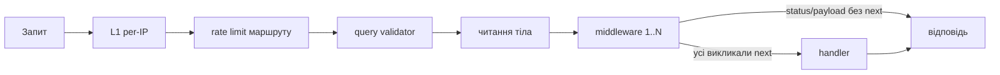

# Маршрутизація та middleware

Маршрути бекенду описуються декларативно у двох файлах: HTTP — у [`src/app/routes/http-routes.ts`](https://github.com/Blazheiko/itvibe-template/blob/main/packages/backend/src/app/routes/http-routes.ts), WebSocket — у [`src/app/routes/ws-routes.ts`](https://github.com/Blazheiko/itvibe-template/blob/main/packages/backend/src/app/routes/ws-routes.ts). Під час старту роутер ([`src/vendor/start/router.ts`](https://github.com/Blazheiko/itvibe-template/blob/main/packages/backend/src/vendor/start/router.ts)) розгортає групи, склеює префікси та списки middleware і реєструє маршрути в uWebSockets.js. Загальний шлях запиту описано на сторінці [Життєвий цикл запиту](/backend/request-lifecycle).

## HTTP-маршрути: `defineRoute`

Хелпер `defineRoute` лежить у [`src/app/routing/define-route.ts`](https://github.com/Blazheiko/itvibe-template/blob/main/packages/backend/src/app/routing/define-route.ts) (а не у `vendor/utils/routing`). Він загортає ArkType-схеми у `defaultValidator` і виводить типи `payload`/`query` для handler-а.

```ts
defineRoute({
  url: "/logout",
  method: "post",
  handler: AuthController.logout.bind(AuthController),
  validator: EmptyFormInputSchema,
  ResponseSchema: ResponseSchemas.LogoutResponseSchema,
  description: "Logout a user",
  middlewares: ["auth_guard"],
}),
```

Основні поля:

| Поле             | Призначення                                                                                                                   |
| ---------------- | ----------------------------------------------------------------------------------------------------------------------------- |
| `url`, `method`  | шлях (підтримує `:param`) та HTTP-метод                                                                                       |
| `handler`        | метод контролера, прив'язаний через `.bind`                                                                                   |
| `validator`      | схема тіла запиту (ArkType із `shared/schemas`); лише для `post`/`put`/`patch`                                                |
| `queryValidator` | схема query; за замовчуванням зайві ключі відхиляються (`onUndeclaredKey("reject")`), з `queryAllowExtra: true` — видаляються |
| `ResponseSchema` | схема відповіді з `shared/responses` (для документації маршрутів)                                                             |
| `middlewares`    | імена middleware з kernel                                                                                                     |
| `rateLimit`      | `{ windowMs, maxRequests }` для конкретного маршруту                                                                          |
| `description`    | опис для інтроспекції                                                                                                         |

Якщо `queryValidator` не задано, `httpData.query` дорівнює `null` — handler має явно оголосити схему, щоб читати query.

### Методи і тіло запиту

| Метод                         | Тіло читається | `validator`                                                   |
| ----------------------------- | -------------- | ------------------------------------------------------------- |
| `post`, `put`, `patch`        | так            | дозволено                                                     |
| `get`, `delete` (`del`)       | ні             | заборонено: помилка типів у `defineRoute` і помилка на старті |
| WS-маршрути (`defineWsRoute`) | —              | дозволено (payload повідомлення)                              |

- Для часткового оновлення використовуйте `patch`.
- `DELETE` тіло не читає: за [RFC 9110 §9.3.5](https://www.rfc-editor.org/rfc/rfc9110.html#section-9.3.5) вміст `DELETE` не має загальновизначеної семантики, і частина проксі його відкидає. Ідентифікатор передавайте через `:param` (`url: "/:id"`), додаткові дані — через `queryValidator`.
- Перевірку на старті робить `routesHandler` ([router.ts](https://github.com/Blazheiko/itvibe-template/blob/main/packages/backend/src/vendor/start/router.ts)): маршрут `get`/`delete` з `validator`, оголошений в обхід `defineRoute`, зупиняє запуск з помилкою `Route DELETE … declares a body validator…`. Множини методів — у [body-methods.ts](https://github.com/Blazheiko/itvibe-template/blob/main/packages/backend/src/vendor/utils/routing/body-methods.ts).
- Як обробляється запит без `Content-Type`, див. [Життєвий цикл запиту](/backend/request-lifecycle#запит-без-content-type).

## Групи, префікси та `API_PATH_PREFIX`

Елемент списку може бути групою: `{ group: [...], prefix, middlewares, rateLimit, description }`. Приклад з `http-routes.ts`:

```ts
{
  group: [ /* defineRoute(...) */ ],
  description: "Admin user and online routes",
  middlewares: ["session_web", "csrf_guard", "auth_guard", "admin_guard"],
  prefix: "admin",
},
```

Правила злиття (див. `router.ts`):

- префікс групи додається до `url` маршруту, а до всього — глобальний префікс `appConfig.pathPrefix` з env `API_PATH_PREFIX` (за замовчуванням `api`, [`src/config/app.ts`](https://github.com/Blazheiko/itvibe-template/blob/main/packages/backend/src/config/app.ts)). Отже `/logout` у групі `auth` стає `/api/auth/logout`;
- middleware групи йдуть **перед** middleware маршруту (`middlewares.concat(route.middlewares)`);
- `rateLimit` маршруту має пріоритет над `rateLimit` групи (`route.rateLimit ?? groupRateLimit`). Лічильник ведеться окремо для кожного маршруту (ключ IP + URL), тож ліміт групи діє на кожен її маршрут окремо, а не на групу в сумі. Поверх цього всі API-запити з IP обмежує глобальний L1, див. [Обмеження частоти запитів](/backend/auth-security#обмеження-частоти-запитів).

У репозиторії, наприклад, група `auth` має ліміт `{ windowMs: 60_000, maxRequests: 10 }`, а окремі маршрути всередині — суворіший `maxRequests: 3`. Ліміт перевіряється до читання тіла запиту ([`src/vendor/start/server.ts`](https://github.com/Blazheiko/itvibe-template/blob/main/packages/backend/src/vendor/start/server.ts)).

## WebSocket-маршрути: `defineWsRoute`

WS-маршрути визначаються через [`src/app/routing/define-ws-route.ts`](https://github.com/Blazheiko/itvibe-template/blob/main/packages/backend/src/app/routing/define-ws-route.ts) і також групуються з `prefix` та `rateLimit`. Поле `url` тут — ім'я події (наприклад `support_chat`), без HTTP-методу. Сокет-ендпоінт один: `/${pathPrefix}/websocket`. Диспетчер подій — [`src/vendor/utils/routing/ws-api-dispatcher.ts`](https://github.com/Blazheiko/itvibe-template/blob/main/packages/backend/src/vendor/utils/routing/ws-api-dispatcher.ts).

```ts
{
  group: [
    defineWsRoute({
      url: "support_chat",
      handler: SupportWsController.chat.bind(SupportWsController),
      validator: SupportChatInputSchema,
      ResponseSchema: ResponseSchemas.SupportChatResponseSchema,
      description: "Send a message to the support agent",
    }),
  ],
  prefix: "support",
  rateLimit: { windowMs: 60_000, maxRequests: 60 },
},
```

## Kernel middleware

Усі middleware реєструються за іменем у [`src/app/middlewares/kernel.ts`](https://github.com/Blazheiko/itvibe-template/blob/main/packages/backend/src/app/middlewares/kernel.ts):

| Ім'я            | Файл                                                                                                                                                                       | Що робить                                                                                                                                                                          |
| --------------- | -------------------------------------------------------------------------------------------------------------------------------------------------------------------------- | ---------------------------------------------------------------------------------------------------------------------------------------------------------------------------------- |
| `session_web`   | [`vendor/utils/middlewares/ws/session-web.ts`](https://github.com/Blazheiko/itvibe-template/blob/main/packages/backend/src/vendor/utils/middlewares/ws/session-web.ts)     | сесія на cookie (використовується в HTTP-групах)                                                                                                                                   |
| `session_api`   | [`vendor/utils/middlewares/http/session-api.ts`](https://github.com/Blazheiko/itvibe-template/blob/main/packages/backend/src/vendor/utils/middlewares/http/session-api.ts) | сесія для API-клієнтів                                                                                                                                                             |
| `csrf_guard`    | [`app/middlewares/csrf-guard.ts`](https://github.com/Blazheiko/itvibe-template/blob/main/packages/backend/src/app/middlewares/csrf-guard.ts)                               | для `post/put/patch/delete` перевіряє Origin/Referer та CSRF-токен із заголовка `csrfConfig.headerName` (порівняння `timingSafeEqual`); при `enforce = false` лише логує порушення |
| `auth_guard`    | [`vendor/utils/middlewares/core/auth-guard.ts`](https://github.com/Blazheiko/itvibe-template/blob/main/packages/backend/src/vendor/utils/middlewares/core/auth-guard.ts)   | `401` з `code: "unauthorized"`, якщо `auth.check()` хибне                                                                                                                          |
| `admin_guard`   | [`app/middlewares/admin-guard.ts`](https://github.com/Blazheiko/itvibe-template/blob/main/packages/backend/src/app/middlewares/admin-guard.ts)                             | `403`, якщо користувач не має `role === 'admin'`                                                                                                                                   |
| `test1`…`test4` | `app/middlewares/test-middleware*.ts`                                                                                                                                      | демонстраційні middleware (логують і дописують `middlewareData`); зареєстровані в kernel, але в жодному маршруті не використовуються                                               |

Деталі сесій і CSRF — на сторінці [Автентифікація та безпека](/backend/auth-security).

## Як виконується ланцюжок

[`execute-httpMiddlewares.ts`](https://github.com/Blazheiko/itvibe-template/blob/main/packages/backend/src/vendor/utils/middlewares/core/execute-httpMiddlewares.ts) реалізує класичний `next()`-ланцюжок: бере middleware з kernel за іменем (невідоме ім'я — помилка `No middleware <name>`) і повертає `true`, лише якщо **кожен** middleware викликав `next()`. Handler запускається тоді, коли ланцюжок пройдено і `responseData.status` лишився у діапазоні 2xx.



## Власний middleware

Шаблон — як у `admin-guard.ts`: функція типу `Middleware`, що або встановлює `status`/`payload` і повертається, або викликає `await next()`.

```ts
import type { HttpContext, Middleware } from '#vendor/types/types.js'

const myGuard: Middleware = async (
    context: HttpContext,
    next: () => Promise<void>,
): Promise<void> => {
    if (context.auth.getUserId() === null) {
        context.responseData.status = 403
        context.responseData.payload = { status: 'forbidden', message: 'Forbidden' }
        return
    }
    await next()
}

export default myGuard
```

Далі: імпортуйте його в `kernel.ts`, додайте ключ (наприклад `my_guard: myGuard`) і вкажіть ім'я в `middlewares` маршруту чи групи. Порядок має значення: `auth_guard`/`admin_guard` повинні стояти після `session_web`. Повний приклад фічі — у [Додаванні фічі](/backend/adding-a-feature).

## Інтроспекція маршрутів і API Playground

[`src/vendor/utils/routing/serialize-routes.ts`](https://github.com/Blazheiko/itvibe-template/blob/main/packages/backend/src/vendor/utils/routing/serialize-routes.ts) серіалізує вихідні HTTP- і WS-маршрути (URL, метод, middleware, опис, схеми). Сервер віддає їх на `GET /${pathPrefix}/doc/routes` як JSON `{ httpRoutes, wsRoutes, pathPrefix }`, але **лише** якщо одночасно:

- `APP_ENV=manual-test`;
- `DOC_PAGE=true` (`configApp.docPage`, за замовчуванням `false`);
- `SERVE_STATIC=true`.

Інакше ендпоінт повертає `404`. Зверніть увагу: в [`.env.example`](https://github.com/Blazheiko/itvibe-template/blob/main/packages/backend/.env.example) стоїть `APP_ENV=local`, тож для playground його треба змінити вручну.

Робочий процес:

1. У `packages/backend/.env` встановіть `APP_ENV=manual-test`, `DOC_PAGE=true`, `SERVE_STATIC=true`.
2. З кореня запустіть `pnpm dev:manual_test` — збирає `shared`, потім паралельно запускає backend (`tsx watch`) і [`packages/api-playground`](https://github.com/Blazheiko/itvibe-template/blob/main/packages/api-playground) (Vite).
3. Playground (Vue-застосунок) проксіює запити на `http://127.0.0.1:3000` ([`vite.config.ts`](https://github.com/Blazheiko/itvibe-template/blob/main/packages/api-playground/vite.config.ts)), завантажує `/api/doc/routes` ([`stores/api-doc.ts`](https://github.com/Blazheiko/itvibe-template/blob/main/packages/api-playground/src/stores/api-doc.ts)) і дозволяє вручну викликати HTTP- та WS-маршрути.

::: info OpenAPI
OpenAPI у проєкті не використовується, і генерувати його не плануємо. Каталог [`src/openapi`](https://github.com/Blazheiko/itvibe-template/blob/main/packages/backend/src/openapi) містить лише невикористані заготовки: `spec.ts` порожній, `schemas.ts` має тільки закоментований імпорт. Опис API дає `/doc/routes` разом з api-playground.
:::
