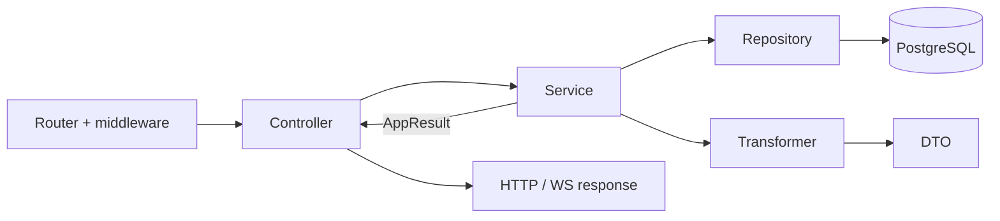
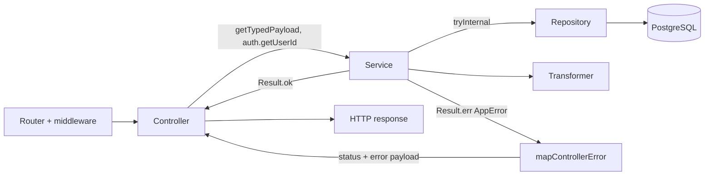

# Сервіси

Сервіс — це **серце застосунку**: тут живуть бізнес-правила, перевірка прав і власності ресурсів, оркестрація кількох репозиторіїв і зовнішніх інтеграцій (email, push, LLM, Sentry, Redis). Сервіс не знає, звідки прийшов виклик — з HTTP-контролера, WS-обробника чи фонового скрипта, — і повертає результат як значення `AppResult<T>`, а не як HTTP-відповідь.

## Навіщо потрібен цей шар

- **Бізнес-логіка в одному місці.** Правило «користувач може видалити лише свою push-підписку» або «після N невдалих спроб — `429`» описане один раз у сервісі й однаково працює для всіх точок входу.
- **Незалежність від транспорту.** Сервіс не має доступу до `responseData`, cookies і сокетів. Його можна викликати з будь-якого контролера, з іншого сервісу чи з тесту без підняття сервера.
- **Явні помилки в типах.** Замість `throw` сервіс повертає `Result.ok(value)` або `Result.err(AppError)`. TypeScript не дасть контролеру забути обробити помилку, а тег помилки (`NotFound`, `Conflict`, …) однозначно визначає HTTP-статус.
- **Межа для винятків.** Виклики репозиторіїв і зовнішніх API обгортаються в `tryInternal` / `tryDomain`: несподіваний виняток БД перетворюється на `Internal`, а не «протікає» в контролер.
- **Головне місце для тестів.** Оскільки вся логіка тут, а залежності — звичайні ES-імпорти, сервіс тестується з моками репозиторіїв і трансформерів, без БД.



## Структура

Сервіси лежать у [`src/app/services`](https://github.com/Blazheiko/vibe-template/tree/main/packages/backend/src/app/services). Index-файлів у доменах немає — імпорт іде з конкретного файлу.

| Домен            | Відповідальність                                                                                   |
| ---------------- | -------------------------------------------------------------------------------------------------- |
| `actions/`       | Лише типи `ToolDefinition` / `ToolCallHandler` для викликів інструментів                           |
| `admin/`         | Онлайн-користувачі, історія онлайну, підписка адміна на WS-канал                                   |
| `ai/`            | Адаптери LLM-провайдерів (OpenAI, Mistral, xAI), промпти, облік використання (`usage/`)            |
| `auth/`          | Реєстрація/логін, OAuth, скидання пароля, верифікація email/SMS, throttle, WS-токен                |
| `communication/` | Broadcast, присутність у WS, онлайн-статус, URL WebSocket                                          |
| `core/`          | `mainService`: init, сесія, оновлення WS-токена                                                    |
| `notifications/` | Email, push-підписки та відправка push                                                             |
| `observability/` | Інтеграція із Sentry                                                                               |
| `shared/`        | `AppError`/`AppResult`, `tryInternal`/`tryDomain`, мапінг помилок у HTTP/WS, доступ до сесії, мова |
| `statistics/`    | Статистика push-підписок                                                                           |
| `support/`       | Чат підтримки, база знань, ембединги, LLM, переклад запитів                                        |
| `user/`          | Аватар                                                                                             |

## Як сервіси оголошуються

DI-контейнера немає. Сервіс — модульний синглтон-об'єкт (`export const authService = { ... }`, [auth-service.ts](https://github.com/Blazheiko/vibe-template/blob/main/packages/backend/src/app/services/auth/auth-service.ts)) або окрема функція (`export async function consumeAuthThrottle`, [auth-throttle-service.ts](https://github.com/Blazheiko/vibe-template/blob/main/packages/backend/src/app/services/auth/auth-throttle-service.ts)). Залежності — звичайні ES-імпорти репозиторіїв і трансформерів з `#app/repositories/index.js` і `#app/transformers/index.js` (див. [Репозиторії](/backend/repositories)). Фабрика використовується лише для AI-адаптера: `export const textAdapter = createTextAdapter()` у [ai-provider.ts](https://github.com/Blazheiko/vibe-template/blob/main/packages/backend/src/app/services/ai/ai-provider.ts).

## Результати та помилки

Сервіси повертають `AppResult<T> = Result<T, AppError>` з `better-result` і не кидають винятків назовні. `AppError` — дискримінований union за `_tag` ([errors.ts](https://github.com/Blazheiko/vibe-template/blob/main/packages/backend/src/app/services/shared/errors.ts)); конструктори: `badRequest`, `unauthorized`, `forbidden`, `notFound`, `conflict`, `rateLimited`, `internal`. Виклики репозиторіїв обгортаються в `tryInternal` / `tryDomain` з [result-helpers.ts](https://github.com/Blazheiko/vibe-template/blob/main/packages/backend/src/app/services/shared/result-helpers.ts). Приклад — [Крок 6](/backend/adding-a-feature#крок-6-service).

Бізнес-правила (перевірка власника ресурсу, throttle, генерація токенів, повідомлення) живуть у сервісах; хелпери доступу — у [session-access.ts](https://github.com/Blazheiko/vibe-template/blob/main/packages/backend/src/app/services/shared/session-access.ts) (`resolveActorAuth`, `resolveResourceOwnership`).

## Тести сервісів

Тести `*.spec.ts` лежать поруч із сервісом. Патерн: замокати `#app/repositories/index.js` і `#app/transformers/index.js` через `vi.mock`, імпортувати сервіс динамічно після моків, перевіряти `Result.isOk` / `Result.isError`. Фрагмент з [push-subscription-service.spec.ts](https://github.com/Blazheiko/vibe-template/blob/main/packages/backend/src/app/services/notifications/push-subscription-service.spec.ts):

```ts
vi.mock('#app/repositories/index.js', () => ({
    pushSubscriptionRepository: pushSubscriptionRepositoryMock,
}))

afterEach(() => {
    vi.resetModules()
    vi.clearAllMocks()
})

it('returns serialized subscriptions', async () => {
    pushSubscriptionRepositoryMock.findByUserIdWithLogs.mockResolvedValue([{ id: 1n }])

    const { pushSubscriptionService } = await import('./push-subscription-service.js')
    const result = await pushSubscriptionService.getSubscriptions(7n)

    expect(Result.isOk(result)).toBe(true)
})
```

## Потік виклику



## Чек-лист сервісу

- [ ] бізнес-правила, перевірка прав і власності;
- [ ] виклики репозиторіїв (у `tryInternal`) і серіалізація через трансформери;
- [ ] зовнішні інтеграції (email, push, LLM, Sentry);
- [ ] повернення `AppResult<T>`, без `throw` і без доступу до `responseData`.

## Суміжні шари

- [Контролери](/backend/controllers) — HTTP/WS-адаптери: приймають запит і віддають відповідь.
- [Сервіси](/backend/services) — бізнес-логіка, повертають `AppResult<T>`.
- [Репозиторії](/backend/repositories) — єдине місце, де пишеться SQL.
- [Трансформери](/backend/transformers) — перетворення рядків БД на публічні DTO.

Загальна схема — [Архітектура](/backend/architecture), покроковий приклад — [Додавання фічі](/backend/adding-a-feature).
