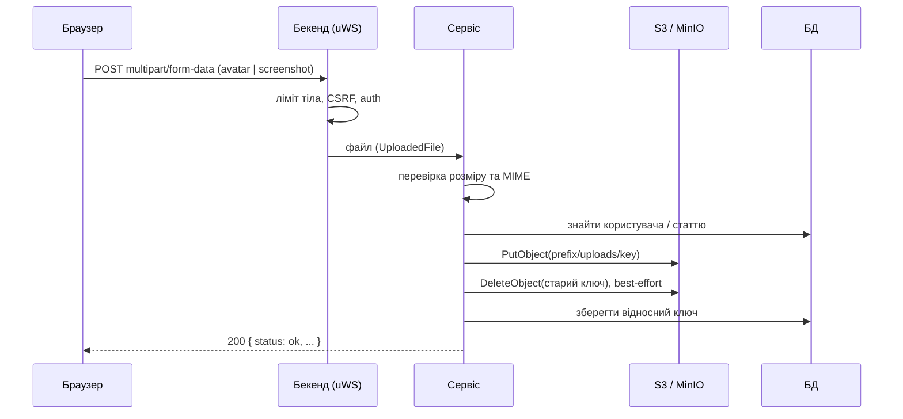

# Сховище файлів (S3)

Бекенд зберігає файли користувачів в S3-сумісному сховищі (AWS S3, MinIO, DigitalOcean Spaces тощо). Уся робота з ним іде через один модуль-обгортку над `@aws-sdk/client-s3`: [`s3.ts`](https://github.com/Blazheiko/itvibe-template/blob/main/packages/backend/src/vendor/utils/storage/s3.ts). Зараз сховище використовують дві фічі: аватари користувачів і скриншоти статей бази знань (support).

Змінні оточення `S3_*` описано в розділі [Сховище S3](/backend/configuration#сховище-s3). Тут їх не повторюємо.

## Налаштування клієнта

Конфіг читається з [`config/disk.ts`](https://github.com/Blazheiko/itvibe-template/blob/main/packages/backend/src/config/disk.ts): `s3Region`, `s3AccessKeyId`, `s3SecretAccessKey`, `s3Endpoint`, `s3Bucket`, `s3Prefix`, `s3StaticDataPrefix`, `s3DynamicDataPrefix`.

[`s3.ts`](https://github.com/Blazheiko/itvibe-template/blob/main/packages/backend/src/vendor/utils/storage/s3.ts) створює один `S3Client` під час імпорту модуля:

- **Endpoint.** Якщо `S3_ENDPOINT` порожній, SDK працює зі стандартним AWS. Якщо endpoint задано без схеми, до нього додається `https://`. Так поводився старий клієнт `minio`.
- **Region.** `S3_REGION` або `us-east-1`. Порожній рядок теж замінюється на значення за замовчуванням (`||`, а не `??`), бо SDK не приймає порожній регіон.
- **`forcePathStyle`** вмикається для будь-якого кастомного endpoint, у якому немає `amazonaws.com`. Тому MinIO та Spaces адресуються path-style (`https://host/bucket/key`).
- **`requestChecksumCalculation` / `responseChecksumValidation` = `WHEN_REQUIRED`.** Нові версії SDK за замовчуванням додають CRC-контрольні суми, а частина S3-сумісних сховищ такі запити відхиляє.
- Під час старту в лог пишуться `endpoint`, `bucket` і `region`. Ключі доступу в лог не потрапляють.

Тест [`s3.spec.ts`](https://github.com/Blazheiko/itvibe-template/blob/main/packages/backend/src/vendor/utils/storage/s3.spec.ts) перевіряє один сценарій: endpoint без схеми дає HTTPS і path-style адресацію.

## Ключі об'єктів

`buildObjectKey(key)` (експортується з `s3.ts`) формує повний ключ так: `${S3_PREFIX ?? 'app'}/${S3_DYNAMIC_DATA_PREFIX ?? 'uploads'}/${key}`. Слеші на краях префіксів обрізаються. У базі зберігається лише **відносний** ключ:

| Дані               | Відносний ключ                            | Де формується                                                                                                                                           |
| ------------------ | ----------------------------------------- | ------------------------------------------------------------------------------------------------------------------------------------------------------- |
| Аватар             | `avatars/<userId>/<uuid>.<ext>`           | [avatar-service.ts](https://github.com/Blazheiko/itvibe-template/blob/main/packages/backend/src/app/services/user/avatar-service.ts)                    |
| Скриншот статті KB | `knowledge-base/<articleId>/<uuid>.<ext>` | [knowledge-base-service.ts](https://github.com/Blazheiko/itvibe-template/blob/main/packages/backend/src/app/services/support/knowledge-base-service.ts) |

Розширення (`jpg`, `png`, `webp`) і `ContentType` об'єкта беруться з типу, визначеного за вмістом файлу (див. нижче); ім'я файлу клієнта на ключ не впливає.

## Операції модуля

| Функція                                        | Що робить                                                                                                                                               |
| ---------------------------------------------- | ------------------------------------------------------------------------------------------------------------------------------------------------------- |
| `uploadToS3(key, body, contentType, options?)` | `PutObjectCommand` з `buildObjectKey(key)`, `ContentType` і `ContentLength`. Опційно передає `ACL: 'public-read'` (`publicRead`) і `ContentDisposition` |
| `deleteFromS3(key)`                            | `DeleteObjectCommand` з `buildObjectKey(key)` — як і решта функцій, приймає відносний ключ                                                              |
| `presignUrl(key, expirySeconds = 3600)`        | Presigned **GET** URL через `@aws-sdk/s3-request-presigner` (`getSignedUrl`)                                                                            |
| `downloadFromS3(key)`                          | `GetObjectCommand`, повертає `{ data: Buffer, contentType }`                                                                                            |

Presigned PUT і multipart-upload з браузера напряму в бакет у коді **не реалізовано**.

## Як відбувається завантаження

Обидва сценарії працюють однаково: браузер надсилає `multipart/form-data` **на бекенд**, бекенд перевіряє файл і сам кладе його в S3.

- **Аватар:** `POST /avatar/upload`, поле `avatar`, middleware `session_web`, `csrf_guard`, `auth_guard`. Видалення: `DELETE /avatar/` ([http-routes.ts](https://github.com/Blazheiko/itvibe-template/blob/main/packages/backend/src/app/routes/http-routes.ts), [avatar-controller.ts](https://github.com/Blazheiko/itvibe-template/blob/main/packages/backend/src/app/controllers/http/user/avatar-controller.ts)).
- **Скриншот KB:** `POST /admin/knowledge-base/:id/screenshot`, поле `screenshot`, додатково `admin_guard` ([admin-knowledge-base-controller.ts](https://github.com/Blazheiko/itvibe-template/blob/main/packages/backend/src/app/controllers/http/admin/admin-knowledge-base-controller.ts)).

Обидва маршрути мають `allowedContentTypes: ['multipart']` і `EmptyFormInputSchema`. Ліміт тіла для multipart задає `APP_MAX_MULTIPART_BODY_SIZE` (за замовчуванням 50 MB, [app.ts](https://github.com/Blazheiko/itvibe-template/blob/main/packages/backend/src/config/app.ts)). Тіло буферизується повністю, детальніше в розділі [Життєвий цикл запиту](/backend/request-lifecycle).

Перевірки в сервісах:

| Фіча     | Макс. розмір | Дозволені MIME                          |
| -------- | ------------ | --------------------------------------- |
| Аватар   | 10 MB        | `image/jpeg`, `image/png`, `image/webp` |
| Скриншот | 5 MB         | `image/png`, `image/jpeg`, `image/webp` |

Тип перевіряється **за вмістом**: [`detectImageType`](https://github.com/Blazheiko/itvibe-template/blob/main/packages/backend/src/vendor/utils/storage/detect-image-type.ts) читає сигнатуру файлу (PNG `89 50 4E 47 0D 0A 1A 0A`, JPEG `FF D8 FF`, WebP `RIFF…WEBP`). Файл приймається, лише коли виявлений тип дозволений **і** збігається з заявленим у multipart `Content-Type`; інакше `400 bad_request` («Invalid file type»). GIF, SVG та інші формати не розпізнаються й відхиляються.

Після успішного завантаження сервіс видаляє попередній об'єкт (best-effort: помилка лише пишеться в лог як `warn`) і записує новий відносний ключ у БД.



## Як файли віддаються

- **Аватари** завантажуються з `ACL: public-read` (рішення Р1) і читаються напряму з CDN. Бекенд віддає фронтенду `cdnUrl` (`CDN_URL`), `s3Prefix` і `s3DynamicDataPrefix` ([main-service.ts](https://github.com/Blazheiko/itvibe-template/blob/main/packages/backend/src/app/services/core/main-service.ts)). Фронтенд будує URL у `getStorageFileUrl` ([state.ts](https://github.com/Blazheiko/itvibe-template/blob/main/packages/frontend/src/stores/state.ts), [avatar-url.ts](https://github.com/Blazheiko/itvibe-template/blob/main/packages/frontend/src/utils/avatar-url.ts)). Якщо `CDN_URL` порожній, аватар не показується.
- **Скриншоти KB** публічні: це довідковий контент, не секрет. Адмін завантажує їх з `ACL: public-read` ([knowledge-base-service.ts](https://github.com/Blazheiko/itvibe-template/blob/main/packages/backend/src/app/services/support/knowledge-base-service.ts)). `GET /support/screenshot/:articleId` (потрібен `auth_guard`) відповідає `302` з `Location: <CDN_URL>/<повний ключ>` ([support-controller.ts](https://github.com/Blazheiko/itvibe-template/blob/main/packages/backend/src/app/controllers/http/support/support-controller.ts)). Якщо `CDN_URL` порожній, маршрут повертає `404`.

::: warning Правило: медіа чату підтримки лише з нашого CDN
Зображення й посилання, які бачить користувач у чаті підтримки, мають вести тільки на наш origin або на `CDN_URL`. Прямі посилання на S3-endpoint, presigned URL і сторонні хости заборонені: `img-src` у CSP дозволяє лише `'self'` і origin `CDN_URL`, і браузер перевіряє origin також після редиректу. Скриншоти, завантажені до цієї зміни без `public-read`, треба зробити публічними (ACL або політика бакета для префікса `knowledge-base/`), інакше CDN віддасть `403`.
:::

::: warning Аватари, завантажені до feat-023
Раніше аватари йшли в бакет без `public-read`. Якщо бакет або префікс не відкриті політикою сховища чи CDN, такі старі об'єкти лишаються приватними: їх треба перезалити або виставити ACL окремо.
:::

## Локальна розробка з MinIO

Docker Compose для MinIO в репозиторії немає. Мінімальний приклад (облікові дані є плейсхолдерами):

```bash
docker run -d --name minio -p 9000:9000 -p 9001:9001 \
  -e MINIO_ROOT_USER=<minio-user> \
  -e MINIO_ROOT_PASSWORD=<minio-password> \
  minio/minio server /data --console-address ":9001"
```

Створіть бакет у консолі `http://localhost:9001` і пропишіть у `packages/backend/.env`:

```bash
S3_ENDPOINT=http://localhost:9000   # без схеми буде https://
S3_REGION=us-east-1
S3_BUCKET=<bucket>
S3_ACCESS_KEY_ID=<minio-user>
S3_SECRET_ACCESS_KEY=<minio-password>
S3_PREFIX=app
S3_DYNAMIC_DATA_PREFIX=uploads
CDN_URL=http://localhost:9000/<bucket>
```

Для `localhost` path-style вмикається автоматично. Щоб аватари відображалися, дайте префіксу `app/uploads/avatars/` анонімний доступ на читання.

CORS бакета описує [`corsS3.xml`](https://github.com/Blazheiko/itvibe-template/blob/main/corsS3.xml): лише `GET` і `HEAD` з origin застосунку (placeholder `https://app.example.com` — замініть своїм). Усі завантаження й видалення йдуть через бекенд із серверними ключами, тож браузеру `PUT`/`POST` не потрібні. Приклад для кількох оточень — [`corsS3.prod.example.xml`](https://github.com/Blazheiko/itvibe-template/blob/main/corsS3.prod.example.xml). Застосовується вручну до бакета, код ці файли не читає.

## Безпека

- Скриншоти KB і аватари публічні й віддаються через `CDN_URL`. `presignUrl` (TTL за замовчуванням 3600 с) у браузерних сценаріях не використовується: його host — S3-endpoint, якого немає в CSP `img-src`.
- `ACL: public-read` використовують обидва завантаження: аватари й скриншоти KB.
- Імена об'єктів генеруються сервером (`randomUUID`), тому клієнт не може обрати шлях або перезаписати чужий файл.
- Секрети `S3_*` зберігайте лише в оточенні, див. [Безпека та автентифікація](/backend/auth-security).

::: warning Розмір файлу
Розмір перевіряється вже після того, як усе тіло буферизовано (до ліміту multipart у 50 MB).
:::
