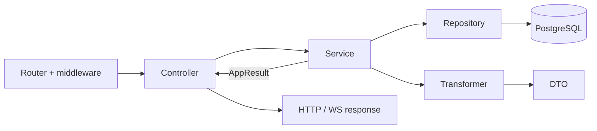

# Трансформери

Трансформер — це **чиста функція серіалізації**: вона бере рядок, який повернув репозиторій (з `bigint` id, об'єктами `Date` і внутрішніми полями), і перетворює його на публічний DTO, який можна безпечно віддати клієнту в JSON.

## Навіщо потрібен цей шар

- **Безпека даних.** Рядок `users` містить хеш пароля і `sessionToken`. Трансформер явно відкидає такі поля, тож вони не потраплять у відповідь навіть якщо сервіс поверне «весь користувач». Без цього шару легко випадково віддати клієнту зайве.
- **JSON-сумісність.** `bigint` не серіалізується `JSON.stringify`, а `Date` треба віддавати в єдиному форматі. Трансформер приводить id до `string`, а дати — до ISO-рядка через `luxon`.
- **Стабільний публічний контракт.** Внутрішні назви колонок (`createdAt`) можуть змінюватися, а клієнт очікує `created_at`. Трансформер — одне місце, де визначається, як сутність виглядає зовні; похідні поля (`emailVerified: boolean` замість `emailVerifiedAt`) теж додаються тут.
- **Повторне використання.** Один і той самий користувач повертається з логіну, реєстрації, OAuth — усі вони викликають `userTransformer.serialize`, тож форма відповіді однакова.
- **Легко тестувати.** Трансформер не має залежностей і побічних ефектів: вхідний рядок → вихідний об'єкт.



## Як влаштовані

Трансформери в [`app/transformers/`](https://github.com/Blazheiko/vibe-template/blob/main/packages/backend/src/app/transformers/index.ts) — це об'єкти з методами `serialize` / `serializeArray` (у push-підписок ще `serializeWithLogs` / `serializeArrayWithLogs`). Вони:

- приводять `bigint` id до `string`;
- переводять `Date` у ISO-рядок через `luxon` (`DateTime.fromJSDate(...).toISO()`), з перейменуванням `createdAt`/`updatedAt` → `created_at`/`updated_at`;
- прибирають чутливі поля: [user-transformer.ts](https://github.com/Blazheiko/vibe-template/blob/main/packages/backend/src/app/transformers/user-transformer.ts) відкидає `password` і `sessionToken` (простір імен сесій у Redis, див. [Автентифікація](/backend/auth#що-таке-usertoken)) і додає похідне `emailVerified: boolean`.

```ts
serialize(user: UserRow): SerializedUser {
    const { id, password: _password, sessionToken: _sessionToken, createdAt, updatedAt, emailVerifiedAt, ...rest } = user
    return { ...rest, id: String(id), created_at: DateTime.fromJSDate(createdAt).toISO(), /* ... */ }
}
```

Тип результату (`SerializedUser`, `SerializedPushSubscription`) виводиться з типу рядка через `Omit<...> & {...}`, тож він живе в бекенді й **не імпортується** з `packages/shared`. Схеми відповідей у [packages/shared/src/responses](https://github.com/Blazheiko/vibe-template/blob/main/packages/shared/src/responses/main-controller.ts) описані окремо (ArkType + інтерфейси); відповідність DTO і схеми не перевіряється компілятором, а лише валідацією відповіді (див. [«Валідація»](/backend/validation)).

## Де використовуються

Трансформери викликаються в **сервісах**: `userTransformer` — у [auth-service.ts](https://github.com/Blazheiko/vibe-template/blob/main/packages/backend/src/app/services/auth/auth-service.ts); `pushSubscriptionTransformer` — у [push-subscription-service.ts](https://github.com/Blazheiko/vibe-template/blob/main/packages/backend/src/app/services/notifications/push-subscription-service.ts) і [push-subscription-statistics-service.ts](https://github.com/Blazheiko/vibe-template/blob/main/packages/backend/src/app/services/statistics/push-subscription-statistics-service.ts).

Обхід: `mainService.init` збирає об'єкт користувача вручну (див. [«Архітектура»](/backend/architecture)); адмінські списки, AI-, support- та online-історія повертають рядки або проєкції репозиторіїв без трансформера.

## Тестування

Трансформери — чисті функції, тож їх тестують без моків: [user-transformer.spec.ts](https://github.com/Blazheiko/vibe-template/blob/main/packages/backend/src/app/transformers/user-transformer.spec.ts) перевіряє, що `password` і `sessionToken` не потрапляють у DTO. У тестах сервісів трансформери мокають через barrel:

```ts
vi.mock('#app/transformers/index.js', () => ({
    pushSubscriptionTransformer: pushSubscriptionTransformerMock,
}))
```

## Суміжні шари

- [Контролери](/backend/controllers) — HTTP/WS-адаптери: приймають запит і віддають відповідь.
- [Сервіси](/backend/services) — бізнес-логіка, повертають `AppResult<T>`.
- [Репозиторії](/backend/repositories) — єдине місце, де пишеться SQL.
- [Трансформери](/backend/transformers) — перетворення рядків БД на публічні DTO.

Загальна схема — [Архітектура](/backend/architecture), покроковий приклад — [Додавання фічі](/backend/adding-a-feature).
