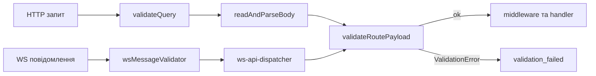

# Валідація

Вхідні дані (тіло HTTP-запиту, query, payload WS-повідомлення та сам конверт WS-повідомлення) перевіряються схемами ArkType (`@arktype/type`). Ядро сервера (`vendor/`) працює не з ArkType, а з нейтральним контрактом `Validator<T>`; конкретну бібліотеку підключає адаптер в `app/validate`. Загальний порядок обробки запиту описано в [Життєвому циклі запиту](/backend/request-lifecycle), поля маршруту — в [Маршрутизації та middleware](/backend/routing). Перевірку вихідних даних за `ResponseSchema` описано в [Перевірці відповідей](/backend/response-validation).

## Коротко на прикладі

**Задача:** маршрут `POST /api/notes` має приймати лише непорожній `title` до 200 символів і необов'язковий `body`, а все інше відхиляти.

1. Опишіть схему в `shared` (з туторіалу [Як додати фічу](/backend/adding-a-feature#крок-1-схема-вхідних-даних-у-shared)):

    ```ts
    export const CreateNoteInputSchema = type({
        title: '1 <= string <= 200',
        'body?': 'string <= 5000',
        '+': 'reject', // зайві поля — помилка
    })
    ```

2. Передайте її маршруту як `validator` (для query — `queryValidator`):

    ```ts
    defineRoute({ url: '/', method: 'post', handler: ..., validator: CreateNoteInputSchema })
    ```

3. У контролері візьміть уже перевірені дані: `getTypedPayload(context)` повертає `CreateNoteInput`.

**Результат:** некоректний запит не доходить до контролера.

| Тіло запиту                 | Відповідь                                       |
| --------------------------- | ----------------------------------------------- |
| `{"title":"Купити молоко"}` | `200`, нотатку створено                         |
| `{"title":""}`              | `422`, `"messages":["title must be non-empty"]` |
| `{"title":"x","done":true}` | `422`, `"messages":["done must be removed"]`    |

Перевірка форми даних (тип, довжина, зайві поля) — у схемі. Перевірка змісту (чи існує запис, чи можна користувачу) — у сервісі, див. [Перший маршрут](/guide/first-endpoint#крок-2-service). Нижче описано, як це влаштовано всередині.

## Контракт `Validator<T>`

[vendor/contracts/validator.ts](https://github.com/Blazheiko/vibe-template/blob/main/packages/backend/src/vendor/contracts/validator.ts):

```ts
// One problem of a field; `path` is dot-separated (`nested.name`), `''` for the root.
export interface ValidationIssue {
    path: string
    message: string
}

export type ValidationResult<T> =
    { ok: true; value: T } | { ok: false; messages: string[]; issues?: ValidationIssue[] }

export interface Validator<T> {
    validate(input: unknown): ValidationResult<T>
    describe?(): unknown
}

export type InferPayload<V> = V extends Validator<infer T> ? T : unknown
```

- `validate` синхронний і не кидає винятків — повертає результат-об'єднання.
- `describe` необов'язковий: повертає схему для документації маршрутів (`GET /<prefix>/doc/routes` і api-playground). [serialize-routes.ts](https://github.com/Blazheiko/vibe-template/blob/main/packages/backend/src/vendor/utils/routing/serialize-routes.ts) розуміє три форми результату:
    - тип ArkType — перетворює [serialize-ark-schema.ts](https://github.com/Blazheiko/vibe-template/blob/main/packages/backend/src/vendor/utils/tooling/serialize-ark-schema.ts);
    - готовий опис `{ expression: string, fields?: { name, type, required }[], jsonSchema? }` — передається як є, некоректні елементи `fields` відкидаються;
    - об'єкт JSON Schema (має `type`, `properties`, `anyOf`, `oneOf`, `allOf`, `$ref`, `enum` або `const`) — `fields` береться з `properties` верхнього рівня і `required`, `expression` — з `type`, сама схема йде в `jsonSchema`.

    Інший результат або відсутній `describe` — маршрут серіалізується без `inputSchema` / `querySchema`.

### ArkType-адаптер

[app/validate/adapters/arktype-adapter.ts](https://github.com/Blazheiko/vibe-template/blob/main/packages/backend/src/app/validate/adapters/arktype-adapter.ts) — `arkValidator(schema)` викликає схему, і якщо результат — `type.errors`, повертає `{ ok: false, messages, issues }`: `issues` — по запису `{ path, message }` на кожну помилку ArkType (`path` — `propString`, наприклад `nested.name`; `''` для кореня), `messages` — ті самі `message` рядками. Власний адаптер може не повертати `issues`, тоді в помилці буде лише `messages`. `describe()` повертає саму схему.

Активний движок фіксується одним рядком у [app/validate/index.ts](https://github.com/Blazheiko/vibe-template/blob/main/packages/backend/src/app/validate/index.ts):

```ts
export { arkValidator as defaultValidator, arkValidator } from './adapters/arktype-adapter.js'
```

## Як маршрут отримує валідатор

У маршрутах передається **схема**, а не валідатор: `defineRoute` / `defineWsRoute` самі загортають її через `defaultValidator` ([define-route.ts](https://github.com/Blazheiko/vibe-template/blob/main/packages/backend/src/app/routing/define-route.ts), [define-ws-route.ts](https://github.com/Blazheiko/vibe-template/blob/main/packages/backend/src/app/routing/define-ws-route.ts)). Вручну обгортати `arkValidator(...)` у файлах маршрутів не потрібно.

- `validator` — схема тіла (HTTP) або payload (WS). На HTTP він дозволений лише для `post`, `put` і `patch`; на `get`/`delete` дає помилку типів і помилку на старті, бо тіло там не читається ([Методи і тіло запиту](/backend/routing#методи-і-тіло-запиту)). Без `Content-Type` і без тіла валідується `{}`, тож handler з `validator` не отримує `payload = null` (крім `octet`-маршрутів).
- `queryValidator` — схема query (лише HTTP). До неї `defineRoute` застосовує `onUndeclaredKey("reject")` (зайві ключі → помилка) або, з `queryAllowExtra: true`, `onUndeclaredKey("delete")` (зайві ключі видаляються). `queryArrays` перелічує ключі, які можуть повторюватися (збираються в `string[]`); див. [flatten-query.ts](https://github.com/Blazheiko/vibe-template/blob/main/packages/backend/src/vendor/utils/validation/flatten-query.ts).

Приклад з [http-routes.ts](https://github.com/Blazheiko/vibe-template/blob/main/packages/backend/src/app/routes/http-routes.ts):

```ts
defineRoute({
    url: '/login',
    method: 'post',
    handler: AuthController.login.bind(AuthController),
    validator: LoginInputSchema,
    ResponseSchema: ResponseSchemas.LoginResponseSchema,
    description: 'Login a user by email or phone identifier',
})
```

### Виведення типів

`defineRoute` виводить тип `payload` з `Type<T>` схеми тіла, а тип `query` — зі схеми query (або `null`, якщо `queryValidator` не задано). Якщо задано `ResponseSchema`, результат хендлера звіряється з її вхідним типом (`inferIn`) — див. [Тип відповіді хендлера](/backend/routing#тип-відповіді-хендлера). Для обробників, оголошених окремо (методи контролерів), є хелпер `InferQuery<typeof Schema>` в [app/validate/index.ts](https://github.com/Blazheiko/vibe-template/blob/main/packages/backend/src/app/validate/index.ts); на рівні контракту — `InferPayload<V>`. У shared-схемах тип зазвичай експортується поруч зі схемою через `typeof Schema.infer` / `["inferIn"]`.

## Де виконується валідація

Усі шляхи зводяться до [validateRoutePayload](https://github.com/Blazheiko/vibe-template/blob/main/packages/backend/src/vendor/utils/validation/validate-route-payload.ts): виклик `validator.validate`, а при `ok: false` — `throw new ValidationError(messages, undefined, issues)`.



- **HTTP query** — `validateQuery` у [server.ts](https://github.com/Blazheiko/vibe-template/blob/main/packages/backend/src/vendor/start/server.ts), до читання тіла. Без `queryValidator` → `httpData.query === null`.
- **HTTP тіло** — `readAndParseBody` у тому ж файлі: після парсингу, якщо є `route.validator` і payload не `null`. Без валідатора payload стає `null` (див. [Життєвий цикл](/backend/request-lifecycle)).
- **WS конверт** — [ws-message-validator.ts](https://github.com/Blazheiko/vibe-template/blob/main/packages/backend/src/app/validate/ws-message-validator.ts) (`{ payload, event, timestamp }`) реєструється в [app/start/index.ts](https://github.com/Blazheiko/vibe-template/blob/main/packages/backend/src/app/start/index.ts) через `registerWsMessageValidator` і викликається в `onMessage` [ws-handlers.ts](https://github.com/Blazheiko/vibe-template/blob/main/packages/backend/src/vendor/utils/network/ws-handlers.ts).
- **WS payload** — у [ws-api-dispatcher.ts](https://github.com/Blazheiko/vibe-template/blob/main/packages/backend/src/vendor/utils/routing/ws-api-dispatcher.ts) після rate limit, до middleware. Деталі — [WebSocket](/backend/websocket).

## Схеми

| Місце                                                                                                                                              | Призначення                                                                                              |
| -------------------------------------------------------------------------------------------------------------------------------------------------- | -------------------------------------------------------------------------------------------------------- |
| [packages/shared/src/schemas](https://github.com/Blazheiko/vibe-template/tree/main/packages/shared/src/schemas)                                    | основні схеми вводу (auth, main, support, push-subscription, query, ws…), спільні для frontend і backend |
| [app/validate/schemas/common](https://github.com/Blazheiko/vibe-template/blob/main/packages/backend/src/app/validate/schemas/common/pagination.ts) | лише реекспорт пагінаційних/дата-схем з `shared/schemas`                                                 |
| [app/validate/schemas/query](https://github.com/Blazheiko/vibe-template/tree/main/packages/backend/src/app/validate/schemas/query)                 | містить лише тест виведення типів (`arktype-inference.spec.ts`)                                          |

Приклад схеми ([shared/src/schemas/auth/register.ts](https://github.com/Blazheiko/vibe-template/blob/main/packages/shared/src/schemas/auth/register.ts)):

```ts
import { type } from '@arktype/type'

export const RegisterInputSchema = type({
    name: 'string >= 1 & string <= 100',
    email: 'string.email & string <= 255',
    password: 'string >= 8 & string <= 32',
    token: 'string <= 60',
    '+': 'reject',
})

export type RegisterInput = (typeof RegisterInputSchema)['inferIn']
```

`'+': 'reject'` забороняє невідомі ключі. Query-схеми приходять рядками, тому використовують морфи-парсери, напр. `type('string.integer.parse').pipe(type('number > 0'))` у [query/common.ts](https://github.com/Blazheiko/vibe-template/blob/main/packages/shared/src/schemas/query/common.ts) (там же коментар про cast-обхід для дефолтів у кортежах ArkType).

## Checkers: заголовки, cookies, параметри

[app/validate/checkers](https://github.com/Blazheiko/vibe-template/tree/main/packages/backend/src/app/validate/checkers) — не схеми, а regex/довжина для «сирого» транспорту. Використовуються в [http-request-handlers.ts](https://github.com/Blazheiko/vibe-template/blob/main/packages/backend/src/vendor/utils/network/http-request-handlers.ts):

| Checker             | Правила                                                                                     | Поведінка при порушенні                            |
| ------------------- | ------------------------------------------------------------------------------------------- | -------------------------------------------------- |
| `validateHeader`    | ім'я `^[a-zA-Z0-9\-_]+$`, 1–256 символів; значення — друковані ASCII і таб, ≤ 3072          | заголовок мовчки відкидається (`getHeaders`)       |
| `validateCookie`    | ім'я/значення за regex, ліміт `appConfig.reasonableCookieLimit`, коректне percent-кодування | cookie мовчки відкидається (`parseCookies`)        |
| `validateParameter` | `^[a-zA-Z0-9\-_./]*$`, ≤ 256 символів                                                       | `ParameterValidationError` → **400** `bad_request` |

## Формат помилок

[ValidationError](https://github.com/Blazheiko/vibe-template/blob/main/packages/backend/src/app/validate/errors/validation-error.ts) має `code = "validation_failed"`, `statusCode = 422`, `messages: string[]` і `issues?: ValidationIssue[]`.

HTTP-відповідь (обробник помилок у [server.ts](https://github.com/Blazheiko/vibe-template/blob/main/packages/backend/src/vendor/start/server.ts)) — статус **422**:

```json
{
    "status": "error",
    "code": "validation_failed",
    "message": "Validation failure",
    "details": {
        "kind": "validation",
        "messages": [
            "email must be an email address (was \"x\")",
            "password must be at least length 8 (was 3)"
        ],
        "issues": [
            { "path": "email", "message": "email must be an email address (was \"x\")" },
            { "path": "password", "message": "password must be at least length 8 (was 3)" }
        ]
    }
}
```

`messages` — по рядку на кожне поле (раніше — один рядок `summary` з усіма помилками); клієнти, що показують `messages`, працюють як і раніше. Для підсвічування полів у формі беріть `issues[].path`. Тип — `ValidationErrorDetails` у [`shared/src/errors/error-codes.ts`](https://github.com/Blazheiko/vibe-template/blob/main/packages/shared/src/errors/error-codes.ts).

Помилка параметра шляху — статус **400**, `code: "bad_request"`, `details.kind: "parameter_validation"`, `details.parameter`.

У WS (і для конверта, і для payload) повертається `status: "error"` з конвертом `error`, створеним `createWsErrorEnvelope("validation_failed", "Validation failure", { details: { kind: "validation", messages, issues } })` — ті самі `messages` і `issues`, що й у HTTP. HTTP-статусу немає. Формат конверта — див. [WebSocket](/backend/websocket).

## Схеми відповідей (`ResponseSchema`)

`ResponseSchema` (тип `BaseType` з ArkType у [types.d.ts](https://github.com/Blazheiko/vibe-template/blob/main/packages/backend/src/vendor/types/types.d.ts)) використовується двічі. [serialize-routes.ts](https://github.com/Blazheiko/vibe-template/blob/main/packages/backend/src/vendor/utils/routing/serialize-routes.ts) перетворює його на `outputSchema` для doc-сторінки маршрутів. А [router.ts](https://github.com/Blazheiko/vibe-template/blob/main/packages/backend/src/vendor/start/router.ts) при старті будує з нього `responseCheck` — перевірку результату контролера під час виконання; реакцію на порушення задає `RESPONSE_VALIDATION_CONTRACT` (`strict` / `log`). Перевіряється об'єкт до JSON-серіалізації; подробиці — [Перевірка відповідей](/backend/response-validation). Схеми відповідей беруться з `shared/responses`.

## Що лишилося ArkType-специфічним

Рішення про абстракцію валідатора записане в [ADR 0001](https://github.com/Blazheiko/vibe-template/blob/main/docs/adr/0001-validator-abstraction.md) і реалізоване: `vendor/start/server.ts` і `ws-api-dispatcher.ts` працюють тільки з `Validator<T>`. Свідомо прив'язаними до ArkType лишаються:

- `ResponseSchema?: BaseType` у `vendor/types/types.d.ts`;
- перевірка відповідей під час виконання ([validate-response.ts](https://github.com/Blazheiko/vibe-template/blob/main/packages/backend/src/vendor/utils/validation/validate-response.ts)) викликає схему напряму й розпізнає помилки через `type.errors`, а не через `Validator<T>`;
- `defineRoute`/`defineWsRoute` і `InferQuery` типізовані через `Type` з `@arktype/type`;
- doc-серіалізація `ResponseSchema` (`outputSchema`) — лише ArkType; схеми `validator` / `queryValidator` приймаються й від інших движків через `describe()` (див. [контракт](#контракт-validator-t));
- схема WS-конверта в `ws-message-validator.ts`.

::: warning План
Не реалізовано з початкового плану (див. ADR 0001): експорт `InputSchema` з `app/validate/index.ts` (§3.6); демонстраційний `nativeValidator(predicate)` (§9); перенесення `RouteConfig`/`ResponseSchema` з `vendor/types` в `app/routing/types.ts` (§5.6, окремий PR).
:::

## Рецепт: валідація для нового маршруту

1. Опишіть схему в `packages/shared/src/schemas/<домен>/` через `type({...})` з `'+': 'reject'` і експортуйте її разом з типом; додайте в `index.ts` пакета.
2. Передайте схему в `validator` (і/або `queryValidator`) у `defineRoute`/`defineWsRoute` — не обгортайте вручну.
3. Типізуйте handler: тип payload виводиться автоматично; для окремо оголошених обробників — `InferQuery<typeof Schema>` або тип зі схеми.
4. Перевірте 422 з `validation_failed` на невалідному тілі. Повний сценарій — [Додавання фічі](/backend/adding-a-feature).

### Заміна бібліотеки валідації

Код це підтримує лише як **глобальну** заміну: новий адаптер, що реалізує `Validator<T>`, і зміна експорту `defaultValidator` в `app/validate/index.ts`. Але доведеться також переписати всі схеми в `shared`, типи `defineRoute`/`defineWsRoute`/`InferQuery` (вони на `Type` ArkType), `ws-message-validator.ts` і doc-серіалізацію. Проєкт використовує один валідатор: маршрути передають сиру схему (`validator: SomeSchema`), обгортку робить `defineRoute`, а змішувати движки по маршрутах не можна ([ADR 0001](https://github.com/Blazheiko/vibe-template/blob/main/docs/adr/0001-validator-abstraction.md)).
