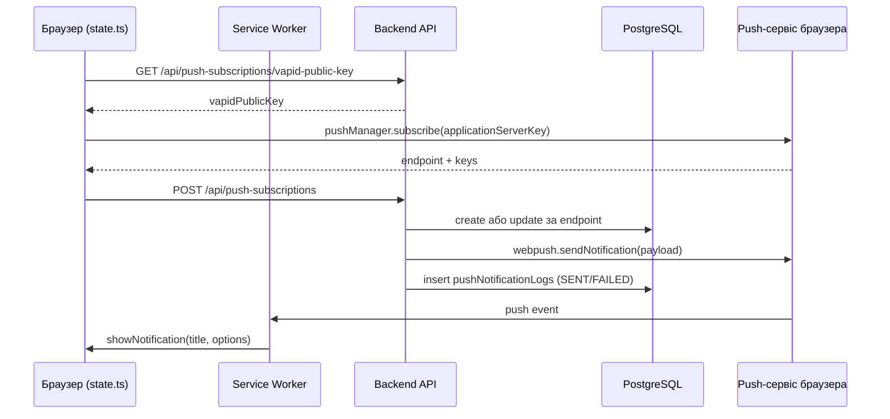

# Web Push сповіщення

Web Push дозволяє серверу показати користувачу системне сповіщення, **навіть коли вкладку із застосунком закрито**: повідомлення доставляє push-сервіс браузера (Google FCM для Chrome, Mozilla autopush для Firefox, Apple для Safari), а показує його Service Worker. У шаблоні вже є все потрібне: підписка у фронтенді, збереження підписок у PostgreSQL, відправка через бібліотеку [`web-push`](https://github.com/web-push-libs/web-push), журнал відправок і статистика. Щоб це запрацювало, потрібні лише VAPID-ключі.

## Як це працює

1. Користувач вмикає сповіщення в акаунті ([`UserAccount.vue`](https://github.com/Blazheiko/vibe-template/blob/main/packages/frontend/src/views/UserAccount.vue)). Браузер питає дозвіл (`Notification.requestPermission()`).
2. Фронтенд бере **публічний** VAPID-ключ з бекенду і просить браузер створити підписку: `pushManager.subscribe({ userVisibleOnly: true, applicationServerKey })`.
3. Браузер реєструється в своєму push-сервісі й повертає підписку: унікальний `endpoint` (URL у push-сервісі) і ключі шифрування `p256dh` та `auth`.
4. Фронтенд відправляє підписку на бекенд, бекенд зберігає її в таблиці `push_subscriptions`.
5. Коли трапляється подія (новий вхід, зміна пароля, відповідь підтримки), бекенд шифрує payload ключами підписки, підписує запит **приватним** VAPID-ключем і робить `POST` на `endpoint`.
6. Push-сервіс перевіряє підпис, будить Service Worker браузера, а той показує сповіщення. Клік відкриває `data.url`.

## Що таке VAPID-ключі

**VAPID** (Voluntary Application Server Identification, [RFC 8292](https://www.rfc-editor.org/rfc/rfc8292)) — це спосіб, яким ваш сервер доводить push-сервісу браузера, що він має право надсилати повідомлення на конкретну підписку.

- Це **пара ключів ECDSA на кривій P-256**: публічний і приватний, у форматі base64url.
- **Публічний ключ** не секретний. Фронтенд передає його браузеру як `applicationServerKey` під час підписки, і push-сервіс «прив'язує» підписку до нього.
- **Приватний ключ** — секрет, він лише на сервері. Ним бекенд підписує короткий JWT у заголовку `Authorization` кожного push-запиту. Push-сервіс перевіряє підпис публічним ключем з підписки. Тож навіть якщо хтось дізнається `endpoint`, без приватного ключа він не надішле повідомлення.
- **`VAPID_SUBJECT`** — контакт власника сервера (`mailto:` або `https:` URL). Його отримує push-сервіс, щоб зв'язатися з вами, якщо з вашими запитами щось не так.

::: tip VAPID не шифрує повідомлення
VAPID лише ідентифікує сервер. Вміст повідомлення шифрується окремо ключами самої підписки (`p256dh`, `auth`, [RFC 8291](https://www.rfc-editor.org/rfc/rfc8291)), тож push-сервіс не бачить, що ви надсилаєте. Бібліотека `web-push` робить і те, і інше.
:::

::: warning Ключі не можна просто змінити
Кожна підписка прив'язана до публічного ключа, з яким її створили. Якщо замінити ключі, усі наявні підписки перестануть працювати: push-сервіс відхилятиме запити, і користувачам доведеться підписатися знову. Генеруйте ключі один раз на оточення і зберігайте приватний ключ як секрет (менеджер секретів, змінні CI), а не в репозиторії.
:::

### Генерація ключів

У бекенді є скрипт [`generate-vapid-keys.ts`](https://github.com/Blazheiko/vibe-template/blob/main/packages/backend/src/scripts/generate-vapid-keys.ts):

```bash
# надрукувати нову пару ключів
pnpm --filter backend push:vapid

# записати ключі прямо в packages/backend/.env
pnpm --filter backend push:vapid --write
```

- З кореня репозиторію те саме запускає `pnpm push:vapid` (і `pnpm push:vapid --write`).
- Без прапорців скрипт лише друкує рядки `VAPID_PUBLIC_KEY=...` і `VAPID_PRIVATE_KEY=...`, які треба додати в `.env`.
- `--write` оновлює `VAPID_PUBLIC_KEY` і `VAPID_PRIVATE_KEY` у `packages/backend/.env`, решту файлу не чіпає. Якщо файлу немає, створює його.
- Якщо приватний ключ у `.env` уже задано, `--write` відмовляється (код виходу `1`), щоб випадково не зламати наявні підписки. Щоб таки замінити ключі, додайте `--force`.

Після генерації задайте `VAPID_SUBJECT` (наприклад `mailto:admin@your-domain.com`) і перезапустіть бекенд.

### Конфігурація

[`config/push.ts`](https://github.com/Blazheiko/vibe-template/blob/main/packages/backend/src/config/push.ts) читає три змінні:

| Змінна              | За замовчуванням                     | Призначення                          |
| ------------------- | ------------------------------------ | ------------------------------------ |
| `VAPID_PUBLIC_KEY`  | `''`                                 | публічний ключ, віддається фронтенду |
| `VAPID_PRIVATE_KEY` | `''`                                 | приватний ключ, секрет               |
| `VAPID_SUBJECT`     | `mailto:admin@vibe-template.example` | контакт для push-сервісу             |

Під час першої відправки [`push-notification-sender-service.ts`](https://github.com/Blazheiko/vibe-template/blob/main/packages/backend/src/app/services/notifications/push-notification-sender-service.ts) викликає `webpush.setVapidDetails(...)`. Якщо ключі порожні, пише `VAPID keys not configured — push notifications disabled` і нічого не надсилає (`{ sent: 0, failed: 0 }`). `GET /push-subscriptions/vapid-public-key` і `POST /push-subscriptions/test-push` у цьому випадку відповідають `500 VAPID keys not configured`, тож підписатися неможливо. Решта застосунку працює.

## Типи сповіщень

Кожне сповіщення має тип `notificationType`, а підписка — необов'язковий список `notificationTypes` (`'mention' | 'system'`), які вона хоче отримувати. Порожній список означає «усі типи».

| Тип       | Що це                                                      |
| --------- | ---------------------------------------------------------- |
| `system`  | сповіщення безпеки акаунта                                 |
| `mention` | повідомлення, адресовані користувачу (відповідь підтримки) |

## HTTP-маршрути

Група `push-subscriptions` у [`http-routes.ts`](https://github.com/Blazheiko/vibe-template/blob/main/packages/backend/src/app/routes/http-routes.ts) з middleware `session_web` і `csrf_guard`; на кожному маршруті, крім `vapid-public-key`, стоїть `auth_guard` (анонімний запит → `401` до контролера); контролер — [`push-subscription-controller.ts`](https://github.com/Blazheiko/vibe-template/blob/main/packages/backend/src/app/controllers/http/notifications/push-subscription-controller.ts). Фронтенд звертається до них з префіксом `/api` ([`utils/api.ts`](https://github.com/Blazheiko/vibe-template/blob/main/packages/frontend/src/utils/api.ts)).

| Метод    | Шлях                                             | Призначення                                                                                                                                                  |
| -------- | ------------------------------------------------ | ------------------------------------------------------------------------------------------------------------------------------------------------------------ |
| `GET`    | `/push-subscriptions/vapid-public-key`           | Публічний VAPID-ключ                                                                                                                                         |
| `POST`   | `/push-subscriptions/test-push`                  | Тестовий push поточному користувачу; тіло `{ title?, body? }` (`PushSubscriptionTestInputSchema`: до 200 / 1000 символів), відповідь містить `sent`/`failed` |
| `GET`    | `/push-subscriptions`                            | Підписки користувача                                                                                                                                         |
| `POST`   | `/push-subscriptions`                            | Створити підписку (`CreateSubscriptionInputSchema`)                                                                                                          |
| `GET`    | `/push-subscriptions/:subscriptionId`            | Одна підписка                                                                                                                                                |
| `PUT`    | `/push-subscriptions/:subscriptionId`            | Оновити (`UpdateSubscriptionInputSchema`)                                                                                                                    |
| `DELETE` | `/push-subscriptions/:subscriptionId`            | Видалити                                                                                                                                                     |
| `GET`    | `/push-subscriptions/:subscriptionId/logs`       | Журнал відправок                                                                                                                                             |
| `GET`    | `/push-subscriptions/:subscriptionId/statistics` | Статистика                                                                                                                                                   |
| `PUT`    | `/push-subscriptions/:subscriptionId/deactivate` | Деактивувати                                                                                                                                                 |

## Збереження підписки

[`push-subscription-service.ts`](https://github.com/Blazheiko/vibe-template/blob/main/packages/backend/src/app/services/notifications/push-subscription-service.ts) у `createSubscription` шукає підписку за `endpoint` (він унікальний серед усіх користувачів). Якщо підписка належить іншому користувачу, її переносять на поточного лише тоді, коли `p256dhKey` і `authKey` збігаються з збереженими (той самий браузер, зміна акаунта); інакше — `409 conflict`, підписка лишається за старим власником. Якщо вона є — оновлює ключі `p256dhKey`/`authKey`, метадані пристрою, `notificationTypes`, `timezone` і знову робить `isActive: true`; інакше створює новий запис. Робота з таблицею — через репозиторій, див. [Репозиторії](/backend/repositories).

## Відправка та формат payload

`pushNotificationSenderService.sendToUser(userId, payload, { skipIfOnline?, notificationType? })`:

1. Якщо `skipIfOnline` і користувач має активне WebSocket-з'єднання (`wsConnectionRegistry.isUserOnline`) — push пропускається (див. [WebSocket](/backend/websocket)).
2. Береться список активних підписок; якщо в підписки непорожній `notificationTypes` і він не містить `notificationType` — її пропускають.
3. Для кожної підписки викликається `webpush.sendNotification` з JSON:

```json
{
    "notification": {
        "title": "...",
        "body": "...",
        "icon": "/icons/icon_192x192.png",
        "badge": "/icons/badge-72.png",
        "vibrate": [200, 100, 200],
        "data": { "url": "/", "...": "payload.data" },
        "tag": "...",
        "actions": [
            { "action": "open", "title": "Open" },
            { "action": "close", "title": "Close" }
        ]
    }
}
```

Активні підписки (з урахуванням `notificationType`) обробляються паралельно, не більше `PUSH_SEND_CONCURRENCY = 5` запитів до push-сервісу одночасно. Результат кожної спроби — рядок `pushNotificationLogs` зі статусом `SENT` (і `statusCode` відповіді) або `FAILED` (з `errorMessage`); після всіх відправок рядки пишуться одним `insertMany` через [`push-notification-log-repository.ts`](https://github.com/Blazheiko/vibe-template/blob/main/packages/backend/src/app/repositories/notifications/push-notification-log-repository.ts), а `lastUsedAt` успішних підписок оновлюється одним `touchLastUsed`. Якщо запис не вдався, помилка логується, а результат `{ sent, failed }` відповідає фактичним відповідям push-сервісу.

**Прострочені підписки:** відповідь push-сервісу `410` або `404` деактивує підписку (`pushSubscriptionRepository.deactivate`). Окремої фонової очистки чи видалення неактивних записів немає.

**Бізнес-події** ([`user-notification-service.ts`](https://github.com/Blazheiko/vibe-template/blob/main/packages/backend/src/app/services/notifications/user-notification-service.ts)). Push надсилається без очікування: збій або повільний push-сервіс не змінює й не затримує відповідь, помилка — лише `warn`.

| Подія                                 | Де                                                      | `notificationType` | `skipIfOnline` |
| ------------------------------------- | ------------------------------------------------------- | ------------------ | -------------- |
| Новий вхід (`new_sign_in`)            | успішний `login` (email/телефон) і OAuth-callback       | `system`           | ні             |
| Зміна пароля (`password_changed`)     | `POST /auth/change-password`                            | `system`           | ні             |
| Скидання пароля (`password_reset`)    | скидання за email-токеном і за SMS                      | `system`           | ні             |
| Вихід з усіх пристроїв (`logout_all`) | `POST /auth/logout-all`                                 | `system`           | ні             |
| Відповідь підтримки                   | збережена відповідь Support AI (`support/support_chat`) | `mention`          | так            |

Сповіщення безпеки йдуть на всі активні підписки, зокрема й на пристрій, з якого виконано дію: підписки не прив'язані до сесії. Відповідь підтримки доходить лише тоді, коли в користувача немає відкритого WS-з'єднання; оскільки закриття з'єднання зупиняє генерацію, на практиці це випадок, коли вкладка закрилася вже після збереження відповіді. Підписка, у якої `notificationTypes` не містить відповідного типу, push не отримує. Окремо є ендпоінт `test-push`.

::: warning Межі `skipIfOnline`
«Онлайн» означає лише одне: у **цьому процесі** є хоча б одне відкрите WS-з'єднання користувача ([`ws-connection-registry.ts`](https://github.com/Blazheiko/vibe-template/blob/main/packages/backend/src/app/websocket/ws-connection-registry.ts), `Map` у пам'яті, `isUserOnline` = `userStorage.has(userId)`). Звідси:

- **Кілька інстансів.** З'єднання на іншому інстансі не видно: користувач, онлайн там, вважається офлайн, і push прийде. Спільного реєстру (Redis тощо) немає.
- **Фонова вкладка — теж онлайн.** Відкрите з'єднання у згорнутій вкладці чи заблокованому телефоні пригнічує push, хоча користувач повідомлення не бачить.
- **Момент перевірки.** Стан читається один раз перед надсиланням; з'єднання, яке закрилося одразу після перевірки, push уже не поверне.
- **Обрив без close.** Поки сервер не помітив розрив (heartbeat), з'єднання рахується відкритим.
  :::

## Статистика

[`push-subscription-statistics-service.ts`](https://github.com/Blazheiko/vibe-template/blob/main/packages/backend/src/app/services/statistics/push-subscription-statistics-service.ts) рахує `totalNotifications`, `sentNotifications`, `failedNotifications`, `pendingNotifications`, `successRate` (%), `last7DaysCount`, `lastUsed`, `isActive`. Лічильники дає один SQL-запит `countsBySubscription` (`count(case …)`), межу 7 днів обчислює застосунок і передає параметром.

## Фронтенд

- Підписка — у [`stores/state.ts`](https://github.com/Blazheiko/vibe-template/blob/main/packages/frontend/src/stores/state.ts): перевіряє `registration.pushManager.getSubscription()`, отримує VAPID-ключ з `/api/push-subscriptions/vapid-public-key`, викликає `pushManager.subscribe({ applicationServerKey })` і відправляє дані на `POST /api/push-subscriptions`.
- [`service-worker.ts`](https://github.com/Blazheiko/vibe-template/blob/main/packages/frontend/src/service-worker.ts) у обробнику `push` парсить JSON, зливає `payload.notification` з дефолтами і викликає `showNotification`; `notificationclick` закриває нотифікацію і відкриває `data.url` (або `/`).



## Локальне тестування

1. Згенеруйте ключі: `pnpm --filter backend push:vapid --write`, і перезапустіть бекенд.
2. Service Worker реєструється лише в production-збірці (див. [Фронтенд → PWA](/frontend/#pwa)), а push потребує `localhost` або HTTPS. Зберіть фронтенд і віддайте його бекендом або через `vite preview`.
3. Увійдіть, увімкніть сповіщення в акаунті й дозвольте їх у браузері.
4. Викличте `POST /api/push-subscriptions/test-push` (тіло `{}` або `{ "title": "…", "body": "…" }`, з CSRF-токеном) з активною сесією. Результат видно у відповіді (`sent`/`failed`), у логах бекенду та через `/:subscriptionId/logs`.

Юніт-тести: `pnpm --filter backend test`, зокрема [`push-subscription-service.spec.ts`](https://github.com/Blazheiko/vibe-template/blob/main/packages/backend/src/app/services/notifications/push-subscription-service.spec.ts).
