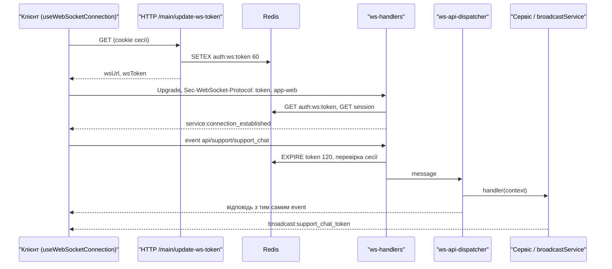

# WebSocket

Бекенд тримає один WebSocket-ендпоінт `/<pathPrefix>/websocket` (за замовчуванням `/api/websocket`) на тому ж сервері uWebSockets.js, що й HTTP. Через нього клієнт викликає WS-маршрути у стилі «запит — відповідь», а сервер надсилає push-події (`broadcast:*`). Загальний шлях upgrade і повідомлення описано на сторінці [Життєвий цикл запиту](/backend/request-lifecycle), схему токенів — у розділі [Авторизація WebSocket](/backend/auth-security), а синтаксис `defineWsRoute` — на сторінці [Маршрутизація та middleware](/backend/routing-middlewares). Тут зібрано все, що стосується саме WS: структура на сервері, протокол, push-події, heartbeat, клієнт і обмеження.

## Підключення

### Отримання токена по HTTP

Браузерний `WebSocket` не вміє передавати cookie-сесію як заголовок авторизації, тому клієнт спочатку отримує короткоживучий WS-токен:

1. `GET /<pathPrefix>/main/update-ws-token` (група `main` з `session_web` + `csrf_guard`, на маршруті `auth_guard`) — [http-routes.ts](https://github.com/Blazheiko/itvibe-template/blob/main/packages/backend/src/app/routes/http-routes.ts).
2. `MainController.updateWsToken` → `mainService.updateWsToken` ([main-controller.ts](https://github.com/Blazheiko/itvibe-template/blob/main/packages/backend/src/app/controllers/http/core/main-controller.ts), [main-service.ts](https://github.com/Blazheiko/itvibe-template/blob/main/packages/backend/src/app/services/core/main-service.ts)) повертає `{ wsUrl, wsToken }`.
3. [generate-ws-token-service.ts](https://github.com/Blazheiko/itvibe-template/blob/main/packages/backend/src/app/services/auth/generate-ws-token-service.ts) генерує 16-символьний ключ і пише в Redis `auth:ws:<token>` з TTL 60 с і даними `{ sessionId, userId, userToken }`.
4. `wsUrl` будує [get-ws-url-service.ts](https://github.com/Blazheiko/itvibe-template/blob/main/packages/backend/src/app/services/communication/get-ws-url-service.ts): `wss://` для `production`/`prod`, інакше `ws://`, далі `<domain>/<pathPrefix>/websocket`.

### Upgrade

`handleUpgrade` у [ws-handlers.ts](https://github.com/Blazheiko/itvibe-template/blob/main/packages/backend/src/vendor/utils/network/ws-handlers.ts) спершу перевіряє ліміт upgrade за IP ([upgrade-rate-limit.ts](https://github.com/Blazheiko/itvibe-template/blob/main/packages/backend/src/vendor/utils/rate-limit/upgrade-rate-limit.ts), за замовчуванням 60 на хвилину): перевищення дає `429` з `Retry-After`, збій лічильника — `503`. Потім він розбирає `Sec-WebSocket-Protocol` через кому: перший елемент — токен, другий — тип застосунку (`app-web` → `web`, `app-pwa` → `pwa`, інше → `web` з попередженням). Токен перевіряється за форматом (`accessTokenLength` = 16, лише `[a-zA-Z0-9]`), інакше `401 Invalid token format`. Далі викликається хук `onUpgrade`, тобто `wsSessionAuth.verifyUpgradeToken` з [ws-session-auth.ts](https://github.com/Blazheiko/itvibe-template/blob/main/packages/backend/src/app/websocket/ws-session-auth.ts), і сервер повертає клієнту як обраний subprotocol сам токен. Якщо основний Redis-клієнт недоступний, upgrade відхиляється **до** `res.upgrade` відповіддю `503 Service Unavailable` з `Retry-After: 1` (без `4001`); після першої недоступної команди друга (`get` сесії) не виконується.

```ts
const token = protocols[0] ?? ''
const appType = normalizeAppTypeProtocol(protocols[1] ?? '')
```

Якщо `verifyUpgradeToken` не знайшов живої сесії для токена правильного формату, upgrade відхиляється **до** `res.upgrade` відповіддю `401 Session expired`: з'єднання не відкривається. Браузер бачить це як невдалий handshake (close `1006`), і клієнт оновлює токен через HTTP (див. нижче). Якщо дані є, клієнт отримує `service:connection_established` з `socket_id` (UUID з'єднання) і `activity_timeout: 30`.

Під час кожного вхідного повідомлення `onRefreshToken` продовжує TTL `auth:ws:<token>` до 120 с, а в `onClose` і `closeAllWs` (graceful shutdown, код `4201`) токен видаляється через `onRevokeToken`. Отже токен одноразовий щодо з'єднання: для нового підключення потрібен новий виклик `update-ws-token`.

## Структура на сервері

| Модуль                                                                                                                                                             | Роль                                                                                                                              |
| ------------------------------------------------------------------------------------------------------------------------------------------------------------------ | --------------------------------------------------------------------------------------------------------------------------------- |
| [vendor/start/server.ts](https://github.com/Blazheiko/itvibe-template/blob/main/packages/backend/src/vendor/start/server.ts)                                       | `configureWebsockets`: реєстрація `server.ws(...)`, опції uWS, `broadcastToChannel` (`server.publish`)                            |
| [vendor/utils/network/ws-handlers.ts](https://github.com/Blazheiko/itvibe-template/blob/main/packages/backend/src/vendor/utils/network/ws-handlers.ts)             | транспорт: `handleUpgrade`, `onOpen`, `onMessage`, `onClose`, `closeAllWs`; хуки застосунку `WsAppHooks` і валідатор повідомлення |
| [app/start/index.ts](https://github.com/Blazheiko/itvibe-template/blob/main/packages/backend/src/app/start/index.ts)                                               | склеює vendor і app: `registerWsMessageValidator` і `registerWsAppHooks`                                                          |
| [app/websocket/ws-session-auth.ts](https://github.com/Blazheiko/itvibe-template/blob/main/packages/backend/src/app/websocket/ws-session-auth.ts)                   | перевірка, продовження, відкликання WS-токена в Redis                                                                             |
| [app/websocket/ws-coordinator.ts](https://github.com/Blazheiko/itvibe-template/blob/main/packages/backend/src/app/websocket/ws-coordinator.ts)                     | `handleConnected` / `handleDisconnected`: роль користувача, реєстр, `userOnlineService`, presence                                 |
| [app/websocket/ws-connection-registry.ts](https://github.com/Blazheiko/itvibe-template/blob/main/packages/backend/src/app/websocket/ws-connection-registry.ts)     | in-memory реєстр з'єднань                                                                                                         |
| [vendor/utils/routing/ws-api-dispatcher.ts](https://github.com/Blazheiko/itvibe-template/blob/main/packages/backend/src/vendor/utils/routing/ws-api-dispatcher.ts) | маршрутизація повідомлень на handler                                                                                              |

Підключення хуків у [app/start/index.ts](https://github.com/Blazheiko/itvibe-template/blob/main/packages/backend/src/app/start/index.ts):

```ts
registerWsAppHooks({
    onUpgrade: (token) => wsSessionAuth.verifyUpgradeToken(token),
    onConnected: (ws, userData) => websocketCoordinator.handleConnected(ws, userData),
    onDisconnected: (ws, userData, code) =>
        websocketCoordinator.handleDisconnected(ws, userData, code),
    onRefreshToken: (token) => wsSessionAuth.refreshToken(token),
    onRevokeToken: (token) => wsSessionAuth.revokeToken(token),
})
```

### Що відстежується

- **Транспорт** (`ws-handlers.ts`): `Set<MyWebSocket>` усіх відкритих сокетів — лише для `closeAllWs` при зупинці.
- **Реєстр** (`ws-connection-registry.ts`): `Map<userId, { ip, userAgent, appType, connections: Map<uuid, ws> }>`. Один користувач може мати кілька з'єднань (вкладки, PWA); `appType` стає `pwa`, якщо хоча б одне з'єднання PWA. `registerConnection` повертає `true` для першого з'єднання, `unregisterConnection` — `true` для останнього. Є також `isUserOnline`, `findOnlineUsers`, `forEachConnection`, `getConnection`, `getOnlineUsers`, `getOnlineUserMeta`.
- **Канали**: використовується pub/sub uWS (`ws.subscribe` / `server.publish`). У коді є один канал — `admin` ([admin-ws-channel-service.ts](https://github.com/Blazheiko/itvibe-template/blob/main/packages/backend/src/app/services/admin/admin-ws-channel-service.ts)); підписатись може лише з'єднання з `role === 'admin'`, лічильник підписників зберігається в пам'яті.
- **Історія онлайну в БД**: `userOnlineService.trackConnected/trackDisconnected` викликаються з координатора без `await` (помилки лише логуються).

У `handleDisconnected` з'єднання видаляється з реєстру **синхронно до будь-якого `await`**, щоб broadcast-цикли не звертались до вже закритого uWS-сокета.

::: warning `app/state/user-storage.ts`
[user-storage.ts](https://github.com/Blazheiko/itvibe-template/blob/main/packages/backend/src/app/state/user-storage.ts) (`getUserByToken`/`setUserByToken`/`deleteToken` на `Map`) у поточному коді ніде не імпортується. Реальний стан з'єднань — у `ws-connection-registry.ts`.
:::

Усі ці структури живуть у пам'яті одного процесу: при кількох інстансах реєстр, канали і presence не спільні.

## Протокол повідомлень

Клієнт надсилає текстовий JSON (бінарні повідомлення ігноруються з логом помилки). Форму перевіряє [ws-message-validator.ts](https://github.com/Blazheiko/itvibe-template/blob/main/packages/backend/src/app/validate/ws-message-validator.ts) (ArkType через адаптер `defaultValidator`):

```ts
const WsMessageSchema = type({
    payload: 'Record<string, unknown> | null',
    event: 'string',
    timestamp: 'number',
})
```

Приклад запиту від клієнта:

```json
{ "event": "api/support/support_chat", "timestamp": 1760000000000, "payload": { "message": "..." } }
```

Відповідь (`WsResponseData`) повторює `event` і `timestamp` запиту, тож клієнт зіставляє її із запитом:

```json
{
    "event": "api/support/support_chat",
    "timestamp": 1760000000000,
    "status": "200",
    "error": null,
    "data": { "status": "ok" }
}
```

При помилці `status: "error"`, `data: null` (або `{}`), а `error` — конверт `{ code, message, reason?, details? }`.

### Диспетчер

[ws-api-dispatcher.ts](https://github.com/Blazheiko/itvibe-template/blob/main/packages/backend/src/vendor/utils/routing/ws-api-dispatcher.ts):

1. Ім'я маршруту — частина `event` до першого `:`; шукається **точним збігом** у `wsRoutesByUrl` ([router.ts](https://github.com/Blazheiko/itvibe-template/blob/main/packages/backend/src/vendor/start/router.ts), `createWsRoutesByUrl`). Ключі — повний URL з `pathPrefix`, групою і `url`, наприклад `api/support/support_chat`.
2. `checkRateLimitWs` ([ws-rate-limit.ts](https://github.com/Blazheiko/itvibe-template/blob/main/packages/backend/src/vendor/utils/rate-limit/ws-rate-limit.ts)) — ліміт маршруту або групи, ключ IP + URL.
3. `validateRoutePayload`, якщо в маршруту є `validator`; payload заморожується (`Object.freeze`).
4. `createWsContext` → middleware маршруту (якщо є) → `handler(context)`; результат кладеться в `responseData.data`.

| Ситуація                                 | `error.code`                                       |
| ---------------------------------------- | -------------------------------------------------- |
| невалідна форма повідомлення або payload | `validation_failed` (`details.kind: "validation"`) |
| маршрут не знайдено                      | `not_found` («Route not found»)                    |
| перевищено ліміт                         | `rate_limited` (`reason: rate_limit_exceeded`)     |
| виняток у handler                        | `internal_error`                                   |
| сесія зникла (вже відкрите з'єднання)    | `service:error` `unauthorized` + закриття `4001`   |
| Redis недоступний                        | `service_unavailable`, з'єднання не закривається   |

Перед диспетчером `onMessage` перевіряє сесію через `wsSessionHandler` ([session-handler.ts](https://github.com/Blazheiko/itvibe-template/blob/main/packages/backend/src/vendor/utils/session/session-handler.ts)) на **кожне** повідомлення, тож вихід із сесії по HTTP рве WS при наступному повідомленні.

Якщо основний Redis-клієнт недоступний (refresh токена або читання сесії дали `RedisUnavailableError`), з'єднання **не закривається**, а у відповідь на це повідомлення приходить помилка з початковим `event`, у тому ж форматі, що й `rate_limited`:

```json
{
    "status": "error",
    "event": "api/<route>",
    "error": {
        "code": "service_unavailable",
        "message": "Service temporarily unavailable. Try again later."
    },
    "data": null,
    "timestamp": 1730000000000
}
```

Фронтенд шукає колбек за `event`, тож відповідний Promise одразу відхиляється, а не чекає клієнтського таймауту. Після першої недоступної команди друга не виконується.

### WS-маршрути

Визначені в [app/routes/ws-routes.ts](https://github.com/Blazheiko/itvibe-template/blob/main/packages/backend/src/app/routes/ws-routes.ts), контролери — у [controllers/ws/](https://github.com/Blazheiko/itvibe-template/blob/main/packages/backend/src/app/controllers/ws):

| Повна назва події (`event`)          | Контролер                                  | Призначення                                                                                                    | Ліміт групи |
| ------------------------------------ | ------------------------------------------ | -------------------------------------------------------------------------------------------------------------- | ----------- |
| `api/admin/subscribe_online_users`   | `AdminWsController.subscribeOnlineUsers`   | підписати з'єднання адміна на канал `admin`; група з `ws_admin_guard` (не адмін → `status "403"`, `forbidden`) | 120 / 60 с  |
| `api/admin/unsubscribe_online_users` | `AdminWsController.unsubscribeOnlineUsers` | відписати з'єднання від `admin`                                                                                | 120 / 60 с  |
| `api/support/support_open_chat`      | `SupportWsController.openChat`             | відкрити чат підтримки, запустити привітання                                                                   | 60 / 60 с   |
| `api/support/support_chat`           | `SupportWsController.chat`                 | надіслати повідомлення агенту підтримки                                                                        | 60 / 60 с   |

Support-контролери ([support-controller.ts](https://github.com/Blazheiko/itvibe-template/blob/main/packages/backend/src/app/controllers/ws/support-controller.ts)) одразу відповідають `{ status: 'ok' }`, а саму відповідь агента запускають без `await` і доставляють push-подіями.

## Push від сервера до клієнта

Усі push-повідомлення формує `makeBroadcastJson` ([json-handlers.ts](https://github.com/Blazheiko/itvibe-template/blob/main/packages/backend/src/vendor/utils/helpers/json-handlers.ts)): `{ event: "broadcast:<event>", status: 200, payload }`. API — [broadcast-service.ts](https://github.com/Blazheiko/itvibe-template/blob/main/packages/backend/src/app/services/communication/broadcast-service.ts):

- `broadcastMessageToUser(userId, …)` — на всі з'єднання користувача (через реєстр);
- `broadcastMessageToUserExcept(userId, excludeUuid, …)` — на всі, крім одного;
- `broadcastMessageToUserConnection(userId, uuid, …)` — на конкретне з'єднання;
- `broadcastMessageToChannel(channel: WsChannel, …)` → `broadcastToChannel` у `server.ts` (`isWsChannel`, потім `server.publish`).

Події, які реально надсилаються:

| Подія                                                                         | Звідки                                                                                                                                                                               | Кому                                                                    |
| ----------------------------------------------------------------------------- | ------------------------------------------------------------------------------------------------------------------------------------------------------------------------------------ | ----------------------------------------------------------------------- |
| `broadcast:admin_user_online_upsert`                                          | [ws-presence-service.ts](https://github.com/Blazheiko/itvibe-template/blob/main/packages/backend/src/app/services/communication/ws-presence-service.ts), перше з'єднання користувача | канал `admin`                                                           |
| `broadcast:admin_user_online_remove`                                          | `ws-presence-service.ts`, останнє з'єднання закрито                                                                                                                                  | канал `admin`                                                           |
| `broadcast:support_chat_token`, `support_chat_complete`, `support_chat_error` | [support-service.ts](https://github.com/Blazheiko/itvibe-template/blob/main/packages/backend/src/app/services/support/support-service.ts)                                            | з'єднання, з якого прийшов запит (fallback — усі з'єднання користувача) |

Presence публікується лише якщо в каналі `admin` є підписники (`adminWsChannelService.hasSubscribers()`). Сервісні події транспорту: `service:connection_established`, `service:error`.

## Heartbeat, таймаути, клієнт

Опції uWS у `configureWebsockets` ([server.ts](https://github.com/Blazheiko/itvibe-template/blob/main/packages/backend/src/vendor/start/server.ts)): `compression: 0` (вимкнено), `idleTimeout: 120` с, `maxPayloadLength: 1 MB`, `maxBackpressure: 64 KB`. Протокольний ping/pong uWS не використовується явно: клієнт надсилає текст `ping`, сервер відповідає `pong`, що скидає idle-таймер. `pong` надсилається **першим і без жодної Redis-команди**: heartbeat підтверджує транспорт, а не Redis. Продовження TTL токена виконується після `pong` і не очікується; якщо Redis недоступний, воно мовчки пропускається, тож повільний або недоступний Redis не закриває з'єднання через pong-таймаут клієнта.

Клієнт фронтенду — singleton-композабл [useWebSocketConnection.ts](https://github.com/Blazheiko/itvibe-template/blob/main/packages/frontend/src/composables/useWebSocketConnection.ts) на `useWebSocket` з `@vueuse/core`:

- `protocols` — масив `[wsToken, 'app-web']`, який мутується перед перепідключенням;
- heartbeat з [websocket-heartbeat.ts](https://github.com/Blazheiko/itvibe-template/blob/main/packages/frontend/src/utils/websocket-heartbeat.ts): `ping` кожні 10 с, закриття, якщо `pong` не прийшов за 5 с. Планувальник створюється з `immediate: false` — після виправлення «don't start the heartbeat interval before the socket connects» інтервал запускає сам `useWebSocket` при підключенні, а не з моменту завантаження модуля (інакше pong-таймаут міг закрити сокет ще під час handshake);
- `websocketApi(route, payload)` надсилає `event` у форматі `<prefix>/<route>` ([`ws-event.ts`](https://github.com/Blazheiko/itvibe-template/blob/main/packages/frontend/src/utils/ws-event.ts): `prefix` — `VITE_API_PATH_PREFIX`, за замовчуванням `api`, слеші на краях обрізаються) і чекає відповідь з тим самим `event` до 10 с. Одночасно для однієї події може чекати лише один запит: другий отримує `Request already in progress`;
- повідомлення розбираються за префіксом: `broadcast:` → [useBroadcastHandler.ts](https://github.com/Blazheiko/itvibe-template/blob/main/packages/frontend/src/composables/useBroadcastHandler.ts), `service:` → сервісні обробники, `api` → резолв запиту.

Перепідключення (вбудований `autoReconnect` vueuse закоментовано, логіка своя в `handleWebSocketClose`):

Рішення приймає чиста функція [`resolveWebSocketCloseAction`](https://github.com/Blazheiko/itvibe-template/blob/main/packages/frontend/src/utils/websocket-close.ts) (покрита тестами):

- код `4001` → `unauthorized()`: новий `mainApi.updateWsToken()` і `websocketOpen(wsUrl, wsToken)`; якщо HTTP теж каже «не автентифіковано» — подія `unauthorized` в event bus і закриття; інші помилки — повтор через 5 с;
- `1006`, коли з'єднання так і не відкрилося (сервер відхилив upgrade з `401` або недоступний), → так само `unauthorized()`: перший раз одразу, наступні поспіль — через 5 с, щоб недоступний WS-ендпоінт при робочому HTTP не давав швидкого циклу оновлень токена;
- коди `4000–4099` (крім `4001`) → без перепідключення;
- інші коди (зокрема `4201` при зупинці сервера) → `open()` через 5 с. Оскільки токен на сервері вже відкликано, такий повтор, найімовірніше, отримає `4001` і піде гілкою оновлення токена.

::: tip Нестандартний `API_PATH_PREFIX`
Ключі WS-маршрутів на сервері — `<API_PATH_PREFIX>/<route>`. Фронтенд, зібраний з тим самим `VITE_API_PATH_PREFIX`, формує ті самі події; з іншим префіксом сервер відповідає `not_found`. HTTP-виклики фронтенду поки ходять на `/api/...` незалежно від цієї змінної (п. 73 у [code-issues](https://github.com/Blazheiko/itvibe-template/blob/main/docs/plan/code-issues-found-during-docs.md)), тож для повністю іншого префікса потрібна ще й переадресація HTTP на проксі.
:::

## Обмеження та безпека

- **Розмір повідомлення**: `maxPayloadLength` 1 MB на рівні uWS; окремого налаштування для WS немає (див. [Життєвий цикл запиту](/backend/request-lifecycle)).
- **Rate limit повідомлень**: per-route/per-group через `checkRateLimitWs`, лічильник у пам'яті процесу (з'єднання живе на одному інстансі), ключ IP + URL маршруту — за IP, а не за з'єднанням, щоб бюджет не множився новими з'єднаннями. Ліміт групи діє на кожен маршрут групи окремо, а не на всю групу разом. При збої перевірки — відмова (`allowed: false`, `retryAfter: 1`).
- **Авторизація маршрутів**: усі WS-маршрути вимагають валідну сесію (перевірка в `onMessage`); ролі перевіряються в сервісах (наприклад, `admin` для каналу). Детальніше — [Автентифікація та безпека](/backend/auth-security).

- **Rate limit upgrade, два рівні**, обидва за IP і незалежні від HTTP L1: рівень 1 у пам'яті процесу (`WS_UPGRADE_RATE_LIMIT_*`, 120/хв) відсікає флуд до будь-якого I/O; рівень 2 у Redis (`WS_UPGRADE_SHARED_RATE_LIMIT_*`, 60/хв) — спільний бюджет на всі інстанси. Обидва перевіряються до формату токена і до пошуку сесії, тож невалідні токени теж витрачають бюджет. Якщо Redis для лімітів недоступний, рівень 2 пропускається, і діє лише рівень 1. Звичайні HTTP-запити на `/<pathPrefix>/websocket` рахуються в HTTP L1. Деталі — [Обмеження частоти запитів](/backend/auth-security#обмеження-частоти-запитів).
- **`ping`/`pong`** (heartbeat) обробляється в `onMessage` до диспетчера і під rate limit повідомлень не потрапляє.

Токени сесії в логах маскуються: `maskTokenForLogs` ([`mask-sensitive.ts`](https://github.com/Blazheiko/itvibe-template/blob/main/packages/backend/src/vendor/utils/helpers/mask-sensitive.ts)) лишає лише перші 4 символи (`abcd…`). Так логуються WS-токен у `verifyUpgradeToken`, `userToken` у `wsSessionHandler` і `destroyAllSessions`, `cookieUserToken` у `token-handler.ts`.

Канали обмежено whitelist'ом `WS_CHANNELS` у [`shared/src/guards/ws-channels.ts`](https://github.com/Blazheiko/itvibe-template/blob/main/packages/shared/src/guards/ws-channels.ts) (зараз лише `admin`). `broadcastToChannel` приймає тип `WsChannel`, а в runtime додатково перевіряє значення через `isWsChannel`: невідомий канал не публікується, сервер пише `warn` і повертає `false`. Новий канал додається в `WS_CHANNELS`. Guard без залежностей, тож його можна імпортувати й на фронтенді (`shared/guards`).

## Діаграма послідовності



## Як додати WS-маршрут

1. Опишіть схему вхідних даних і відповіді в `packages/shared` (як `SupportChatInputSchema` і `SupportChatResponseSchema`).
2. Додайте метод у контролер у `packages/backend/src/app/controllers/ws/`. Він отримує `WsContext<Input>`; payload беріть через `getTypedPayload(context)`, користувача — з `context.userData`, сокет — з `context.ws`. Помилки сервісів перетворюйте через `appErrorToWsError`.
3. Зареєструйте маршрут у `ws-routes.ts` в наявній або новій групі з `prefix` і `rateLimit`:

```ts
defineWsRoute({
    url: 'support_chat',
    handler: SupportWsController.chat.bind(SupportWsController),
    validator: SupportChatInputSchema,
    ResponseSchema: ResponseSchemas.SupportChatResponseSchema,
    description: 'Send a message to the support agent',
})
```

4. На фронтенді викликайте `websocketApi('<prefix>/<url>', payload)`; для push — `broadcastService` на бекенді і обробник у `useBroadcastHandler.ts`.
5. Для тривалих операцій відповідайте одразу, а результат шліть push-подією на `userData.uuid`, як у support-контролері.

Загальний рецепт фічі — [Як додати фічу](/backend/adding-a-feature).
