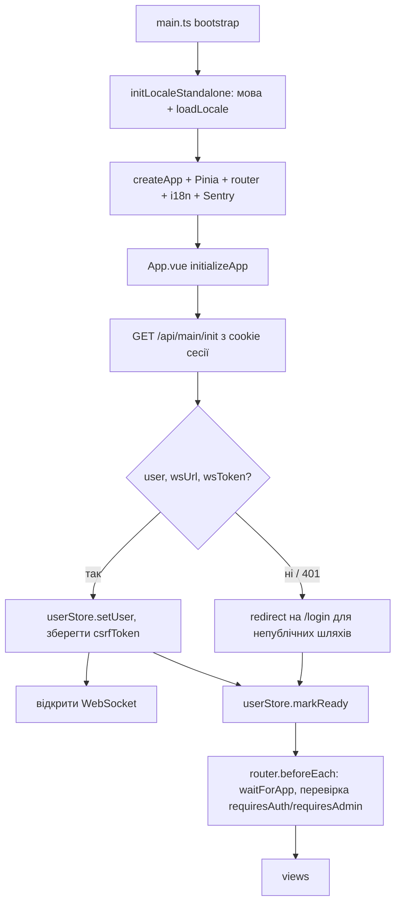

# Фронтенд

`packages/frontend` — односторінковий застосунок (SPA) на Vue 3 + Vite, який у production віддає сам бекенд. Ця сторінка — огляд. Деталі окремих підсистем описані на сторінках бекенду, і тут на них лише посилання.

## Стек

Залежності взято з [`packages/frontend/package.json`](https://github.com/Blazheiko/itvibe-template/blob/main/packages/frontend/package.json):

| Призначення        | Пакет                                                            |
| ------------------ | ---------------------------------------------------------------- |
| UI-фреймворк       | `vue` 3.5, `@vueuse/core`                                        |
| Збірка / dev       | `vite` 7, `@vitejs/plugin-vue`, `vite-plugin-vue-devtools`       |
| Стан               | `pinia`                                                          |
| Роутинг            | `vue-router` 5                                                   |
| i18n               | `vue-i18n` 11                                                    |
| Моніторинг помилок | `@sentry/vue`                                                    |
| PWA install prompt | `@khmyznikov/pwa-install`                                        |
| Інше               | `mitt` (event bus), `dompurify`, `vue-advanced-cropper` (аватар) |
| Спільні контракти  | `shared` (`workspace:*`)                                         |
| Тести              | `vitest`, `@vue/test-utils`, `jsdom`, `@playwright/test`         |
| Типи               | `typescript` 6.0.3, `vue-tsc`                                    |

## Dev-сервер і проксі

[`vite.config.ts`](https://github.com/Blazheiko/itvibe-template/blob/main/packages/frontend/vite.config.ts): порт `5173`, проксі `/api` → `http://127.0.0.1:3000` і `/ws` → `ws://127.0.0.1:3000` (`ws: true`). Аліас `@` → `src/`. Тег `pwa-install` оголошено як custom element. Через `define` у бандл потрапляє `BUILD_TIMESTAMP`, за яким порівнюються версії застосунку і Service Worker.

Як запускати разом із бекендом: [/guide/getting-started](/guide/getting-started), команди: [/reference/scripts](/reference/scripts).

## Змінні оточення

Тип `ImportMetaEnv` в [`src/env.d.ts`](https://github.com/Blazheiko/itvibe-template/blob/main/packages/frontend/src/env.d.ts) описує тільки `VITE_BASE_URL`. У коді використовуються також інші змінні:

| Змінна                                                                                                                  | Де використовується                                                                                                                                                         |
| ----------------------------------------------------------------------------------------------------------------------- | --------------------------------------------------------------------------------------------------------------------------------------------------------------------------- |
| `VITE_BASE_URL`                                                                                                         | префікс для всіх HTTP-запитів у [`utils/base-api.ts`](https://github.com/Blazheiko/itvibe-template/blob/main/packages/frontend/src/utils/base-api.ts)                       |
| `VITE_AUTH_PHONE_ENABLED`                                                                                               | `'true'` вмикає вхід і реєстрацію за телефоном у [`AuthModals.vue`](https://github.com/Blazheiko/itvibe-template/blob/main/packages/frontend/src/components/AuthModals.vue) |
| `VITE_SENTRY_ENABLED`, `VITE_SENTRY_DSN`, `VITE_SENTRY_ENVIRONMENT`, `VITE_SENTRY_RELEASE`, `VITE_SENTRY_*_SAMPLE_RATE` | конфігурація Sentry, див. [/backend/observability](/backend/observability)                                                                                                  |

::: warning Fallback `VITE_BASE_URL`
Якщо `VITE_BASE_URL` не задано, `base-api.ts` бере `https://itvibe-template.example`. У dev-режимі запити тоді йдуть на цей домен, а не через Vite-проксі. Щоб працювало відносно поточного origin, змінну треба задати явно. Решта `VITE_*` (крім `VITE_BASE_URL`) не описані в `ImportMetaEnv`.
:::

## Структура `src/`

| Каталог / файл                                                                                                        | Вміст                                                                                                                                                       |
| --------------------------------------------------------------------------------------------------------------------- | ----------------------------------------------------------------------------------------------------------------------------------------------------------- |
| [`main.ts`](https://github.com/Blazheiko/itvibe-template/blob/main/packages/frontend/src/main.ts)                     | bootstrap: локаль → `createApp` → Pinia, router, i18n → Sentry → `mount`; реєстрація SW і повідомлення про оновлення                                        |
| [`App.vue`](https://github.com/Blazheiko/itvibe-template/blob/main/packages/frontend/src/App.vue)                     | `initializeApp()`: виклик `GET /api/main/init`, збереження користувача, відкриття WebSocket                                                                 |
| `views/`                                                                                                              | сторінки: `Login`, `UserAccount`, `SupportView`, `VerifyEmailView`, `ResetPasswordView`, юридичні сторінки, `admin/`                                        |
| `components/`                                                                                                         | `AppHeader`, `AuthModals`, `MenuButton` (PWA install), `ConnectionStatus`, `UpdateNotification`, `ToastContainer`, `AvatarEditorModal`, `admin/`            |
| `composables/`                                                                                                        | `useWebSocketConnection`, `useBroadcastHandler`, `useSessionLifecycle`, `useLocale`, `useSentry`, `useToast`                                                |
| `stores/`                                                                                                             | Pinia: `user`, `state`, `toast`, `support` (і демо `counter`)                                                                                               |
| [`router/index.ts`](https://github.com/Blazheiko/itvibe-template/blob/main/packages/frontend/src/router/index.ts)     | маршрути та guard                                                                                                                                           |
| [`plugins/i18n.ts`](https://github.com/Blazheiko/itvibe-template/blob/main/packages/frontend/src/plugins/i18n.ts)     | інстанс `vue-i18n`                                                                                                                                          |
| `locales/`                                                                                                            | файли перекладів                                                                                                                                            |
| `utils/`                                                                                                              | HTTP-клієнт (`base-api.ts`, `api.ts`), `csrf-token.ts`, WebSocket (`websocket-base.ts`, `websocket-heartbeat.ts`), Sentry, `pwa-install.ts`, `event-bus.ts` |
| `types/`                                                                                                              | типи, зокрема `i18n.d.ts`                                                                                                                                   |
| [`service-worker.ts`](https://github.com/Blazheiko/itvibe-template/blob/main/packages/frontend/src/service-worker.ts) | Service Worker, збирається окремо                                                                                                                           |

Загальна структура монорепозиторію: [/guide/project-structure](/guide/project-structure).

### Роутер і guard

У маршрутах є `meta` (`requiresAuth`, `requiresAdmin`, `hideHeader`, `authModal` тощо, типи розширено в `env.d.ts`). `router.beforeEach` для захищених маршрутів чекає `waitForApp()` зі стору `user`, тобто завершення `initializeApp`. Публічні сторінки (вхід, верифікація email, скидання пароля) не чекають ініціалізації. Без користувача guard перенаправляє на `/login?redirect=<шлях>`. Маршрут `requiresAdmin` для не-адміна перенаправляє на `/account`.

### i18n

Список мов береться з `APP_LOCALE_CODES` пакета [`shared`](/shared/). У `src/locales/` є 18 файлів: `en`, `uk`, `ru`, `de`, `fr`, `es`, `it`, `pt`, `pl`, `cs`, `nl`, `sv`, `tr`, `ar`, `hi`, `zh`, `ja`, `ko`. В основний бандл входить тільки `en`. Інші мови `loadLocale()` підвантажує динамічним `import()` і зливає з `en`, тож відсутні ключі показуються англійською. Початкову мову `initLocaleStandalone()` у [`composables/useLocale.ts`](https://github.com/Blazheiko/itvibe-template/blob/main/packages/frontend/src/composables/useLocale.ts) визначає за `navigator.language`, а якщо такої мови немає — бере `en`.

## HTTP-клієнт, сесія і CSRF

[`utils/base-api.ts`](https://github.com/Blazheiko/itvibe-template/blob/main/packages/frontend/src/utils/base-api.ts) обгортає `fetch`, а [`utils/api.ts`](https://github.com/Blazheiko/itvibe-template/blob/main/packages/frontend/src/utils/api.ts) містить типізовані методи (`/api/auth/*`, `/api/main/*`, `/api/push-subscriptions*`).

- Усі запити йдуть з `credentials: 'include'`, тож браузер сам надсилає сесійну cookie. JS її не читає.
- CSRF-токен не вбудовується в HTML. Він приходить у полі `csrfToken` відповіді (зокрема `init`) і зберігається в пам'яті модуля [`utils/csrf-token.ts`](https://github.com/Blazheiko/itvibe-template/blob/main/packages/frontend/src/utils/csrf-token.ts). Токен перевіряється regex `^[A-Za-z0-9_-]{32,128}$` і оновлюється з кожної відповіді, у якій є нове значення.
- Для `POST`/`PUT`/`PATCH`/`DELETE` клієнт додає заголовок `X-CSRF-Token`.
- Коли сервер повертає `csrf_invalid`, клієнт один раз емітить `init_app`, щоб повторно ініціалізуватися й отримати новий токен. Неавторизовану відповідь клієнт перетворює на подію `unauthorized` в event bus.
- Помилки не кидаються: метод повертає `{ data, error }`, де `error` має нормалізовані `code` і `transportCode`. Нормалізація живе в `utils/response-normalizer.ts`.

Серверна сторона цього механізму описана в [/backend/auth-security](/backend/auth-security).

## WebSocket і push

- Після успішного `init` `App.vue` відкриває WebSocket з `data.wsUrl` і `data.wsToken`. Клієнт (`useWebSocketConnection`, `websocket-base.ts`, heartbeat, broadcast-обробник) описано в [/backend/websocket](/backend/websocket). Там же розібрано проблему №17 з [code-issues](https://github.com/Blazheiko/itvibe-template/blob/main/docs/plan/code-issues-found-during-docs.md): фронтенд вшиває префікс `api/` у назви WS-подій.
- Підписка на Web Push працює через `/api/push-subscriptions*` (VAPID-ключ, CRUD). Як SW обробляє push, описано в [/backend/mail-push](/backend/mail-push).

## PWA

- **Service Worker** — окрема збірка [`vite.sw.config.ts`](https://github.com/Blazheiko/itvibe-template/blob/main/packages/frontend/vite.sw.config.ts): lib-режим, формат `iife`, результат `dist/service-worker.js`, `emptyOutDir: false`, щоб не стерти бандл застосунку. `main.ts` реєструє його тільки в production (`scope: '/'`, `updateViaCache: 'none'`) після події `load`. У dev уже встановлені SW знімаються з реєстрації.
- **Оновлення.** `main.ts` порівнює `BUILD_TIMESTAMP` застосунку і SW (через `MessageChannel`, `GET_BUILD_TIMESTAMP`). Коли різниця більша за 10 хвилин і це не перше встановлення, він емітить `update_available`, і `UpdateNotification` показує повідомлення. Помилки SW (`SW_ERROR`) пересилаються в Sentry.
- **Встановлення.** Веб-компонент `@khmyznikov/pwa-install` використовується в `MenuButton.vue`, а стан `beforeinstallprompt` зберігає [`utils/pwa-install.ts`](https://github.com/Blazheiko/itvibe-template/blob/main/packages/frontend/src/utils/pwa-install.ts) (`initializePwaInstallTracking()` викликається на старті).
- **Офлайн і кешування** в SW: [/backend/caching-etag](/backend/caching-etag).

## Збірка і тести

`pnpm --filter frontend build` запускає паралельно `vue-tsc --build` і `vite build`, а потім `build-sw`. Результат лежить у `packages/frontend/dist`. У Docker-образі [`Dockerfile`](https://github.com/Blazheiko/itvibe-template/blob/main/Dockerfile) копіює `dist` у `packages/backend/public`, звідки його віддає бекенд. Подробиці: [/backend/deployment](/backend/deployment).

У production-збірці (застосунок і Service Worker) виклики `console.log`, `console.info`, `console.debug` і `console.trace` вирізаються мінифікатором: [`vite.console.ts`](https://github.com/Blazheiko/itvibe-template/blob/main/packages/frontend/vite.console.ts) передає їх у `esbuild.pure`. Так у консоль браузера не потрапляють токени й дані користувача, зокрема зі сторонніх залежностей. `console.warn` і `console.error` лишаються. У dev-режимі (`pnpm dev`) код не мінифікується, тож усі логи на місці. Не покладайтеся на це вирізання як на захист: секрети не варто логувати й у dev.

Unit-тести (Vitest, `src/**/__tests__`) і e2e (Playwright, `e2e/`) описані в [/backend/testing](/backend/testing). Відома проблема №38: Playwright `webServer` запускається через `npm`.

## Старт застосунку

