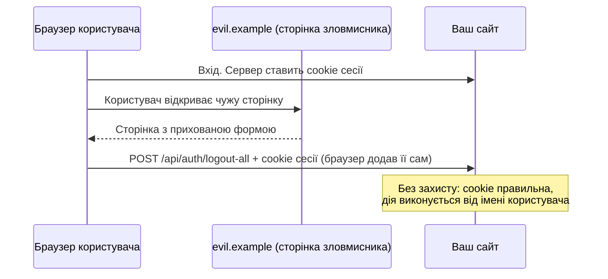
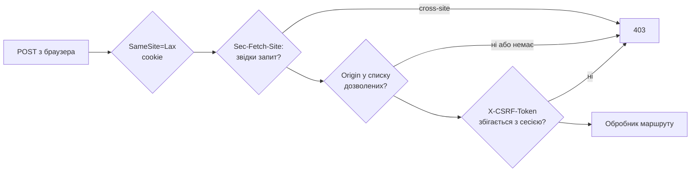
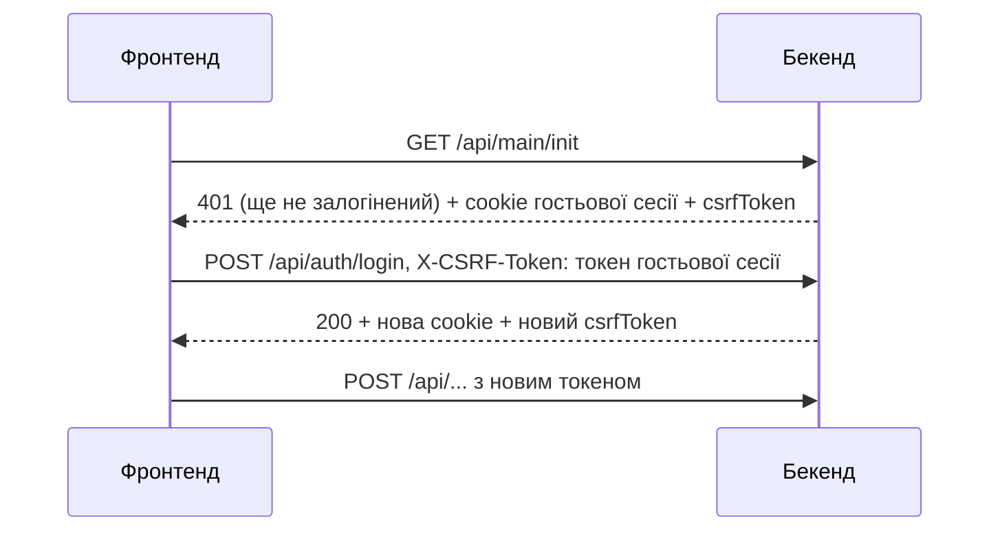

# CSRF простими словами

::: info Перед читанням
Нічого знати не потрібно. Корисно мати уявлення, що таке [cookie](/reference/glossary#cookie) і [сесія](/reference/glossary#сесія), — обидва терміни пояснено в глосарії. Технічний довідник з усіма змінними й кодами помилок — розділ [CSRF](/backend/auth-security#csrf) на сторінці «Автентифікація та безпека».
:::

Ця сторінка пояснює, що таке CSRF-атака, чому від неї треба захищатися саме в застосунку з cookie-сесіями і як захист влаштований у цьому шаблоні. Більшість захисту працює сама: фронтенд і бекенд уже все роблять. Наприкінці — що потрібно знати, коли ви додаєте власні маршрути або тестуєте API через curl.

## Що таке CSRF

**CSRF** (Cross-Site Request Forgery, «підробка міжсайтового запиту») — атака, коли чужий сайт змушує браузер користувача надіслати запит на ваш сайт **від імені цього користувача**.

Аналогія. Ви залогінені в банку, і браузер тримає «перепустку» банку — cookie сесії. Потім ви відкриваєте зовсім інший сайт, наприклад сторінку з котиками. На ній прихована форма, яка сама відправляється на адресу банку: «переказати 1000 грн на рахунок X». Браузер чесно додає до цього запиту cookie банку, бо так працюють cookie: вони йдуть на свій сайт, звідки б не почався запит. Банк бачить правильну cookie і думає, що запит зробили ви.



Важливі деталі:

- Зловмисник **не бачить** відповіді й не може прочитати cookie. Йому це й не потрібно: достатньо, щоб дія виконалася.
- Небезпечні лише запити, що **змінюють** дані: `POST`, `PUT`, `PATCH`, `DELETE`. Тому захист у шаблоні перевіряє тільки їх; `GET` має лише читати.
- Атака працює саме тому, що сесія тримається в cookie. Якби токен доступу щоразу додавав JavaScript (як заголовок `Authorization`), чужий сайт не зміг би його підставити. Але cookie з `HttpOnly` безпечніші від крадіжки через XSS, тож шаблон обирає cookie і окремо закриває CSRF.

## Як захищається шаблон: чотири шари

Кожен шар може тільки **відхилити** запит; жоден не дозволяє пропустити наступні. Якщо зловмисник обійде один шар, його зупинить інший.



### 1. Cookie з `SameSite=Lax`

Сесійна cookie має атрибут `SameSite=Lax`. Він каже браузеру: «не надсилай цю cookie, якщо запит прийшов з іншого сайту», за винятком звичайного переходу за посиланням. Сучасний браузер просто не додасть cookie до прихованої форми з `evil.example`. Але покладатися лише на це не можна: старі браузери й особливі випадки існують, тому є ще три шари.

### 2. `Sec-Fetch-Site`: браузер сам каже, звідки запит

Сучасні браузери додають до кожного запиту заголовок `Sec-Fetch-Site`, і JavaScript на сторінці не може його підробити. Значення `same-origin` означає «запит з того самого сайту», `cross-site` — «з чужого». Шаблон одразу відхиляє `cross-site` з `403` і причиною `fetch_site_cross_site`.

### 3. `Origin`: адреса сторінки, що надіслала запит

Браузер додає до `POST` заголовок `Origin` — схему, домен і порт сторінки, з якої пішов запит, наприклад `https://app.example.com`. Сервер порівнює його зі списком довірених адрес `CSRF_ALLOWED_ORIGINS`. Чужий origin, `Origin: null` (так буває з пісочниць і локальних файлів) або запит без `Origin` і `Referer` отримують `403` з причиною `origin_mismatch`.

### 4. CSRF-токен: секрет, якого немає в зловмисника

Головний шар. Для кожної сесії сервер генерує випадковий **CSRF-токен** і зберігає його поруч із сесією в Redis. Фронтенд додає цей токен до кожного запиту, що змінює дані, у заголовку `X-CSRF-Token`. Сервер порівнює: токен у заголовку має збігатися з токеном сесії.

Чужий сайт не може дізнатися токен: він не може прочитати відповідь вашого сервера (це забороняє браузер), тож і токен підставити не може. Невідповідний токен — `403` з причиною `token_mismatch`.

## Звідки фронтенд бере токен

Токен приходить у відповіді `GET /api/main/init` — першого запиту, який робить застосунок після завантаження. Фронтенд тримає його лише в пам'яті й оновлює з відповідей, які видають новий токен (вхід, вихід, зміна пароля).

::: tip Чому токен не вшитий у HTML
Шаблон — це PWA: Service Worker кешує HTML-сторінку, щоб застосунок відкривався офлайн. Якби токен був у HTML, з кешу міг би прийти старий токен, і запити падали б з `403`. Тому HTML однаковий для всіх і не містить нічого секретного, а токен завжди приходить свіжим з API. Service Worker при цьому **ніколи** не кешує відповіді API.
:::



### Навіть для входу потрібен токен

Може здатися дивним, що токен потрібен ще до входу. Але існує окремий різновид атаки — **login CSRF**: чужий сайт непомітно логінить вас в **акаунт зловмисника**. Ви думаєте, що працюєте у своєму акаунті, і зберігаєте туди дані, а читає їх зловмисник. Тому сервер ще до входу створює гостьову сесію з власним токеном, і запит входу має прийти з ним.

## Що робить фронтенд, коли щось пішло не так

Ці випадки обробляє `src/utils/base-api.ts`, писати власний код не потрібно.

- **Токен застарів.** Наприклад, у сусідній вкладці ви змінили пароль, і сесія оновилася. Запит отримує `403 token_mismatch`. Фронтенд мовчки перепитує `main/init` і, якщо там той самий користувач, **один раз** повторює запит зі свіжим токеном. Дія виконується рівно один раз.
- **В іншій вкладці увійшли під іншим акаунтом.** Cookie спільна для всіх вкладок, тож сесія вже належить іншій людині. Фронтенд не надсилає дію, призначену для попереднього користувача, а перезавантажує сторінку, щоб показати актуальний акаунт і не залишити в пам'яті даних попереднього.
- **В іншій вкладці вийшли.** Повтору немає: користувача переводить на сторінку входу.
- **Сервер не відповідає.** Дія не надсилається навмання: виклик отримує помилку, і наступна дія знову спробує перевірити сесію. Очікування обмежене 10 секундами.
- **Причини `origin_mismatch` і `fetch_site_*`** повтором не виправити, тож фронтенд одразу повертає помилку.

## Що потрібно знати розробнику

### Новий маршрут, що змінює дані

Додавайте його в групу маршрутів, де є `session_web` і `csrf_guard` — так влаштовані всі групи в [`http-routes.ts`](https://github.com/Blazheiko/vibe-template/blob/main/packages/backend/src/app/routes/http-routes.ts). Тоді захист працює автоматично. Фронтенд підставить токен сам, якщо ви викликаєте API через `baseApi.http` або `baseApi.upload`.

Якщо новий запит робить **незалогінений** користувач (як вхід чи скидання пароля), передайте `{ csrfRecovery: 'public' }`: так фронтенд знатиме, що повтор у гостьовій сесії допустимий. Приклади — в [`api.ts`](https://github.com/Blazheiko/vibe-template/blob/main/packages/frontend/src/utils/api.ts).

### Налаштування

| Змінна                 | За замовчуванням | Що робить                                                                                                                                                                                                              |
| ---------------------- | ---------------- | ---------------------------------------------------------------------------------------------------------------------------------------------------------------------------------------------------------------------- |
| `CSRF_ENFORCE`         | `true`           | Відхиляти порушення з `403`. `false` — лише записувати в лог (для діагностики).                                                                                                                                        |
| `CSRF_STRICT_ORIGIN`   | `true`           | Відхиляти запити без `Origin` і `Referer`.                                                                                                                                                                             |
| `CSRF_ALLOWED_ORIGINS` | порожньо         | Довірені адреси фронтенду через кому, наприклад `https://app.example.com`. У production **обов'язкова**: без неї сервер не стартує. Локально порожнє значення означає «довіряти адресам з `APP_URL` і `FRONTEND_URL`». |

Фронтенд і API мають бути на одному сайті: на тому самому домені або на піддоменах одного домену (`app.example.com` і `api.example.com`). На зовсім різних доменах браузер не надсилатиме cookie сесії через `SameSite=Lax`.

### Тестування через curl або API Playground

curl — не браузер, і сам заголовок `Origin` не додає. Передайте його явно разом з токеном:

```bash
B=http://127.0.0.1:3000/api
O='origin: http://localhost:5173'
CSRF=$(curl -s -c cookies.txt -b cookies.txt $B/main/init | sed -E 's/.*"csrfToken":"([^"]+)".*/\1/')
curl -s -b cookies.txt -c cookies.txt -H "$O" -H 'content-type: application/json' \
  -H "x-csrf-token: $CSRF" -d '{"email":"user@example.com","password":"<user-password>","token":""}' \
  $B/auth/login
```

Повний сценарій — у [Швидкому старті](/guide/getting-started#те-саме-через-curl). [API Playground](/playground/) працює на порту `5174`, тому додайте його адресу в `CSRF_ALLOWED_ORIGINS`.

### Що означає `403 csrf_invalid`

| `reason`                | Що сталося                                                               | Що робити                                                                          |
| ----------------------- | ------------------------------------------------------------------------ | ---------------------------------------------------------------------------------- |
| `token_mismatch`        | Немає заголовка `X-CSRF-Token` або токен від іншої сесії                 | Взяти свіжий токен з `GET /api/main/init`. Після входу чи виходу токен змінюється. |
| `origin_mismatch`       | `Origin` не в списку, `Origin: null` або немає ні `Origin`, ні `Referer` | Перевірити `CSRF_ALLOWED_ORIGINS`; у curl додати `-H 'origin: ...'`.               |
| `fetch_site_cross_site` | Браузер повідомив, що запит з чужого сайту                               | Фронтенд і API на різних сайтах — така схема не підтримується.                     |
| `fetch_site_invalid`    | Невідоме значення `Sec-Fetch-Site`                                       | Перевірити проксі або клієнт, що підставляє цей заголовок.                         |

## Що далі

- [Автентифікація та безпека → CSRF](/backend/auth-security#csrf) — точний порядок перевірок, ротація сесій, усі деталі.
- [Як влаштований бекенд](/guide/how-backend-works) — де `csrf_guard` стоїть серед інших middleware.

::: tip Перевірити самому
Запустіть проєкт за [Швидким стартом](/guide/getting-started) і надішліть `POST /api/auth/logout` через curl без заголовка `origin`. Сервер відповість `403` з `reason: origin_mismatch`. Додайте `-H 'origin: http://localhost:5173'` — тепер `403` буде з `token_mismatch`. Додайте ще й `x-csrf-token` — запит пройде.
:::
