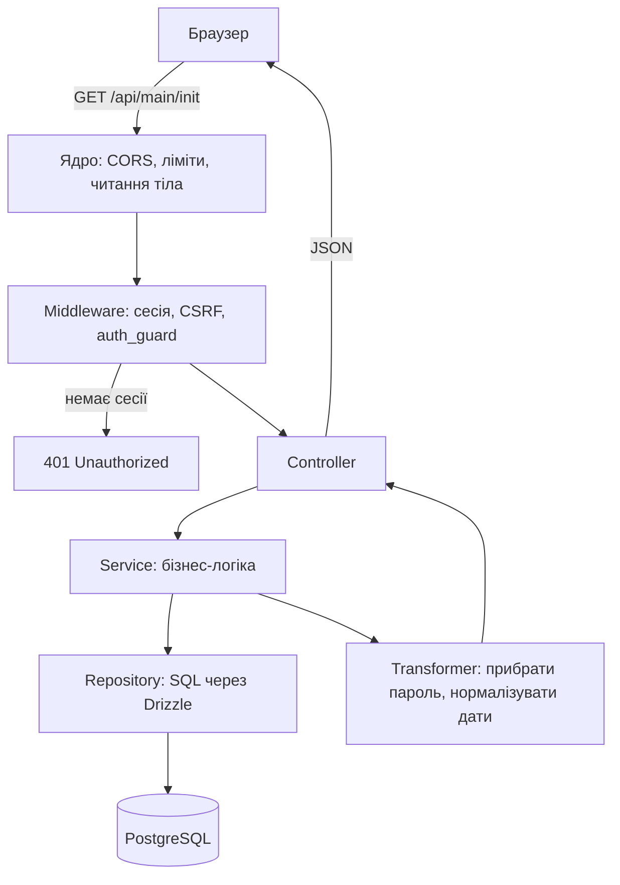

# Як влаштований бекенд

Ця сторінка для тих, хто вперше відкрив шаблон. Тут без зайвих деталей пояснено, з чого складається бекенд, що відбувається з запитом і навіщо код розкладено саме так. Технічні подробиці кожної теми — на окремих сторінках розділу [Бекенд](/backend/), посилання наведено по ходу.

## Коротко

Бекенд — це один Node.js-процес, який:

1. приймає HTTP-запити (`/api/...`) і WebSocket-з'єднання;
2. перевіряє, хто прийшов і чи можна йому це робити;
3. виконує бізнес-логіку, читає й пише дані в PostgreSQL, тримає сесії в Redis;
4. повертає JSON-відповідь або надсилає подію через WebSocket.

Він написаний на [uWebSockets.js](https://github.com/uNetworking/uWebSockets.js) — дуже швидкому сервері, написаному на C++. Express, Fastify чи NestJS тут немає: замість них у каталозі `src/vendor/` лежить невелике власне «ядро», яке робить роутинг, читання тіла запиту, сесії, ліміти й логування. Вам не треба його змінювати, щоб додати фічу: увесь ваш код живе в `src/app/`.

::: tip Чому не Express?
uWebSockets.js обробляє в рази більше запитів на секунду і тримає HTTP та WebSocket в одному процесі. Ціна — у нього немає екосистеми middleware, як у Express. Шаблон закриває цю прогалину: CORS, CSRF, сесії, rate limiting, валідація та статика вже написані й протестовані.
:::

## Шлях одного запиту

Уявімо, що фронтенд викликає `GET /api/main/init`, щоб дізнатися, хто зараз залогінений.



1. **Ядро** знаходить маршрут, перевіряє CORS і ліміт запитів, читає тіло.
2. **Middleware** по черзі перевіряють запит: `session_web` піднімає сесію з cookie, `csrf_guard` перевіряє CSRF-токен, `auth_guard` відсікає незалогінених з кодом `401`.
3. **Валідація.** Якщо маршрут описав схему вхідних даних, ядро перевіряє payload. Некоректний запит отримує `422` ще до вашого коду.
4. **Controller** бере дані запиту й викликає потрібний сервіс.
5. **Service** виконує логіку: перевіряє права, рахує, звертається до інших сервісів.
6. **Repository** робить запит до бази.
7. **Transformer** перетворює рядок з бази на безпечний об'єкт для клієнта (без пароля, токенів тощо).
8. Controller повертає результат, ядро серіалізує його в JSON.

Повний технічний розбір — [Життєвий цикл запиту](/backend/request-lifecycle).

## Навіщо стільки шарів

Новачкам часто здається, що простіше написати все в одному обробнику. На маленькому проєкті це працює, але з ростом такий код стає важко тестувати й змінювати. Шари розділяють відповідальність:

| Шар         | Відповідає за                        | Чого тут **не** має бути      | Де лежить                                    |
| ----------- | ------------------------------------ | ----------------------------- | -------------------------------------------- |
| Route       | URL, метод, схема, middleware, ліміт | Логіки                        | `app/routes/http-routes.ts`, `ws-routes.ts`  |
| Middleware  | Перевірки перед обробником           | Бізнес-правил конкретної фічі | `app/middlewares/`, реєстр у `kernel.ts`     |
| Controller  | «Перекласти» HTTP на виклик сервісу  | SQL, складних обчислень       | `app/controllers/http`, `app/controllers/ws` |
| Service     | Бізнес-логіка, рішення, помилки      | Прямого доступу до таблиць    | `app/services/`                              |
| Repository  | Запити до БД                         | Логування, бізнес-рішень      | `app/repositories/`                          |
| Transformer | Форма даних для клієнта              | Звернень до БД                | `app/transformers/`                          |

Що це дає на практиці:

- **Сервіс можна протестувати без HTTP і без бази** — підмінивши репозиторій.
- **Один сервіс використовують і HTTP, і WebSocket-контролери**, логіка не дублюється.
- **Зміна схеми БД зачіпає лише репозиторій**, а не весь код.
- **Пароль не потрапить у відповідь випадково**, бо дані йдуть клієнту лише через трансформер.

Правила між шарами перевіряє тест [`layering.spec.ts`](https://github.com/Blazheiko/itvibe-template/blob/main/packages/backend/src/app/layering.spec.ts): якщо контролер імпортує репозиторій напряму, `pnpm test` впаде. Детальніше — [Архітектура](/backend/architecture).

## Помилки без винятків

Сервіси не кидають `throw` на очікувані помилки («користувача не знайдено», «невірний пароль»). Вони повертають `Result` з бібліотеки `better-result`:

```ts
if (user === null) return Result.err(notFound('User', 'User not found'))
return Result.ok({ user })
```

Контролер перевіряє результат і перетворює помилку на правильний HTTP-статус через `mapControllerError`. Так помилки видно в типах: TypeScript не дасть забути, що виклик може не вдатися. Детальніше — [Контролери та сервіси](/backend/controllers-services).

## Контракти в `shared`

Схеми вхідних даних і відповідей описані один раз у пакеті `shared` на [arktype](https://arktype.io/). Бекенд використовує їх для валідації, фронтенд — для типів. Якщо ви змінили поле у відповіді, TypeScript підсвітить усі місця на фронтенді, які треба оновити. Детальніше — [Валідація](/backend/validation) і [Пакет shared](/shared/).

## Де зберігаються дані

| Сховище         | Що там                                               | Сторінка                                   |
| --------------- | ---------------------------------------------------- | ------------------------------------------ |
| PostgreSQL      | Користувачі, push-підписки, база знань, промпти тощо | [База даних](/backend/database)            |
| Redis           | Сесії, спільні rate limits, тимчасові коди           | [Автентифікація](/backend/auth-security)   |
| S3 / MinIO      | Файли: аватари, скриншоти                            | [Сховище файлів](/backend/storage)         |
| Пам'ять процесу | Активні WebSocket-з'єднання, кеш статики             | [Кешування та ETag](/backend/caching-etag) |

Схема БД описана в коді через Drizzle ORM (`src/database/schema.ts`), а зміни схеми застосовуються міграціями.

## Як працюють сесії

Після логіну сервер створює сесію в Redis і ставить браузеру HttpOnly-cookie з підписаним ідентифікатором. JavaScript на сторінці цю cookie прочитати не може, тож її не вкраде XSS. На кожен запит middleware `session_web` знаходить сесію в Redis. Вихід — це просто видалення сесії з Redis, тому `logout-all` миттєво розлогінює всі пристрої. Для запитів, що змінюють дані, додатково потрібен CSRF-токен, який фронтенд отримує з `/api/main/init`. Детальніше — [Автентифікація та безпека](/backend/auth-security).

## WebSocket простими словами

HTTP — це «запитав і отримав відповідь». WebSocket — постійне з'єднання, через яке сервер сам може надіслати повідомлення: «новий користувач онлайн», «ось наступний шматок відповіді AI». Фронтенд отримує короткоживучий токен з `/api/main/init`, відкриває з'єднання, і далі обидві сторони обмінюються JSON-повідомленнями. WS-маршрути описуються так само, як HTTP: URL-подія, обробник, схема. Детальніше — [WebSocket](/backend/websocket).

## Конфігурація

Усі налаштування — змінні оточення у файлі `packages/backend/.env` (зразок — `.env.example`). Під час старту `validateRuntimeConfig()` перевіряє, що конфігурація безпечна. Наприклад, сервер не запуститься, якщо секрет для хешування OTP-кодів коротший за 32 символи. Повний довідник — [Конфігурація](/backend/configuration).

## Що робити далі

1. Запустіть проєкт за [Швидким стартом](/guide/getting-started).
2. Відкрийте [`http-routes.ts`](https://github.com/Blazheiko/itvibe-template/blob/main/packages/backend/src/app/routes/http-routes.ts) і пройдіть по `GET /api/main/init` від маршруту до репозиторію — це найкращий спосіб відчути структуру.
3. Пройдіть туторіал [Як додати фічу](/backend/adding-a-feature): він показує всі шари на прикладі нового ресурсу.
4. Тримайте під рукою [Глосарій](/reference/glossary), якщо зустрінете незнайомий термін.
