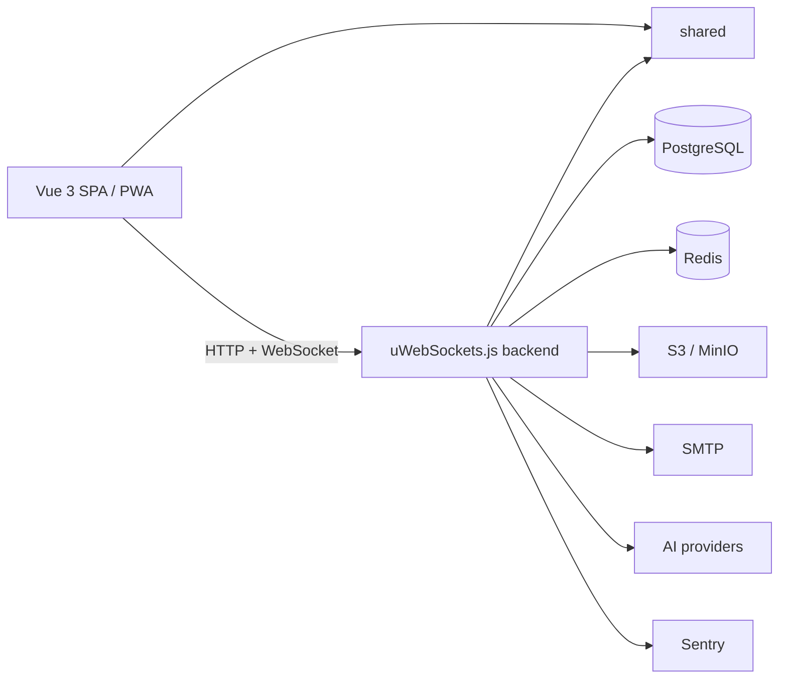

# Вступ

**vibe-template** — це full-stack TypeScript-монорепозиторій-шаблон: фронтенд на Vue 3, високопродуктивний бекенд на uWebSockets.js і пакет `shared` зі спільними контрактами (схеми, enum-и, guards, відповіді), які використовуються з обох боків. Репозиторій організовано як [pnpm](https://pnpm.io/) workspace ([README.md](https://github.com/Blazheiko/vibe-template/blob/main/README.md), [pnpm-workspace.yaml](https://github.com/Blazheiko/vibe-template/blob/main/pnpm-workspace.yaml)).

## Для чого він

Шаблон призначений для швидкого старту production-ready SPA-застосунків: замість того щоб щоразу будувати однаковий фундамент, ви починаєте з робочого застосунку, у якому вже є:

- **Автентифікація** — вхід через email, телефон (SMS) і соцпровайдери; сесії, CSRF-захист і throttling.
- **Real-time** — налаштований WebSocket-шар на uWebSockets.js (оновлення в реальному часі, presence, двобічні повідомлення).
- **Push-сповіщення** — серверна доставка web push.
- **PWA** — фронтенд налаштований як Progressive Web App.
- **Інше** — файлове сховище (S3/MinIO), транзакційна пошта, i18n, інтеграції з AI-провайдерами, моніторинг помилок і типобезпечний шар контрактів.

Готові продуктові флоу: реєстрація/підтвердження email, логін/логаут (зокрема logout-all), зміна та скидання пароля, опційна телефонна автентифікація, основа OAuth (`auth/oauth/:provider/redirect` і `/callback`), сторінка акаунта з аватаром, керування push-підписками, адмін-зона (користувачі, онлайн, база знань), AI-чат підтримки та API playground ([README.md](https://github.com/Blazheiko/vibe-template/blob/main/README.md)).

### Кому підходить

- SaaS-дашборди та продукти з акаунтами, адмін-панелі з real-time активністю;
- PWA з автентифікацією, push і офлайн-режимом;
- застосунки, яким із першого дня потрібні спільні контракти фронтенду й бекенду;
- **backend-only / API-сервіси**: пакет `frontend` можна прибрати, вимкнути роздачу статики (`SERVE_STATIC=false`) і обробку сесій/CSRF, а для ручного тестування API використовувати `api-playground`.

Ймовірно, надмірний для статичних лендингів, serverless/edge-first застосунків і проєктів без автентифікації, БД та real-time.

## Стек

| Область           | Що використовується                                                           |
| ----------------- | ----------------------------------------------------------------------------- |
| API               | uWebSockets.js, валідація маршрутів (arktype), WebSocket                      |
| БД                | PostgreSQL, Drizzle ORM / drizzle-kit `1.0.0-rc.4` (міграції + seed)          |
| Auth/безпека      | cookies, CSRF, CORS, throttling, CSP                                          |
| Фронтенд          | Vue 3, Pinia, vue-router, vue-i18n, PWA, Vitest, Playwright                   |
| Спостережуваність | Sentry (`@sentry/node`, `@sentry/vue`), Pino                                  |
| Інтеграції        | S3/MinIO (`@aws-sdk/client-s3`), nodemailer, web-push, OpenAI / Mistral / xAI |

Джерела: [package.json](https://github.com/Blazheiko/vibe-template/blob/main/package.json), [packages/backend/package.json](https://github.com/Blazheiko/vibe-template/blob/main/packages/backend/package.json), [packages/frontend/package.json](https://github.com/Blazheiko/vibe-template/blob/main/packages/frontend/package.json), [packages/shared/package.json](https://github.com/Blazheiko/vibe-template/blob/main/packages/shared/package.json).

Вимоги: Node.js `^24.22.2` і pnpm `>=9` (зафіксовано `pnpm@9.15.0` через `packageManager`), TypeScript `6.0.3`.

::: tip Наступний крок
Це перша сторінка маршруту **«Перший день»** (меню ліворуч): шість сторінок від запуску до власного проєкту. Далі — [Швидкий старт](/guide/getting-started): запуск локально і перший вхід.
:::

## Інші розділи

- [Початок роботи](/guide/getting-started)
- [Структура проєкту](/guide/project-structure)
- [Огляд бекенду](/backend/)
- [Скрипти](/reference/scripts)
