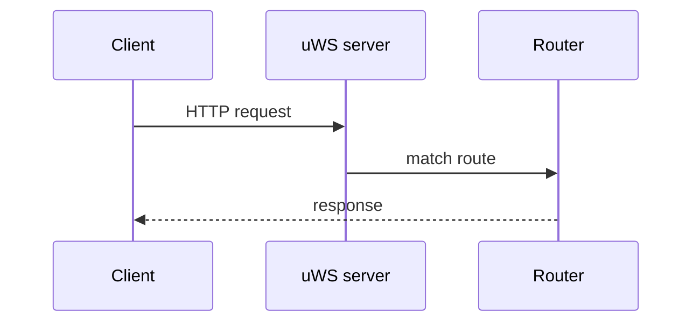

# Smoke-сторінка

Тимчасова сторінка каркаса (T1.7): перевіряє Mermaid, Markdown include і статичні зображення під
`base`. Буде замінена контентом v1 на етапі 4.

## Mermaid

## Зображення

## Include

<!--@include: ../../packages/backend/src/scripts/README.md-->
