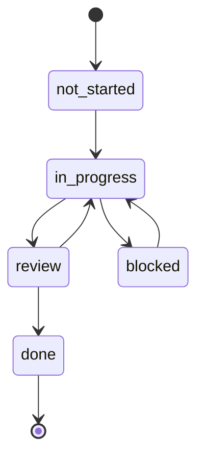

# Процес роботи

Цей розділ описує, як у репозиторії організовано роботу людей і агентів: як обрати фічу, де зберігається її стан, коли вона вважається завершеною і що оновити в документації. Правила взято з [`AGENTS.md`](https://github.com/Blazheiko/vibe-template/blob/main/AGENTS.md).

::: info Шукаєте, як зробити з шаблону свій продукт?
Ця сторінка описує процес роботи в репозиторії шаблону. Як перейменувати шаблон, змінити інтерфейс і обрати інтеграції для власного проєкту, описано в розділі [Свій проєкт на шаблоні](/guide/your-project).
:::

## Старт сесії

1. Відкрити [`feature_list.json`](https://github.com/Blazheiko/vibe-template/blob/main/feature_list.json) і знайти фічу, у якої `owner` збігається з вами, а `status` дорівнює `in_progress`. Це ваша активна фіча.
2. Перейти на гілку з поля `branch`. Файли `progress.md` і `session-handoff.md` цієї фічі лежать **на її гілці**, а не в `main`.
3. Прочитати `progress.md`: стан минулої сесії, блокери, «Notes for Next Session». Якщо сесія продовжується, прочитати також `session-handoff.md`.
4. Запустити [`./init.sh`](https://github.com/Blazheiko/vibe-template/blob/main/init.sh). Скрипт по черзі виконує `pnpm install`, `pnpm run typecheck`, `pnpm run lint`, `pnpm test` і `pnpm run build` (`set -e`, тож зупиняється на першій помилці). Якщо він падає, далі не працюємо.
5. Кожен owner веде одну фічу за раз. Нова робота оформлюється новим записом у `feature_list.json` через PR у `main`, а не розширенням поточної фічі.

## `feature_list.json`

Файл живе тільки на `main` і є єдиним джерелом правди про те, хто над чим працює. Його блок `schema` задає поля і допустимі статуси:

| Поле           | Зміст                                                      |
| -------------- | ---------------------------------------------------------- |
| `id`           | Ідентифікатор виду `feat-XXX`                              |
| `name`         | Назва фічі                                                 |
| `description`  | Опис, часто з посиланням на план у `docs/plan/`            |
| `owner`        | Людина або агент, відповідальні за фічу (рівно один)       |
| `branch`       | Гілка, де живуть `progress.md` і `session-handoff.md`      |
| `dependencies` | Список `id`, які мають бути `done` перед стартом           |
| `status`       | `not-started`, `in_progress`, `blocked`, `review`, `done`  |
| `evidence`     | Посилання на PR/коміт або вивід, що підтверджує завершення |

Рядок фічі редагує тільки її owner. Усі інші пропонують зміни через PR. Двоє людей не можуть ділити один рядок `in_progress`. Допомога з чужою фічею означає PR у її гілку, а не правки в її `progress.md`.

## Статуси

Кожен перехід статусу робиться окремим PR, що змінює `feature_list.json` на `main`. Статус `blocked` дозволений, але причину треба записати в `progress.md` на гілці фічі.

У діаграмі `not_started` означає `not-started` (Mermaid не дозволяє дефіс в ідентифікаторі стану). `AGENTS.md` прямо називає лише ланцюжок `not-started → in_progress → review → done` і дозволяє `blocked`. Повернення з `review` і вихід із `blocked` показано як очевидні сценарії, окремих правил для них немає.

Залежності обов'язкові: фічу не можна починати, поки її `dependencies` не мають статусу `done`. Якщо почати треба раніше, залежність виділяють в окрему меншу `feat-XXX` і закривають першою.

## Definition of Done

Фіча стає `done` лише тоді, коли в `progress.md` у розділі **Evidence of Completion** записано:

- `pnpm typecheck` без помилок;
- `pnpm lint` без помилок;
- `pnpm test` проходить, а для змін в UI ще й `pnpm --filter frontend test:e2e`;
- описано ручну перевірку golden path;
- рядок у `feature_list.json` переведено в `done` з посиланням на коміт або вивід у `evidence`.

Рев'юер перевіряє цей блок evidence у `progress.md` гілки перед тим, як схвалити merge. Команди описано в розділі [Скрипти](/reference/scripts), тести в розділі [Тестування](/backend/testing).

## Кінець сесії

Перед завершенням сесії треба закомітити і запушити гілку фічі з оновленим `progress.md` (поточний стан, змінені файли, наступний крок). Якщо робота не закінчена, заповнити `session-handoff.md`, щоб наступна сесія стартувала без втрат.

## Гілки, коміти, PR

- Гілка фічі вказана в `branch`. У поточній історії використовуються префікси на кшталт `feat/…` та `docs/…` (наприклад `feat/vitepress-docs`). Окремого правила іменування в `AGENTS.md` немає.
- Коміти пишуться коротко, із наміром на першому місці. Корисні трейлери: `Tested: pnpm test` або `Not-tested: requires production credentials`.
- PR описує зміну, виконану перевірку, пов'язані issue, а для видимих змін фронтенду додає скриншоти або запис екрана.

::: warning
У розділі Commit & Pull Request Guidelines файлу `AGENTS.md` досі сказано, що «checkout does not include .git history». Для поточного репозиторію це вже неправда: історія є, а PR зливаються на GitHub.
:::

## Документація

Сайт у `documentation/` публікується на GitHub Pages з `main` через [`.github/workflows/docs.yml`](https://github.com/Blazheiko/vibe-template/blob/main/.github/workflows/docs.yml).

- Якщо змінюється публічна поведінка бекенду (маршрут, змінна оточення, middleware, міграція або схема БД), відповідну сторінку в `documentation/backend/` оновлюють у тому ж PR. Наприклад: [Маршрутизація](/backend/routing), [Конфігурація](/backend/configuration), [База даних](/backend/database).
- Сторінки пишуться з коду, з посиланнями на джерела на GitHub. Те, що ще не реалізовано, позначають `::: warning План`. Для секретів використовують плейсхолдери.
- Нову сторінку додають у sidebar у [`documentation/.vitepress/config.ts`](https://github.com/Blazheiko/vibe-template/blob/main/documentation/.vitepress/config.ts) і в `KEY_PAGES` у [`documentation/scripts/verify-dist.mjs`](https://github.com/Blazheiko/vibe-template/blob/main/documentation/scripts/verify-dist.mjs).
- Якщо сторінка використовує `<!--@include-->`, шлях до джерела має бути в `paths` у `docs.yml`.
- Перед merge запускають `pnpm docs:build && pnpm docs:verify`.

## Беклог наступних фіч

Проблеми в коді, знайдені під час написання документації, зібрано в [`docs/plan/code-issues-found-during-docs.md`](https://github.com/Blazheiko/vibe-template/blob/main/docs/plan/code-issues-found-during-docs.md). Це джерело для майбутніх записів `feat-XXX`: кожен пункт, який вирішили виправляти, оформлюють новим рядком у `feature_list.json` через PR у `main`.
