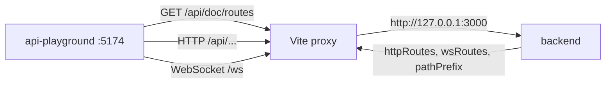

# API Playground

`packages/api-playground` — це Vue-застосунок для розробників: він завантажує опис маршрутів із backend і дає змогу вручну викликати HTTP- та WebSocket-маршрути. Це інструмент лише для локальної розробки. У production він не потрібен і не призначений для нього.

Як backend віддає опис маршрутів і коли endpoint `/doc/routes` взагалі доступний, описано в розділі [Маршрутизація та middleware](/backend/routing-middlewares). Тут розглянуто саму клієнтську частину.

## Стек

За даними [`package.json`](https://github.com/Blazheiko/itvibe-template/blob/main/packages/api-playground/package.json):

- Vue 3, `vue-router`, Pinia, `@vueuse/core`;
- Vite 7 з `@vitejs/plugin-vue` і `vite-plugin-vue-devtools`;
- Tailwind CSS 3 (PostCSS, autoprefixer);
- TypeScript `6.0.3`, перевірка типів через `vue-tsc`;
- workspace-залежність `shared`.

Скрипти: `dev`, `build` (`type-check` разом із `vite build`), `preview`, `typecheck`, `lint`, `lint:check`, `format`. Скрипта `test` немає.

## Запуск

1. У `packages/backend/.env` задайте `APP_ENV=manual-test`, `DOC_PAGE=true`, `SERVE_STATIC=true`. Пояснення до цих змінних є в розділах [Маршрутизація](/backend/routing-middlewares) і [Конфігурація](/backend/configuration).
2. З кореня репозиторію виконайте `pnpm dev:manual_test`. Команда збирає `shared`, а потім паралельно запускає backend і playground ([кореневий `package.json`](https://github.com/Blazheiko/itvibe-template/blob/main/package.json)). Інші скрипти описано в [довіднику скриптів](/reference/scripts).
3. Відкрийте `http://localhost:5174`.

### Vite proxy

У [`vite.config.ts`](https://github.com/Blazheiko/itvibe-template/blob/main/packages/api-playground/vite.config.ts) dev-сервер слухає порт **5174** і проксіює запити:

| Префікс                                             | Ціль                    | Примітка                    |
| --------------------------------------------------- | ----------------------- | --------------------------- |
| `/<VITE_API_PATH_PREFIX>` (за замовчуванням `/api`) | `http://127.0.0.1:3000` | `changeOrigin: true`        |
| `/ws`                                               | `ws://127.0.0.1:3000`   | `ws: true`, WebSocket proxy |

Префікс API береться з `VITE_API_PATH_PREFIX` (має збігатися з бекендовим `API_PATH_PREFIX`, за замовчуванням `api`). Базовий URL для HTTP-викликів за замовчуванням порожній. Тому запити йдуть відносно origin dev-сервера і проходять через proxy. Його можна перевизначити змінною `VITE_API_BASE_URL` або в налаштуваннях UI ([`stores/api-settings.ts`](https://github.com/Blazheiko/itvibe-template/blob/main/packages/api-playground/src/stores/api-settings.ts)).

## Завантаження опису маршрутів

Функція `fetchRoutes()` у [`stores/api-doc.ts`](https://github.com/Blazheiko/itvibe-template/blob/main/packages/api-playground/src/stores/api-doc.ts) робить `fetch(apiUrl(baseUrl, 'doc/routes'))` ([`utils/api-path.ts`](https://github.com/Blazheiko/itvibe-template/blob/main/packages/api-playground/src/utils/api-path.ts)): `<baseUrl>/<VITE_API_PATH_PREFIX>/doc/routes`, з порожнім `baseUrl` — через proxy. Відповідь має форму `{ httpRoutes, wsRoutes, pathPrefix }`. Store об'єднує групи з однаковим префіксом, присвоює маршрутам числові `id` і будує для навігації плоскі списки з `fullUrl` (префікс + шляхи груп + `url`). Отриманий `pathPrefix` зберігається в налаштуваннях.

Серіалізацію на backend виконує [`serialize-routes.ts`](https://github.com/Blazheiko/itvibe-template/blob/main/packages/backend/src/vendor/utils/routing/serialize-routes.ts). Вона копіює поля маршруту, замінює `handler` на `null` і прибирає `validator`, `queryValidator` та `ResponseSchema`. Замість них додаються:

- `inputSchema` — з `validator` (тіло запиту);
- `querySchema` — з `queryValidator`;
- `outputSchema` — з `ResponseSchema`;
- `bodyLimits` — лише для `post`/`put`/`patch`: список `{ kind, maxBytes }` для кожного типу з `allowedContentTypes` (за замовчуванням `["json"]`), бо ліміт залежить від `Content-Type` запиту. `[]` означає `allowedContentTypes: []`, і картка пише «No allowed body types». Обчислюється через `resolveMaxBodySize` у [serialize-routes.ts](https://github.com/Blazheiko/itvibe-template/blob/main/packages/backend/src/vendor/utils/routing/serialize-routes.ts).

Кожна схема має форму `{ expression, fields[], jsonSchema? }` (тип `ArkSchema` у store). Решта полів, які використовує UI: `url`, `method`, `description`, `middlewares`, `rateLimit` / `groupRateLimit` (`{ windowMs, maxRequests }`), а для груп ще `prefix` і `group`. Детальніше про схеми див. [Валідація](/backend/validation).

Картка маршруту ([`ApiRoute.vue`](https://github.com/Blazheiko/itvibe-template/blob/main/packages/api-playground/src/components/api/ApiRoute.vue)) показує метод, URL, middleware, схеми й rate limit. Якщо в маршруту немає власного ліміту, показується ліміт групи з позначкою `route`/`group`. Є також окрема сторінка маршруту `/route/:routeId` ([`router/index.ts`](https://github.com/Blazheiko/itvibe-template/blob/main/packages/api-playground/src/router/index.ts)).

## Будова інтерфейсу

Головна сторінка ([`ApiHomeView.vue`](https://github.com/Blazheiko/itvibe-template/blob/main/packages/api-playground/src/views/ApiHomeView.vue)) має три колонки під шапкою `ApiHeader`:

| Колонка                | Компонент                                                                                                                                           | Що показує                                                            |
| ---------------------- | --------------------------------------------------------------------------------------------------------------------------------------------------- | --------------------------------------------------------------------- |
| ліва (від ширини `xl`) | [`SiteNavigation.vue`](https://github.com/Blazheiko/itvibe-template/blob/main/packages/api-playground/src/components/navigation/SiteNavigation.vue) | дерево груп і маршрутів (`TreeGroup.vue`), перемикач HTTP / WebSocket |
| центральна             | `ApiGroup.vue` → `ApiRoute.vue`                                                                                                                     | групи та картки маршрутів                                             |
| права (від `xl`)       | [`OnThisPage.vue`](https://github.com/Blazheiko/itvibe-template/blob/main/packages/api-playground/src/components/navigation/OnThisPage.vue)         | зміст сторінки з підсвіткою активного розділу                         |

На вужчих екранах навігацію дає `MobileNavigation.vue` (з `MobileGroupItem.vue`). `RouteGroupsMenu.vue` — меню груп. Окремий маршрут відкривається на `/route/:routeId` (`RouteDetailView.vue`).

## Що реалізовано

### HTTP-запити

Форма [`TestForm.vue`](https://github.com/Blazheiko/itvibe-template/blob/main/packages/api-playground/src/components/api/TestForm.vue) містить:

- поля для path-параметрів: кожен `:name` у `fullUrl` замінюється введеним значенням;
- заголовки у форматі JSON (за замовчуванням `Content-Type: application/json`) з перевіркою JSON;
- тіло у форматі JSON, яке заповнюється заготовкою з `inputSchema`. Для `GET` і `DELETE` тіло не надсилається ([`utils/base-api.ts`](https://github.com/Blazheiko/itvibe-template/blob/main/packages/api-playground/src/utils/base-api.ts));
- генерацію еквівалентної `curl`-команди;
- повторні запуски: кількість запитів і кількість «потоків», зі статистикою часу відповіді (середній, мінімальний, максимальний) і кількістю успішних запитів;
- перегляд відповіді: статус, заголовки, час, тіло.

Окремого редактора query-рядка немає. `querySchema` лише відображається в картці маршруту, тому query-параметри доведеться дописати в URL вручну.

### Глобальні налаштування

[`ApiSettingsModal.vue`](https://github.com/Blazheiko/itvibe-template/blob/main/packages/api-playground/src/components/api/ApiSettingsModal.vue) і `stores/api-settings.ts` керують такими налаштуваннями:

- `baseUrl`, який зберігається в `localStorage`, і тимчасовий override на поточну сесію (він у `localStorage` не потрапляє);
- глобальні заголовки з перемикачем `enableGlobalHeaders`, які додаються до кожного HTTP-запиту;
- скидання до значень за замовчуванням.

Окремих «середовищ» зі змінними немає. Тема (light/dark) теж зберігається в `localStorage` ([`useTheme.ts`](https://github.com/Blazheiko/itvibe-template/blob/main/packages/api-playground/src/composables/useTheme.ts)).

### Авторизація та сесія

Спеціальної логіки для автентифікації чи CSRF немає: CSRF-токен автоматично не отримується і не підставляється. `fetch` викликається без явного `credentials`. Через Vite proxy запити same-origin, тому браузер надсилає cookie за звичайними правилами. Потрібні заголовки (наприклад, токен) можна додати вручну в заголовки запиту або в глобальні заголовки. Про механізми захисту на backend див. [Автентифікація та безпека](/backend/auth-security).

### WebSocket

[`useWebSocketConnection.ts`](https://github.com/Blazheiko/itvibe-template/blob/main/packages/api-playground/src/composables/useWebSocketConnection.ts) разом із [`TestFormWs.vue`](https://github.com/Blazheiko/itvibe-template/blob/main/packages/api-playground/src/components/api/TestFormWs.vue) і [`WebSocketModal.vue`](https://github.com/Blazheiko/itvibe-template/blob/main/packages/api-playground/src/components/api/WebSocketModal.vue) підтримують:

- підключення за URL і токеном. Токен передається як subprotocol (`Sec-WebSocket-Protocol`);
- автозаповнення: якщо HTTP-відповідь містить `wsUrl` і `wsToken`, вони підставляються у форму підключення;
- надсилання повідомлень у форматі `{ event, timestamp, payload }`, де `event` — повний шлях WS-маршруту. Відповідь зіставляється з запитом за `event`, діє тайм-аут. Паралельний запит з тим самим `event` відхиляється;
- обробку закриття з'єднання: код `4001` вважається неавторизованим доступом, для кодів `4000–4099` перепідключення не виконується.

Протокол описано в розділі [WebSocket](/backend/websocket).

### Чого немає

Історії запитів і збережених запитів немає: стан форми ніде не зберігається.

## Типові проблеми

| Симптом                                                                    | Що перевірити                                                                                                                                                                                                      |
| -------------------------------------------------------------------------- | ------------------------------------------------------------------------------------------------------------------------------------------------------------------------------------------------------------------ |
| маршрути не завантажуються, `Failed to fetch` або 404 на `/api/doc/routes` | backend запущений на `:3000`; у `packages/backend/.env` задано `APP_ENV=manual-test`, `DOC_PAGE=true`, `SERVE_STATIC=true` (без усіх трьох endpoint не реєструється); `API_PATH_PREFIX` — `api` (див. «Обмеження») |
| HTTP-запити йдуть не туди                                                  | `VITE_API_BASE_URL` і `baseUrl` / override у налаштуваннях: порожнє значення означає «через Vite proxy»                                                                                                            |
| WebSocket не підключається                                                 | URL і токен у формі підключення; токен береться з відповіді, що містить `wsUrl` і `wsToken`; закриття з кодом `4001` — токен недійсний                                                                             |
| помилки CORS у консолі                                                     | запити йдуть повз proxy (заданий `baseUrl` на інший origin); тоді origin playground має бути в CORS-whitelist backend ([Автентифікація та безпека](/backend/auth-security))                                        |

Кнопка **Test Connection** у налаштуваннях робить `GET <baseUrl>/<prefix>/ping` — liveness-маршрут бекенду (раніше вона била в неіснуючий `/health`). WS-адреса за замовчуванням виводиться з `baseUrl`: `http://` → `ws://`, `https://` → `wss://`. Повідомлення не ставляться в чергу: без відкритого з'єднання `sendMessage` нічого не надсилає, пише помилку в консоль і повертає `false`.

## Обмеження

- Тести — Vitest (`pnpm --filter api-playground test`): побудова URL під префіксом, `http`/`https` → `ws`/`wss`, `sendMessage` без з'єднання.
- Скрипт `build` існує (`vite build`), але production-розгортання playground у репозиторії не налаштоване. Застосунок розрахований на dev-сервер із proxy.
- У `packages/api-playground/docs/` лишились дві внутрішні нотатки — `ROADMAP.md` і `UI-UX-ANALYSIS.md`. Це ідеї та аналіз, а не опис фактичної поведінки.

::: danger Безпека
Ніколи не вмикайте `APP_ENV=manual-test` і `DOC_PAGE=true` у production. `/doc/routes` розкриває повну карту API: URL, middleware, схеми валідації та rate limits. Див. [Автентифікація та безпека](/backend/auth-security) і [Маршрутизація](/backend/routing-middlewares).
:::
