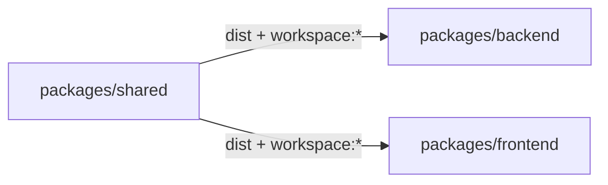

# Пакет shared

`packages/shared` містить контракти, спільні для backend і frontend: ArkType-схеми вводу, схеми та інтерфейси відповідей, коди помилок, branded-типи, enum-и мов і утиліти. Завдяки цьому сервер і клієнт імпортують ту саму схему чи тип, а не тримають дві копії.



## package.json і збірка

Дані з [packages/shared/package.json](https://github.com/Blazheiko/itvibe-template/blob/main/packages/shared/package.json):

- `name: "shared"`, `private: true`, `type: "module"`;
- `exports` має кореневий вхід `.` і підшляхи `./brands`, `./schemas`, `./responses`, `./errors`, `./enums`, `./utils`, `./guards`. Кожен вказує на `dist/<розділ>/index.js` і `.d.ts`;
- `build`: `tsc --build`, `dev`: `tsc --build --watch`. [tsconfig.json](https://github.com/Blazheiko/itvibe-template/blob/main/packages/shared/tsconfig.json) збирає `src` у `dist` (`composite: true`);
- залежності в рантаймі: `@arktype/type`, `@ark/util`, `libphonenumber-js`.

Backend і frontend підключають пакет як `"shared": "workspace:*"` ([backend/package.json](https://github.com/Blazheiko/itvibe-template/blob/main/packages/backend/package.json), [frontend/package.json](https://github.com/Blazheiko/itvibe-template/blob/main/packages/frontend/package.json)).

Оскільки `exports` вказують лише на `dist`, без збірки пакета споживачі його не знайдуть. Тому кореневий `pnpm dev` спочатку запускає `build:shared` (`pnpm --filter shared build`), потім збирає backend і лише тоді паралельно стартує dev-сервери ([package.json](https://github.com/Blazheiko/itvibe-template/blob/main/package.json)). Див. також [«Скрипти»](/reference/scripts).

## Структура `src/`

| Розділ                                                                                                     | Вміст                                                                                                                                                                                                                                                                                                                                                                                                     |
| ---------------------------------------------------------------------------------------------------------- | --------------------------------------------------------------------------------------------------------------------------------------------------------------------------------------------------------------------------------------------------------------------------------------------------------------------------------------------------------------------------------------------------------- |
| [brands](https://github.com/Blazheiko/itvibe-template/tree/main/packages/shared/src/brands)                | branded-примітиви: у [primitives.ts](https://github.com/Blazheiko/itvibe-template/blob/main/packages/shared/src/brands/primitives.ts), напр., `EmailSchema = type("string.email").brand("Email")` і `PositiveIntSchema`, а в [ids.ts](https://github.com/Blazheiko/itvibe-template/blob/main/packages/shared/src/brands/ids.ts) лежить `EntityIdSchema`                                                   |
| [enums](https://github.com/Blazheiko/itvibe-template/blob/main/packages/shared/src/enums/languages.ts)     | `APP_LOCALE_CODES` (`as const`), мапи назв мов і функції `resolveLanguageName`, `resolveLanguageCode`, `isAppLocaleCode` тощо                                                                                                                                                                                                                                                                             |
| [errors](https://github.com/Blazheiko/itvibe-template/blob/main/packages/shared/src/errors/error-codes.ts) | об'єкт `ErrorCode` (`BadRequest: "bad_request"`, `ValidationFailed: "validation_failed"`, `CsrfInvalid: "csrf_invalid"`…) і список `ErrorCodeValues`, без runtime-залежності від ArkType (модуль імпортує фронтенд). `ErrorCodeSchema` — у `responses`                                                                                                                                                    |
| [guards](https://github.com/Blazheiko/itvibe-template/blob/main/packages/shared/src/guards/index.ts)       | [ws-channels.ts](https://github.com/Blazheiko/itvibe-template/blob/main/packages/shared/src/guards/ws-channels.ts): whitelist WS-каналів `WS_CHANNELS` (`admin`), тип `WsChannel` і guard `isWsChannel(value: unknown)` без залежностей; його використовує `broadcastToChannel`, а фронтенд може імпортувати з `shared/guards`                                                                            |
| [responses](https://github.com/Blazheiko/itvibe-template/tree/main/packages/shared/src/responses)          | схеми та інтерфейси відповідей по контролерах (`auth-controller.ts`, `main-controller.ts`, `admin-user-controller.ts`…). Канонічна помилка лежить в [error-response.ts](https://github.com/Blazheiko/itvibe-template/blob/main/packages/shared/src/responses/error-response.ts): `CanonicalErrorResponseSchema` з `status: "'error'"`, `code`, `message` і необов'язковими `reason`/`details`/`csrfToken` |
| [schemas](https://github.com/Blazheiko/itvibe-template/tree/main/packages/shared/src/schemas)              | ArkType-схеми вводу за доменами (`auth`, `main`, `support`, `push-subscription`, `query`, `ws`, `activity`, `common`). Кожна схема експортується разом із типом, напр. `LoginInputSchema` / `LoginInput` у [auth/login.ts](https://github.com/Blazheiko/itvibe-template/blob/main/packages/shared/src/schemas/auth/login.ts)                                                                              |
| [utils](https://github.com/Blazheiko/itvibe-template/blob/main/packages/shared/src/utils/phone.ts)         | `normalizePhoneNumber(input, defaultCountry?)` (на `libphonenumber-js`, повертає E.164 або кидає `PhoneNormalizationError`) і `looksLikePhoneNumber`                                                                                                                                                                                                                                                      |

Про правила написання схем (`'+': 'reject'`, query-морфи) див. [«Валідація»](/backend/validation). Чому DTO трансформерів не беруться з `shared/responses`, пояснено в розділі [«Репозиторії та трансформери»](/backend/repositories-transformers).

::: warning Розбіжності в коді

- [src/index.ts](https://github.com/Blazheiko/itvibe-template/blob/main/packages/shared/src/index.ts) реекспортує всі розділи, крім `guards` (рядок закоментовано), хоча підшлях `shared/guards` є в `exports`.
- `EntityIdSchema` лежить у `brands`, але це рядковий regex `/^[1-9]\d*$/` без `.brand(...)`, тобто фактично не branded-тип.
  :::

## Використання в backend

Маршрути беруть схеми вводу із `shared/schemas`, а схеми відповідей імпортують з `shared/responses` як простір імен ([http-routes.ts](https://github.com/Blazheiko/itvibe-template/blob/main/packages/backend/src/app/routes/http-routes.ts)):

```ts
import * as ResponseSchemas from 'shared/responses'

defineRoute({
    url: '/login',
    method: 'post',
    handler: AuthController.login.bind(AuthController),
    validator: LoginInputSchema,
    ResponseSchema: ResponseSchemas.LoginResponseSchema,
})
```

`ResponseSchema` у рантаймі не перевіряється, а потрапляє лише в doc-серіалізацію маршрутів (див. [«Валідація»](/backend/validation)). Контролери імпортують лише типи, напр. `import type { SupportChatInput } from 'shared/schemas'` у [ws/support-controller.ts](https://github.com/Blazheiko/itvibe-template/blob/main/packages/backend/src/app/controllers/ws/support-controller.ts). Сервіси користуються утилітами, як-от `resolveLanguageName` з `shared/enums` у [support-llm-service.ts](https://github.com/Blazheiko/itvibe-template/blob/main/packages/backend/src/app/services/support/support-llm-service.ts).

## Використання у frontend

- API-клієнт [utils/api.ts](https://github.com/Blazheiko/itvibe-template/blob/main/packages/frontend/src/utils/api.ts) типізується через `shared/responses`, `shared/schemas` і `import type { ErrorCode } from 'shared/errors'`;
- [response-normalizer.ts](https://github.com/Blazheiko/itvibe-template/blob/main/packages/frontend/src/utils/response-normalizer.ts) і компоненти (наприклад, [AuthModals.vue](https://github.com/Blazheiko/itvibe-template/blob/main/packages/frontend/src/components/AuthModals.vue)) порівнюють коди помилок зі значеннями `ErrorCode`;
- [useBroadcastHandler.ts](https://github.com/Blazheiko/itvibe-template/blob/main/packages/frontend/src/composables/useBroadcastHandler.ts) перевіряє WS-повідомлення в рантаймі схемою `WSAdminUserOnlineUpsertPayloadSchema` з `shared/schemas`;
- [plugins/i18n.ts](https://github.com/Blazheiko/itvibe-template/blob/main/packages/frontend/src/plugins/i18n.ts) і [useLocale.ts](https://github.com/Blazheiko/itvibe-template/blob/main/packages/frontend/src/composables/useLocale.ts) беруть `APP_LOCALE_CODES` і `resolveLanguageCode` з `shared/enums`;
- адмінські view імпортують типи `AdminUserListItem`, `AdminOnlineUserDetail` тощо з `shared/responses`.

## Тести

Скрипт `test` виконує `pnpm build && node --test test/*.test.js`, тобто вбудований раннер Node проганяє JS-файли з `test/` на зібраному `dist`. Кореневий `pnpm test` (`pnpm -r test`) запускає його разом з іншими пакетами.

::: warning
Єдиний файл [test/languages.test.js](https://github.com/Blazheiko/itvibe-template/blob/main/packages/shared/test/languages.test.js) містить лише два імпорти (`node:test`, `node:assert/strict`) і жодного тест-кейсу. Тож поки що пакет фактично не покритий тестами.
:::

## Як додати контракт

1. Схему вводу покладіть у `src/schemas/<домен>/<name>.ts`, а схему чи інтерфейс відповіді у `src/responses/<controller>.ts`. Поруч зі схемою експортуйте тип (`typeof X.infer`).
2. Додайте експорт в `index.ts` відповідного розділу (напр. [schemas/index.ts](https://github.com/Blazheiko/itvibe-template/blob/main/packages/shared/src/schemas/index.ts)). Новий розділ потрібно додати і в `src/index.ts`, і в `exports` у `package.json`.
3. Перезберіть пакет: `pnpm build:shared` (або `pnpm --filter shared dev` у watch-режимі). Інакше backend і frontend побачать стару версію `dist`.
4. Підключіть схему в маршруті (`validator`, `ResponseSchema`) і далі дійте за кроками з [«Додавання фічі»](/backend/adding-a-feature).
